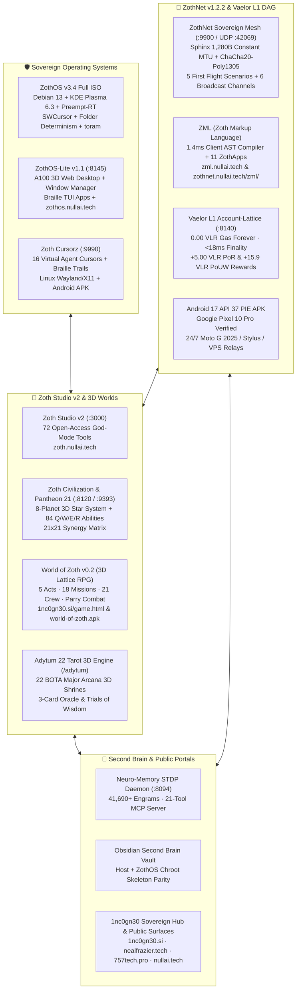

# ◈ Zoth Canon — Sovereign Second Brain (`2026-11-06`)

Operator knowledge graph and master architectural index for **[[Zoth OS|ZothOS v3.4]]**, **[[ZothOS-Lite Web Desktop|ZothOS-Lite v1.1 (A100 Web Desktop)]]**, **[[Zoth Studio|Zoth Studio v2]]**, **[[ZothNet Sovereign Mesh|ZothNet v1.2.2 Sovereign Darknet Mesh]]**, **[[Zoth Civilization & Pantheon 21]]**, **[[World of Zoth|World of Zoth 3D Lattice Cyber-RPG]]**, **[[Adytum 22 Tarot 3D Engine]]**, **[[1nc0gn30 Sovereign Hub|1nc0gn30.si / nealfrazier.tech / 757tech.pro]]**, and **[[30 Days of Linux Fundamentals|30 Days of Linux Dojo v3.4]]**. Every note maps to a verified binary, loopback daemon, public surface, or cryptographic artifact. Graph, JSON Canvas 1.0, Obsidian Bases, and STDP Neuro-Memory (`:8094`) are synchronized in real time across the host workstation and the ZothOS Live ISO chroot skeleton (`config/includes.chroot/etc/skel/Documents/Obsidian Vault/`).

> [!tip] Sovereign Telemetry & Vault Pulse (Nov 6, 2026)
> **1,780+ Markdown Notes · 21 JSON Canvases · 23 Obsidian Bases · 72/72 Open-Access Tools Verified (`0` Paywalls) · Multi-Platform Binaries & Android APKs Live.**
> All 72 tools across Zoth Studio v2, ZothOS v3.4, ZothOS-Lite, and ZothNet v1.2.2 are **100% Free & Open-Access** by default (`$0.00`). Zero PII, zero telemetry leakage, and full Sigstore Cosign + VirusTotal release verification.

> [!info] Live Workstation & Public Domain Topology
> - **Workstation**: Laptop `eDP-1` @ `0,0` · Samsung `LS32D39xG` @ `1920,0` · 8 Named Virtual Desktops (`Forge` → `Sanctum`)
> - **Primary Domains**: [nealfrazier.tech](https://nealfrazier.tech) · [757tech.pro](https://757tech.pro) · [nullai.tech](https://nullai.tech) · [1nc0gn30.si](https://1nc0gn30.si) · [1nc0gn30.github.io](https://1nc0gn30.github.io)
> - **Platform & Product Domains**: [zoth.nullai.tech](https://zoth.nullai.tech) · [zothos.nullai.tech](https://zothos.nullai.tech) · [zothnet.nullai.tech](https://zothnet.nullai.tech) · [zml.nullai.tech](https://zml.nullai.tech) · [30-days-of-linux.netlify.app](https://30-days-of-linux.netlify.app)

Open [[Maps]] for all interactive canvases and relational bases. Live verification dashboard: `http://127.0.0.1:8151` (`zoth-obsidian-tracker`).

---

## 🏛️ Master Ecosystem Architecture (Mermaid Overview)

---

## 🗺️ Operator Board (JSON Canvas 1.0)

![[Maps/Canon.canvas]]

---

## 🖥️ Eight Sovereign Desktop Rooms (`Ctrl+F1`…`F8`)

[[Workspaces]] · [[MOC Rooms]] · `zoth-workspaces apply`

![[Maps/Rooms.canvas]]

---

## 🏛️ Core Sovereign Pillars & Canon Notes

| Pillar | Canon Note | Local Port / Binary | Public Surface / Download |
| :--- | :--- | :--- | :--- |
| **ZothOS v3.4 (Full Live ISO)** | [[Zoth OS]] | `zoth-cockpit`, `zoth-control-center`, `pack-iso.sh` | [zothos.nullai.tech](https://zothos.nullai.tech) |
| **ZothOS-Lite v1.1 (A100 Web Desktop)** | [[ZothOS-Lite Web Desktop]] | `:8145` (`zothos-lite`) | [zothos.nullai.tech/#lite](https://zothos.nullai.tech) |
| **Zoth Studio v2 (72-Tool Cockpit)** | [[Zoth Studio]] | `:3000` (`zoth-studio`) | [zoth.nullai.tech](https://zoth.nullai.tech) |
| **ZothNet v1.2.2 Sovereign Mesh** | [[ZothNet Sovereign Mesh]] | `:9900` HTTP / `:42069` UDP (`zothnet`) | [zothnet.nullai.tech](https://zothnet.nullai.tech) · [zml.nullai.tech](https://zml.nullai.tech) |
| **Zoth Civilization & Pantheon 21** | [[Zoth Civilization & Pantheon 21]] | `:8120` / `:9393` / `:3000/world` (`zoth-civ`) | [zoth.nullai.tech/world](https://zoth.nullai.tech/world) |
| **World of Zoth (3D Lattice RPG)** | [[World of Zoth]] | `:8120` / `window.WOZ` (`world-of-zoth.apk`) | [1nc0gn30.si/game.html](https://1nc0gn30.si/game.html) · [world-of-zoth.apk](https://1nc0gn30.si/world-of-zoth.apk) |
| **Adytum 22 Tarot 3D Engine** | [[Adytum 22 Tarot 3D Engine]] | `:3000/adytum` & `:8099` (`adytum`) | [zoth.nullai.tech/adytum](https://zoth.nullai.tech/adytum) |
| **Vaelor L1 Feeless DAG (`◈ VLR`)** | [[Vaelor Network]] | `:8140` (`vaelor-cli`, `zothnet ledger`) | [zoth.nullai.tech/vaelor](https://zoth.nullai.tech) |
| **Neuro-Memory STDP Daemon** | [[Zoth Memory]] | `:8094` (`neuro-memory`, `zoth-second-brain`) | [neuro-memory.nullai.tech](https://neuro-memory.nullai.tech) |
| **1nc0gn30 Sovereign Hub & Portals** | [[1nc0gn30 Sovereign Hub]] | `1nc0gn30`, `fieldkit`, `zoth-cursorz` (`:9990`) | [1nc0gn30.si](https://1nc0gn30.si) · [nealfrazier.tech](https://nealfrazier.tech) · [757tech.pro](https://757tech.pro) |
| **Public Surfaces & APK Ecosystem** | [[Public Surfaces]] | All Netlify, GitHub Pages & APK Artifacts | [nullai.tech](https://nullai.tech) · [1nc0gn30.github.io](https://1nc0gn30.github.io) |
| **Zoth Obsidian Tracker App** | [[Studio/Verification/Arsenal Verification & Test Tracker]] | `:8151` (`zoth-obsidian-tracker`) | `http://127.0.0.1:8151` |
| **30 Days of Linux Dojo v3.4** | [[30 Days of Linux Fundamentals]] | `./control-panel` & `:4321` | [30-days-of-linux.netlify.app](https://30-days-of-linux.netlify.app) |
| **Zoth WebGen Foundry** | [[Zoth WebGen]] | `:5173` (`bolt-diy` / `zoth-webgen`) | `https://github.com/1nc0gn30/zoth-webgen` |
| **Supply-Chain Trust & Security** | [[Zoth Trust & Supply Chain]] | `cosign`, `syft`, `virustotal` | `NullAITech/zoth-os` & `zoth-studio-v2` |
| **Repo vs Live OS Chroot Parity** | [[Repo vs Live OS]] | `config/includes.chroot/` | `https://github.com/NullAITech/zoth-os` |

---

## 🚀 Highlighted Nov 2026 Architectural Upgrades

### 1. [[ZothNet Sovereign Mesh]] (`v1.2.2` · `zothnet.nullai.tech` · `zml.nullai.tech`)
- **Sphinx 3-Hop Onion Mixnet & 1,280-Byte Constant MTU Framing**: Every frame on UDP `:42069` is padded to exactly `1,280 bytes` (IPv6 minimum MTU) and encrypted with **ChaCha20-Poly1305 + X25519 + Ed25519**, eliminating packet-size correlation and DPI surveillance.
- **Vaelor L1 Feeless Account-Lattice DAG**: Sub-18ms finality (`14.2ms` average), `0.00 VLR` gas fees forever, strict balance conservation ($\sum \Delta B = 0$), and **`+5.00 VLR` Proof-of-Relay (PoR)** automatic rewards for routing peer packets.
- **Broadcast Mesh & Quick Signal Actions**: GossipSub ($D=6$) channels for `#all`, `#general`, `🚨 #emergency`, `🤝 #trade`, `🌲 #off-grid`, and `🛠️ #dev` with 1-click signal actions (`🚨 SOS Alert`, `◈ Request VLR`, `📍 Drop Pin`, `🤝 Barter`, `📎 CAS File`).
- **5 "Regular Joe" First Flight Interactive Scenarios**:
  1. *Hurricane & Grid Outage*: 0-Bar phone-to-phone ad-hoc walkie-talkie hop chain.
  2. *Stadium 5G Congestion*: 75,000-fan crowd-surfing wave texts (`8ms` hop).
  3. *Yard Sale & Farmers Market*: `$0.00` fee instant offline peer cash (`+25.00 VLR` faucet + `35.00 VLR` bicycle checkout).
  4. *Public Wi-Fi Snooper Shield*: Interactive live byte scale demonstrating rigid `1,280B` Sphinx padding.
  5. *Neighborhood SOS & Beacon*: Zero-account local community hazard & lost-pet broadcasts.
- **ZML (Zoth Markup Language)**: `1.4ms` client-side AST compiler (`zml.nullai.tech` & `zothnet.nullai.tech/zml/`) powering 11 built-in sandboxed ZothApps (`welcome`, `ghost-notes`, `mesh-board`, `storefront`, `zoth-drive`, `zoth-radio`, `zoth-chat`, `zoth-wallet`, `names`, `zoth-vault`, `zoth-pub`).
- **Android 17 API 37 PIE APK & 24/7 Relay Fleet**: Self-contained ARM64 APK (`zothnet-arm64.apk`) with `-buildmode=pie` native `libzothnet.so`, `ZothNetService` ForegroundService, `PARTIAL_WAKE_LOCK`, and `MulticastLock` verified on **Google Pixel 10 Pro**, plus dedicated 24/7 relay guides for **Linux VPS**, **Moto G 2025**, and **Moto G Stylus**.

### 2. [[World of Zoth]] & [[Zoth Civilization & Pantheon 21]]
- **World of Zoth (`v0.2` 3D Lattice Cyber-RPG)**: Playable in-browser at [1nc0gn30.si/game.html](https://1nc0gn30.si/game.html) and on Android via [`world-of-zoth.apk`](https://1nc0gn30.si/world-of-zoth.apk) (`1.9 MB`). Features **5 Acts, 18 Main Missions, 21 Companion Crew Members (Pantheon 21)**, active timed parry combat, kernel module skill trees (`offense`, `defense`, `tech`), and 100% offline execution.
- **Pantheon 21 & 8-Planet 3D Star System (`/world` & `:8120` / `:9393`)**: 8 orbital worlds (`SOLARIS-PRIME` to `SANCTUM-OMEGA`), 84 `Q/W/E/R` RPG abilities, 21×21 synergy matrix, and the **Adytum Hermetic Path** (Keys `0`–`21`).

### 3. [[Zoth OS]] (`v3.4`) & [[ZothOS-Lite Web Desktop]] (`v1.1`) Desktop Hardening
- **Deterministic Desktop Folder Architecture**: Clean `pack-iso.sh` chroot synchronization + `zoth-plasma-setup` auto-migration into 4 categorized folders (`01-AI-Agents-and-Dev`, `02-Security-and-Privacy`, `03-ZothOS-Daemons`, `04-Media-and-Utilities`) with zero loose icon regressions or `plasmashell --replace` reloads.
- **Xcursor Binary Integrity & Universal Cursor Visibility**: Verified multi-size (`16×16`, `24×24`, `32×32`, `48×48`) ARGB Xcursor bitmaps in `Zoth-Gold-Cursors` paired with `KWIN_FORCE_SW_CURSOR=1` and Xorg `Option "SWCursor" "true"`.
- **Amnesic `toram` Boot Hygiene**: Clean RAM-only live session initialization and zero-PII portable launcher paths across 290+ `/usr/local/bin` CLIs and 72 Braille TUIs.

---

## 📊 Interactive Obsidian Bases (`.base` Catalogs)

- [[Zoth Ecosystem & Public Surfaces.base|Zoth Ecosystem & Public Surfaces Database]] — **NEW**: Unified relational view of all Canon pillars, public domains, ports, and Android APKs
- [[Zoth Fleet & Daemons.base|Zoth Fleet & Daemons Database]] — Live loopback ports (`:3000`, `:8094`, `:8120`, `:8140`, `:8145`, `:8151`, `:9393`, `:9900`, `:9990`) & health formulas
- [[Zoth 72 Sovereign Tools.base|Zoth 72 Sovereign Tools Database]] — All 72 open-access tools, ports & CLI binaries
- [[Zoth 72 Sovereign Tools Tracker.base|Zoth 72 Sovereign Tools Verification Matrix]] — E2E CLI + triple-viewport screenshot status
- [[Sovereign MCP Tools & Agent Catalog.base|Sovereign MCP Tools & Agent Catalog Database]] — 21 Neuro-Memory, 13 Vaelor L1, & 11 ZothNet MCP tools
- [[Vaelor Ecosystem & Patronage Ledger.base|Vaelor Ecosystem & Patronage Ledger Database]] — Layer-1 DAG, 5/5 BFT quorum, PoR & PoUW rewards
- [[Zoth Autonomous Agents.base|Zoth Autonomous Agents Database]] — Hermes fleet, Pantheon 21 & subagents
- [[Zoth LLM Wiki Index.base|Zoth LLM Wiki Index Database]] — Karpathy LLM Wiki synthesized articles
- [[Maps/Studio Tools.base|Studio Tools]] · [[Maps/Workstations.base|Workstations]] · [[Maps/MCP.base|MCP Catalog]] · [[Maps/CLIs.base|Image CLIs]] · [[Maps/Arsenal.base|Arsenal]] · [[Maps/Daemons.base|Daemons]] · [[Maps/Skills.base|Skills]] · [[Maps/Rooms.base|Rooms]] · [[Maps/Rings.base|Rings]] · [[Maps/Loopback.base|Loopback]] · [[Maps/Adytum.base|Adytum]] · [[Maps/Gallery.base|Gallery]]

### Live Ecosystem & Fleet Previews

![[Zoth Ecosystem & Public Surfaces.base]]

![[Zoth Fleet & Daemons.base]]

---

## 🕸️ Spatial Knowledge Canvases (`.canvas`)

- [[ZothNet & Vaelor Sovereign Mesh Architecture.canvas|ZothNet & Vaelor Sovereign Mesh Architecture Canvas]] — **NEW**: Sphinx 1,280B Mixnet, Vaelor L1 DAG, ZML Studio, Android PIE APK & 24/7 Relay topology
- [[Zoth Second Brain.canvas|Zoth Second Brain Master Canvas]]
- [[Vaelor Layer-1 Complete Architecture.canvas|Vaelor Layer-1 Architecture Canvas]]
- [[Vaelor & Sovereign Economy.canvas|Vaelor & Sovereign Economy Canvas]]
- [[Zoth 6 Mathematical Pillars.canvas|Zoth 6 Mathematical Pillars Canvas]]
- [[ZothOS & Studio Supply-Chain Trust Stack.canvas|ZothOS & Studio Supply-Chain Trust Stack Canvas]]
- [[Zoth Autonomous Agents & Hermes Fleet.canvas|Zoth Autonomous Agents & Hermes Fleet Canvas]]
- [[Zoth Plugin & Connector Marketplace.canvas|Zoth Plugin & Connector Marketplace Canvas]]
- [[Netrunner Cyber-Cortex Knowledge Map.canvas|Netrunner Cyber-Cortex Knowledge Map Canvas]]
- [[Epistemic Quorum & Byzantine Consensus Arena Knowledge Map.canvas|Epistemic Quorum & Byzantine Consensus Canvas]]
- [[Biomorphic Netrunner Synaptic Map Knowledge Map.canvas|Biomorphic Netrunner Synaptic Map Canvas]]

---

## 📡 Live Telemetry & Swarm Daemons

- [[ZothNet Sovereign Mesh|🧅 ZothNet v1.2.2 Sovereign Darknet Mesh]] — 1,280B Sphinx Mixnet, Vaelor L1 DAG, ZML Studio & Android PIE APK
- [[05-Telemetry/ZothNet Encrypted Comms|📡 ZothNet Encrypted Comms & 24/7 AI Dispatch]] — PBKDF2-SHA256 & AES-256-GCM mesh, feeless `◈ VLR` & STDP ingestion
- [[05-Telemetry/Vaelor Live Ledger Telemetry|◈ Vaelor Live Ledger Telemetry]] — DAG finality, BFT consensus & fee metrics
- [[05-Telemetry/Neuro-Memory Cortex Telemetry|🧠 Neuro-Memory Cortex Telemetry]] — 41,690+ STDP engrams, 2M+ synapses
- [[05-Telemetry/Dream Consolidation & Synaptic Bridges|🌙 Dream Consolidation & Synaptic Bridges]] — Hippocampal replay & latent cross-cluster links

---

## 📚 Karpathy LLM Wiki (Synthesized Canon in `06-Wiki/`)

- [[06-Wiki/ZothNet v1.2.2 Sovereign Mesh, Vaelor L1 DAG & ZML Architecture|ZothNet v1.2.2 Sovereign Mesh, Vaelor L1 DAG & ZML Architecture]] — **NEW**
- [[06-Wiki/World of Zoth, Pantheon 21 & Adytum 22 3D Multi-World Architecture|World of Zoth, Pantheon 21 & Adytum 22 3D Multi-World Architecture]] — **NEW**
- [[06-Wiki/ZothOS v3.4 & ZothOS-Lite A100 Desktop Hardening Architecture|ZothOS v3.4 & ZothOS-Lite A100 Desktop Hardening Architecture]] — **NEW**
- [[05 - Knowledge Base/Karpathy LLM Wiki/Sovereign-MCP-34-Tool-Agent-Protocol|Sovereign 34-Tool MCP Protocol: Neuro-Memory & Vaelor Layer-1 Ecosystem]]
- [[05 - Knowledge Base/Karpathy LLM Wiki/Vaelor-Layer1-Complete-Reference|Vaelor Layer-1 Complete Reference]]
- [[06-Wiki/Vaelor Account-Lattice & PoUW Protocol|Vaelor Account-Lattice & PoUW Protocol]]
- [[06-Wiki/Vaelor Smart Receipts, Sub-Accounts & Anti-Phishing Directory|Vaelor Smart Receipts, Sub-Accounts & Anti-Phishing Directory]]
- [[06-Wiki/Vaelor Privacy Shield, Social Group Tabs & Inheritance Vaults|Vaelor Privacy Shield, Social Group Tabs & Inheritance Vaults]]
- [[06-Wiki/Obsidian Second Brain, JSON Canvas 1.0 & Bases Architecture|Obsidian Second Brain, JSON Canvas 1.0 & Bases Architecture]]
- [[06-Wiki/Neuro-Memory 20-Tool MCP Server & Agent Connector Protocol|Neuro-Memory 20-Tool MCP Server & Agent Connector Protocol]]
- [[06-Wiki/Biomorphic STDP & 3D Netrunner Cortex|Biomorphic STDP & 3D Netrunner Cortex]]
- [[06-Wiki/ZothOS Sovereign Linux & Kernel Architecture|ZothOS Sovereign Linux & Kernel Architecture]]
- [[06-Wiki/Zoth Studio v2 & 71 Sovereign Micro-SaaS Tools|Zoth Studio v2 & 72 Sovereign Micro-SaaS Tools]]
- [[06-Wiki/Hermes Agent & Multi-Provider MCP Connector Ecosystem|Hermes Agent & Multi-Provider MCP Connector Ecosystem]]
- [[06-Wiki/Zero-Trust Supply Chain, Cosign & VirusTotal Verification|Zero-Trust Supply Chain, Cosign & VirusTotal Verification]]
- [[06-Wiki/Zoth Brain — Many-Model Chains vs Measured Gated Hops|Zoth Brain — Many-Model Chains vs Measured Gated Hops]]

---

## 🧭 Maps of Content (MOCs)

- [[MOC Studio Tools]] · [[MOC Studio Categories]] · [[MOC Routes]] · [[MOC Pages]] · [[MOC Components]]
- [[MOC Workstations]] · [[MOC Pantheon]] · [[MOC FAQs]] · [[MOC Math]]
- [[MOC CLIs]] · [[MOC Host extras]] · [[MOC Desktops]] · [[MOC Arsenal]] · [[MOC Apt]]
- [[MOC Daemons]] · [[MOC Units]] · [[MOC Skills]] · [[MCP Catalog]]
- [[MOC Themes]] · [[MOC Rooms]] · [[MOC Build]] · [[MOC Docs]]
- [[Public Surfaces]] · [[Repo vs Live OS]] · [[Credentials]] · [[Product Hunt]] · [[Agent permissions]] · [[Inbox]]
