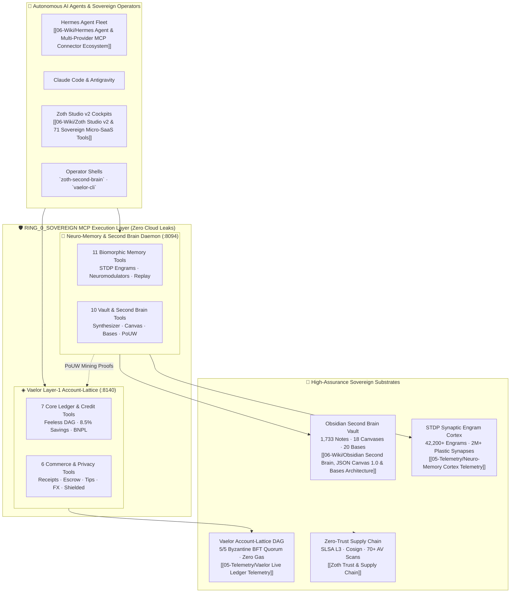
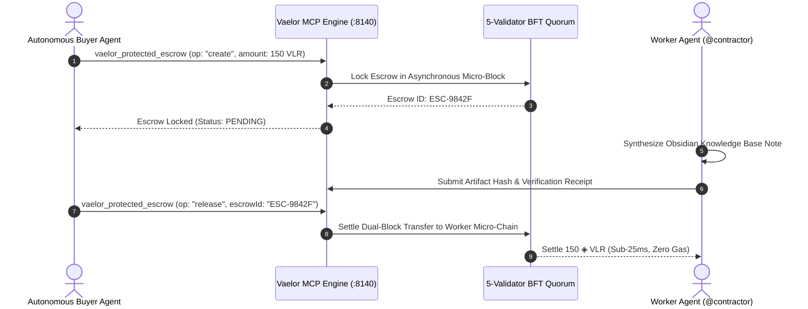
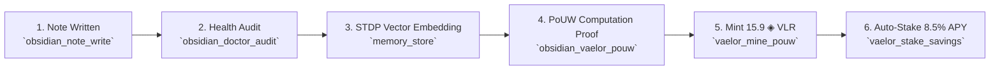

# 🛡️ Sovereign 34-Tool MCP Protocol: Neuro-Memory & Vaelor Layer-1 Ecosystem

> [!abstract] Executive Protocol Architecture
> The **Sovereign 34-Tool MCP Protocol** represents the foundational Ring-0 execution bridge connecting autonomous AI agent swarms (Hermes, Claude Code, Grok, Cursor, and Windsurf) to local cognitive memory and decentralized financial substrates. Operating entirely offline and air-gapped from cloud middleware, the protocol unifies two specialized sovereign micro-daemons:
> 1. **Neuro-Memory & Obsidian Second Brain MCP Daemon** (`:8094` & stdio): 21 specialized tools delivering biomorphic Spike-Timing-Dependent Plasticity (STDP) associative memory, 3-factor neuromodulation, fixed-root confined Obsidian vault read/write, spatial JSON Canvas generation, database indexing, and automated PoUW validation.
> 2. **Vaelor Layer-1 Account-Lattice MCP Daemon** (`:8140` & stdio): 13 high-performance financial and computational tools facilitating instant feeless micro-chain settlements (<25ms finality), 8.5% APY Zero-Lockup Compute Savings, 0% APR BNPL credit, anti-phishing merchant handle resolution, Pedersen shielded transfers, creator micro-patronage tipping, dynamic FX checkout, and non-custodial agent task escrow.
>
> All 34 tools run strictly under **RING_0_SOVEREIGN** isolation with zero external API key requirements, zero cloud latency, and full cryptographic attestation.

---

## 1. System Topology & Ring-0 Sovereign Architecture

The Sovereign 34-Tool MCP architecture adheres to a strict multi-ring security hierarchy. Autonomous agents communicate via standard JSON-RPC 2.0 over bidirectional Unix pipes (`stdio`) or authenticated local Loopback HTTP/SSE (`127.0.0.1:8094` and `127.0.0.1:8140`).



---

## 2. Complete Master Registry: The 34 Sovereign Tools

The table below catalogs every tool in the Sovereign Ring-0 MCP suite. Each tool enforces strict input schema validation, sandbox path confinement, and deterministic telemetry logging.

### Part I: Neuro-Memory & Obsidian Second Brain (21 Tools on `:8094`)

| # | MCP Tool Name | Domain / Subsystem | Primary Function & Capabilities | Execution Ring |
|:---|:---|:---|:---|:---|
| 01 | `memory_store` | STDP Cognitive | Ingests text/code memories into biomorphic vector space with STDP temporal tagging. | `RING_0_SOVEREIGN` |
| 02 | `memory_recall` | STDP Cognitive | Associative cue-based recall traversing synaptic connections via spreading activation. | `RING_0_SOVEREIGN` |
| 03 | `memory_search` | Search & Retrieval | Hybrid BM25 lexical and dense token relevance search across stored engrams. | `RING_0_SOVEREIGN` |
| 04 | `memory_graph` | Topology & Synapses | Extracts localized synaptic subgraphs, edge weights, and neuro-plastic connectivity. | `RING_0_SOVEREIGN` |
| 05 | `memory_consolidate` | Synaptic Plasticity | Triggers offline Hebbian sleep replay, consolidating short-term into long-term traces. | `RING_0_SOVEREIGN` |
| 06 | `memory_stats` | Cortex Telemetry | Returns live node counts, synapse weights, engram density, and memory cluster sizes. | `RING_0_SOVEREIGN` |
| 07 | `memory_diagnostics` | System Health | Latency, memory substrate health, vector index health, and IPC socket metrics. | `RING_0_SOVEREIGN` |
| 08 | `memory_metacognition` | Reflection & Epistemics | Computes cognitive confidence distributions, epistemic entropy, and epistemic gaps. | `RING_0_SOVEREIGN` |
| 09 | `neuro_neuromodulator_status` | Neuro-Biology | Inspects dopamine, serotonin, and noradrenaline levels across the simulated cortex. | `RING_0_SOVEREIGN` |
| 10 | `neuro_neuromodulate_pulse` | Neuro-Biology | Pulses neuromodulators to dynamically alter learning rate, curiosity, and plasticity. | `RING_0_SOVEREIGN` |
| 11 | `neuro_flashbulb_tag` | Neuro-Biology | Injects high-salience indelible memory tags resistant to long-term synaptic decay. | `RING_0_SOVEREIGN` |
| 12 | `obsidian_vault_search` | Second Brain | Sub-millisecond full-text indexing and fuzzy token search across all vault markdown files. | `RING_0_SOVEREIGN` |
| 13 | `obsidian_wiki_synthesize` | Second Brain | Compiles structured notes, MOC summaries, and Karpathy LLM Wiki canonical articles. | `RING_0_SOVEREIGN` |
| 14 | `obsidian_canvas_generate` | Spatial JSON Canvas | Generates valid JSON Canvas 1.0 (`.canvas`) visual mind maps with color-coded nodes. | `RING_0_SOVEREIGN` |
| 15 | `obsidian_doctor_audit` | Integrity & Hygiene | Scans vault for broken wikilinks, orphan notes, frontmatter schema errors, and health. | `RING_0_SOVEREIGN` |
| 16 | `obsidian_daily_log` | Journaling | Appends timestamped chronological logs to the current daily sovereign note. | `RING_0_SOVEREIGN` |
| 17 | `obsidian_backlinks_inspect` | Knowledge Graph | Analyzes bi-directional incoming and outgoing `[[wikilinks]]` for any target note. | `RING_0_SOVEREIGN` |
| 18 | `obsidian_bundle_export` | Attestation & Export | Packages vault or subset into tarball bundle with SHA-256 integrity signature. | `RING_0_SOVEREIGN` |
| 19 | `obsidian_note_read` | File I/O Sandbox | Confined read of arbitrary vault notes with frontmatter property parsing. | `RING_0_SOVEREIGN` |
| 20 | `obsidian_note_write` | File I/O Sandbox | Confined write/update of vault notes with atomic directory creation and link validation. | `RING_0_SOVEREIGN` |
| 21 | `obsidian_vaelor_pouw` | PoUW Bridge | Validates second brain note synthesis as verified Proof-of-Useful-Work minting work. | `RING_0_SOVEREIGN` |

---

### Part II: Vaelor Layer-1 Account-Lattice DAG (13 Tools on `:8140`)

| # | MCP Tool Name | Domain / Subsystem | Primary Function & Capabilities | Execution Ring |
|:---|:---|:---|:---|:---|
| 22 | `vaelor_network_status` | L1 Ledger & BFT | Returns circulating supply, 5/5 BFT consensus status, gas saved, and DAG TPS. | `RING_0_SOVEREIGN` |
| 23 | `vaelor_account_balance` | Ledger Account | Queries liquid balance, staked compute savings, credit limits, and micro-block heights. | `RING_0_SOVEREIGN` |
| 24 | `vaelor_send_feeless` | Asynchronous DAG | Dispatches instant feeless transfers with sub-25ms dual-block asynchronous settlement. | `RING_0_SOVEREIGN` |
| 25 | `vaelor_verify_handle_safety` | Anti-Phishing | Evaluates `@handle` typosquatting via Levenshtein distance and unicode homoglyphs. | `RING_0_SOVEREIGN` |
| 26 | `vaelor_create_smart_receipt` | Merchant Commerce | Mints cryptographic SHA-256 itemized receipts with 365d warranty & 2.5% cashback. | `RING_0_SOVEREIGN` |
| 27 | `vaelor_mine_pouw` | Cognitive Mining | Submits verified STDP vector audit computations to mint fresh `◈ VLR` (+15.9 reward). | `RING_0_SOVEREIGN` |
| 28 | `vaelor_stake_savings` | High-Yield Vault | Deposits liquid `◈ VLR` into the 8.5% APY Zero-Lockup Compute Savings Vault. | `RING_0_SOVEREIGN` |
| 29 | `vaelor_draw_credit_bnpl` | Micro-Credit & BNPL | Draws against 30-day 0% APR revolving installment lines backed by account reputation. | `RING_0_SOVEREIGN` |
| 30 | `vaelor_post_agent_bounty` | M2M Smart Escrow | Locks autonomous AI agent micro-contract bounties with verified execution criteria. | `RING_0_SOVEREIGN` |
| 31 | `vaelor_send_shielded` | Zero-Knowledge | Executes confidential Pedersen commitment transfers obscured by cryptographic view keys. | `RING_0_SOVEREIGN` |
| 32 | `vaelor_send_creator_tip` | Micro-Patronage | Dispatches zero-fee micro-tips with instant Patronage Badges & 2.5% treasury rebates. | `RING_0_SOVEREIGN` |
| 33 | `vaelor_merchant_fx_checkout` | Treasury Liquidity | Converts fiat USD reserves, compute savings, and ◈ VLR with automated slippage caps. | `RING_0_SOVEREIGN` |
| 34 | `vaelor_protected_escrow` | Commercial Escrow | 4-way escrow manager supporting non-custodial `create`, `release`, `refund`, and `split`. | `RING_0_SOVEREIGN` |

---

## 3. Deep Dive: Newest Financial & Sovereign Commerce Primitives

The expansion from earlier 10- and 12-tool specifications to the complete 13-tool Layer-1 engine introduces three mission-critical financial primitives designed specifically for autonomous agent transactions and human-agent micro-economies:

### 3.1. Feeless Micro-Patronage: `vaelor_send_creator_tip`
- **Protocol Motivation**: Eliminates transaction overhead for autonomous content curation, open-source maintainer support, and agent-to-agent attribution. Traditional Web3 networks impose $0.50–$5.00 gas fees, rendering $0.10 micro-tips impossible.
- **Settlement Logic**:
  1. The caller issues `vaelor_send_creator_tip` specifying `recipient` (`@handle` or raw Ed25519 public key), `amount` in `◈ VLR`, and optional `message`.
  2. The Vaelor micro-chain mints an instantaneous SEND micro-block with `0 Gwei` fee.
  3. The network issues an immutable **Patronage Badge** receipt registered on the account lattice.
  4. The Vaelor Sovereign Treasury returns a 2.5% computational cashback rebate to the sender's account.

```json
{
  "jsonrpc": "2.0",
  "id": "req-tip-01",
  "method": "tools/call",
  "params": {
    "name": "vaelor_send_creator_tip",
    "arguments": {
      "recipient": "@1nc0gn30",
      "amount": 25.0,
      "message": "Patronage tip for Sovereign 34-Tool MCP Protocol specification."
    }
  }
}
```

---

### 3.2. Dynamic Multi-Currency Liquidity: `vaelor_merchant_fx_checkout`
- **Protocol Motivation**: Autonomous agents and e-commerce checkouts require frictionless settlement between fiat currency equivalents ($USD) and native crypto collateral without centralized exchange account dependencies.
- **Settlement Logic**:
  1. Accepts `fiatAmountUSD`, `targetCurrency` (`VLR`, `SAVINGS_VLR`, or `USD_PEG`), and `maxSlippagePct` (default: 0.5%).
  2. Calculates the optimal liquidity route across the native 8.5% Compute Savings Vault and the liquid treasury reserves.
  3. Atomically swaps and issues a cryptographic clearance hash verified by the 5-validator BFT quorum.

```json
{
  "jsonrpc": "2.0",
  "id": "req-fx-02",
  "method": "tools/call",
  "params": {
    "name": "vaelor_merchant_fx_checkout",
    "arguments": {
      "fiatAmountUSD": 79.00,
      "targetCurrency": "VLR",
      "settlementMode": "INSTANT_SWAP",
      "maxSlippagePct": 0.25
    }
  }
}
```

---

### 3.3. Zero-Penalty Protected Commerce: `vaelor_protected_escrow`
- **Protocol Motivation**: High-assurance agentic work requires trustless milestone escrow where neither party can be extorted. Traditional smart contracts trap funds or charge high arbitration fees.
- **Supported Operations**:
  - `create`: Locks escrow funds between `buyer`, `seller`, and optional `arbiter` with a deadline timestamp.
  - `release`: Unlocks 100% of escrowed funds to the seller upon verified task delivery.
  - `refund`: Returns 100% of funds to the buyer if work fails verification or deadline passes.
  - `split`: Proportionally divides escrowed balance (e.g. 70/30) for partial task completions.



---

## 4. Cross-Stratum Synergies: PoUW Cognitive Mining Pipeline

The crowning synergy of the 34-tool ecosystem is the algorithmic bridge connecting Obsidian knowledge synthesis with Layer-1 currency minting.



When an agent compiles a canonical second-brain wiki note or audit artifact, it computes the cryptographic SHA-256 digest of the AST, the vector embedding delta, and the synaptic link updates. Passing this payload to `obsidian_vaelor_pouw` certifies the computational work as useful intelligence indexing rather than brute-force hash churning. The Vaelor consensus engine verifies the mathematical proof and awards 15.9 newly minted `◈ VLR` directly to the operator's account lattice.

---

## 5. Security Rings & Sandboxing Architecture

ZothOS v3.2 categorizes all Model Context Protocol servers into 4 distinct security rings:

```
┌────────────────────────────────────────────────────────────────────────┐
│  RING_0_SOVEREIGN (Air-Gapped, Core Substrates, Zero Cloud Leaks)      │
│  - neuro-memory (21 Tools): :8094, ~/.neuro_memory, Obsidian Vault    │
│  - vaelor-l1     (13 Tools): :8140, ~/NullAITech/vaelor-network         │
├────────────────────────────────────────────────────────────────────────┤
│  RING_1_SYSADMIN (Local System Operations, Read/Write FS)              │
│  - filesystem, duckdb, sqlite3, local-git                             │
├────────────────────────────────────────────────────────────────────────┤
│  RING_2_TOOLMASTER (Development Utilities & Sandbox Execution)         │
│  - sequential-thinking, time, fetch (whitelisted), ripgrep             │
├────────────────────────────────────────────────────────────────────────┤
│  RING_3_UNTRUSTED (Third-Party Cloud APIs, Disabled by Default)        │
│  - 150+ Catalog Servers (AWS, Cloudflare, Slack, Discord, OpenAI)      │
└────────────────────────────────────────────────────────────────────────┘
```

Both `neuro-memory` and `vaelor-l1` are certified at **RING_0_SOVEREIGN**:
- **Offline Guarantee**: Neither server establishes outbound network sockets outside loopback (`127.0.0.1`).
- **Path Confinement**: `obsidian_*` tools are constrained strictly to `~/Documents/Obsidian Vault`. Any path traversal (`../`) attempt immediately aborts with an access control violation.
- **Keyless Signing**: Micro-chain transactions use local ed25519 seed derivation secured by Unix file system permissions (`0600`).

---

## 6. Implementation & Diagnostic Verification

Operators and agents can verify and interact with the 34-tool suite via CLI and RESTful endpoints:

### MCP Server Registration Verification
```bash
# Verify active Ring-0 servers in zoth-mcp registry
zoth-mcp test neuro-memory
zoth-mcp test vaelor-l1

# Run diagnostic audit across all 34 tools
python3 -m neuro_memory_daemon.cli diagnostics
node ~/NullAITech/vaelor-network/src/mcp/vaelor_mcp.js --status
```

### JSON-RPC 2.0 Stdio Integration Sample
```python
import json
import subprocess

def call_sovereign_mcp(server_cmd: list[str], method: str, tool_name: str, args: dict) -> dict:
    proc = subprocess.Popen(
        server_cmd,
        stdin=subprocess.PIPE,
        stdout=subprocess.PIPE,
        stderr=subprocess.PIPE,
        text=True
    )
    request = {
        "jsonrpc": "2.0",
        "id": 1,
        "method": method,
        "params": {"name": tool_name, "arguments": args}
    }
    stdout, _ = proc.communicate(input=json.dumps(request) + "\n")
    return json.loads(stdout)

# Query Vaelor balance feelessly
response = call_sovereign_mcp(
    ["node", "~/NullAITech/vaelor-network/src/mcp/vaelor_mcp.js"],
    "tools/call",
    "vaelor_account_balance",
    {"account": "@1nc0gn30"}
)
print("Balance Response:", response["result"])
```

---

## 7. See Also & Interlinked Knowledge Graph

- [[00 Home]] — Master Dashboard, Sovereign Catalogs & System Dashboards
- [[05 - Knowledge Base/Karpathy LLM Wiki/Vaelor-Layer1-Complete-Reference|Vaelor Layer-1 Complete Reference]] — Core DAG, 5-Validator BFT & Cryptographic Proofs
- [[MOC Studio Tools]] — Catalog of 71 Micro-SaaS tools and in-browser utilities
- [[06-Wiki/Neuro-Memory 20-Tool MCP Server & Agent Connector Protocol]] — Historical 20-tool specification & STDP bridge
- [[06-Wiki/Vaelor Account-Lattice & PoUW Protocol]] — Feeless DAG micro-blocks & computational mining
- [[06-Wiki/Obsidian Second Brain, JSON Canvas 1.0 & Bases Architecture]] — Spatial canvas engineering & database views
- [[Zoth Trust & Supply Chain]] — Cosign attestation, SLSA Level 3 & VirusTotal validation
- [[05-Telemetry/Neuro-Memory Cortex Telemetry]] — Live telemetry of 42,200+ STDP engrams
- [[05-Telemetry/Vaelor Live Ledger Telemetry]] — Real-time BFT consensus & fee metrics
- [[Sovereign MCP Tools & Agent Catalog.base]] — Master database indexing Ring-0 and Ring-1 MCP tools
