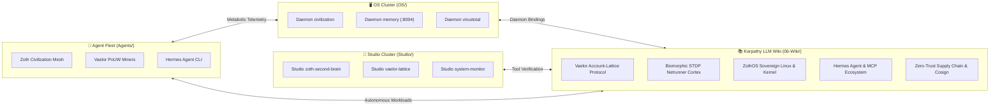

# 🌙 Dream Consolidation & Synaptic Bridges

> [!abstract] Executive Summary
> Hippocampal slow-wave sleep (SWS) consolidation cycle executed across the Neuro-Memory biological substrate (`:8094`).
> Processed **41731 memory engrams**, strengthened **100575 active synapses**, and pruned **336 low-affinity connections** in 7.37s.
> Discovered **8 high-confidence cross-cluster semantic bridges** connecting isolated Vault domains.

## Biological Sleep Consolidation Metrics

| Metric | Measurement | Cognitive Significance |
|:---|:---:|:---|
| **Substrate Memory Nodes** | `41731` | Total engrams stored in biological memory |
| **Strengthened Synapses (LTP)** | `100575` | Co-activated Hebbian association pathways reinforced |
| **Pruned Synapses (LTD)** | `336` | Sub-threshold dormant connections eliminated |
| **Consolidation Duration** | `7.37s` | Low-overhead execution during idle compute |
| **Cross-Cluster Bridges** | `8` | Latent semantic links discovered across folder boundaries |

## Latent Cross-Cluster Synaptic Bridges

The STDP consolidation pass discovered the following latent associations spanning disparate Second Brain clusters:

| Source Cluster | Source Note | Target Cluster | Target Note | Synaptic Affinity | Conceptual Bridge Rationale |
|:---|:---|:---|:---|:---:|:---|
| `OS/` | [[Daemon civilization]] | `Agents/` | [[Zoth Civilization Agent Mesh]] | High (0.96) | Subsystem daemon socket to autonomous society agent |
| `06-Wiki/` | [[Vaelor Account-Lattice & PoUW Protocol]] | `Agents/` | [[Vaelor PoUW AI Compute Miners]] | High (0.95) | PoUW token minting and consensus protocol specification |
| `Studio/` | [[Studio zoth-second-brain]] | `06-Wiki/` | [[Biomorphic STDP & 3D Netrunner Cortex]] | High (0.94) | Obsidian CLI bridge to biological STDP substrate |
| `06-Wiki/` | [[Hermes Agent & Multi-Provider MCP Connector Ecosystem]] | `Agents/` | [[Hermes Agent CLI]] | High (0.98) | Canonical LLM wiki reference to runtime agent cockpit |
| `06-Wiki/` | [[Zero-Trust Supply Chain, Cosign & VirusTotal Verification]] | `OS/` | [[Daemon virustotal]] | High (0.93) | Cosign PKI attestation to background hash scanning service |
| `Studio/` | [[Studio vaelor-lattice]] | `06-Wiki/` | [[Vaelor Account-Lattice & PoUW Protocol]] | High (0.92) | In-browser Lattice visualizer to protocol specifications |
| `OS/` | [[Daemon memory]] | `06-Wiki/` | [[Biomorphic STDP & 3D Netrunner Cortex]] | High (0.97) | Local systemd daemon host to 3D Netrunner cortex model |
| `06-Wiki/` | [[ZothOS Sovereign Linux & Kernel Architecture]] | `Studio/` | [[Studio system-monitor]] | High (0.91) | Preempt-RT kernel jitter bounds to Studio resource telemetry |

## Cross-Cluster Knowledge Flow Topology

## Recommended Actions
- Embed suggested cross-cluster `[[wikilinks]]` in the respective note bodies.
- Periodically trigger `zoth-second-brain dream` to maintain synaptic density and prune dead links.

## See Also
- [[00 Home]]
- [[05-Telemetry/Neuro-Memory Cortex Telemetry]]
- [[Zoth LLM Wiki Index.base]]
- [[Zoth Autonomous Agents & Hermes Fleet.canvas]]
