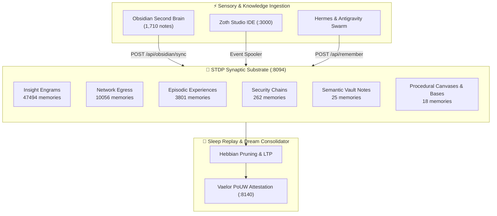

# 🧠 Neuro-Memory Cortex Telemetry

> [!important] Biological Synaptic Substrate (:8094)
> Real-time neural telemetry compiled directly from the Neuro-Memory biological substrate daemon via `@kepano/knap` structured template synthesis.

- **Total Memories (Engrams):** `61670`
- **Total Synaptic Connections:** `2963736` (Spike-Timing-Dependent Plasticity)
- **Synaptic Density:** `48.06` synapses / memory
- **Average Importance Rating:** `0.602`
- **Average Access Replays:** `1.8`
- **Working Memory Cache:** `0 bytes`

## Biological Cortex Architecture

## Memory Category Breakdown

| Category | Engram Count | Primary Role in Cognitive Substrate |
|:---|:---:|:---|
| `insight` | 47494 | Algorithmic breakthroughs, architecture designs & syntheses |
| `network_egress` | 10056 | HTTP audit traces, RPC attestations & network transactions |
| `episodic` | 3801 | Interaction histories, tool executions & timestamped events |
| `security_chain` | 262 | Cryptographic keys, Ed25519 signatures & security audits |
| `semantic` | 25 | Obsidian Second Brain MOCs & canonical concepts |
| `procedural` | 18 | JSON Canvas 1.0 & Obsidian Bases schema workflows |

> [!tip] Spike-Timing-Dependent Plasticity (STDP)
> Pre-synaptic spikes preceding post-synaptic firing induce Long-Term Potentiation (LTP), strengthening associative recall pathways, while delayed spikes trigger Long-Term Depression (LTD).

## See Also

- [[Zoth Memory|Zoth Memory Architecture]]
- [[Zoth Memory Stratum.base|Memory Stratum Database]]
- [[Netrunner Cyber-Cortex Knowledge Map.canvas|Cyber-Cortex Knowledge Canvas]]
- [[Zoth Autonomous Agents & Hermes Fleet.canvas|Hermes Fleet Canvas]]
- [[00 Home]]
