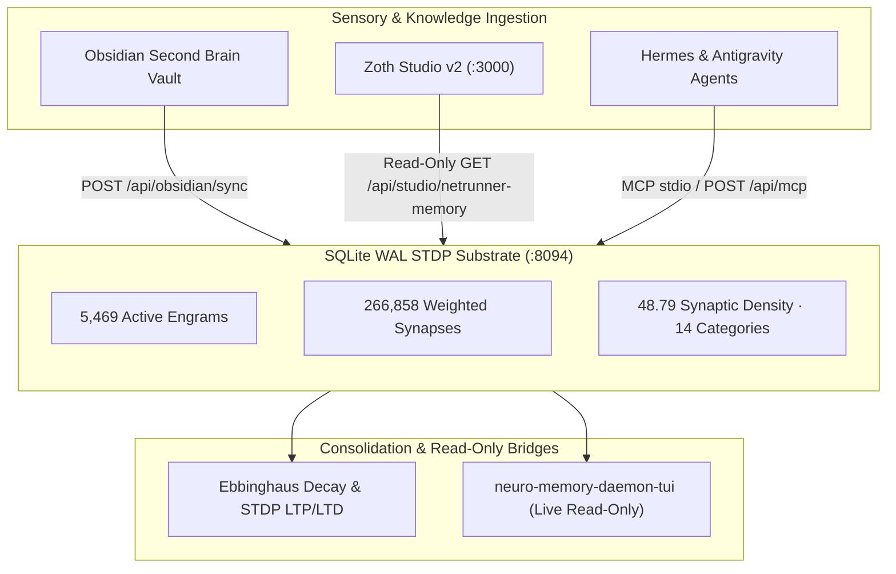

# Neuro-Memory Cortex Telemetry (`v2.9.0`)

> [!important] Live Standing Biological Synaptic Substrate (`127.0.0.1:8094`)
> Verified read-only telemetry snapshot from `GET http://127.0.0.1:8094/api/stats` (SQLite WAL substrate in `~/.neuro-memory/`). Engineered by **Neal Frazier Tech (@1nc0gn30) • NullAI Platform**.

- **Total Memories (Engrams):** `5,469`
- **Total Synaptic Connections:** `266,858` (3-Factor Spike-Timing-Dependent Plasticity)
- **Synaptic Density:** `48.79` synapses / memory
- **Average Importance Rating:** `0.631`
- **Average Access Replays:** `1.35`
- **Active Categories:** `14`
- **MCP Tool Count:** `21` (`11` cognitive + `10` Obsidian/Vaelor)
- **External Network Egress:** `0` requests (100% local loopback)

## Biological Cortex Architecture



## Operational Verification Commands

```bash
# Strictly read-only health and telemetry probes
curl -sS http://127.0.0.1:8094/health
curl -sS http://127.0.0.1:8094/api/stats
neuro-memory-daemon-tui --status
```

- **Canonical Repository**: [https://github.com/1nc0gn30/neuro-memory-daemon](https://github.com/1nc0gn30/neuro-memory-daemon)
- **Zoth Studio Route**: [https://zoth.nullai.tech/tools/neuro-memory-daemon](https://zoth.nullai.tech/tools/neuro-memory-daemon)

## See Also

- [[Zoth Memory|Zoth Memory Architecture]]
- [[Zoth Memory Stratum.base|Memory Stratum Database]]
- [[Studio neuro-memory-daemon|Neuro-Memory Daemon Studio Walkthrough]]
- [[Daemon neuro_memory|neuro-memory-daemon]]
- [[00 Home]]
