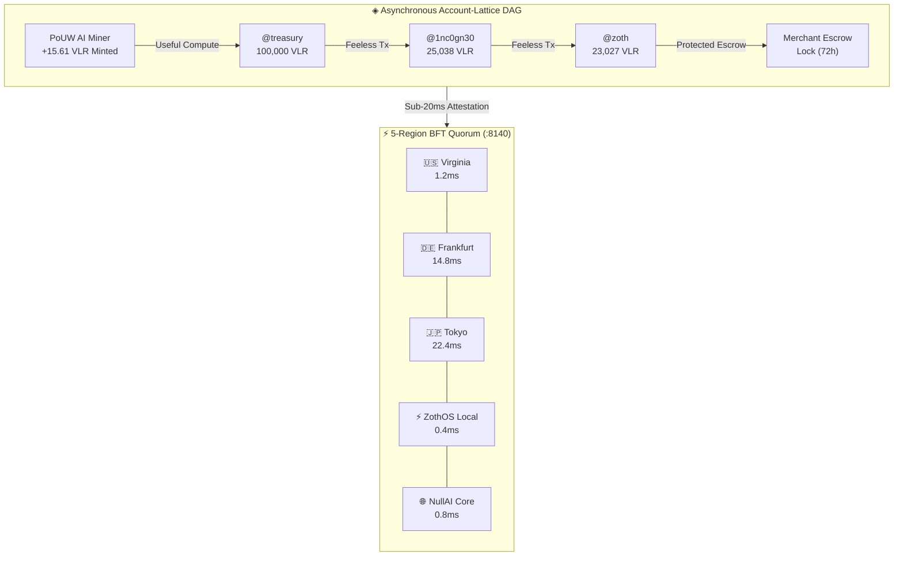

# ◈ Vaelor Live Ledger Telemetry

> [!info] Live Autonomous Telemetry
> Compiled directly from the active Vaelor Validator Node (`:8140`) via `@kepano/knap` structured template synthesis.

- **Protocol:** `Vaelor Account-Lattice L1` (Feeless Asynchronous Account-Lattice DAG)
- **Symbol:** `VLR` (◈)
- **Chain ID:** `vaelor-mainnet-1`
- **Total Blocks Minted:** `26946`
- **Total Supply:** `624843.6718 VLR`
- **Total PoUW Minted:** `430224.0318 VLR`
- **Total Gas Saved:** `$12125.7 USD` (100% Feeless transactions)
- **Active Accounts:** `7`
- **Consensus Health:** `100% BFT FINALITY` (Quorum: 5, BFT Threshold: 4)

## Account-Lattice DAG Topology & Consensus

## Validator Mesh Registry (:8140)

| Flag | Validator Node | Region | Base Latency | Status | Uptime |
|:---:|:---|:---|:---:|:---:|:---:|
| 🇺🇸 | US-East Sovereign Validator | us-east (N. Virginia) | 1.2 ms | 🟢 ONLINE | 99.99% |
| 🇩🇪 | EU-Central Sovereign Validator | eu-central (Frankfurt) | 14.8 ms | 🟢 ONLINE | 99.99% |
| 🇯🇵 | Asia-East Sovereign Validator | ap-northeast (Tokyo) | 22.4 ms | 🟢 ONLINE | 99.99% |
| ⚡ | ZothOS Edge Micro-Validator | local-edge (ZothStudio :8140) | 0.4 ms | 🟢 ONLINE | 99.99% |
| 🌐 | NullAI Sovereign Consensus Core | global-anycast (NullAI Core) | 0.8 ms | 🟢 ONLINE | 99.99% |

## Registered Account Micro-Chains

| Handle | Display Name | Balance (◈ VLR) | Height | Guardians | Status |
|:---|:---|:---:|:---:|:---|:---:|
| `@treasury` | Vaelor Sovereign Treasury & Reserve | 98680 VLR | 9 | @neal, @zoth, @nullai | 🔒 Secured |
| `@1nc0gn30` | 1nc0gn30 (@1nc0gn30) | 82.095 VLR | 60 | @treasury, @zoth | 🔒 Secured |
| `@zoth` | Zoth Studio & ZothOS Compute Node | 460366.085 VLR | 26290 | @neal, @treasury | 🔒 Secured |
| `@sprig` | Sprig Kitchen • 757 Local Merchant | 8461.527 VLR | 199 | @neal, @zoth, @passkey_sprig_vault | 🔒 Secured |
| `@citizen` | Sovereign Demo Wallet (Passkey Ready) | 7615.964842 VLR | 380 | @neal, @zoth, @passkey_backup_757 | 🔒 Secured |
| `@hatch` | Hatch Open-Source & Creator Grants | 5000 VLR | 1 | @neal, @treasury | 🔒 Secured |
| `@zoth-rig2` | ZothOS Autonomous 24/7 AI Node | 2527 VLR | 7 | @neal, @zoth | 🔒 Secured |

> [!tip] Proof-of-Useful-Work (PoUW)
> Vaelor miners mint tokens strictly by performing verified AI workloads, including Schema.org AEO syntheses, Core Web Vitals DOM audits, and entropy verifications.

## See Also

- [[Vaelor Network|Vaelor Network Canon]]
- [[Vaelor & Sovereign Economy.canvas|Vaelor & Sovereign Economy Canvas]]
- [[Zoth Autonomous Agents & Hermes Fleet.canvas|Hermes Fleet Canvas]]
- [[00 Home]]
