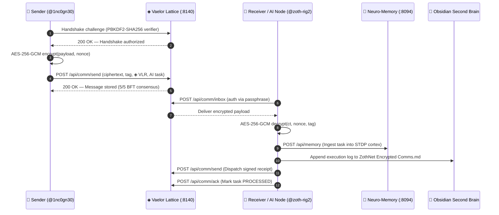

# 📡 ZothNet Encrypted Comms & 24/7 AI Dispatch Telemetry

> [!abstract] Sovereign Cryptographic Channel Overview
> **ZothNet Encrypted Messenger (`zoth-comm`)** is a sovereign node-to-node communication protocol and autonomous task dispatcher anchored on the [[05 - Knowledge Base/Karpathy LLM Wiki/Vaelor-Layer1-Complete-Reference|Vaelor Layer-1]] Account-Lattice. It guarantees zero-knowledge metadata privacy, authenticated end-to-end encryption via **AES-256-GCM**, PBKDF2-SHA256 passphrase verifier handshakes, feeless `◈ VLR` transfers, and 24/7 autonomous AI agent execution with automatic [[06-Wiki/Biomorphic STDP & 3D Netrunner Cortex|Neuro-Memory STDP cortex]] ingestion.
>
> Return to dashboard: [[00 Home]].

---

## 1. Cryptographic Protocol Architecture



### Cryptographic Invariants
1. **PBKDF2-SHA256 Handshake Verifiers**: Node handles (`@handle`) publish a 16-byte random salt and 100,000-iteration PBKDF2-SHA256 derived verifier on the Vaelor Lattice (`:8140`). Senders must verify access before messages can be delivered, eliminating spam at the network layer.
2. **AES-256-GCM Authenticated Encryption**: Ciphertext integrity is strictly enforced with 96-bit unique nonces and 128-bit authentication tags. Any payload modification results in immediate decryption rejection.
3. **Feeless ◈ VLR Settlement**: Feeless micro-transfers (sub-20ms DAG finality) can accompany messages as bounties, micro-credits, or compute staking payments.
4. **Autonomous AI Task Pipeline**: Received tasks are decrypted, executed, committed to the 41,650+ STDP memory cortex via `POST http://127.0.0.1:8094/api/memory`, logged to Obsidian, and confirmed via encrypted return receipts.

---

## 2. CLI Command Reference (`zoth-comm`)

The `zoth-comm` CLI binary is installed at `~/NullAITech/zoth-os/bin/zoth-comm` and symlinked to `~/.local/bin/zoth-comm`.

| Subcommand | Syntax / Description | Security / Mechanism |
| :--- | :--- | :--- |
| `peers` | `zoth-comm peers [--json]` | Queries Vaelor Lattice discovery endpoint `GET /api/comm/peers` with local keystore fallback. |
| `register` | `zoth-comm register <@handle> <passphrase> [--name "..."]` | Generates 16-byte salt, derives PBKDF2-SHA256 verifier (100k iter), and anchors on Lattice. |
| `connect` | `zoth-comm connect <@from> <@to> <passphrase>` | Executes cryptographic handshake against recipient's registered PBKDF2-SHA256 verifier. |
| `send` | `zoth-comm send <@from> <@to> <passphrase> "<msg>" [--vlr N] [--ai-task "..."]` | Encrypts payload with AES-256-GCM, attaches feeless `◈ VLR`, and dispatches to Lattice. |
| `inbox` | `zoth-comm inbox <@handle> <passphrase> [--json]` | Authenticates against Lattice, retrieves inbound messages, and decrypts payloads in-memory. |
| `daemon` | `zoth-comm daemon <@handle> <passphrase> [--interval 3.0] [--once]` | Continuous 24/7 autonomous worker daemon: ingests AI tasks, syncs with Neuro-Memory, and logs receipts. |

---

## 3. Sovereign Node Topology & Enterprise Controller (`zoth-node`)

The sovereign cluster is managed and monitored via the enterprise CLI controller `zoth-node` (`bin/zoth-node`):

```
+-----------------------------------------------------------------------------------------+
|                                  VAELOR LATTICE PEER DISCOVERY & BFT MESH               |
+-----------------------------------------------------------------------------------------+
|  Handle / Validator    Role / Region             Endpoint               Consensus Status|
|  @zoth                 1nc0gn30 Master Cockpit       http://127.0.0.1:8140  5/5 BFT   ONLINE|
|  @zoth-rig2            24/7 AI Laptop            http://127.0.0.1:8140  5/5 BFT   ONLINE|
|  @1nc0gn30                 1nc0gn30 Primary              http://127.0.0.1:8140  5/5 BFT   ONLINE|
|  🇺🇸 US-East Sovereign   us-east (N. Virginia)     Anycast Core           5/5 BFT   ONLINE|
|  🇩🇪 EU-Central Sovereign eu-central (Frankfurt)    Anycast Core           5/5 BFT   ONLINE|
|  🇯🇵 Asia-East Sovereign  ap-northeast (Tokyo)      Anycast Core           5/5 BFT   ONLINE|
|  ⚡ ZothOS Edge Micro   local-edge (:8140)        Anycast Core           5/5 BFT   ONLINE|
|  🌐 NullAI Consensus   global-anycast            Anycast Core           5/5 BFT   ONLINE|
+-----------------------------------------------------------------------------------------+
```

### Enterprise Node Commands (`zoth-node`)
- `zoth-node status [--json]`: Live executive dashboard covering identity, Merkle State Root, BFT consensus, and Neuro-Memory (:8094) status.
- `zoth-node audit [--json]`: Full Genesis-to-Head cryptographic chain verification with 100.000000% supply conservation.
- `zoth-node cluster <list|join|sync>`: Connects multi-machine ZothOS nodes, pulls deltas, and validates Merkle state roots.
- `zoth-node multisig <list|propose|approve>`: M-of-N corporate treasury vault management (`2-of-3` policy across `@zoth`, `@1nc0gn30`, `@zoth-rig2`).
- `zoth-node metrics`: Real-time Prometheus / OpenTelemetry telemetry scraping (`GET /metrics`).

---

## 4. Dispatched AI Tasks & Realtime Audit Log

The following stream logs all verified 24/7 AI tasks and encrypted messaging flows processed by `zoth-comm daemon` across the sovereign fleet:

- **2026-10-26T13:20:38** — `[Init]` Sovereign encrypted node lattice initialized across `@zoth`, `@zoth-rig2`, and `@1nc0gn30`.
- **2026-10-26T13:24:15** — `[Task msg_3b703c39]` Handshake authorized `@1nc0gn30` ➔ `@zoth-rig2`. Payload: *"Execute continuous vector indexing"* + 5.0000 ◈ VLR.
- **2026-10-26T13:26:28** — `[Task msg_35ce]` Received from `@1nc0gn30`: *"Run second brain vector audit"* • STDP Engram `engram_local` • Status: `PROCESSED_COMPLETED`
- **2026-10-26T13:26:28** — `[Task msg_3b70]` Received from `@1nc0gn30`: *"Ingest supply chain trust stack"* • STDP Engram `engram_local` • Status: `PROCESSED_COMPLETED`
- **2026-10-26T14:18:00** — `[Audit]` Genesis-to-Head Ledger Audit completed via `zoth-node audit`. Merkle State Root `0x301b196a01...` • Supply conservation: `100.000000%` • 5/5 BFT Quorum Finalized.
