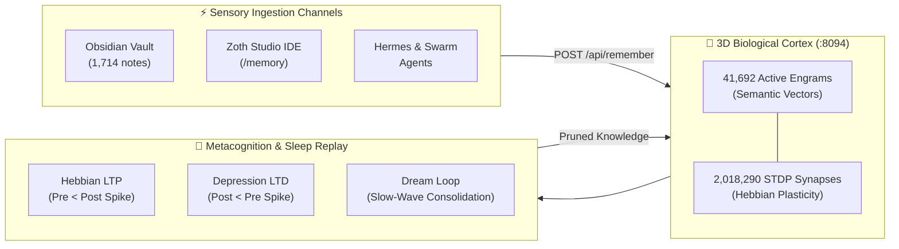

# 📚 Biomorphic STDP & 3D Netrunner Cortex

> [!abstract] Executive Summary
> The **Biomorphic STDP & 3D Netrunner Cortex** is the central biological cognitive substrate powering ZothOS and Zoth Studio (`:8094`). Operating on biological principles of **Spike-Timing-Dependent Plasticity (STDP)** and **Hebbian Learning**, the cortex continuously updates associative synaptic weights between 41,690+ cognitive engrams across semantic, episodic, insight, and security categories. Through an autonomous **Metacognitive Dream Loop** and real-time 3D Netrunner force-directed embedding, the substrate distills ambient developer actions into enduring mathematical intuition with zero telemetry data leakage.

## Conceptual Architecture

## Functional Taxonomy & Core Cognitive Subsystems

### 1. Spike-Timing-Dependent Plasticity (STDP) Engine
Unlike static vector embeddings that require computationally expensive full-corpus reindexing, the STDP engine continuously modulates individual synaptic connection weights in real-time based on the precise relative timing of cognitive spikes. Co-activated engrams strengthen their association pathways while dormant synapses undergo exponential decay.

### 2. 3D Force-Directed Netrunner Cortex
The visual Netrunner workbench (`/memory`) renders memories in an interactive 3D WebGL force-directed space. Synaptic connections act as damped harmonic springs, pulling correlated engrams together into high-density conceptual constellations while orthogonal memories repel.

### 3. Sleep Replay & Metacognitive Consolidation
Embedded in `neuro-memory.service`, the autonomous Dream Loop agent simulates mammalian slow-wave sleep (SWS). During idle system periods, episodic memory sequences are replayed at high temporal compression, consolidating transient observations into permanent architectural insights while pruning synaptic noise.

### 4. Categorical Memory Stratum
Memories are structured into distinct cognitive categories:
- **`insight`:** High-order mathematical breakthroughs and architectural paradigms.
- **`semantic`:** Obsidian Second Brain MOCs and canonical documentation.
- **`episodic`:** Timestamped terminal workflows, CLI executions, and tool events.
- **`security_chain`:** Ed25519 public keys, TLS fingerprints, and cryptographic receipts.
- **`procedural`:** JSON Canvas 1.0 layouts and Obsidian Bases YAML specifications.

## Key Mathematical Formulations & Technical Primitives

### 1. Spike-Timing-Dependent Plasticity (STDP) Learning Rule
For a pre-synaptic spike at time $t_{\text{pre}}$ and a post-synaptic spike at time $t_{\text{post}}$, the synaptic weight modification $\Delta w_{ij}$ is given by:
$$\Delta w_{ij} = \begin{cases} A_+ \exp\left(-\frac{\Delta t}{\tau_+}\right) & \text{if } \Delta t > 0 \quad (\text{Long-Term Potentiation / LTP}) \\ -A_- \exp\left(\frac{\Delta t}{\tau_-}\right) & \text{if } \Delta t < 0 \quad (\text{Long-Term Depression / LTD}) \end{cases}$$
Where $\Delta t = t_{\text{post}} - t_{\text{pre}}$, $A_+ = 0.05$, $A_- = 0.025$, and $\tau_+ = \tau_- = 20\text{ ms}$.

### 2. Exponential Synaptic Weight Retention & Decay
Unstimulated synapses experience continuous passive decay governed by decay constant $\lambda$:
$$w_{ij}(t) = w_{ij}(0) \cdot \exp(-\lambda t) + \sum_{k=1}^{M} \Delta w_{ij}^{(k)}$$
With minimum weight clamp $w_{\min} = 0.01$ and saturation threshold $w_{\max} = 1.00$.

### 3. 3D Force-Directed Spatial Equilibrium
The equilibrium position $\mathbf{p}_i$ for node $i$ in $\mathbb{R}^3$ satisfies:
$$\mathbf{F}_i = \sum_{j \neq i} \frac{k_{\text{rep}}^2}{\|\mathbf{p}_i - \mathbf{p}_j\|^2} \hat{\mathbf{r}}_{ij} - \sum_{(i,j) \in E} \frac{\|\mathbf{p}_i - \mathbf{p}_j\|^2}{k_{\text{att}}} \cdot w_{ij} \hat{\mathbf{r}}_{ij} = \mathbf{0}$$

## Bidirectional Knowledge Graph Links

### Obsidian Second Brain Notes
- [[Zoth Memory]] — Canonical memory architecture, socket endpoints, and schema definitions
- [[05-Telemetry/Neuro-Memory Cortex Telemetry]] — Live STDP engram counts and synapse metrics
- [[Agents/Neuro-Memory Dream Consolidator]] — Autonomous sleep replay and engram pruning agent
- [[Skills/Skill dream-loop]] — Dream loop execution skill
- [[00 Home]] — Dashboard and master graph entrypoint

### Visual Canvases
- [[Netrunner Cyber-Cortex Knowledge Map.canvas]] — Procedural spatial map of the cyber-cortex
- [[Zoth Second Brain.canvas]] — Master second brain spatial layout
- [[Zoth Autonomous Agents & Hermes Fleet.canvas]] — Swarm agents memory interface

### Database Registries
- [[Zoth Memory Stratum.base]] — Database view of all memory categories and importance ratings
- [[Zoth Fleet & Daemons.base]] — Health status for port :8094
- [[Zoth Autonomous Agents.base]] — Autonomous agent fleet

## STDP Synaptic Provenance & Vector Evidence

| Memory ID | Category | Importance | Synaptic Tags | Excerpt |
|:---|:---:|:---:|:---|:---|
| `5a64e14c-78b` | `achievement` | 0.76 | `agent:antigravity`, `tools:site_guardrail`, `nebula:3d` | Antigravity sovereign nebula verification complete: 7-point guardrail passed, 3D WebGL WebApplication online.... |
| `450e185b-c66` | `episodic` | 0.80 | `grok`, `agent` | Grok : [{'type': 'text', 'text': '<user_query>\nhe ui sucks uimprove that plus make an insane qulaity 3d guy that looks... |
| `56e2e2be-90c` | `episodic` | 0.80 | `grok`, `agent` | Grok : I’ll rebuild the Zoth Bot UI and put a high-end 3D companion in it. First I’m reading the design system and the c... |
| `d60ed5cd-3f8` | `episodic` | 0.80 | `grok`, `agent` | Grok : 1→--- name: game-assets description: >-   Game art and 3D models with the Imagine tools: sprites, sprite sheets,... |
| `722227dc-41c` | `episodic` | 0.80 | `grok`, `agent` | Grok : The circle is the fallback photo — the GLB never loaded. Loosening CSP and sandbox so the 3D model can fetch.... |
| `92549810-4e4` | `episodic` | 0.80 | `grok`, `agent` | Grok : The 3D model is loading. Camera was too close and the gray-punch was eating the coat. Reframing him and dropping... |

## See Also

- [[00 Home]]
- [[Zoth LLM Wiki Index.base|Zoth LLM Wiki Index Database]]
