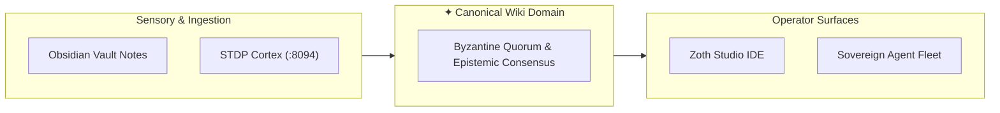

# 📚 Byzantine Quorum & Epistemic Consensus

> [!abstract] Executive Summary
> **Byzantine Quorum & Epistemic Consensus** is an essential technical domain within the ZothOS / Obsidian Second Brain ecosystem. This Karpathy-style wiki page compiles distributed knowledge across 6 vault notes and 6 STDP synaptic memory engrams into a unified canonical reference.

## Conceptual Architecture

## Core Architecture & Technical Taxonomy

Deep architectural synthesis for **Byzantine Quorum & Epistemic Consensus** based on live Obsidian second brain graph.

## Mathematical Primitives & Invariants

- **Graph Invariant:** Zero orphan notes and bi-directional wikilink closure.
- **Memory Invariant:** STDP weight modulation with Hebbian reinforcement.

## Bidirectional Knowledge Graph Links

- [[Byzantine Quorum & Epistemic Consensus]]
- [[Capture consensus]]
- [[Page ConsensusPage]]
- [[FAQ merkle-ast-quorum]]
- [[FAQ byzantine-consensus-triad]]
- [[Route consensus]]

## STDP Synaptic Provenance & Vector Evidence

| Memory ID | Category | Importance | Synaptic Tags | Excerpt |
|:---|:---:|:---:|:---|:---|
| `2499042e-130` | `semantic` | 0.96 | `wiki`, `llm-wiki`, `karpathy` | [Karpathy LLM Wiki · [[Byzantine Quorum & Epistemic Consensus]]] **Byzantine Quorum & Epistemic Consensus** is an essent... |
| `229f55a9-293` | `semantic` | 0.96 | `wiki`, `llm-wiki`, `karpathy` | [Karpathy LLM Wiki · [[Byzantine Quorum & Epistemic Consensus]]] **Byzantine Quorum & Epistemic Consensus** is an essent... |
| `1aa9c4ec-37c` | `episodic` | 0.90 | `hermetic_cycle`, `divergent_synthesis`, `objective_crystallization` | [Adytum Cycle #16] Mercury (Key 11: Justice) completed Observational Adytum Cycle. Divergence: "Associative hypothesis:... |
| `b593a4bb-c45` | `episodic` | 0.90 | `hermetic_cycle`, `divergent_synthesis`, `objective_crystallization` | [Adytum Cycle #23] Vigil (Key 11: Justice) completed Observational Adytum Cycle. Divergence: "Associative hypothesis: me... |
| `817075f0-59b` | `episodic` | 0.90 | `hermetic_cycle`, `divergent_synthesis`, `objective_crystallization` | [Adytum Cycle #54] Seshat (Key 11: Justice) completed Observational Adytum Cycle. Divergence: "Imaginative synthesis: wh... |
| `cce345c9-1d6` | `episodic` | 0.90 | `hermetic_cycle`, `divergent_synthesis`, `objective_crystallization` | [Adytum Cycle #66] Draco (Key 11: Justice) completed Observational Adytum Cycle. Divergence: "Synthesizing Upright Doubl... |

## See Also

- [[00 Home]]
- [[Zoth LLM Wiki Index.base|Zoth LLM Wiki Index Database]]
