# 📚 Hermes Agent & Multi-Provider MCP Connector Ecosystem

> [!abstract] Executive Summary
> The **Hermes Agent & Multi-Provider MCP Connector Ecosystem** is the sovereign autonomous agency layer within ZothOS. Built on Nous Research's Hermes Agent framework, Hermes provides an extensible, tool-calling agent operating across terminal CLI (`hermes chat`), desktop Electron interfaces, and OpenAI-compatible proxies. Hermes interfaces with **150+ modular skills** and standardized Model Context Protocol (MCP) servers, delegating bounded subtasks with persistent associative memory.

## Conceptual Architecture

```mermaid
flowchart LR
    subgraph HermesSurfaces["🤖 Hermes Agent Cockpits"]
        CLI["Terminal CLI (hermes chat)"]
        Desktop["Electron Desktop App"]
        TUI["Ink Terminal UI"]
    end
    
    subgraph ModelRouter["⚡ Multi-Provider LLM Router"]
        M1["Nous Hermes 3"]
        M2["Anthropic Claude 3.7"]
        M3["Local Ollama / Qwen"]
    end
    
    subgraph MCPConnectors["🔌 Model Context Protocol (MCP)"]
        C1["Memory Daemon (:8094)"]
        C2["Shopify / Etsy Connectors"]
        C3["Obsidian Vault Bridge"]
        C4["Filesystem & Bash Engine"]
    end
    
    HermesSurfaces --> ModelRouter
    ModelRouter --> MCPConnectors
```

## Functional Taxonomy & Agent Framework

### 1. Multi-Surface Runtime
Hermes operates across four distinct operational surfaces:
- **Interactive Chat & CLI:** Rapid terminal interaction (`hermes chat -q "<query>"`).
- **Ink TUI:** Rich terminal user interface with streaming token rendering.
- **Electron Desktop Workspace:** Native desktop environment with DOM inspection tools.
- **OpenAI-Compatible Proxy:** Local proxy router for drop-in tool integration.

### 2. Model Context Protocol (MCP) Decoupling
Tools are declared through standardized Model Context Protocol JSON schemas. Eagerly loaded tools execute natively while specialized integrations (Shopify, Etsy, filesystem) are lazily loaded on-demand, minimizing initial agent context overhead.

### 3. Persistent Associative Memory
Every interaction, task delegation, and verified breakthrough is synchronized with the local [[Zoth Memory]] daemon (`:8094`), establishing permanent memory engrams that survive agent reboots.

## Key Mathematical Formulations & Technical Primitives

### 1. Tool-Calling Selection Entropy
Given a set of $K$ available MCP tools, tool selection entropy is minimized to ensure deterministic execution:
$$H(\mathcal{T}) = -\sum_{i=1}^{K} P(T_i \mid \text{Prompt}) \log_2 P(T_i \mid \text{Prompt})$$

### 2. Context Window Compression Ratio
Bounded subagent delegation compresses prompt tokens while preserving necessary semantic context:
$$\rho_{\text{compression}} = 1 - \frac{|\text{Context}_{\text{delegated}}|}{|\text{Context}_{\text{raw}}|}$$

### 3. MCP JSON-RPC Round-Trip Latency
Standard input/output IPC round-trip latency satisfies:
$$\text{RTT}_{\text{stdio}} = t_{\text{serialize}} + t_{\text{pipe}} + t_{\text{execute}} < 15\text{ ms}$$

## Bidirectional Knowledge Graph Links

### Obsidian Second Brain Notes
- [[Agents/Hermes Agent CLI]] — Dedicated Hermes agent specification note
- [[Skills/Skill hermes-agent]] — Complete operational hub and skill reference
- [[MCP Catalog]] — Full catalog of 153 MCP servers
- [[Zoth Autonomous Agents & Hermes Fleet.canvas]] — Spatial agent fleet canvas
- [[Zoth Autonomous Agents.base]] — Agent fleet database
- [[00 Home]] — Dashboard and master graph entrypoint

## STDP Synaptic Provenance & Vector Evidence

| Memory ID | Category | Importance | Synaptic Tags | Excerpt |
|:---|:---:|:---:|:---|:---|
| `91ddd3cc-298` | `episodic` | 0.60 | `grok`, `agent` | Grok : - [in_progress] 1: Hermes stream engine + pocket workspace computer - [pending] 2: Native agent loop, skills, goa... |
| `086890e8-d37` | `episodic` | 0.60 | `grok`, `agent` | Grok : Hermes is the real engine (Nous + tools). I’ll make Zoth Bot the gold pocket UI over it: agent loop, this-laptop... |
| `5c885ff9-0cf` | `episodic` | 0.60 | `grok`, `agent` | Grok : - [completed] 1: Hermes stream engine + pocket workspace computer - [completed] 2: Native agent loop, skills, goa... |
| `0ed792ad-62e` | `episodic` | 0.60 | `grok`, `agent` | Grok : Zoth Bot is back on the desk as the pocket god. Hermes is the engine; this laptop is the computer.  **What it is... |
| `961fc621-920` | `episodic` | 0.75 | `grok`, `agent` | Grok : exit: 0 count 25  ==== 2026-10-23T05:39:25Z step 1783 len 671 sweet . i am about to leave . you have hermes agent... |
| `bd9169ed-6b7` | `episodic` | 0.76 | `grok`, `agent` | Grok : 1→# Hermes Agent Local Hermes CLI install, stream-json one-shot protocol, and Nous/Ollama config used by Zoth Bot... |

## See Also

- [[00 Home]]
- [[Zoth LLM Wiki Index.base|Zoth LLM Wiki Index Database]]
