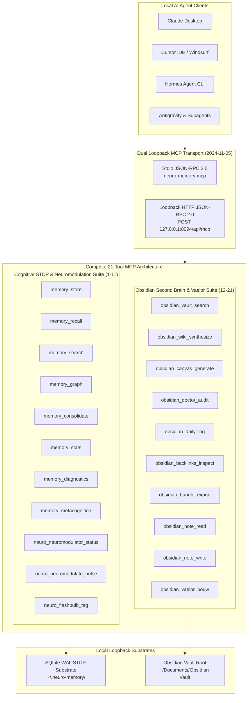

# Neuro-Memory 21-Tool MCP Server & Agent Connector Protocol (`v2.9.0`)

> [!abstract] Executive Summary
> The **Neuro-Memory 21-Tool MCP Server** (`neuro_memory_daemon.mcp_server`, `v2.9.0`, Apache-2.0, engineered by **Neal Frazier Tech (@1nc0gn30) • NullAI Platform**) is the open standard cognitive and knowledge bridge linking local AI agents (Claude Desktop, Cursor IDE, Hermes Agent, Antigravity) to the SQLite WAL **Spike-Timing-Dependent Plasticity (STDP)** substrate (`~/.neuro-memory/`) and the **Obsidian Second Brain Vault** (`~/Documents/Obsidian Vault`). Implementing the **Model Context Protocol (MCP `2024-11-05`)** over dual transports (`stdio` JSON-RPC 2.0 via `neuro-memory mcp` and loopback HTTP `POST http://127.0.0.1:8094/api/mcp`), the server exposes **21 verified tools** (`11` cognitive STDP/neuromodulation tools + `10` Obsidian Second Brain & Vaelor bridge tools).

## Conceptual Architecture



## Complete 21-Tool MCP Functional Catalog

### Part I: Cognitive & Biological STDP Memory Tools (1–11)
| # | Tool Name | Description |
|---|-----------|-------------|
| 1 | `memory_store` | Encodes an associative memory engram into SQLite WAL with tags, category, and importance weighting. |
| 2 | `memory_recall` | Executes CA3/CA1 pattern completion and multi-hop spreading activation recall. |
| 3 | `memory_search` | Filtered full-text, tag, category, and agent search across stored engrams. |
| 4 | `memory_graph` | Exports local synaptic adjacency subgraphs (`json`, `mermaid`, `dot`, `ascii`). |
| 5 | `memory_consolidate` | Runs sleep replay consolidation with Ebbinghaus decay and sub-threshold pruning. |
| 6 | `memory_stats` | Returns live engram, synapse, density, and category telemetry. |
| 7 | `memory_diagnostics` | Audits storage integrity, runtime version, and database health. |
| 8 | `memory_metacognition` | Evaluates epistemic confidence, provenance, and dialectic conflicts. |
| 9 | `neuro_neuromodulator_status` | Reports NE, DA, ACh, 5-HT levels and Yerkes-Dodson arousal efficiency. |
| 10 | `neuro_neuromodulate_pulse` | Applies a controlled neuromodulatory delta pulse to plasticity gains. |
| 11 | `neuro_flashbulb_tag` | Locks a high-salience engram against decay via flashbulb consolidation. |

### Part II: Obsidian Second Brain & Vaelor Bridge Tools (12–21)
| # | Tool Name | Description |
|---|-----------|-------------|
| 12 | `obsidian_vault_search` | Unified search across Vault Markdown notes, JSON Canvases, Bases, and STDP engrams. |
| 13 | `obsidian_wiki_synthesize` | Compiles or retrieves a canonical Karpathy LLM Wiki note in `06-Wiki/` with realpath confinement. |
| 14 | `obsidian_canvas_generate` | Procedurally generates a JSON Canvas 1.0 knowledge map inside the vault root with traversal checks. |
| 15 | `obsidian_doctor_audit` | Audits `.canvas`, `.base`, and `.md` syntax and wikilink graph connectivity. |
| 16 | `obsidian_daily_log` | Reads or appends timestamped engineering log entries in `07-Daily/YYYY-MM-DD.md`. |
| 17 | `obsidian_backlinks_inspect` | Inspects outgoing wikilinks, incoming backlinks, and unlinked mentions. |
| 18 | `obsidian_bundle_export` | Exports a SHA-256 verified portable Second Brain knowledge bundle. |
| 19 | `obsidian_note_read` | Reads a vault note with strict realpath fixed-root confinement, parsing frontmatter and wikilinks. |
| 20 | `obsidian_note_write` | Writes Obsidian Flavored Markdown with fixed-root confinement and STDP synchronization. |
| 21 | `obsidian_vaelor_pouw` | Queries Vaelor L1 status (`127.0.0.1:8140`) or records a PoUW indexing attestation. |

---

## Security Invariants (`v2.9.0`)

- **Strict Loopback `Host` & `Origin` Guards (`403`)**: Rejects non-loopback `Host` headers and untrusted `Origin` headers across `GET`, `HEAD`, `POST`, `PUT`, `DELETE`, and `OPTIONS`, reflecting only trusted loopback origins (`Vary: Origin`, zero `*` wildcard CORS).
- **4 HTTP Security Headers & Stripped Banner**: Emits `X-Frame-Options: SAMEORIGIN`, `X-Content-Type-Options: nosniff`, `Referrer-Policy: strict-origin-when-cross-origin`, strict loopback `CSP`, and `Server: Neuro-Memory`.
- **Input & Payload Bounds**: Enforces a `1 MiB` (`413`) request body cap, `400` on invalid `Content-Length` / query params / JSON, and JSON-RPC `-32700` Parse Error on malformed `POST /api/mcp` payloads.
- **Fixed-Root Vault Confinement**: Enforces `Path.resolve().is_relative_to(vault_dir.resolve())` and rejects `..`, `/`, `\`, and NUL across note, wiki, and `.canvas` endpoints and MCP tools.

## Multi-Provider Agent Integration

```json
{
  "mcpServers": {
    "neuro-memory": {
      "command": "/usr/local/bin/neuro-memory",
      "args": ["mcp"]
    }
  }
}
```

- **Canonical Repository**: [https://github.com/1nc0gn30/neuro-memory-daemon](https://github.com/1nc0gn30/neuro-memory-daemon)
- **Zoth Studio Route**: [https://zoth.nullai.tech/tools/neuro-memory-daemon](https://zoth.nullai.tech/tools/neuro-memory-daemon)
- **Attribution**: Engineered by **Neal Frazier Tech** (`@1nc0gn30`) • [NullAI Platform](https://nullai.tech)

## See Also

- [[00 Home]] — Sovereign Second Brain Central Hub
- [[Zoth Memory]] — Biomorphic Cognitive Memory Substrate
- [[Studio neuro-memory-daemon|Neuro-Memory Daemon Studio Walkthrough]]
- [[Daemon neuro_memory|neuro-memory-daemon]]
- [[MCP neuro-memory|MCP neuro-memory]]
- [[Zoth OS]] — Sovereign Operating System
