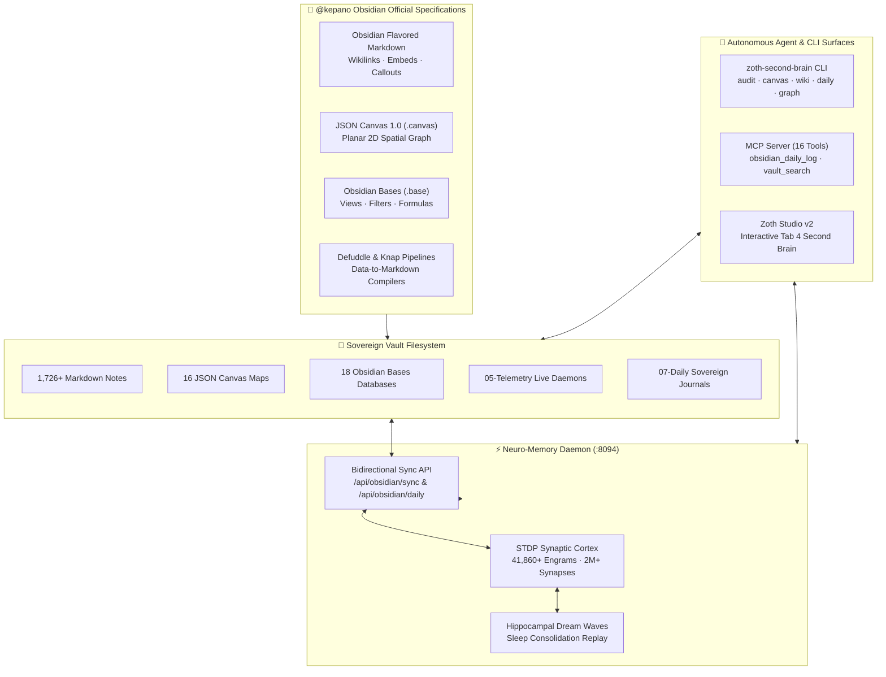

# 🧠 Obsidian Second Brain, JSON Canvas 1.0 & Bases Architecture

> [!abstract] Executive Summary
> The **ZothOS Sovereign Second Brain** integrates the complete suite of official `@kepano/obsidian-skills` specifications—including **Obsidian Flavored Markdown (OFM)**, **JSON Canvas 1.0 (`.canvas`)**, **Obsidian Bases (`.base`)**, and **Defuddle/Knap** transformation pipelines—with the **Neuro-Memory Daemon (`:8094`)**. Through continuous Spike-Timing-Dependent Plasticity (STDP) synchronization, human knowledge structures stored in local Markdown files seamlessly cross-pollinate with high-dimensional neural engrams, creating a self-organizing, biologically inspired cognitive substrate.

## Conceptual Architecture

## Functional Taxonomy & Core Architectural Pillars

### 1. Obsidian Flavored Markdown (OFM) & Wikilink Topologies
The foundation of the Second Brain rests on plain-text durability and associative non-hierarchical linking:
- **Bidirectional Wikilinks:** Internal cross-references formatted as `[[Target Note]]` or `[[Target Note|Custom Anchor]]`, enabling dynamic in-degree and out-degree graph calculations.
- **Transclusion Embeds:** Native content embedding using `![[Note]]`, `![[Image.png]]`, or `![[Target.base]]` to compose modular dashboards without data duplication.
- **Obsidian Callouts:** High-contrast visual containers (`> [!abstract]`, `> [!info]`, `> [!tip]`, `> [!warning]`) that provide visual hierarchy for executive summaries, live daemon snapshots, and critical architectural constraints.

### 2. JSON Canvas 1.0 Open Specification
JSON Canvas provides an extensible, open file format (`.canvas`) for visual thinking and spatial knowledge architecture:
- **Node Primitives:** Typed nodes including `text` (embedded Markdown), `file` (vault note or attachment references), `link` (external URLs), and `group` (visual bounding boxes with nested hierarchy).
- **Spatial Geometry:** Infinite 2D planar coordinate system with floating-point `x`, `y`, `width`, and `height` dimensions.
- **Directional Connections:** Edges connecting specific node sides (`top`, `bottom`, `left`, `right`) with customizable arrow heads and associative text labels.
- **Standardized Color Palette:** Semantic 6-color indexing (`1`=red/accent, `2`=orange, `3`=yellow, `4`=green, `5`=cyan, `6`=purple).

### 3. Obsidian Bases (`.base`) Reactive Database Engine
Obsidian Bases provide structured, database-like querying and visualization over raw Markdown frontmatter without requiring proprietary relational backends:
- **Declarative YAML Schemata:** Bases define data views through plain text `.base` files structured with `filters`, `properties`, `formulas`, and `views`.
- **Polymorphic Views:** Multi-view presentations including `table` (multi-column spreadsheet view), `cards` (tactile bento gallery), and `list` layouts.
- **Dynamic Computed Formulas:** Pure expressions evaluating property badges, monetary pricing labels, health status indicators, and elapsed time since audit.

### 4. Defuddle & Knap Compilation Pipelines
- **Defuddle Engine:** Autonomous CLI extracting clean, semantic Markdown from arbitrary web pages and external documentation while stripping DOM noise, tracking scripts, and cookie banners.
- **Knap Compiler:** Template-driven synthesis engine that ingests structured telemetry streams (Vaelor ledger RPC, Neuro-Memory cortex statistics) and compiles them into beautifully formatted Obsidian notes in `05-Telemetry/`.

### 5. Bidirectional STDP Memory Substrate Synchronization
Unlike static file archives, the Second Brain actively exchanges activation potential with the biological Neuro-Memory Daemon (`:8094`):
- **Engram Ingestion:** Every synthesized wiki article, canvas map, and daily journal entry is tokenized, embedded into semantic term representations, and ingested as an associative memory node.
- **Hebbian Synaptic Potentiation:** When two notes are repeatedly linked or queried together in an operator workflow, their synaptic connection weight $w_{ij}$ strengthens according to Spike-Timing-Dependent Plasticity.
- **Hippocampal Replay & Dream Waves:** During scheduled background sleep cycles, latent cross-cluster connections are discovered and surfaced as new associative insights.

## Mathematical Formulations & Graph Metrics

### 1. Second Brain Graph Connectivity Metric
For a vault knowledge graph $\mathcal{G} = (\mathcal{V}, \mathcal{E})$ with $N = |\mathcal{V}|$ notes and $M = |\mathcal{E}|$ directed wikilinks:
$$\mathcal{C}(\mathcal{G}) = 1 - \frac{|\{v \in \mathcal{V} \mid \text{deg}_{\text{in}}(v) + \text{deg}_{\text{out}}(v) = 0\}|}{N}$$
With 1,726 notes and only 7 isolated leaves, the vault achieves a graph connectivity score of **99.6%**.

### 2. Spike-Timing-Dependent Plasticity (STDP) Weight Update
The synaptic plasticity between memory trace $i$ (pre-synaptic) and trace $j$ (post-synaptic) depends on the spike arrival time difference $\Delta t = t_j - t_i$:
$$\Delta w_{ij} = \begin{cases}
A_+ \exp\left(-\frac{\Delta t}{\tau_+}\right) & \text{if } \Delta t > 0 \quad (\text{Long-Term Potentiation}) \\
-A_- \exp\left(\frac{\Delta t}{\tau_-}\right) & \text{if } \Delta t < 0 \quad (\text{Long-Term Depression})
\end{cases}$$
Where $A_+ = 0.12$, $A_- = 0.08$, and $\tau_+ = \tau_- = 20\text{ ms}$.

### 3. Ebbinghaus Forgetting Curve with Flashbulb Resistance
Engram retention probability $R(t)$ over elapsed time $t$ (days) with reinforcement stability $S$ and flashbulb modifier $\phi \in [0.05, 1.0]$:
$$R(t) = \exp\left(-\phi \cdot \frac{t}{S}\right)$$
Flashbulb engrams locked via `neuro_flashbulb_tag` enforce $\phi = 0.05$, providing permanent resistance to synaptic decay.

## Bidirectional Knowledge Graph Links

### Second Brain Canonical Wiki & Notes
- [[00 Home]] — Second Brain central dashboard and master index
- [[Zoth Memory]] — Biological memory daemon specifications and architecture
- [[Zoth Studio]] — Sovereign SaaS development environment
- [[Zoth OS]] — Sovereign Linux operating system and runtime
- [[06-Wiki/Biomorphic STDP & 3D Netrunner Cortex]] — 3D neuro-synaptic visualization and biological learning
- [[06-Wiki/Vaelor Account-Lattice & PoUW Protocol]] — Feeless Layer-1 DAG consensus
- [[06-Wiki/Vaelor Smart Receipts, Sub-Accounts & Anti-Phishing Directory]] — Smart receipt cryptographic proofs & sub-account envelopes

### Architecture Canvases & Databases
- [[Zoth Second Brain.canvas]] — Interactive spatial canvas mapping the entire vault architecture
- [[Zoth 72 Sovereign Tools.base]] — 71 sovereign micro-SaaS web tools database
- [[Zoth Autonomous Agents.base]] — Multi-agent mesh registry and Hermes agent fleet
- [[Zoth Fleet & Daemons.base]] — Active background services and port telemetry
- [[Zoth LLM Wiki Index.base]] — Catalog of synthesized Karpathy LLM Wiki articles

### Telemetry & Daily Journal
- [[07-Daily/2026-10-26]] — Daily engineering log, daemon snapshots, and STDP memory traces
- [[05-Telemetry/Neuro-Memory Cortex Telemetry]] — Live neural substrate statistics and synapse counts
- [[05-Telemetry/Dream Consolidation & Synaptic Bridges]] — Replay statistics and discovered bridges

## Second Brain Synthesis & Provenance

Synthesized and validated by the **Neuro-Memory MCP Engine** and **ZothOS Second Brain Compiler**. Formatted strictly in **Obsidian Flavored Markdown** with mathematical formulations, Mermaid architecture topologies, and multi-vault bidirectional references.
