# 📚 Vaelor Account-Lattice & PoUW Protocol

> [!abstract] Executive Summary
> **Vaelor (◈ VLR)** is a next-generation Layer-1 feeless cryptocurrency architecture designed to eliminate blockchain transaction fees and mining energy waste. Operating on an asynchronous **Account-Lattice DAG**, each account controls an independent micro-chain validated via a sub-20ms SHA-256 work stamp. Byzantine Fault Tolerant (BFT) finality is achieved across a 5-region validator quorum, while native Layer-1 **Protected-Pay Escrow** (24–72h buyer protection windows) and **Recurring Pull Subscription Allowances** provide consumer payment features surpassing legacy credit card rails.

## Conceptual Architecture

```mermaid
flowchart LR
    subgraph UserSurfaces["👤 User & Client Surfaces"]
        P1["Passkey Biometric<br/>@1nc0gn30"]
        P2["Merchant POS SDK<br/>@merchant"]
        P3["Pull Subscriptions<br/>Guarded Allowances"]
    end
    
    subgraph AccountLatticeDAG["◈ Asynchronous Lattice DAG"]
        direction TB
        TxSend["SEND Block<br/>PoW Nonce Stamp"]
        TxRecv["RECEIVE Block<br/>Balance Settle"]
        Escrow["Protected-Pay<br/>ESCROW_LOCK (72h)"]
        TxSend --> TxRecv
        TxSend --> Escrow
    end
    
    subgraph ConsensusBFT["⚡ 5-Region BFT Finality (:8140)"]
        direction TB
        V1["🇺🇸 Virginia (1.2ms)"]
        V2["🇩🇪 Frankfurt (14.8ms)"]
        V3["🇯🇵 Tokyo (22.4ms)"]
        V4["⚡ Local Edge (0.4ms)"]
        V5["🌐 NullAI Core (0.8ms)"]
    end
    
    subgraph PoUWWorkers["⛏️ AI Compute Miners"]
        M1["AEO Schema JSON-LD"]
        M2["CWV Performance Audits"]
        M3["Security Entropy Scans"]
        M4["LLM Inference Receipts"]
    end
    
    UserSurfaces --> AccountLatticeDAG
    AccountLatticeDAG -->|Sub-20ms Quorum| ConsensusBFT
    PoUWWorkers -->|PoUW Coin Minting| AccountLatticeDAG
```

## Functional Taxonomy & Core Architectural Pillars

### 1. Asynchronous Account-Lattice DAG
Unlike monolithic single-queue blockchains where every transaction competes in a global mempool, Vaelor gives every user, merchant, and sovereign daemon an individual Ed25519 micro-chain. Transactions require only dual-block consensus (SEND on sender's lattice, RECEIVE on receiver's lattice), completely eliminating global queue head-of-line blocking.

### 2. $0.00 Gas & Micro-PoW Anti-Spam Stamp
Spam prevention is handled entirely on the client side without burning monetary gas. Every transaction computes a sub-20ms SHA-256 micro-stamp over the account's previous block hash:
- Gas fee: **$0.00**
- Settlement speed: **<20ms**
- Verification: Instant O(1) hash check by validators

### 3. Layer-1 Protected-Pay Escrow
Merchants and buyers can conduct commercial transactions with native protocol-level chargeback protection. Funds are held in an `ESCROW_LOCK` state for 24 to 72 hours, enabling instant release upon delivery or instant refund if goods fail—with zero credit card interchange fees.

### 4. Proof-of-Useful-Work (PoUW) Compute Minting
Rather than burning terawatt-hours on useless cryptographic hash calculations, Vaelor mints new VLR supply strictly through verified artificial intelligence tasks:
- **AEO Schema Graph Synthesis:** Automated Schema.org generation for search crawlers.
- **CWV DOM Audits:** Tri-viewport Core Web Vitals layout shift validation.
- **Security Entropy Audits:** Ed25519 key verification and secret leak prevention.

## Key Mathematical Formulations & Technical Primitives

### 1. Anti-Spam Micro-Proof-of-Work Stamp
The sender must produce a 32-bit nonce $n$ such that:
$$\text{SHA-256}(\text{account} \mathbin{\Vert} \text{previous\_hash} \mathbin{\Vert} n) < T_{\text{diff}}$$
Where $T_{\text{diff}} = 2^{256 - k}$ and $k = 16$ bits of required leading zero difficulty (achieved in $\approx 4.8\text{ ms}$).

### 2. Byzantine Fault Tolerant Consensus Quorum
For a validator set of size $N = 5$ with fault tolerance $f = 1$:
$$Q = 2f + 1 = 4 \quad (80\% \text{ quorum threshold})$$
A block is finalized when it receives valid Ed25519 signatures from at least $Q$ online regional validators:
$$\sum_{v \in V} \mathbb{I}_{\text{attested}}(v) \ge 4$$

### 3. Proof-of-Useful-Work Reward Equation
The newly minted coin reward $R_{\text{VLR}}$ for verified AI task execution is calculated as:
$$R_{\text{VLR}} = \beta \cdot \mathcal{C}(\text{Task}) \cdot \exp\left(-\frac{\Delta t_{\text{latency}}}{\tau}\right)$$
Where $\mathcal{C}(\text{Task})$ represents computational entropy units and $\beta = 1.05$.

## Bidirectional Knowledge Graph Links

### Obsidian Second Brain Notes
- [[Vaelor Network]] — Canonical architecture specification and network primitives
- [[05-Telemetry/Vaelor Live Ledger Telemetry]] — Live DAG state, block counts, and validator pings
- [[Agents/Vaelor PoUW AI Compute Miners]] — Sovereign AI mining daemon specs
- [[Zoth Trust & Supply Chain]] — Cryptographic supply-chain and Ed25519 trust verification
- [[Zoth OS]] — Operating system conductor integration

### Visual Canvases
- [[Vaelor & Sovereign Economy.canvas]] — Interactive spatial canvas of the lattice and economy
- [[Zoth Autonomous Agents & Hermes Fleet.canvas]] — Multi-agent mesh connecting PoUW workers

### Database Registries
- [[Zoth 71 Sovereign Tools.base]] — Core tool database with monetization status
- [[Zoth Fleet & Daemons.base]] — Service ports and health probe endpoints
- [[Zoth Autonomous Agents.base]] — Agent fleet registry

## STDP Synaptic Provenance & Vector Evidence

| Memory ID | Category | Importance | Synaptic Tags | Excerpt |
|:---|:---:|:---:|:---|:---|
| `5610e92b-b97` | `semantic` | 0.79 | `obsidian`, `second-brain`, `moc` | [Obsidian Second Brain · [[Vaelor Network]]] --- title: "Vaelor Network (◈ VLR)" date: 2026-10-26 tags:   - vaelor   - c... |
| `ad4d10cd-a04` | `procedural` | 0.78 | `obsidian`, `second-brain`, `canvas` | [Obsidian Second Brain · Spec Artifact Vaelor Layer-1 Complete Architecture.canvas] {   "nodes": [     {       "id": "a1... |
| `1a0d56c9-8e1` | `procedural` | 0.78 | `obsidian`, `second-brain`, `canvas` | [Obsidian Second Brain · Spec Artifact Vaelor & Sovereign Economy.canvas] {   "nodes": [     {       "id": "100000000000... |
| `78db75b5-a76` | `procedural` | 0.77 | `obsidian`, `second-brain`, `base` | [Obsidian Second Brain · Spec Artifact Vaelor Ecosystem & Patronage Ledger.base] filters:   and:     - file.hasTag("vael... |
| `eeece19b-8df` | `semantic` | 0.79 | `obsidian`, `second-brain`, `moc` | [Obsidian Second Brain · [[Vaelor Network]]] --- title: "Vaelor Network (◈ VLR)" date: 2026-10-26 tags:   - vaelor   - c... |
| `f874dc64-72b` | `procedural` | 0.78 | `obsidian`, `second-brain`, `base` | [Obsidian Second Brain · Spec Artifact Vaelor Ecosystem & Patronage Ledger.base] filters:   and:     - file.hasTag("vael... |

## See Also

- [[00 Home]]
- [[Zoth LLM Wiki Index.base|Zoth LLM Wiki Index Database]]
