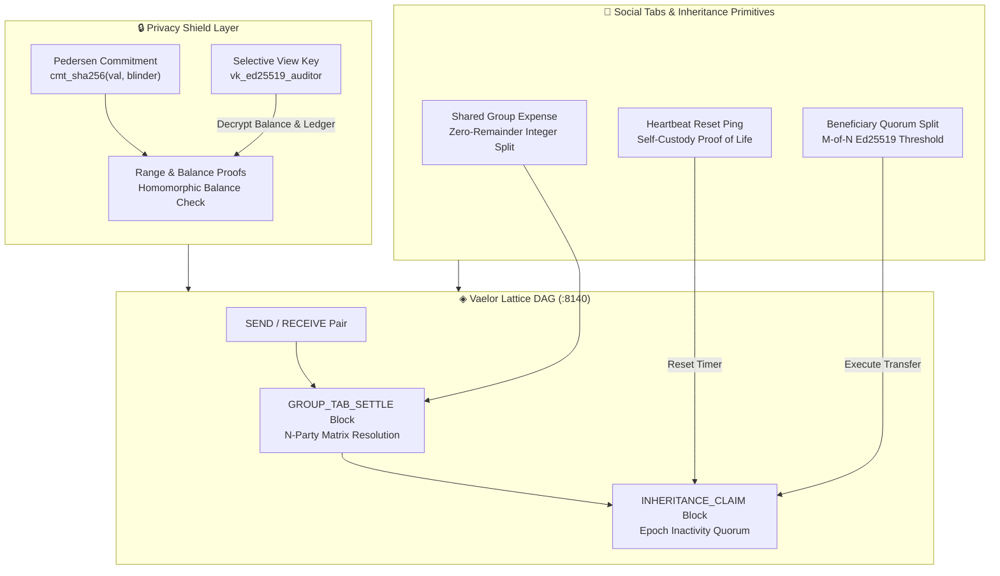

# 🛡️ Vaelor Privacy Shield, Social Group Tabs & Inheritance Vaults

> [!abstract] Executive Summary
> **Vaelor (◈ VLR)** introduces zero-knowledge privacy and social coordination primitives directly into its Layer-1 feeless Account-Lattice DAG (:8140). The **Vaelor Privacy Shield** combines Pedersen-style SHA-256 value commitments (`cmt_...`) and selective disclosure view keys (`vk_...`) for non-custodial auditability without deanonymization. Complementing the privacy layer are native **Social Group Tabs** (`GROUP_TAB_SETTLE`) providing integer-exact zero-remainder bill settlement across multi-agent swarms and human cohorts, alongside sovereign **Inheritance Continuity Vaults** (`INHERITANCE_CLAIM`) featuring configurable dead-man's switch epochs, multi-beneficiary quorum disbursement, and zero custodial exposure.

## Conceptual Architecture



## Functional Taxonomy & Core Architectural Pillars

### 1. Pedersen-Style Value Commitments (`cmt_...`) & Selective View Keys (`vk_...`)
Standard transparent blockchains expose transaction balances, counterparties, and spending velocities to external heuristics and surveillance clusters. The Vaelor Privacy Shield implements confidential value accounting on the account lattice:

- **Blinded Value Commitments (`cmt_...`):** Each confidential block hides the transferred amount using a cryptographically binding and hiding commitment:
  $$\text{Commitment} = \text{SHA256}(v \parallel r \parallel \text{salt})$$
  where $v$ is the integer micro-VLR amount and $r$ is a 256-bit blinding scalar derived from the sender's ephemeral Diffie-Hellman secret.
- **Homomorphic Balance Verification:** Validators verify that the sender’s unblinded input commitments equal output commitments plus feeless balance adjustments without learning the scalar values.
- **Selective Auditor View Keys (`vk_...`):** To facilitate tax compliance, enterprise book-keeping, and legal audits, account owners can generate read-only view keys (`vk_ed25519...`). The view key derives the shared secret required to unblind transaction values and counterparties without conferring spending authority.

```json
{
  "blockType": "CONFIDENTIAL_SEND",
  "account": "vlr_1zothprime777...",
  "commitment": "cmt_8f4a9b2c3d4e5f60718293a4b5c6d7e8f90123456789abcdef0123456789abcd",
  "ephemeralPubkey": "eph_91a2b3c4d5e6f708192a3b4c5d6e7f8091a2b3c4d5e6f708192a3b4c5d6e7f80",
  "viewKeyTag": "vk_tag_4402fe91bc62...",
  "rangeProof": "rp_sha256_pedersen_v1..."
}
```

---

### 2. Social Group Tabs & Zero-Remainder Bill Settlement (`GROUP_TAB_SETTLE`)
Traditional peer-to-peer bill splitting requires manual reciprocal payments, resulting in transaction churn, round-off discrepancies, and cross-chain fee erosion. Vaelor provides a native **Social Group Tab** state machine:

- **Matrix Debt Minimization:** When an $N$-member group incurs multiple asymmetric expenditures (e.g., dining, co-working rents, shared AI compute clusters), the tab state accumulates debits and credits. At settlement, an integer-exact algorithm simplifies reciprocal debts to the minimum number of directed transfers.
- **Zero-Remainder Micro-VLR Precision:** All splits are computed in base atomic integer units (1 VLR = $10^6$ micro-units). Indivisible remainders are deterministically attributed to the largest funder or rotated round-robin, guaranteeing zero dust loss.
- **Single-Block Settlement (`GROUP_TAB_SETTLE`):** The final settlement compiles all simplified debts into a single multi-party lattice block signed by participant session keys.

```json
{
  "type": "GROUP_TAB_SETTLE",
  "groupId": "tab_hackathon_paris_2026",
  "totalExpenseMicroVLR": 450000000,
  "participants": 4,
  "simplifiedDebts": [
    { "from": "vlr_1agent_alice...", "to": "vlr_1agent_bob...", "amount": 112500000 },
    { "from": "vlr_1agent_charlie...", "to": "vlr_1agent_bob...", "amount": 112500000 }
  ],
  "zeroDustAttribution": "round_robin_deterministic",
  "signatures": ["sig_ed25519_alice...", "sig_ed25519_bob...", "sig_ed25519_charlie..."]
}
```

---

### 3. Sovereign Inheritance Continuity Vaults (`INHERITANCE_CLAIM`)
Crypto-asset loss due to sudden incapacitation, memory loss, or disaster remains a major vulnerability in pure self-custody systems. Vaelor solves this via on-chain **Dead-Man's Switch Continuity Vaults** with zero third-party custody:

- **Heartbeat Epoch Timers:** The vault creator configures an inactivity window (e.g., 180 days, 365 days). Any standard lattice block signed by the primary account (payment, vote, or explicit 0-VLR heartbeat ping) resets the timer.
- **Threshold Beneficiary Quorum:** If the timer expires without a heartbeat, designated beneficiary addresses (`vlr_...`) can jointly broadcast an `INHERITANCE_CLAIM`. A configurable threshold (e.g., 2-of-3 beneficiaries or 1 beneficiary + 1 verified auditor) must sign the claim.
- **Dispute & Cancellation Grace Window:** Upon threshold claim activation, a 14-day cancellation window opens. If the original account is active, a 1-click broadcast immediately aborts the transfer, freezes suspicious beneficiary keys, and updates vault parameters.
- **Automated Disbursement:** Once the grace window elapses uncontested, the vault executes atomic disbursements according to pre-configured basis point allocations.

```json
{
  "type": "INHERITANCE_CLAIM",
  "vaultAccount": "vlr_1sovereign_patriarch...",
  "inactivityPeriodDays": 365,
  "daysSinceLastHeartbeat": 381,
  "beneficiaries": [
    { "account": "vlr_1heir_daughter...", "basisPoints": 6000 },
    { "account": "vlr_1heir_son...", "basisPoints": 4000 }
  ],
  "graceWindowStatus": "EXPIRED_UNCONTESTED",
  "disbursementBlock": "blk_lattice_claim_exec_99a8b7..."
}
```

---

## Inter-System Synaptic Integrations

1. **Neuro-Memory Daemon (:8094):** The daemon's hippocampal consolidation loop tracks Vaelor privacy commitments, view key associations, and active group tab balances across developer subagents, reinforcing episodic memories without storing unencrypted private scalars.
2. **Obsidian Second Brain:** Vault notes in `04-Ingested/` and `05-Telemetry/` ingest live DAG ledger attestations, rendering visual topology in [[00 Home]] and `05-Telemetry/Vaelor Live Ledger Telemetry.md`.
3. **ZothOS & Zoth Studio:** The client-side payment rail supports 1-click view key generation for zero-knowledge receipt verification and instant group tab resolution during multi-agent collaborative builds.

## See Also

- [[00 Home]] — Sovereign Second Brain Central Hub
- [[Vaelor Network]] — Layer-1 Feeless DAG & Consensus Engine
- [[06-Wiki/Vaelor Account-Lattice & PoUW Protocol|Vaelor Account-Lattice & PoUW Protocol]]
- [[06-Wiki/Vaelor Smart Receipts, Sub-Accounts & Anti-Phishing Directory|Vaelor Smart Receipts, Sub-Accounts & Anti-Phishing Directory]]
- [[Zoth OS]] — Preempt-RT Sovereign Operating System
- [[Zoth Memory]] — Biological STDP Synaptic Substrate
