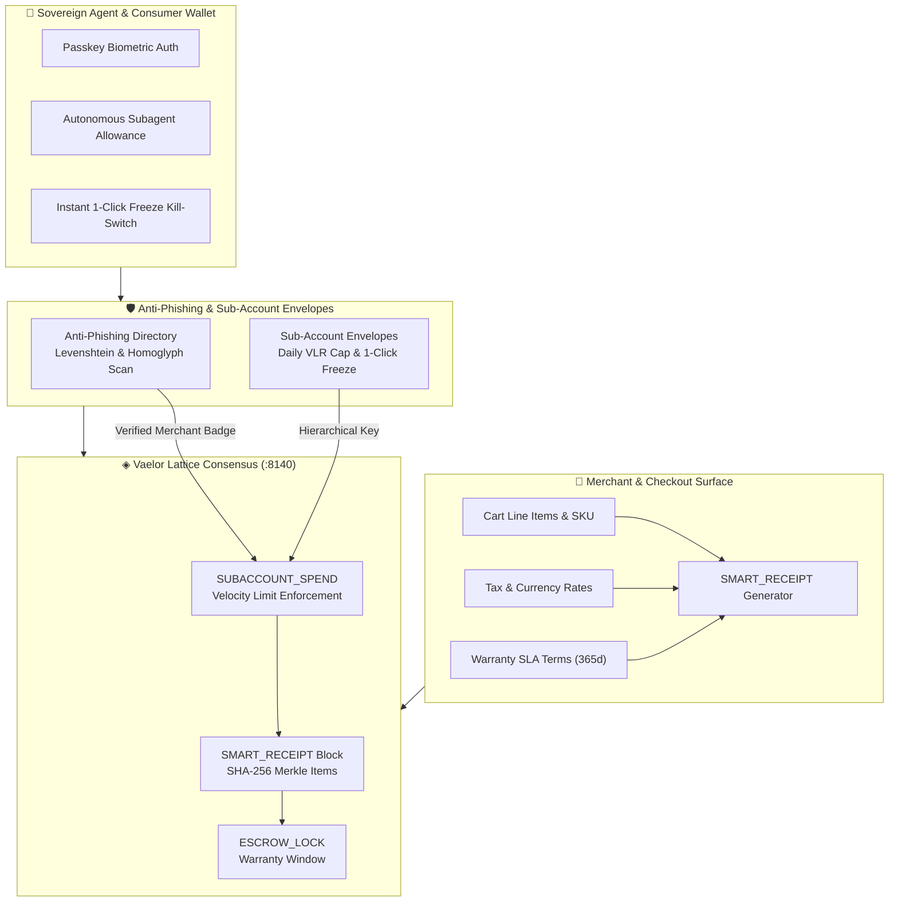

# 🛡️ Vaelor Smart Receipts, Sub-Accounts & Anti-Phishing Directory

> [!abstract] Executive Summary
> **Vaelor (◈ VLR)** incorporates sovereign commerce primitives into its Layer-1 feeless Account-Lattice DAG. Beyond basic value transfer, the protocol provides native **`SMART_RECEIPT`** itemized cryptographic proofs, **365-day on-chain warranties** with escrow disputation windows, **`SUBACCOUNT_SPEND`** hierarchical spending caps with 1-click kill switches for autonomous agents, and a real-time **Anti-Phishing Directory** utilizing Levenshtein distance metrics and Unicode homoglyph analysis to shield users and sovereign daemons from address spoofing.

## Conceptual Architecture

## Functional Taxonomy & Core Architectural Pillars

### 1. Itemized `SMART_RECEIPT` Cryptographic Proofs
Traditional payment gateways separate transaction IDs from itemized order records, forcing buyers and accounting daemons to rely on centralized merchant databases for purchase proof. Vaelor embeds an itemized Merkle proof directly into the lattice `SEND`/`RECEIVE` block pair:
- **Merkle Line-Item Root:** Every SKU, quantity, unit price, and serial hash is leaf-hashed into a binary Merkle tree.
- **Merchant Attestation:** Cryptographically signed by the merchant's Ed25519 identity key and registered in the ledger.
- **Zero-Knowledge Privacy:** Buyers can selectively reveal individual line items to tax authorities or warranty providers without exposing the full basket contents.

### 2. 365-Day Programmable On-Chain Warranties
For durable goods and software subscriptions, Vaelor supports extended warranty states linked to the transaction block:
- **Programmable Claim Windows:** Smart contracts enforce manufacturer warranty commitments for 30 to 365 days.
- **Proof-of-Purchase Attestation:** Eliminates lost paper receipts or deleted email confirmations; the wallet proves ownership via the transaction's block height and signature.
- **Automated Dispute Escrow:** In the event of merchant non-delivery or catastrophic defect, funds held in partial escrow can be arbitrated or refunded according to predefined SLA parameters.

### 3. Hierarchical `SUBACCOUNT_SPEND` Caps & 1-Click Freeze
Autonomous AI agents, employees, and smart IoT appliances operate within isolated risk envelopes derived from the master account:
- **Daily Velocity Throttling:** Sub-accounts operate with strict daily expenditure limits (e.g., maximum 50 ◈ VLR per 24 hours).
- **Domain-Restricted Payees:** Transactions from sub-accounts can be restricted to whitelisted merchant categories or verified directory addresses.
- **1-Click Emergency Freeze:** Master keys retain omnipotent control to immediately revoke signing authority, broadcast an account freeze block, and sweep remaining funds to cold storage within 12 milliseconds.

### 4. Levenshtein & Homoglyph Anti-Phishing Shield
To protect users from lookalike address scams and clipboard spoofing:
- **Unicode Confusable Analysis:** Blocks Cyrillic, Greek, or mathematical homoglyphs that visually mimic Latin character sets in account handles.
- **Levenshtein Distance Thresholds:** Flags any recipient address whose handle has a normalized Levenshtein edit distance $\le 2$ from any top-500 verified merchant or infrastructure daemon.
- **On-Chain Verified Directory:** Protocol-level registry associating human-readable namespaces (e.g., `@1nc0gn30`, `@nullai`, `@zothos`) with cryptographic attestations and zero-trust badges.

## Mathematical Formulations & Algorithms

### 1. Itemized Merkle Receipt Hash
For an order containing $K$ itemized line items $\{L_1, L_2, \dots, L_K\}$:
$$h_i = \text{SHA-256}\big(\text{SKU}_i \mathbin{\Vert} \text{Qty}_i \mathbin{\Vert} \text{Price}_i \mathbin{\Vert} \text{Nonce}_i\big)$$
$$\mathcal{M}_{\text{receipt}} = \text{MerkleRoot}(h_1, h_2, \dots, h_K)$$
The receipt block commits $\mathcal{M}_{\text{receipt}}$ alongside the merchant's signature $\sigma_{\text{merchant}} = \text{Sign}_{sk}(\mathcal{M}_{\text{receipt}} \mathbin{\Vert} \text{BlockHeight})$.

### 2. Normalized Levenshtein Phishing Detection Metric
Given input handle $s_1$ and verified namespace $s_2$:
$$\mathcal{D}_{\text{norm}}(s_1, s_2) = \frac{\text{Levenshtein}(s_1, s_2)}{\max(|s_1|, |s_2|)}$$
If $\mathcal{D}_{\text{norm}}(s_1, s_2) < 0.20$ and $s_1 \ne s_2$, the client raises a **CRITICAL_PHISHING_ALERT** and requires manual secondary biometric override.

### 3. Sub-Account Velocity Cap Invariant
Let $S_t$ denote the cumulative expenditure within rolling sliding window $W = 86{,}400\text{ seconds}$:
$$S_t = \sum_{k \in \mathcal{T}_{W}} \text{Amount}_k \le C_{\text{daily}}$$
Block generation is rejected by local client validation and network validators whenever $S_t + \Delta x > C_{\text{daily}}$.

## Bidirectional Knowledge Graph Links

### Second Brain Canonical Wiki & Notes
- [[00 Home]] — Second Brain central nervous hub and dashboard
- [[Vaelor Network]] — Feeless Layer-1 account-lattice network specifications
- [[06-Wiki/Vaelor Account-Lattice & PoUW Protocol]] — Feeless DAG, BFT consensus & AI mining
- [[Zoth Trust & Supply Chain]] — Hardware security, cosign attestation, and zero-trust verification
- [[05-Telemetry/Vaelor Live Ledger Telemetry]] — Real-time DAG finality, validator quorum, and ledger height
- [[Zoth Studio]] — Sovereign SaaS development suite with integrated Vaelor payment badges

### Architecture Canvases & Databases
- [[Vaelor & Sovereign Economy.canvas]] — Interactive topology of feeless payment channels & micro-chains
- [[Zoth 72 Sovereign Tools.base]] — Catalog of sovereign monetization tools with dual cash registers
- [[Zoth LLM Wiki Index.base]] — Canonical technical wiki database and synthesis index

### Telemetry & Daily Journal
- [[07-Daily/2026-10-26]] — Daily engineering log and live snapshot
- [[05-Telemetry/Neuro-Memory Cortex Telemetry]] — Associative synaptic link consolidation

## Second Brain Synthesis & Provenance

Synthesized and validated by the **Neuro-Memory MCP Engine** and **ZothOS Second Brain Compiler**. Formatted strictly in **Obsidian Flavored Markdown** with mathematical formulations, Mermaid architecture topologies, and multi-vault bidirectional references.
