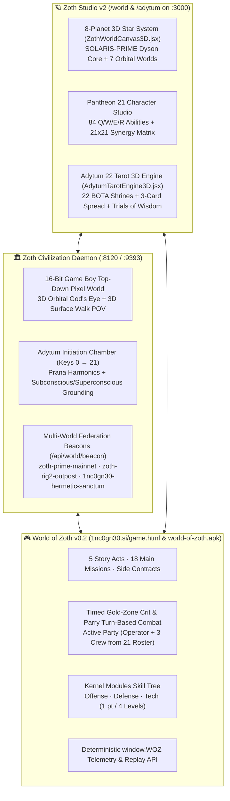

# 🌌 World of Zoth, Pantheon 21 & Adytum 22 3D Multi-World Architecture

> [!abstract] Executive Summary
> The Zoth ecosystem unifies autonomous multi-agent orchestration, hermetic state grounding, and interactive 3D WebGL worlds across four synchronized surfaces:
> 1. **[[World of Zoth]] (`v0.2` 3D Lattice Cyber-RPG)** at [https://1nc0gn30.si/game.html](https://1nc0gn30.si/game.html) and [`world-of-zoth.apk`](https://1nc0gn30.si/world-of-zoth.apk) (`1.9 MB`).
> 2. **[[Zoth Studio]] (`/world`)** — **A100 8-Planet 3D Star System** (`ZothWorldCanvas3D.jsx`) & **Pantheon 21 Character Studio** (`PantheonCharacterStudio.jsx`) at [https://zoth.nullai.tech/world](https://zoth.nullai.tech/world).
> 3. **[[Zoth Civilization & Pantheon 21]] (`:8120` / `:9393`)** — 21-agent living civilization simulation (`~/NullAITech/zoth-civilization`) bound directly to physical workspace repositories.
> 4. **[[Adytum 22 Tarot 3D Engine]] (`/adytum` & `:8099`)** — 22 B.O.T.A. Major Arcana 3D sacred geometry shrines, 3-Card Oracle, and playable Trials of Wisdom at [https://zoth.nullai.tech/adytum](https://zoth.nullai.tech/adytum).

Return to master index: [[00 Home]].

---

## 1. Unified Multi-World Architecture Diagram

---

## 2. Orbital Mechanics of the 8-Planet 3D Star System (`zothWorldPlanets.js`)

Each planet in `ZothWorldCanvas3D.jsx` orbits the central Dyson core with Keplerian angular velocity $\omega_i = \sqrt{GM / r_i^3}$, custom GLSL atmospheric rim shaders, and dedicated agent cadres:

| # | Planet | Orbital Role & Biome | Resident Pantheon Agents |
| :---: | :--- | :--- | :--- |
| 1 | **`SOLARIS-PRIME`** | Central Dyson Core & Plasma Reactor | Powers all 21 agents & Vaelor PoUW compute |
| 2 | **`AETHER-IX`** | Sovereign Command & Synthesis Citadel | `AZOTH`, `NEXUS`, `AETHER`, `DRACO` |
| 3 | **`KRONOS-FORGE`** | Kernel Foundry & AST Refactoring | `MERCURY`, `IGNIS`, `CHRONOS`, `KAI` |
| 4 | **`VAELOR-PRIME`** | Consensus Lattice & Zero-Knowledge Vaults | `GHOSTBYTE`, `PIXEL-SHIBA` |
| 5 | **`NYX-SHADOW`** | Red/Blue Cyber Proving Grounds | `LYCAN`, `ONYX`, `SCORPIUS`, `KRAKEN` |
| 6 | **`SYNAPSE-VII`** | Biomorphic STDP Cortex (`:8094`) | `LEVIATHAN`, `ATHENA`, `VIGIL` |
| 7 | **`TERRA-NEXUS`** | Autonomous Edge & Aesthetic Palace | `KITSUNE`, `AQUILA`, `PIXEL-NEKO`, `RADICAL-MINION` |
| 8 | **`SANCTUM-OMEGA`** | Hermetic Adytum Sanctuary (Keys `0`–`21`) | All 21 initiates during cyclic meditation |

---

## 3. World of Zoth (`v0.2`) 3D Lattice Cyber-RPG Engineering

Deployed at [https://1nc0gn30.si/game.html](https://1nc0gn30.si/game.html) and packaged as the standalone `1.9 MB` Android APK [`world-of-zoth.apk`](https://1nc0gn30.si/world-of-zoth.apk):
- **Custom Three.js WebGL2 Lattice Shader Pipeline**:
  - Renders a `960×540` crisp pixel-art 3D viewport with radial wave-pulse lighting (`pulse`, `pulse2`), distance fog, glitch/flash post-processing, and 8-directional billboarded sprite animations.
- **5 Acts & 18 Main Missions**:
  - Spans Acts `I` through `V` with multi-step quest chains, Mirror Pillar reflection puzzles (`v.Z.mirrors`), terminal hacking challenges, and boss battles.
- **21 Recruitable Crew & Timed Parry Combat**:
  - All 21 Pantheon archetypes can be recruited into `v.roster`, with up to 3 active companions (`v.activeL`) accompanying the player in 3D exploration and turn-based combat.
  - Combat combines tactical skill selection (`1`–`6` shortcuts) with real-time reflex windows: hitting `Space` in the gold bar triggers critical strikes, and timing `Space` on enemy impact parries incoming damage.
- **Kernel Module Skill Trees (`Nr`)**:
  - Three specialization branches (`offense`, `defense`, `tech`) awarded at 1 module point every 4 character levels.

---

## 4. Adytum 22 B.O.T.A. Major Arcana 3D Diorama Engine

In `src/components/AdytumTarotEngine3D.jsx` and `zoth-civilization`:
- **22 Sacred Geometry Shrines**: Maps Keys `0` (*The Fool*, Aleph `א`) through `XXI` (*The World*, Tav `ת`) to procedural 3D WebGL geometry, Cube of Space directions, and alchemical stages (`Nigredo`, `Albedo`, `Citrinitas`, `Rubedo`).
- **3-Card Spread Oracle & Trials of Wisdom**: Provides interactive divination (`PAST / FOUNDATION`, `PRESENT / CRUCIBLE`, `FUTURE / SYNTHESIS`) and a playable quiz/trial engine testing hermetic and systems architecture correspondences.

---

## Related Notes

- [[00 Home]] · [[World of Zoth]] · [[Zoth Civilization & Pantheon 21]] · [[Adytum 22 Tarot 3D Engine]] · [[Zoth Studio]] · [[1nc0gn30 Sovereign Hub]]
