# 📚 Zero-Trust Supply Chain, Cosign & VirusTotal Verification

> [!abstract] Executive Summary
> The **Zero-Trust Supply Chain, Cosign & VirusTotal Verification** architecture establishes mathematical tamper-evidence for all code, container images, and release artifacts distributed across ZothOS and the NullAI Platform. Every git commit, release tarball, and live daemon binary is cryptographically signed using **Cosign Ed25519** and verified against **VirusTotal 70+ Antivirus Scanning Engines**, guaranteeing 0 false positives, 0 malware detections, and unalterable author provenance.

## Conceptual Architecture

```mermaid
flowchart LR
    subgraph CommitOrigin["✍️ Author Provenance"]
        Dev["1nc0gn30 (@1nc0gn30)"]
        Git["GPG / Ed25519 Signed Git Commit"]
    end
    
    subgraph SecurityGuardrail["🛡️ Zero-Trust Verification Pipeline"]
        Cosign["Cosign Signature & PKI Attestation"]
        VT["VirusTotal 70+ AV Multi-Engine Scan"]
        Entropy["Zero-Leak Secret Entropy Audit"]
    end
    
    subgraph ProductionDeploy["🚀 Sovereign Distribution"]
        Netlify["Verified Netlify Deployment"]
        OSRelease["Signed ZothOS ISO / Tarball"]
        Lattice["Vaelor PoUW Hash Attestation"]
    end
    
    CommitOrigin --> SecurityGuardrail
    SecurityGuardrail --> ProductionDeploy
```

## Functional Taxonomy & Security Verification Layers

### 1. Cryptographic Git Commit Signatures
All codebase modifications on `main` require strict author attribution (`1nc0gn30 <1nc0gn30@users.noreply.github.com>`) and Ed25519 digital signatures. Unsigned commits or modified author strings fail local pre-commit guardrails.

### 2. Sigstore / Cosign Artifact Attestation
Release packages and container layers are signed with `cosign`, producing cryptographic receipts verified without centralized certificate authorities. Verification proves image bit-for-bit authenticity against developer public keys.

### 3. VirusTotal 70+ AV Multi-Engine Consensus
Every binary, installer script, and release tarball is submitted to the VirusTotal API. Artifacts require a clean consensus score across all 70+ commercial antivirus scanning engines (Kaspersky, CrowdStrike, Sophos, Microsoft Defender) prior to public distribution.

### 4. Zero-Leak Entropy Scanning
Codebases undergo continuous entropy scans (`Ghostbyte Zero-Leak Guard v3.2`). API keys, private keys, and environment secrets are mathematically detected and quarantined before staging.

## Key Mathematical Formulations & Technical Primitives

### 1. Ed25519 Signature Verification
Given public key $A$, signature $(R, S)$, and message $M$, verification validates:
$$8 \cdot R + 8 \cdot H(R \mathbin{\Vert} A \mathbin{\Vert} M) \cdot A = 8 \cdot S \cdot B$$
Where $B$ is the generator point on Edwards25519 curve.

### 2. VirusTotal Consensus Clean Ratio
The clean security ratio $C_{\text{clean}}$ must strictly equal 1.00:
$$C_{\text{clean}} = \frac{N_{\text{clean}}}{N_{\text{total\_engines}}} = 1.00 \quad (N_{\text{total\_engines}} \ge 70)$$

### 3. Shannon Entropy Secret Detection
High-entropy token candidates are identified via:
$$H(X) = -\sum_{i=1}^{n} p(x_i) \log_2 p(x_i) > H_{\text{threshold}} \approx 4.5\text{ bits/char}$$

## Bidirectional Knowledge Graph Links

### Obsidian Second Brain Notes
- [[Zoth Trust & Supply Chain]] — Canonical trust specification and security invariants
- [[Credentials]] — Sovereign credentials policy and zero-leak requirements
- [[Zoth 6 Mathematical Pillars.canvas]] — Six mathematical pillars board
- [[Maps/Arsenal.base]] — Verified packages database
- [[00 Home]] — Dashboard and master graph entrypoint

## STDP Synaptic Provenance & Vector Evidence

| Memory ID | Category | Importance | Synaptic Tags | Excerpt |
|:---|:---:|:---:|:---|:---|
| `c0b2cb5f-c70` | `semantic` | 0.92 | `obsidian`, `second-brain`, `moc` | [Obsidian Second Brain · [[Zoth Trust & Supply Chain]]] --- title: "Zoth Trust & Supply Chain" date: 2026-10-26 tags:... |
| `9cbb2492-b28` | `semantic` | 0.92 | `obsidian`, `second-brain`, `moc` | [Obsidian Second Brain · [[Zoth Trust & Supply Chain]]] --- title: "Zoth Trust & Supply Chain" date: 2026-10-26 tags:... |
| `33fa5f4b-579` | `semantic` | 0.92 | `obsidian`, `second-brain`, `moc` | [Obsidian Second Brain · [[Zoth Trust & Supply Chain]]] --- title: "Zoth Trust & Supply Chain" date: 2026-10-26 tags:... |
| `8c0a8ccc-100` | `semantic` | 0.92 | `obsidian`, `second-brain`, `moc` | [Obsidian Second Brain · [[Zoth Trust & Supply Chain]]] --- title: "Zoth Trust & Supply Chain" date: 2026-10-26 tags:... |
| `ae75006c-52f` | `semantic` | 0.92 | `obsidian`, `second-brain`, `moc` | [Obsidian Second Brain · [[Zoth Trust & Supply Chain]]] --- title: "Zoth Trust & Supply Chain" date: 2026-10-26 tags:... |
| `20749f81-bcc` | `episodic` | 0.47 | `hermetic_cycle`, `divergent_synthesis`, `objective_crystallization` | [Adytum Cycle #1] Thoth (Key 2: The High Priestess) completed Observational Adytum Cycle. Divergence: "Conceptual diverg... |

## See Also

- [[00 Home]]
- [[Zoth LLM Wiki Index.base|Zoth LLM Wiki Index Database]]
