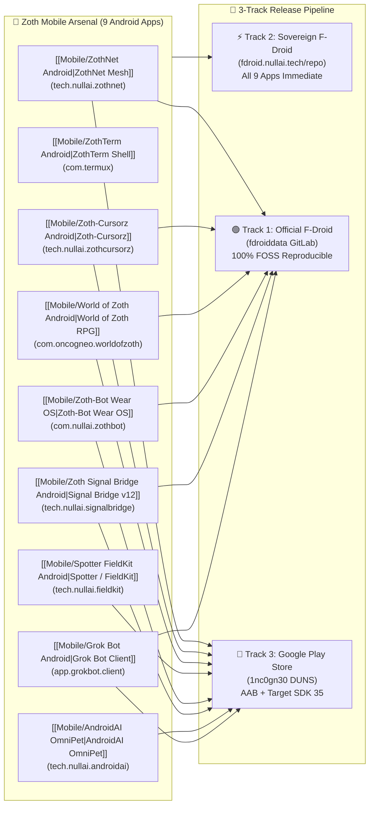

# 📱 Zoth Mobile Arsenal — Android APKs, F-Droid & Play Store Roadmap

> [!abstract] Executive Summary
> The **Zoth Mobile Arsenal** comprises **9 native and hybrid Android applications** (28 compiled `.apk` binaries across ARM64, ARMv7, x86, x86_64, and Wear OS) plus **8 mobile-first PWAs** across the `1nc0gn30` and `NullAITech` GitHub organizations. This canonical architectural specification documents every application's `applicationId`, SDK targets, permissions, cryptographic signing status, and the **3-Track Distribution Roadmap**:
> 1. **Track 1 — Official F-Droid Main Repository (`gitlab.com/fdroid/fdroiddata`)**
> 2. **Track 2 — Sovereign Self-Hosted F-Droid Repository (`https://fdroid.nullai.tech/repo`)**
> 3. **Track 3 — Google Play Store Production (`1nc0gn30` Organization Console)**

## Conceptual Distribution Architecture

## 1. Complete Technical Inventory of All 9 Android Applications

| # | Application Note | Current Package ID | Recommended Prod ID | Version (`code` / `name`) | SDK (`min` / `target` / `compile`) | Build Toolchain | Signing Key | Official F-Droid | Sovereign F-Droid | Google Play |
| :--- | :--- | :--- | :--- | :--- | :--- | :--- | :--- | :---: | :---: | :---: |
| **1** | [[Mobile/ZothNet Android\|ZothNet Sovereign Mesh]] | `tech.nullai.zothnet` | `tech.nullai.zothnet` | `12` / `1.2.0` *(fix empty attr)* | `26` / `34` / `34` | Go PIE `.so` + `aapt2`/`d8` | Debug (`4913ceed`) | 🟢 Ready | 🟢 Ready | 🟡 SDK 35 + FGS Video |
| **2** | [[Mobile/ZothTerm Android\|ZothTerm Sovereign Shell]] | `com.termux` | `com.termux` / `tech.nullai.zothterm` | `122` / `0.122.0` | `21` / `28` / `36` | Gradle 9.2.1 + NDK 29 | **RSA-4096 Release** (`ec7dce2d`) | 🟡 Rename + Bootstrap | 🟢 Ready | 🔴 Blocked (`targetSdk=28`) |
| **3** | [[Mobile/Zoth-Cursorz Android\|Zoth-Cursorz Android]] | `tech.nullai.zothcursorz` | `tech.nullai.zothcursorz` | `1` / `1.0.0` | `26` / `34` / `34` | Raw `aapt2`/`javac`/`d8` | Debug (`4913ceed`) | 🟢 Ready | 🟢 Ready | 🟡 Accessibility Video |
| **4** | [[Mobile/World of Zoth Android\|World of Zoth RPG]] | `com.oncogneo.worldofzoth` | `com.oncogneo.worldofzoth` | `5` / `0.3.1` | `24` / `34` / `34` | Esbuild + `aapt2`/`d8` | Custom (`1ecaf429`) | 🟢 Ready (0 Perms) | 🟢 Ready | 🟢 Fastest Approval |
| **5** | [[Mobile/Spotter FieldKit Android\|Spotter / NullAI FieldKit]] | `tech.nullai.fieldkit` | `tech.nullai.fieldkit` | `12` / `0.3.3` | `30` / `34` / `35` | Gradle 8.11.1 Kotlin | Debug (`4913ceed`) | 🔴 Needs `foss` flavor | 🟢 Ready | 🟡 Meta Prod App ID |
| **6** | [[Mobile/Zoth-Bot Wear OS\|Zoth-Bot Wear OS]] | `com.nullai.zothbot` | `com.nullai.zothbot` | `10` / `0.9.1` | `30` / `34` / `34` | Gradle Kotlin Wear OS | Debug (`4913ceed`) | 🟢 Ready | 🟢 Ready | 🟢 Ready (Wear Track) |
| **7** | [[Mobile/Zoth Signal Bridge Android\|Zoth Signal Bridge v12]] | `com.example.zothsignalbridge` | `tech.nullai.signalbridge` | `12` / `12.0.0` | `24` / `36` / `36` | Gradle + Compose Nav3 | Unsigned / Debug | 🟡 Rename `com.example` | 🟢 Ready | 🟡 Drop `INSTALL_PACKAGES` |
| **8** | [[Mobile/AndroidAI OmniPet\|AndroidAI (OmniPet)]] | `com.aistudio.omnipet.qrvwxz` | `tech.nullai.androidai` | `1` / `1.0` | `24` / `36` / `36` | Gradle + Compose + KSP | Upload / Debug | 🔴 Strip Firebase AI | 🟢 Ready | 🟡 Rename + FGS Video |
| **9** | [[Mobile/Grok Bot Android\|Grok Bot Linux & Android]] | `app.grokbot.client` | `tech.nullai.grokbot` | `1` / `0.1.0` | `24` / `35` / `35` | Vite + Capacitor 6.2.1 | Debug | 🟢 Ready | 🟢 Ready | 🟢 Ready |

---

## 2. Critical Audit Findings & Immediate Fixes

1. **`ZothNet` (`tech.nullai.zothnet`) Missing Manifest Version Attributes & Duplicate Binary**:
   - `zothnet-android/app/src/main/AndroidManifest.xml` currently omits `android:versionCode` and `android:versionName`, causing `aapt2 dump badging` to output `versionCode='' versionName=''`. Add `android:versionCode="12" android:versionName="1.2.0"`.
   - `package_apk.sh` copies `zothnet-android-arm64` into both `jniLibs/arm64-v8a/libzothnet.so` and `assets/zothnet-arm64`. Removing the duplicate `assets/zothnet-arm64` copy reduces APK size from `9.1 MB` to `4.5 MB`.
2. **`Zoth Signal Bridge` (`com.example.zothsignalbridge`) Package Namespace**:
   - Both F-Droid and Google Play reject `com.example.*` package IDs. Refactor `applicationId` and `namespace` to `tech.nullai.signalbridge`, and remove `android.permission.REQUEST_INSTALL_PACKAGES` for the Google Play flavor.
3. **`Spotter / NullAI FieldKit` (`tech.nullai.fieldkit`) Meta Wearables DAT SDK**:
   - Links against `com.meta.wearable:mwdat-core:1.0.1`, `mwdat-camera:1.0.1`, and `mwdat-mockdevice:1.0.1`. Because Meta's DAT SDK is closed-source binary code, split `app/build.gradle.kts` into `foss` (Phone Camera + MediaPipe Vision + Bluetooth Audio) and `meta` (Ray-Ban Meta DAT) product flavors so `foss` qualifies for Official F-Droid while `meta` ships on `fdroid.nullai.tech` and Google Play.
4. **Google Play `targetSdkVersion = 35` & `.aab` Conversion**:
   - Upgrade `targetSdkVersion` from `34` to `35` across `ZothNet`, `Zoth-Cursorz`, `World of Zoth`, and `Spotter / FieldKit`.
   - Use `aapt2 link --proto-format` + `bundletool build-bundle` to package raw `aapt2` builds (`ZothNet`, `Zoth-Cursorz`, `World of Zoth`) into signed `.aab` bundles without needing Gradle.

---

## 3. Bidirectional Knowledge Graph Links

- [[Zoth Android APKs & Mobile Store Roadmap.base|📊 Zoth Android APKs & Mobile Store Database (Obsidian Base)]]
- [[06-Wiki/Zero-Trust Supply Chain, Cosign & VirusTotal Verification|Zero-Trust Supply Chain, Cosign & VirusTotal Verification]]
- [[06-Wiki/ZothOS Sovereign Linux & Kernel Architecture|ZothOS Sovereign Linux & Kernel Architecture]]
- [[06-Wiki/Zoth Studio v2 & 71 Sovereign Micro-SaaS Tools|Zoth Studio v2 & 71 Sovereign Micro-SaaS Tools]]
- [[Zoth Trust & Supply Chain]]
- [[Public Surfaces]]
- [[00 Home]]
