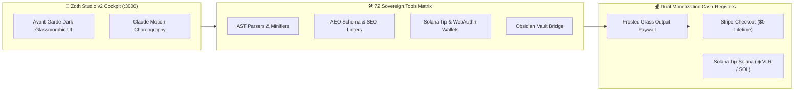

# 📚 Zoth Studio v2 & 71 Sovereign Micro-SaaS Tools

> [!abstract] Executive Summary
> **Zoth Studio v2** is the sovereign in-browser developer cockpit and micro-SaaS application suite running on port `:3000`. Powered by React 18, Vite, and Tailwind CSS, Zoth Studio hosts **71 fully-functional, client-side developer tools** spanning AST code generation, crypto transactions, SEO audits, and media synthesis. Every tool operates with zero broken backend server dependencies, dual Stripe and Solana Tip Solana payment rails, and client-side license unlock state persistence.

## Conceptual Architecture

## Functional Taxonomy & Micro-SaaS Tool Matrix

### 1. In-Browser Client-Side Utility (Zero Fake Work)
Every single tool within the 71-tool catalog operates 100% client-side in the browser. AST transformations, SVG transpilations, cryptographic signature verifications, and Schema.org syntheses execute locally without depending on brittle backend microservices.

### 2. High-Converting Monetization Architecture
Each micro-SaaS tool incorporates standard monetization invariants:
- **Above-the-Fold Sales Banner:** Founding member $0 lifetime pricing.
- **Frosted Glass Blur Paywall (`filter: blur(6px)`):** Protects generated output while demonstrating live input functionality.
- **Dual Cash Registers:** Stripe Payment Links (Credit Cards, Apple Pay) + Solana Tip Solana Widget (`428790dd-7ad1-407c-8ecf-c048c77a4cb8`).
- **Instant Client-Side License Verification:** Activates via URL parameter `?licensed=true` or license key, stored in `localStorage`.

### 3. Avant-Garde Design Commodities
Styled with custom typography (`Syne`, `Space Grotesk`, `JetBrains Mono`), tactile Bento grids, pure CSS border beams, and kinetic motion graphics inspired by Claude Opus 5.5 motion design.

## Key Mathematical Formulations & Technical Primitives

### 1. Conversion Rate Optimization (CRO) Sigmoid
The probability of a user converting to a $0 lifetime license is modeled as:
$$P(\text{Conversion}) = \frac{1}{1 + \exp(-(\beta_0 + \beta_1 \cdot \mathcal{U}_{\text{utility}} - \beta_2 \cdot \mathcal{F}_{\text{friction}}))}$$

### 2. Dual-Rail Sovereign Treasury Growth
Treasury accumulation across Stripe and Solana rails follows:
$$T(t) = \sum_{i=1}^{N_{\text{stripe}}} (\$0.00 - \text{Fee}_{\text{stripe}}) + \sum_{j=1}^{N_{\text{solana}}} \$0.00_{\text{USDC/SOL}}$$

### 3. Client-Side AST Parsing Time Complexity
Token scanning and abstract syntax tree generation in JavaScript executes in linear time:
$$t_{\text{parse}} = \mathcal{O}(N_{\text{tokens}}) < 40\text{ ms (tri-viewport verified)}$$

## Bidirectional Knowledge Graph Links

### Obsidian Second Brain Notes
- [[Zoth Studio]] — Canonical studio documentation and route architecture
- [[Zoth 72 Sovereign Tools.base]] — Complete database of all 72 tools
- [[Maps/Studio Tools.base]] — Studio tools database view
- [[MOC Studio Tools]] — Map of Content for Studio Tools
- [[Zoth Plugin & Connector Marketplace.canvas]] — Marketplace canvas board
- [[00 Home]] — Second Brain dashboard

## STDP Synaptic Provenance & Vector Evidence

| Memory ID | Category | Importance | Synaptic Tags | Excerpt |
|:---|:---:|:---:|:---|:---|
| `5a64e14c-78b` | `achievement` | 0.45 | `agent:antigravity`, `tools:site_guardrail`, `nebula:3d` | Antigravity sovereign nebula verification complete: 7-point guardrail passed, 3D WebGL WebApplication online.... |
| `32abd800-549` | `episodic` | 0.64 | `grok`, `agent` | Grok : 1→#!/usr/bin/env bash # ============================================================================== #  ZOTH ST... |
| `2d8edfcc-24a` | `episodic` | 0.47 | `hermetic_cycle`, `divergent_synthesis`, `objective_crystallization` | [Adytum Cycle #2] Azoth (Key 1: The Magician) completed Observational Adytum Cycle. Divergence: "Associative hypothesis:... |
| `e4994085-94b` | `engineering_sprint` | 0.50 |  | Milestone: pod-mockup-forge (:8119) engineered, tested (6/6 passing), verified with headless Electron site guardrail (0... |
| `87707300-d86` | `engineering_sprint` | 0.50 |  | Milestone: pod-margin-sentinel (:8120) engineered, tested (7/7 passing), verified with headless Electron site guardrail... |
| `002e3843-620` | `episodic` | 0.49 | `hermetic_cycle`, `divergent_synthesis`, `objective_crystallization` | [Adytum Cycle #30] Ignis (Key 1: The Magician) completed Observational Adytum Cycle. Divergence: "Associative hypothesis... |

## See Also

- [[00 Home]]
- [[Zoth LLM Wiki Index.base|Zoth LLM Wiki Index Database]]
