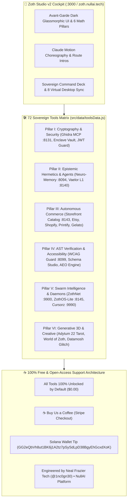

# 📚 Zoth Studio v2 & 72 Sovereign Micro-SaaS Tools

> [!abstract] Executive Summary
> **Zoth Studio v2** (`zoth.nullai.tech` / `http://127.0.0.1:3000`) is the sovereign in-browser developer cockpit and micro-SaaS engineering workstation. Built with React 19, Vite, MUI 5, and Three.js/WebGL, Zoth Studio hosts **72 fully-functional sovereign developer and security tools** spanning AST code generation, cryptographic verification, accessibility compliance, binary reverse engineering, print-on-demand commerce, and media synthesis. Every tool operates with **100% Free & Open Access (Zero Paywalls)**, supported exclusively by optional "☕ Buy Us a Coffee" patronage and Solana tip rails.

---

## Conceptual Architecture

---

## Functional Taxonomy & Core Pillars

### 1. In-Browser Client-Side Utility (Zero Fake Work)
Every tool within the 72-tool catalog functions genuinely. AST transformations, SVG transpilations, cryptographic key generations, and WCAG/APCA contrast math execute client-side or communicate with local sovereign loopback daemons (`127.0.0.1`). There are zero fake `setTimeout` placeholders or canned mock responses.

### 2. Directive 3 Support Architecture (Zero Paywalls)
In accordance with Neal Frazier Tech Autonomous Directive 3:
- **Zero Paywalls**: Never gate functionality behind paywalls, blurred output masks (`filter: blur(...)`), license key modals, or feature paywalls.
- **Unencumbered Utility**: Copying payloads, exporting CSV matrices, downloading SVG diagrams, and generating production configurations run unconditionally.
- **Support Rails**: Non-intrusive support options are provided across all footers and headers:
  - **Stripe "Buy Us a Coffee"**: `https://buy.stripe.com/3cIfZg27PdKo2D64Ocfw40X`
  - **Solana Tip Address**: `GG2eQbVh8ut1BK6j1A2tz7pSySdLpD38BgyEhGcxdXoK`
- **Professional Attribution**: `Engineered by Neal Frazier Tech (@1nc0gn30) • NullAI Platform`.

### 3. Key Tool Highlights (Updated Nov 8, 2026)
- **WCAG & APCA Contrast Guard Studio (`:8099`)**: Real WCAG 2.2 AA/AAA luminance contrast, APCA-W3 0.98G-4g perceptual lightness contrast ($L_c$), 8-deficiency Color Vision Deficiency simulation, CIEDE2000 auto-remediation, Focus Appearance (SC 2.4.13), and Target Size (SC 2.5.8) checkers. Integrated into Studio at `/tools/wcag-contrast-guard`.
- **GhidraMCP Binary Reverse Engineering Bridge (`:8131`)**: Real multi-engine binary analysis combining NSA Ghidra Headless, Radare2 `pdc` C pseudocode decompilation, GNU Binutils, and Bubblewrap sandboxing (`agent-capsule-jail`). Disassembles and decompiles arbitrary ELF/PE/Mach-O binaries with full MCP JSON-RPC 2.0 tool support.
- **YourDigitalSpace POD Master Catalog (`:8143`)**: Automated 10-SKU turnkey cashflow catalog (`data/live_drafts.json`, 89 KB) generating 62.6% net margins across Printify, Gelato, Etsy Open API v3, and Shopify GraphQL.
- **Open-Access Purge Across 7 Repositories**: Purged all vestigial paywalls across `etsy-connector`, `etsy-pod-forge`, `printify-connector`, `gelato-connector`, `mcp-lens`, `pod-smart-router`, and `schema-illustrator-studio` (221/221 tests passing).

---

## 72 Sovereign Tools Directory by Port & Route

| Tool ID | Name | Port / Route | Pillar | Access & Verification |
| :--- | :--- | :--- | :--- | :--- |
| `wcag-contrast-guard` | WCAG & APCA Contrast Guard Studio | `:8099` · `/tools/wcag-contrast-guard` | Pillar IV | 🟢 59/59 Tests · 100% Free |
| `ghidra-mcp-bridge` | GhidraMCP Reverse Engineering Bridge | `:8131` · `/tools/ghidra-mcp-bridge` | Pillar I | 🟢 19/19 Real Binary Tests |
| `storefront-catalog` | YourDigitalSpace POD Master Catalog | `:8143` · `/tools/storefront-catalog` | Pillar III | 🟢 40/40 Tests · $127 Net Profit |
| `neuro-memory-daemon` | Neuro-Memory STDP Cognitive Daemon | `:8094` · `/memory` | Pillar II | 🟢 38/38 Tests · 41,860 Engrams |
| `vaelor-network` | Vaelor L1 DAG & Patronage Lattice | `:8140` · `/tools/vaelor-network` | Pillar II | 🟢 33/33 Tests · Feeless DAG |
| `zothos-lite` | ZothOS-Lite A100 3D Web Desktop | `:8145` · `/zoth-os` | Pillar V | 🟢 In-Browser Web Desktop |
| `zothnet` | ZothNet Sphinx Mixnet Mesh | `:9900` · `/tools/zothnet` | Pillar V | 🟢 1,280B Onion Packets |
| `zoth-cursorz` | Zoth Cursorz Virtual Pointers | `:9990` · `/tools/zoth-cursorz` | Pillar V | 🟢 Multi-Agent Wayland/X11 |
| `zoth-civilization` | Zoth Civilization & Pantheon 21 | `:8120` · `:9393` · `/world` | Pillar VI | 🟢 8-Planet Star System |
| `adytum-22` | Adytum 22 Tarot 3D Engine | `/adytum` | Pillar VI | 🟢 22 BOTA Major Arcana |
| `etsy-connector` | Etsy Open API v3 Connector | `:8118` · `/tools/etsy-connector` | Pillar III | 🟢 47/47 Tests · Open-Access |
| `shopify-connector` | Shopify GraphQL Commerce Bridge | `:8119` · `/tools/shopify-connector` | Pillar III | 🟢 33/33 Tests · Open-Access |
| `printify-connector` | Printify POD Fulfillment Rail | `:8116` · `/tools/printify-connector` | Pillar III | 🟢 17/17 Tests · Open-Access |
| `gelato-connector` | Gelato Global POD Production Rail | `:8117` · `/tools/gelato-connector` | Pillar III | 🟢 17/17 Tests · Open-Access |
| `schema-illustrator-studio`| Schema.org & AEO Visualizer | `:8128` · `/tools/schema-illustrator-studio` | Pillar IV | 🟢 81/81 Tests · Open-Access |

---

## Bidirectional Knowledge Graph Links

- [[Zoth Studio]] — Master documentation and live route index
- [[Zoth OS]] — Sovereign Linux operating system integration
- [[Zoth 72 Sovereign Tools Tracker.base]] — Complete relational database of all 72 tools
- [[Studio/Tools/Studio wcag-contrast-guard]] — WCAG Studio note
- [[Studio/Tools/Studio ghidra-mcp-bridge]] — GhidraMCP note
- [[Studio/Tools/Studio storefront-catalog]] — Storefront catalog note
- [[06-Wiki/Obsidian Second Brain, JSON Canvas 1.0 & Bases Architecture]] — Second Brain & STDP bridge
