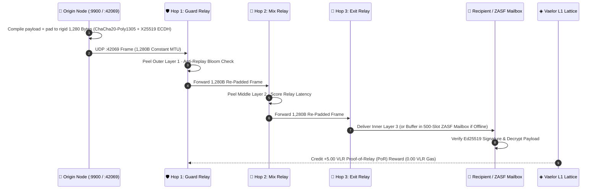

# 🧅 ZothNet v1.2.2 Sovereign Mesh, Vaelor L1 DAG & ZML Architecture (`RFC-ZOTH-0102`)

> [!abstract] Executive Summary
> **ZothNet (`v1.2.2`)** is a zero-DNS, cryptographically sovereign peer-to-peer overlay network (`~/NullAITech/zothnet`, [https://zothnet.nullai.tech](https://zothnet.nullai.tech), [https://github.com/1nc0gn30/zothnet](https://github.com/1nc0gn30/zothnet)) engineered to eliminate metadata surveillance, cellular single-points-of-failure, and payment processor rent-seeking. It unifies **1,280-byte constant-size Sphinx Mixnet onion routing**, **ChaCha20-Poly1305 + X25519 + Ed25519** primitives, the **[[Vaelor Network|Vaelor L1 Feeless Account-Lattice DAG]]** (`0.00 VLR` gas fees forever, `+5.00 VLR` Proof-of-Relay rewards), **ZML (`Zoth Markup Language`, [https://zml.nullai.tech](https://zml.nullai.tech))**, and native binaries across Linux, Windows, macOS, and **Android 17 API 37 PIE (`zothnet-arm64.apk`)** verified on **Google Pixel 10 Pro**.

Return to master index: [[00 Home]] · [[ZothNet Sovereign Mesh]].

---

## 1. End-to-End Protocol Stack (`RFC-ZOTH-0102`)



### 1.1 Rigid 1,280-Byte Constant-Size Sphinx Framing
Standard TLS/HTTPS and messaging protocols leak payload sizes and packet timing to ISP deep-packet inspection (DPI) and public Wi-Fi snoopers. ZothNet enforces a strict wire invariant:
$$\forall p \in \mathcal{P}_{\text{ZothNet}}, \quad |F(p)| = 1,280\text{ Bytes}$$
- **Header (`64 Bytes`)**: Version, frame type, ephemeral `X25519` public key ($32\text{ B}$), routing hop tag, and `Poly1305` MAC ($16\text{ B}$).
- **Encrypted Body + Deterministic Junk Padding (`1,216 Bytes`)**: Regardless of whether the user sends a 5-byte `"hello"` or a chunk of a ZothDrive file, the remaining bytes are filled with indistinguishable `ChaCha20` keystream padding so every frame matches the IPv6 minimum MTU (`1,280 B`).

### 1.2 Kademlia $\alpha=3$ XOR DHT, UDP `:42069` Beacons & RFC 5389 STUN
- **Local Zero-Bar Discovery (`pkg/discovery`)**: Broadcasts lightweight UDP beacons on port `42069` across LAN, Wi-Fi Direct, and mobile hotspots for sub-100ms neighbor handshakes with zero internet or DNS required.
- **Kademlia DHT (`pkg/dht`)**: 256 XOR distance buckets ($k=20$) with parallel $\alpha=3$ iterative lookups ($O(\log N)$ routing convergence):
  $$d(x, y) = x \oplus y \in \{0, 1\}^{256}$$
- **NAT Traversal**: Built-in RFC 5389 STUN reflexive WAN address discovery plus UPnP / NAT-PMP automatic port mapping.
- **ZASF Store-and-Forward Mailbox (`pkg/mesh/mailbox.go`)**: When a mobile recipient is offline or in deep sleep, intermediate relays buffer up to `500` encrypted frames (with configurable `1h`, `24h`, `7d`, or `perm` TTL) and flush them automatically upon peer reconnection.

---

## 2. Vaelor L1 Feeless Account-Lattice DAG & Proof-of-Relay (`PoR`)

Instead of a single global block queue that chokes under congestion and charges gas fees, ZothNet embeds the **[[Vaelor Network|Vaelor L1 Account-Lattice DAG]]** (`pkg/ledger`):
1. **Asynchronous Per-Account Micro-Chains**: Every node's `Ed25519` public key controls its own monotonic frontier chain of `SEND` and `RECV` blocks.
2. **Strict Balance Conservation**:
   $$\sum_{i \in \text{Accounts}} \Delta B_i = \Delta B_{\text{send}} + \Delta B_{\text{recv}} = 0$$
3. **Sub-18ms Finality (`14.2ms` Measured Average) & `$0.00` Gas Forever**: Zero mempool fee auctions; anti-spam is enforced via a fast sub-20ms SHA-256 micro-stamp and token-bucket rate limiter.
4. **`+5.00 VLR` Proof-of-Relay (`PoR`) Incentives**: Nodes that route multi-hop Sphinx and GossipSub packets earn `+5.00 VLR` rewards, turning every spare phone or VPS into a self-sustaining relay anchor.

---

## 3. Broadcast Mesh Topics, Quick Signals & 5 "Regular Joe" First Flight Scenarios

### 3.1 Six GossipSub ($D=6$) Broadcast Channels
1. 🌐 **`#all`** — Unified mesh horizon stream.
2. 📢 **`#general`** — Public community square.
3. 🚨 **`#emergency`** — High-priority SOS, storm outage, and road hazard broadcasts.
4. 🤝 **`#trade`** — Local yard-sale, farmers market, and barter offers with inline `◈ VLR` settlement.
5. 🌲 **`#off-grid`** — 0-bar cellular blackout radio relay coordination.
6. 🛠️ **`#dev`** — ZML app announcements, CAS Merkle CIDs, and node telemetry.
- **Quick Signal Toolbar**: `🚨 SOS Alert`, `◈ Request VLR`, `📍 Drop Pin`, `🤝 Barter`, `📎 CAS File`.

### 3.2 Five "Regular Joe" First Flight Interactive Scenarios
Built directly into `pkg/web/dashboard.html` (`openOnboardingModal(0)`):
1. **Scenario 1 — Hurricane & Grid Outage (`🌪️`)**: Demonstrates `0 Bars (No SIM)` ad-hoc multi-hop relay (`Your Phone ➔ Neighbor 1 (60 yds) ➔ Neighbor 2 (140 yds) ➔ Mom's Phone (300 yds)`).
2. **Scenario 2 — Stadium 5G Congestion (`🏟️`)**: Interactive crowd slider (`1,000`–`85,000` fans) showing how ZothNet achieves `100% ROUTE SURPLUS` (`8ms` wave-hop) while traditional 5G towers jam at `99.4%`.
3. **Scenario 3 — Yard Sale & Farmers Market (`🤝`)**: Interactive `💧 Claim +25.00 VLR Faucet` and `⚡ Tap to Pay 35.00 VLR` for a *Vintage 10-Speed Road Bicycle* with `$0.00` fees and instant offline finality.
4. **Scenario 4 — Public Wi-Fi Snooper Shield (`☕`)**: Live byte gauge proving that any sensitive text is padded to exactly `1,280 Bytes` on the wire.
5. **Scenario 5 — Neighborhood SOS & Beacon (`🚨`)**: 1-click local GossipSub alerts (*Lost Golden Retriever*, *Fallen Tree on Oak Ave*, *Free Generator Power & Warm Soup*) with zero accounts or phone numbers.

---

## 4. ZML (Zoth Markup Language) Reactive Compiler (`1.4ms`)

**ZML** (`pkg/apps/zml.go`, [https://zml.nullai.tech](https://zml.nullai.tech), [https://zothnet.nullai.tech/zml/](https://zothnet.nullai.tech/zml/)) compiles declarative plain-English directives into sandboxed, zero-cloud P2P web apps in `1.4ms`:

| Directive | Compiled Output & Behavior |
| :--- | :--- |
| `@app` / `@slug` / `@desc` | App manifest metadata & `zoth://<slug>` Omnibar route registration |
| `AMBIENT_DEVICE_AUTH` | Zero-password Ed25519 hardware passport authentication via `ZothSDK` `postMessage` bridge |
| `DITHER_BANNER` / `BRAILLE_RADAR` | Ordered Bayer dither banner & 60fps Unicode `U+2800` Braille telemetry indicator |
| `GRID(N)` / `ITEM` | Responsive merchant product cards locked to the host node's Vaelor L1 address |
| `PAY_LINK` / `LOCKED_PAY_LINK` | 1-click feeless `◈ VLR` DAG checkout button with cryptographic receipt generation |
| `CART_BAR` / `RECEIPT_BOX` / `COFFEE_BUTTON` | Built-in shopping cart, SHA-256 receipt verifier, and optional Stripe/Solana support bar |

---

## 5. Android 17 (API 37) PIE Native APK & 24/7 Relay Node Guide

### 5.1 Android 17 API 37 PIE Architecture (`~/NullAITech/zothnet-android/package_apk.sh`)
- **Position Independent Executable (`-buildmode=pie`)**: Compiled via `CGO_ENABLED=0 GOOS=android GOARCH=arm64 go build -buildmode=pie -ldflags="-s -w"` and bundled at `lib/arm64-v8a/libzothnet.so` to satisfy strict SELinux `W^X` enforcement on Android 15, 16, and **Android 17 (API 37)**, verified on **Google Pixel 10 Pro**.
- **24/7 Persistence Services (`ZothNetService.java` & `MainActivity.java`)**:
  - `ForegroundService` (`zothnet_mesh_channel`) prevents background process termination.
  - `PowerManager.PARTIAL_WAKE_LOCK` (`ZothNet::MeshKeepAlive`) keeps UDP `:42069` and Kademlia DHT alive during screen-off deep sleep.
  - `WifiManager.MulticastLock` (`ZothNetMulticast`) enables automatic LAN/hotspot beacon discovery.
  - Signed with `apksigner` (`v1 + v2 + v3 + v4` signing schemes).

### 5.2 Dedicated 24/7 Relay Deployment (Moto G 2025, Moto G Stylus, Linux VPS)
- **Moto G 2025 / Moto G Stylus 24/7 Home & Field Relay**:
  1. Install [`zothnet-arm64.apk`](https://zothnet.nullai.tech/downloads/zothnet-arm64.apk) (`adb install -r zothnet-arm64.apk`).
  2. Set **Settings → Apps → ZothNet → Battery → Unrestricted**.
  3. Leave plugged into USB power or a solar battery bank; the phone continuously relays 1,280B Sphinx frames, caches ZASF offline mailbox messages, and earns `+5.00 VLR` PoR rewards.
- **Linux VPS 24/7 WAN Anchor**:
  ```bash
  curl -fsSL https://zothnet.nullai.tech/install.sh | bash
  zothnet run --alias "VPS-WAN-Relay" --port 42069
  ```

---

## Related Notes

- [[00 Home]] · [[ZothNet Sovereign Mesh]] · [[Vaelor Network]] · [[Public Surfaces]] · [[Zoth OS]]
- [[ZothNet & Vaelor Sovereign Mesh Architecture.canvas]]
