# 📚 ZothOS Sovereign Linux & Kernel Architecture

> [!abstract] Executive Summary
> **ZothOS** is a sovereign, low-latency Linux operating system and developer workstation environment engineered for autonomous AI agency, zero-egress local privacy, and deterministic developer cockpits. Built on a performance-tuned Preempt-RT kernel with decoupled cgroups and isolated systemd service units, ZothOS orchestrates the 5 sovereign fleet daemons (`:8094`, `:8140`, `:3000`, `:5173`, `:9393`) across eight dedicated desktop rooms (Forge through Sanctum).

## Conceptual Architecture

```mermaid
flowchart LR
    subgraph HardwareKernel["⚡ Hardware & Linux Kernel"]
        CPU["Preempt-RT Scheduler<br/>(<50μs Jitter)"]
        Net["eBPF Socket Filter<br/>Loopback Zero-Egress"]
    end
    
    subgraph ConductorDaemons["🛡️ Conductor & Fleet Daemons"]
        D1["neuro-memory (:8094)"]
        D2["vaelor-lattice (:8140)"]
        D3["zoth-studio-v2 (:3000)"]
        D4["bolt-diy (:5173)"]
        D5["civilization (:9393)"]
    end
    
    subgraph DesktopsRooms["🖥️ 8 Workstation Desktops"]
        R1["1: Forge (Core Dev)"]
        R2["2: Studio (Micro-SaaS)"]
        R3["3: Brain (Obsidian)"]
        R4["4: Mesh (Civilization)"]
        R5["8: Sanctum (Security)"]
    end
    
    HardwareKernel --> ConductorDaemons
    ConductorDaemons --> DesktopsRooms
```

## Functional Taxonomy & Operating System Architecture

### 1. Preempt-RT Low-Latency Kernel
Configured with hard real-time preemption (`CONFIG_PREEMPT_RT=y`), the ZothOS kernel minimizes scheduling latency for audio synthesis, WebGL rendering, and local neural inference loops. Deterministic thread scheduling prevents background daemon spikes from degrading operator responsiveness.

### 2. Zero-Egress Loopback Architecture
All inter-daemon telemetry and Model Context Protocol (MCP) data remains strictly bound to localhost loopback (`127.0.0.1`). Network egress is mathematically gated by eBPF socket filters, guaranteeing zero telemetry leaks.

### 3. Conductor Daemon Orchestration
The operating system hosts 5 core systemd services:
- **`neuro-memory` (`:8094`):** Biological STDP memory substrate and Hebbian learning.
- **`vaelor-lattice` (`:8140`):** Feeless Account-Lattice DAG and PoUW compute minting.
- **`zoth-studio-v2` (`:3000`):** In-browser micro-SaaS developer IDE and workbench.
- **`bolt-diy` (`:5173`):** AI code synthesis and real-time execution engine.
- **`zoth-civilization` (`:9393`):** Multi-agent society and emergence simulator.

### 4. Eight-Desktop Room Matrix
ZothOS partitions cognitive work across 8 dedicated virtual desktops:
- `Ctrl+F1` Forge · Core system engineering
- `Ctrl+F2` Studio · Micro-SaaS tools
- `Ctrl+F3` Sanctum · Key management and security
- `Ctrl+F4` Civilization · Autonomous agent evolution

## Key Mathematical Formulations & Technical Primitives

### 1. Real-Time Bounded Execution Jitter
Under continuous compute load, task scheduling jitter $J$ satisfies:
$$J = |t_{\text{actual}} - t_{\text{scheduled}}| < J_{\max} \quad (J_{\max} \le 50\ \mu\text{s})$$

### 2. eBPF Packet Filtering Complexity
Loopback socket inspection operates in constant time:
$$\Delta t_{\text{filter}} = \mathcal{O}(1) < 0.2\ \mu\text{s}$$

### 3. Thermal Dissipation & Power Budget
Dynamic CPU power dissipation $P(t)$ is constrained to prevent thermal throttling:
$$P(t) = C \cdot V^2 \cdot f + P_{\text{static}}, \quad T_{\text{core}} < 60^\circ\text{C}$$

## Bidirectional Knowledge Graph Links

### Obsidian Second Brain Notes
- [[Zoth OS]] — Master operating system overview and configuration notes
- [[OS/Daemons/Daemon civilization]] — Civilization service daemon
- [[OS/Desktops/Desktop zoth-civilization]] — Desktop room assignment
- [[Zoth Fleet & Daemons.base]] — Fleet daemon port registry
- [[Zoth 6 Mathematical Pillars.canvas]] — Six mathematical pillars board
- [[00 Home]] — Dashboard and master graph entrypoint

## STDP Synaptic Provenance & Vector Evidence

| Memory ID | Category | Importance | Synaptic Tags | Excerpt |
|:---|:---:|:---:|:---|:---|
| `d4e48414-e34` | `kernel` | 0.88 | `kernel`, `forged`, `stdp` | Sovereign Ring-0 Enclave synthesized in Netrunner 3D World for Kernel cluster.... |
| `5a64e14c-78b` | `achievement` | 0.27 | `agent:antigravity`, `tools:site_guardrail`, `nebula:3d` | Antigravity sovereign nebula verification complete: 7-point guardrail passed, 3D WebGL WebApplication online.... |
| `ee0d8449-415` | `episodic` | 0.49 | `grok`, `agent` | Grok : 1→{   "name": "zoth-os-website",   "private": true,   "version": "3.2.0",   "type": "module",   "description": "Z... |
| `d1370365-9c2` | `episodic` | 0.25 | `hermetic_cycle`, `divergent_synthesis`, `objective_crystallization` | [Adytum Cycle #6] Onyx (Key 17: The Star) completed Observational Adytum Cycle. Divergence: "Associative hypothesis: mer... |
| `9226614d-930` | `episodic` | 0.27 | `hermetic_cycle`, `divergent_synthesis`, `objective_crystallization` | [Adytum Cycle #7] Ignis (Key 0: The Fool) completed Observational Adytum Cycle. Divergence: "Associative hypothesis: mer... |
| `9eaa6589-ce7` | `episodic` | 0.27 | `hermetic_cycle`, `divergent_synthesis`, `objective_crystallization` | [Adytum Cycle #19] Lycan (Key 0: The Fool) completed Observational Adytum Cycle. Divergence: "Imaginative synthesis: wha... |

## See Also

- [[00 Home]]
- [[Zoth LLM Wiki Index.base|Zoth LLM Wiki Index Database]]
