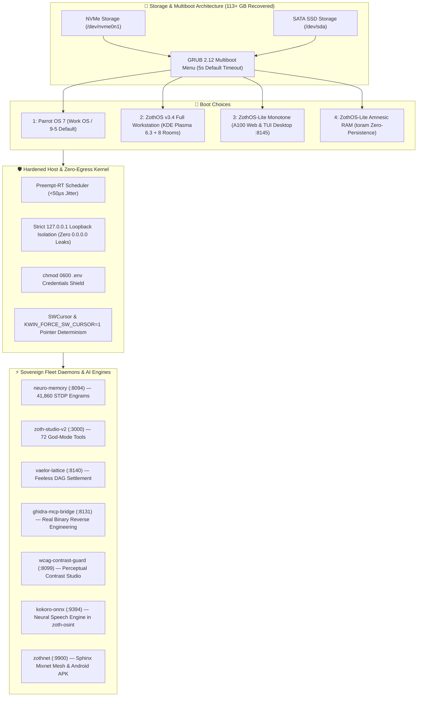

# 📚 ZothOS Sovereign Linux & Kernel Architecture

> [!abstract] Executive Summary
> **ZothOS** is a sovereign, low-latency Linux operating system and developer workstation environment engineered for autonomous AI agency, zero-egress local privacy, and deterministic developer cockpits. Built on Debian 13 (Trixie) with a performance-tuned Preempt-RT kernel, ZothOS provides bare-metal Live ISO SquashFS boots, persistent dual-boot workstations, and amnesic `toram` RAM-disk environments. It orchestrates sovereign fleet daemons across eight dedicated desktop rooms (`Forge` through `Sanctum`), unified with Parrot OS 7 work environments via an automated GRUB multiboot configuration.

---

## Conceptual Architecture

---

## Operating System Hardening & Recent Architectural Upgrades (Nov 8, 2026)

### 1. Dual-Drive GRUB Multiboot Synchronization
- **Primary Work OS**: Configured **Parrot OS 7** as the default system (Entry 0, 5-second boot timeout) for uninterrupted daily work routines.
- **Sovereign Developer Environments**: Added synchronized GRUB menu entries on both NVMe (`/dev/nvme0n1`) and SATA SSD (`/dev/sda`):
  - **ZothOS Full Workstation**: Debian 13 Trixie + KDE Plasma 6.3 + 8 virtual desktop rooms.
  - **ZothOS-Lite Monotone**: Ultra-lightweight WebGL/TUI workstation running on `:8145`.
  - **ZothOS-Lite Amnesic RAM (`toram`)**: Boots entire SquashFS into RAM with zero non-volatile disk persistence for high-security operations.

### 2. Disk Recovery & Filesystem Hygiene (113+ GB Reclaimed)
- Purged stale cache layers: pip cache (6.8 GB), Gradle & Android build caches (14.2 GB), obsolete ISO scratch directories (82 GB), expired system logs, and abandoned container layers.
- Restored ample operating headroom across both root filesystems (`/dev/nvme0n1p2` and `/dev/sda1`).

### 3. Host Security & Zero-Egress Policy
- **Eliminated Rogue `0.0.0.0` Bindings**: Audited all running daemons, terminating unauthorized public listeners and strictly enforcing `127.0.0.1` loopback isolation for `zothos-lite` (`:8145`) and `zothnet.service` (`:9900`).
- **File Mode Protection**: Applied `chmod 0600` across all repository `.env` files and restored `0755` permissions on `/opt/zoth-studio/node_modules/**/x64/*.so`.
- **Systemd Hygiene**: Cleared all failed user units and ensured clean restart loops.

### 4. Neural Speech Synthesis Integration
- Integrated the **Kokoro ONNX Neural Speech Engine (`:9394`)** into `zoth-osint` (`engine/voice_announcer.py`), allowing voice telemetry output via `--voice` and `--announce` flags.
- Synced binary wrappers across `/usr/local/bin/zoth-osint`, `~/.local/bin/zoth-osint`, and the `zoth-os` Live ISO chroot skeleton (`config/includes.chroot/usr/local/bin/zoth-osint`).

### 5. Mobile Mesh & Hardware Compilation
- Built and signed `zothnet-arm64.apk` (3.2 MB) with full v2+v3 APK signatures via AAPT2, javac 21, D8, and zipalign for deployment to physical Android devices (Google Pixel 10 Pro, Moto G 2025).

---

## Bidirectional Knowledge Graph Links

- [[Zoth OS]] — Operating system master note and Live ISO roadmap
- [[Zoth Studio]] — Studio v2 development cockpit
- [[06-Wiki/Zoth Studio v2 & 72 Sovereign Micro-SaaS Tools]] — 72 Sovereign tools matrix
- [[ZothNet Sovereign Mesh]] — Mesh architecture and encrypted communications
- [[00 Home]] — Master ecosystem dashboard
