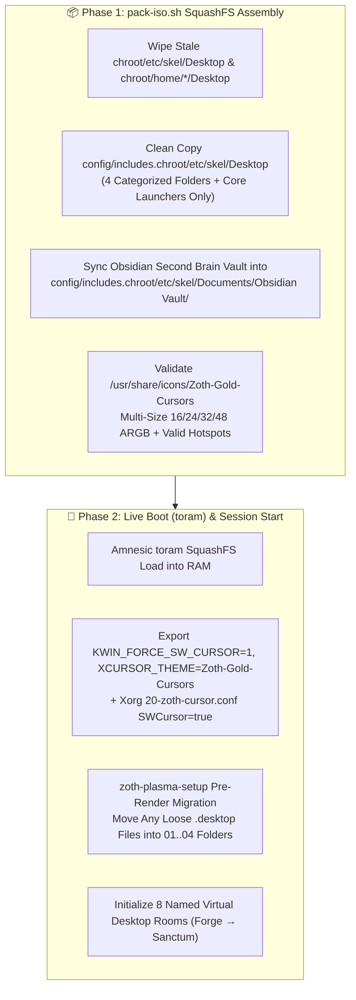

# 🛡️ ZothOS v3.4 & ZothOS-Lite A100 Desktop Hardening Architecture

> [!abstract] Executive Summary
> **[[Zoth OS|ZothOS v3.4.0]]** (19 GB Debian 13 Trixie + KDE Plasma 6.3 / XFCE Live ISO) and **[[ZothOS-Lite Web Desktop|ZothOS-Lite v1.1.0]]** (`<800 MB RAM` A100 3D Web & Docker Desktop on `:8145`) enforce strict deterministic desktop engineering invariants:
> 1. **Deterministic `~/Desktop` Folder Hierarchy** (`01`–`04` categorized folders with zero loose icon regressions).
> 2. **Xcursor Binary Integrity & Universal Cursor Visibility** (`16×16`–`48×48` ARGB bitmaps + `KWIN_FORCE_SW_CURSOR=1` + `Option "SWCursor" "true"`).
> 3. **Amnesic `toram` SquashFS Boot Hygiene & Zero-PII Chroot Parity**.
> 4. **72-Tool CLI, Unicode `U+2800` Braille TUI (`<tool>-tui`), and Zoth Cursorz (`:9990`) Multi-Agent Pointer Integration**.

Return to master index: [[00 Home]] · [[Zoth OS]] · [[ZothOS-Lite Web Desktop]] · [[Repo vs Live OS]].

---

## 1. Live ISO Build & Desktop Initialization Pipeline

---

## 2. Deterministic `~/Desktop` Folder Architecture

### 2.1 Root Causes Eliminated in v3.4
1. **`rsync` Without `--delete` on Desktop Skeletons**: Previously, running `rsync -aHAX config/includes.chroot/ chroot/` without wiping `chroot/etc/skel/Desktop` allowed legacy loose `.desktop` files from older builds to persist in the SquashFS image.
2. **Stale `positions` in `plasma-org.kde.plasma.desktop-appletsrc`**: Hardcoded `desktop:/...` entries for removed files caused KDE Plasma 6 Folder View to re-index and jump icons 3–5 seconds after login.
3. **Conflicting Autostart Scripts**: Running XFCE commands (`xfconf-query`, `xfdesktop --reload`, `picom`) inside Plasma or invoking `plasmashell --replace` after session start caused visual flicker.

### 2.2 The 4 Canonical Desktop Folders
`pack-iso.sh` and `zoth-plasma-setup` guarantee that `~/Desktop` contains only the curated core launchers plus four organized folders:
- 📁 **`01-AI-Agents-and-Dev/`** — Zoth Studio v2, Hermes Agent, Zoth WebGen, Bolt, Neuro-Memory, Zoth Cursorz
- 📁 **`02-Security-and-Privacy/`** — HexStrike AI, Anderson Sentinel, GhidraMCP, Caido, YARA-X Forge, ZothNet Mesh
- 📁 **`03-ZothOS-Daemons/`** — Zoth Control Center, Zoth Cockpit, Tool Nexus, Vaelor L1, Obsidian Tracker (`:8151`)
- 📁 **`04-Media-and-Utilities/`** — PixelCast, AudioCipher, Datamosh Glitch, ASCII Magic, Scene Foundry

---

## 3. Xcursor Binary Integrity & Multi-Agent Virtual Cursors

### 3.1 Hardware/Software Cursor Guarantees
- **Multi-Size ARGB Xcursor Validation**: Every cursor file in `/usr/share/icons/Zoth-Gold-Cursors/cursors/` embeds complete `16×16`, `24×24`, `32×32`, and `48×48` ARGB bitmaps with verified hotspots (`xhot < width`, `yhot < height`) and complete X11/Wayland/GTK/Qt symlinks (`default`, `left_ptr`, `text`, `xterm`, `pointer`, `hand2`, `grab`, `grabbing`, `wait`, `progress`, `crosshair`, `size_hor`, `size_ver`, `size_fdiag`, `size_bdiag`, `dnd-move`, `not-allowed`).
- **VM & Bare-Metal GPU Fallback**:
  - `/etc/environment` & `/etc/profile.d/zoth-cursor.sh`: `KWIN_FORCE_SW_CURSOR=1`, `XCURSOR_THEME=Zoth-Gold-Cursors`, `XCURSOR_SIZE=24`.
  - `/etc/X11/xorg.conf.d/20-zoth-cursor.conf`: `Option "SWCursor" "true"` across modesetting, VirtIO, QXL, and VMware drivers.

### 3.2 Zoth Cursorz (`:9990`) Multi-Agent Pointer Engine
- Spawns up to **16 concurrent virtual agent cursors** (`zoth-cursorz spawn`, `move`, `click`, `overlay`) backed by `/dev/shm/zoth_cursorz.json` shared memory, 60fps Electron transparent overlay, 3D Bayer-dithered Braille hologram trails, OpenCV landmark drift alignment (`<= 60px`), and Android `AccessibilityService` APK parity (`zoth-cursorz-arm64.apk`).

---

## 4. ZothOS-Lite v1.1 A100 3D Web Desktop (`:8145`)

**[[ZothOS-Lite Web Desktop|ZothOS-Lite v1.1]]** (`~/NullAITech/zothos-lite`, [https://zothos.nullai.tech](https://zothos.nullai.tech)) brings the ZothOS experience directly to the browser and lightweight Docker containers (`<800 MB RAM`):
- **60fps 3D WebGL Lattice & Braille Merkaba Desktop**: Hardware-accelerated background with theme switching (`Sovereign Gold`, `Netrunner Cyan`, `Ghost Emerald`, `Ivory Alchemist`).
- **8 Built-in Sovereign Desktop Apps**: Sovereign Terminal (`POST /api/exec`), Pantheon 21 Agent Swarm Dock (`/api/pantheon`), Adytum 22 Tarot Oracle, 72-Tool App Center, Neuro-Memory Explorer (`:8094`), System Telemetry Monitor (`/api/telemetry`), File Explorer, and Theme Switcher.

---

## Related Notes

- [[00 Home]] · [[Zoth OS]] · [[ZothOS-Lite Web Desktop]] · [[Repo vs Live OS]] · [[Zoth Studio]]
