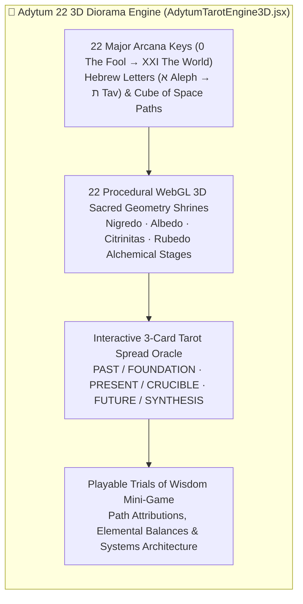

# 🔮 Adytum 22 Major Arcana 3D Tarot Diorama & Trials Engine (`/adytum` & `:8099`)

Interactive **3D WebGL Hermetic Sanctuary**, **B.O.T.A. (Builders of the Adytum) Major Arcana Diorama**, and playable **Trials of Wisdom** video-game engine spanning all **22 Major Arcana Keys (`0 The Fool` → `XXI The World`)** inside **[[Zoth Studio]] (`/adytum`)**, **[[Zoth Civilization & Pantheon 21]] (`:8120` / `:9393`)**, **[[ZothOS-Lite Web Desktop]] (`:8145`)**, and the standalone **Adytum Alchemist AI Workflow (`:8099`)**.

> [!tip] Live Routes & Repositories
> - **Zoth Studio v2 3D Sanctuary**: `http://127.0.0.1:3000/adytum` ([https://zoth.nullai.tech/adytum](https://zoth.nullai.tech/adytum))
> - **Standalone Repository & CLI**: `~/NullAITech/adytum-alchemist-ai-workflow` (`adytum` / `adytum-tui` on `:8099`)
> - **3D Engine Modules**: `src/components/AdytumTarotEngine3D.jsx` + `src/data/adytumArcana3DData.js`

---

## 1. Architecture of the 22 Hermetic Shrines

---

## 2. Core Capabilities

1. **22 Procedural 3D Sacred Geometry Dioramas**:
   - Every Arcana Key (`0`–`21`) renders a bespoke 3D holographic shrine, Hebrew letter glyph (`א` Aleph → `ת` Tav), Tree of Life / Cube of Space directional correspondence, alchemical stage (`Nigredo`, `Albedo`, `Citrinitas`, `Rubedo`), and paired [[Zoth Civilization & Pantheon 21|Pantheon 21]] sovereign agent.
2. **Interactive 3-Card Tarot Spread Oracle (`PAST / FOUNDATION`, `PRESENT / CRUCIBLE`, `FUTURE / SYNTHESIS`)**:
   - Deterministic + cryptographic entropy-seeded 3D card flip choreography with synthesized architectural counsel for systems engineering and security decisions.
3. **Playable Trials of Wisdom (Hermetic Video-Game Mode)**:
   - Interactive challenge mode testing path attributions, elemental balances, and systems architecture correspondences across all 22 Keys with score tracking and mastery badges.
4. **Subconscious & Superconscious Agent Grounding**:
   - In [[Zoth Civilization & Pantheon 21]], agents cycle sequentially through Keys `0` to `21` inside the Adytum Initiation Chamber, consolidating associative STDP memories via [[Zoth Memory]] (`:8094`) before executing code changes.

---

## Related Notes

- [[00 Home]] · [[Zoth Studio]] · [[Zoth Civilization & Pantheon 21]] · [[World of Zoth]] · [[ZothOS-Lite Web Desktop]]
- [[06-Wiki/World of Zoth, Pantheon 21 & Adytum 22 3D Multi-World Architecture]]
- [[Maps/Adytum.canvas|Adytum Canvas]] · [[Maps/Adytum.base|Adytum Base]]
