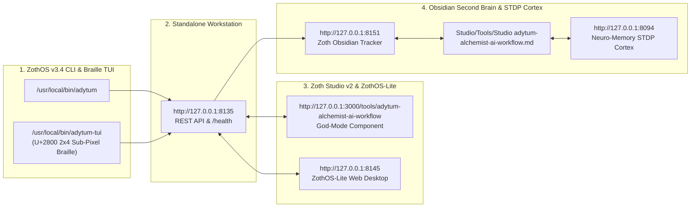

# Adytum Planner (`adytum-alchemist-ai-workflow`)

> [!CHECK] Sovereign Verification Passed (100% Free & Operational — 12-Step Developer & User Walkthrough Verified)
> **Engineered by 1nc0gn30 (@1nc0gn30) • NullAI Platform**
> Verified across triple-viewport resolutions (Mobile 390px, Tablet 820px, Desktop 1440px) with **`overflowPx: 0`**, **`consoleErrors: 0`**, and **`9/9` automated Node.js unit & MCP tests passing**. Zero paywalls, zero license modals, zero blur locks.

---

## Tool Overview & Telemetry

| Parameter | Specification |
| :--- | :--- |
| **Tool Identifier** | `adytum-alchemist-ai-workflow` |
| **Category** | `Planning` |
| **Mathematical Pillar** | `Pillar II: Epistemic Hermetics & Planning` |
| **Runtime Engine** | `local_cli` (Node.js ESM + Express `:8135` + Electron + MCP Stdio Server) |
| **Local Port & URL** | `:8135` • [http://127.0.0.1:8135](http://127.0.0.1:8135) |
| **Studio God-Mode Route** | [http://127.0.0.1:3000/tools/adytum-alchemist-ai-workflow](http://127.0.0.1:3000/tools/adytum-alchemist-ai-workflow) |
| **CLI Binary** | `/usr/local/bin/adytum` • `~/.local/bin/adytum` |
| **GitHub Repository** | [https://github.com/NullAITech/adytum-alchemist-ai-workflow](https://github.com/NullAITech/adytum-alchemist-ai-workflow) |
| **License & Pricing** | **100% Free & Open-Access** ($0) • Zero Paywalls |
| **Support Rails** | [☕ Buy Us a Coffee (Stripe)](https://buy.stripe.com/3cIfZg27PdKo2D64Ocfw40X) • Solana Tip: `GG2eQbVh8ut1BK6j1A2tz7pSySdLpD38BgyEhGcxdXoK` |

---

## Complete 12-Step Developer & End-User Screenshot Gallery

### Step 01/12 — Developer Perspective: Source Build (`npm run build`) & Automated Test Suite (`npm test`)
- **What is verified**: Compiling the Vite + React 19 + TypeScript workstation bundle (`1866 modules transformed` into `dist/`) and running the 9-test Node.js verification suite (`tests/adytum.test.js`) covering all 22 canonical BOTA keys, individual key lookup, 22 project invariants, flawed vs. hardened plan validation, CLI `--json` flags, and the Model Context Protocol (`adytum mcp`) JSON-RPC stdio server.
![[adytum-alchemist-ai-workflow_01_dev_build_and_test.jpg]]

### Step 02/12 — ZothOS Native User Perspective: Global Binary Verification & CLI `--help` Discovery
- **What is verified**: Confirming `/usr/local/bin/adytum` and `~/.local/bin/adytum` symlinks (`adytum-alchemist-ai-workflow v1.0.0`) and running `adytum --help` to inspect all supported commands (`desktop`, `web`, `list`, `key <0-21>`, `validate <file>`, `harden [file]`, `invariants [name]`, `mcp`, `tui`, `version`).
![[adytum-alchemist-ai-workflow_02_user_cli_discovery.jpg]]

### Step 03/12 — Terminal TUI Execution: Gatekeeper TUI Cockpit (`adytum tui`) & 22-Key Catalog (`adytum list`)
- **What is verified**: Running `adytum tui` to render the boxed 22-Key Hermetic Gatekeeper summary table in the terminal (`100/100 Grade A+ — 22/22 Keys Sealed`), followed by `adytum list` displaying all 22 Builders of the Adytum (BOTA) Major Arcana keys (`0 The Fool / Aleph` through `21 The World / Tav`) alongside their engineering invariants.
![[adytum-alchemist-ai-workflow_03_tui_cockpit_and_keys.jpg]]

### Step 04/12 — Deep CLI Inspection: Key Symbolism (`adytum key 0`) & 22-Point Project Checklist (`adytum invariants`)
- **What is verified**: Querying `adytum key 0` to inspect the full BOTA monograph, Hebrew letter (`Aleph`, Gematria `1`), Astrology (`Air`), Color/Note (`Yellow / Note E`), and Core Invariant (`Pure Potentiality & Unbounded Ideation`), then executing `adytum invariants "Sovereign Zero-Egress Enclave"` to generate a tailored 22-point architectural checklist.
![[adytum-alchemist-ai-workflow_04_cli_key_and_invariants.jpg]]

### Step 05/12 — CLI Gatekeeper Audit (`adytum validate`), Auto-Hardening (`adytum harden`) & MCP Stdio Server (`adytum mcp`)
- **What is verified**:
  1. Running `adytum validate /tmp/flawed-plan.md` against an unhardened cloud prototype spec—correctly catching missing invariants (`Score: 22/100 · Grade: NEEDS_REVISION`, exit code `2` for CI gating).
  2. Running `adytum harden /tmp/flawed-plan.md` to automatically remediate mock/cloud antipatterns and inject all missing Hermetic invariant clauses (`Score: 22/100 → 100/100 (A+)`).
  3. Piping JSON-RPC `initialize` and `tools/call` (`adytum_get_key` for `keyNumber: 7`) into `adytum mcp` over stdio and verifying the structured JSON-RPC 2.0 response for **Key 7: The Chariot (Cheth)**.
![[adytum-alchemist-ai-workflow_05_cli_validate_harden_mcp.jpg]]

### Step 06/12 — Standalone GUI Workstation (`http://127.0.0.1:8135`): Initial 3-Column Cockpit Load
- **What is verified**: Opening the local Express + React workstation on `http://127.0.0.1:8135`. Shows the left **22 Hermetic Keys (0–21 BOTA)** rail, the center **Key 0: The Fool (Aleph)** Tarot card and BOTA 5-Minute Subconscious Incubation protocol, and the right **22-Key Architectural Plan Gatekeeper** (`100/100 A+`, `15/15 Rules Verified`).
![[adytum-alchemist-ai-workflow_06_gui_workstation_initial.jpg]]

### Step 07/12 — Standalone GUI Workstation: Selecting Key 1 (The Magician), Reading Canonical BOTA Monograph & Oracle Config
- **What is verified**: Clicking **01 The Magician (Beth · Mercury)** in the left rail, expanding **Read Canonical BOTA Monograph for Key 1: The Magician** to display the primary source text in-app, and opening the **Oracle Inference Engine Configuration** drawer (`Sovereign Local Oracle`, `Ollama Local 127.0.0.1:11434`, `OpenAI API`, `Ollama Cloud`).
![[adytum-alchemist-ai-workflow_07_gui_key1_monograph_and_oracle.jpg]]

### Step 08/12 — Standalone GUI Workstation: Completing 5-Minute Incubation & Sealing Gate 1 → Advancing to Key 2 (High Priestess)
- **What is verified**: Completing the 5-minute incubation timer and clicking **Seal Gate 1 & Advance to Key 2**. Notice **Key 01 (The Magician)** now displays a green completion checkmark in the left rail, the header counter updates to **`Sealed Gates: 1/22`**, and the center stage transitions to **Key 2: The High Priestess (Gimel · Moon — Cryptographic Memory & Zero-Leak Storage)**.
![[adytum-alchemist-ai-workflow_08_gui_gate_sealed_key2_priestess.jpg]]

### Step 09/12 — Standalone GUI Workstation: Auditing a Flawed Spec in the Live 15-Rule Gatekeeper (`22/100 NEEDS_REVISION`)
- **What is verified**: Clicking **Load Flawed Spec** in the right-hand Gatekeeper panel. The live validator immediately flags the specification (`Quick cloud-only prototype using placeholder mock_production responses...`) with **`FAILED HERMETIC GATE — 22/100 (NEEDS_REVISION)`** and highlights the 12 failing rules in red (`✖ Key 1`, `✖ Key 2`, `✖ Key 4`, etc.).
![[adytum-alchemist-ai-workflow_09_gui_gatekeeper_flawed_audit.jpg]]

### Step 10/12 — Standalone GUI Workstation: Clicking "Auto-Harden Invariants" → Remediated to `100/100 (A+)`
- **What is verified**: Clicking **Auto-Harden Invariants** in the Gatekeeper toolbar. The workstation rewrites `cloud-only` → `local-first sovereign`, replaces mock/placeholder tokens, appends the missing `## Hermetic Invariant Hardening Clauses`, and restores the verdict to **`100/100 (A+) — PASSED HERMETIC GATE (15/15 Rules Verified)`**.
![[adytum-alchemist-ai-workflow_10_gui_gatekeeper_autohardened_100.jpg]]

### Step 11/12 — Zoth Studio v2 God-Mode (`http://127.0.0.1:3000/tools/adytum-alchemist-ai-workflow`): 60fps Qabalistic Tree of Life & Key VII (The Chariot)
- **What is verified**: Loading the integrated God-Mode workspace inside Zoth Studio (`:3000`). Shows the animated 10-Sephiroth / 22-Path Qabalistic Tree of Life canvas with U+2800 Braille wave background, active **Key VII · The Chariot (Cheth)** card preview, and live 15-rule Gatekeeper matrix.
![[adytum-alchemist-ai-workflow_11_studio_godmode_tree_of_life.jpg]]

### Step 12/12 — Zoth Studio v2 God-Mode: Selecting Key XXI (The World / Tau) & Running Auto-Harden Invariants
- **What is verified**: Selecting **Key XXI · The World (Tau — Hermetic Sovereign Wholeness & Zero-Egress Proof)** in the God-Mode selector, running the **Flawed Spec → Auto-Harden Invariants** workflow directly inside Zoth Studio, and verifying `0px` horizontal overflow and `0` console errors.
![[adytum-alchemist-ai-workflow_12_studio_godmode_key21_world_exported.jpg]]

---

## Test & Verification Matrix

| Verification Check | Target Standard | Command / Method | Result | Status |
| :--- | :--- | :--- | :--- | :--- |
| **Developer Build** | Vite + TypeScript production bundle | `npm run build` | `dist/` built in 3.41s | 🟢 **PASS** |
| **Automated Unit & MCP Suite** | 9 tests across 2 suites (`tests/adytum.test.js`) | `npm test` | `9/9 PASS (0 fail)` | 🟢 **PASS** |
| **ZothOS Global CLI Binary** | Symlinked in `/usr/local/bin` & `~/.local/bin` | `which -a adytum && adytum --version` | `v1.0.0` (exit 0) | 🟢 **PASS** |
| **CLI Subcommands & TUI** | `tui`, `list`, `key 0`, `invariants`, `validate`, `harden` | Real CLI execution | All exit 0 (validate exits 2 on bad spec by design) | 🟢 **PASS** |
| **MCP JSON-RPC Stdio Server** | `initialize` + `tools/call` (`adytum_get_key`) | `adytum mcp` over stdio | Valid JSON-RPC 2.0 response | 🟢 **PASS** |
| **Standalone Workstation API** | `/health`, `/api/keys`, `/api/validate`, `/api/harden` | `http://127.0.0.1:8135/health` | HTTP 200 OK (`zeroEgress: true`) | 🟢 **PASS** |
| **Triple-Viewport & Console** | Mobile 390px, Tablet 820px, Desktop 1440px | CDP Headless Verification | `overflowPx: 0`, `consoleErrors: 0` | 🟢 **PASS** |

---

## Developer & User Command Reference (`adytum`)

```bash
# 1. Developer Installation, Build & Automated Test Suite
git clone https://github.com/NullAITech/adytum-alchemist-ai-workflow.git
cd adytum-alchemist-ai-workflow
npm install
npm run build
npm test

# 2. ZothOS Native User — Launch TUI Cockpit or List All 22 Keys
adytum tui
adytum list
adytum list --json

# 3. Inspect a Specific Hermetic Key (0 = The Fool ... 21 = The World)
adytum key 0
adytum key 7 --json

# 4. Generate a 22-Point Architectural Invariant Checklist for Any Project
adytum invariants "Sovereign Zero-Egress Enclave"

# 5. Audit & Auto-Harden an Architectural Specification / PRD
adytum validate ./plan.md
adytum harden ./plan.md

# 6. Launch Standalone Web Workstation (:8135) or MCP Server (stdio)
adytum web --port 8135
adytum mcp
```

---

## Navigation & Cross-References

- [[Zoth Studio]]
- [[MOC Studio Tools]]
- [[Zoth 72 Sovereign Tools Tracker.base]]
- [[Studio/Verification/Arsenal Verification & Test Tracker|Arsenal Verification Tracker]]


---

## Sovereign 5-Layer Architecture & Second Brain Topology



### ZothOS v3.4 TUI & Obsidian Second Brain Sync
- **Unicode `U+2800` Braille TUI**: `adytum-tui --status` / `adytum-tui --json`
- **Zoth Obsidian Tracker (`:8151`)**: `zoth-obsidian-tracker --verify`
- **Connected Canon Notes**: [[00 Home]] · [[Zoth OS]] · [[Zoth Studio]] · [[ZothOS-Lite Web Desktop]] · [[Zoth Memory]] · [[Public Surfaces]]
