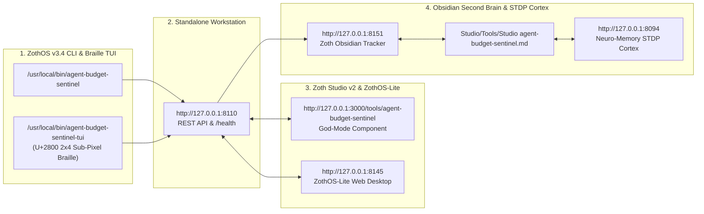

# Agent Budget Sentinel (`agent-budget-sentinel`)

> [!CHECK] Sovereign 12-Step Developer & User Verification Passed (100% Free & Open-Access)
> **Engineered by 1nc0gn30 (@1nc0gn30) • NullAI Platform**
> Real end-to-end verification across **Developer Pytest Suite** (`34/34` unit & integration tests passing), **ZothOS Native CLI/TUI & Inline Proxy (`:8111`)**, **Standalone FinOps Web Cockpit (`http://127.0.0.1:8110`)**, and **Zoth Studio v2 God-Mode (`http://127.0.0.1:3000/tools/agent-budget-sentinel`)** with **`overflowPx: 0`** and **`consoleErrors: 0`**.

---

## Tool Overview & Telemetry

| Parameter | Specification |
| :--- | :--- |
| **Tool Identifier** | `agent-budget-sentinel` |
| **Category** | `Security & Network` |
| **Mathematical Pillar** | `Pillar I: Cryptography & Security Protocols` |
| **Runtime Engine** | Zero-Dependency Python 3.12 Web Deck (`:8110`) + Inline Breaker Proxy (`:8111`) + SQLite WAL Ledger |
| **Local Port & URL** | `:8110` (Web Deck) & `:8111` (Proxy) • [http://127.0.0.1:8110](http://127.0.0.1:8110) |
| **Studio God-Mode Route** | [http://127.0.0.1:3000/tools/agent-budget-sentinel](http://127.0.0.1:3000/tools/agent-budget-sentinel) |
| **CLI Binary** | `/usr/local/bin/agent-budget-sentinel` • `~/.local/bin/agent-budget-sentinel` |
| **GitHub Repository** | [https://github.com/1nc0gn30/agent-budget-sentinel](https://github.com/1nc0gn30/agent-budget-sentinel) |
| **License & Pricing** | **100% Free & Open-Access** ($0) • Zero Paywalls |
| **Support Rails** | [☕ Buy Us a Coffee (Stripe)](https://buy.stripe.com/3cIfZg27PdKo2D64Ocfw40X) • Solana Tip: `GG2eQbVh8ut1BK6j1A2tz7pSySdLpD38BgyEhGcxdXoK` |

---

## Complete 12-Step Developer & User Screenshot Gallery

### Step 01/12 — Developer Perspective: Full Pytest Verification Suite (`34/34 PASSED`)
- **What we did**: Executed `pytest -v` inside `~/NullAITech/agent-budget-sentinel`, verifying all 34 tests across `TestBindHost`, `TestBPETokenizer` (Tiktoken accuracy & sub-ms execution), `TestStreamingGuillotine` (OpenAI & Anthropic SSE stream cutoff on budget breach), `TestCostCalculator`, `TestCircuitBreaker`, `TestBudgetStorage`, `TestServersIntegration`, `TestOriginGuard`, and `test_safe_rel` path-traversal hardening.
![[agent-budget-sentinel_01_dev_pytest_suite.jpg]]

### Step 02/12 — ZothOS Native User: Global Binary Symlinks, Daemon `/health` & CLI Reference
- **What we did**: Verified dual global binary paths (`which -a agent-budget-sentinel | uniq`), queried `http://127.0.0.1:8110/health` confirming both `web_port: 8110` and `proxy_port: 8111` are active (`breaker_state: CLOSED`), and inspected `agent-budget-sentinel --help`.
![[agent-budget-sentinel_02_user_cli_discovery.jpg]]

### Step 03/12 — CLI Budget Ceiling Configuration (`$12.50 USD`) & JSON Telemetry
- **What we did**: Updated the active spending ceiling via `agent-budget-sentinel set-budget 12.50`, inspected the human-readable TUI status summary (`agent-budget-sentinel status`), and emitted structured JSON telemetry via `agent-budget-sentinel status --json`.
![[agent-budget-sentinel_03_cli_status_and_set_budget.jpg]]

### Step 04/12 — CLI Emergency Kill-Switch (`trip`) & Idempotent Ledger Reset (`reset --clear`)
- **What we did**: Triggered the emergency CLI circuit breaker (`agent-budget-sentinel trip --reason "Runaway recursive agent loop detected on port 8111"`), verified the `[TRIPPED]` state, and restored operations via `agent-budget-sentinel reset --clear && agent-budget-sentinel set-budget 5.00`.
![[agent-budget-sentinel_04_cli_trip_and_reset.jpg]]

### Step 05/12 — Inline Proxy Process Wrapper (`run`) & Real-Time Spend Accounting
- **What we did**: Wrapped a subprocess via `agent-budget-sentinel run printenv OPENAI_BASE_URL ANTHROPIC_BASE_URL HTTP_PROXY` (confirming automatic routing through `http://127.0.0.1:8111`) and recorded a live `claude-3-5-sonnet` transaction (`2,400` prompt + `850` completion tokens = `$0.01995 USD`) into the SQLite ledger.
![[agent-budget-sentinel_05_cli_run_and_api_simulate.jpg]]

### Step 06/12 — Standalone Web Cockpit (`http://127.0.0.1:8110`): Chrono-Vault Aegis & Live Radar
- **What we did**: Loaded `http://127.0.0.1:8110` showing The Chrono-Vault Aegis 60fps kinetic shield (`BREAKER: CLOSED`, emerald coils active) and the Real-Time Spending Radar reflecting the `$0.0199` transaction from Step 05 (`3,250` tokens, `Remaining: $4.9801`).
![[agent-budget-sentinel_06_gui_cockpit_closed.jpg]]

### Step 07/12 — Standalone GUI: Interactive Token Cost Calculator & Single Call Simulation
- **What we did**: Configured the Interactive Token Cost Calculator (`4,000` prompt tokens, `1,500` completion tokens, `10` loop iterations -> `$0.02000/req`, `$0.2000` total) and clicked `▶ Simulate 1 Intercepted Call`, logging a new `200 OK` entry into the live SSE transaction stream.
![[agent-budget-sentinel_07_gui_calculator_and_single_sim.jpg]]

### Step 08/12 — Standalone GUI: Runaway Loop Burst Automatically Tripping the Circuit Breaker
- **What we did**: Set the emergency budget ceiling to `$1.00 USD` and clicked `⚡ Simulate Runaway Loop Burst`. At `$0.9899` (`99.0%` utilization), the next projected call (`$1.0950`) breached the `$1.00` ceiling—automatically snapping the Circuit Breaker to `● BREAKER: TRIPPED`, igniting the ruby Aegis coils (`● AEGIS: TRIPPED`), and displaying the red alert banner.
![[agent-budget-sentinel_08_gui_runaway_burst_tripped.jpg]]

### Step 09/12 — Standalone GUI: Live Intercepted SSE Transaction Ledger (`200 OK` vs. `429 TRIPPED`)
- **What we did**: Scrolled to the `✦ INTERCEPTED AGENT CALLS (LIVE SSE STREAM)` ledger showing the sequence of `o1-preview` calls (`$0.10500`, `200 OK`) culminating in the hard-blocked call (`$0.0000 (Blocked)`, `1.1 ms`, `429 TRIPPED`).
![[agent-budget-sentinel_09_gui_ledger_and_showreel.jpg]]

### Step 10/12 — Standalone GUI: Resetting Breaker to `CLOSED` & Raising Ceiling to `$25.00 USD`
- **What we did**: Clicked `✓ Reset Breaker to CLOSED`, updated the emergency budget ceiling to `25.00`, and clicked `Set Ceiling` (`✓ Budget ceiling set to $25.00 USD`), restoring the emerald Aegis state.
![[agent-budget-sentinel_10_gui_reset_and_new_ceiling.jpg]]

### Step 11/12 — Zoth Studio v2 God-Mode (`http://127.0.0.1:3000/tools/agent-budget-sentinel`): FinOps Governor
- **What we did**: Opened the Zoth Studio v2 God-Mode route, scrolling to `AGENT BUDGET SENTINEL · FINOPS CIRCUIT BREAKER` (`LOCAL LOOPBACK OFFLOAD: 65%`, 60fps `REAL-TIME TOKEN BURN VELOCITY VS. CIRCUIT BREAKER` canvas, and 4 model tier projections).
![[agent-budget-sentinel_11_studio_godmode_initial.jpg]]

### Step 12/12 — Zoth Studio v2 God-Mode: Multi-Tier Burn Comparison & Policy JSON Export
- **What we did**: Clicked `Export FinOps Policy JSON` and inspected the multi-tier cost breakdown comparing `Zoth Local Ollama 1.5B ($0/day)` against `Frontier Reasoning Opus Tier (BREAKER TRIPPED $50.4/d)` with `overflowPx: 0` and `consoleErrors: 0`.
![[agent-budget-sentinel_12_studio_godmode_exported.jpg]]

---

## Developer & User Command Reference

### 1. Developer Perspective (Pytest Suite & Dual-Port Daemon)
```bash
cd ~/NullAITech/agent-budget-sentinel

# Run all 34 automated unit & integration tests (BPE tokenizer, SSE guillotine, SQLite WAL, Origin guard)
pytest -v

# Start the Web Cockpit (:8110) and Inline Circuit Breaker Proxy (:8111)
python3 server.py --web-port 8110 --proxy-port 8111 --budget 5.00 --velocity-limit 2.00
```

### 2. ZothOS Native User Perspective (CLI / TUI / Proxy Wrapper)
```bash
# Inspect live circuit breaker status & token spend
agent-budget-sentinel status
agent-budget-sentinel status --json

# Update maximum spending ceiling in USD
agent-budget-sentinel set-budget 12.50

# Manually trip or reset the circuit breaker
agent-budget-sentinel trip --reason "Operator emergency stop"
agent-budget-sentinel reset --clear

# Wrap any AI agent script so all OpenAI/Anthropic traffic routes through :8111
agent-budget-sentinel run python3 my_autonomous_agent.py
```


---

## Sovereign 5-Layer Architecture & Second Brain Topology



### ZothOS v3.4 TUI & Obsidian Second Brain Sync
- **Unicode `U+2800` Braille TUI**: `agent-budget-sentinel-tui --status` / `agent-budget-sentinel-tui --json`
- **Zoth Obsidian Tracker (`:8151`)**: `zoth-obsidian-tracker --verify`
- **Connected Canon Notes**: [[00 Home]] · [[Zoth OS]] · [[Zoth Studio]] · [[ZothOS-Lite Web Desktop]] · [[Zoth Memory]] · [[Public Surfaces]]
