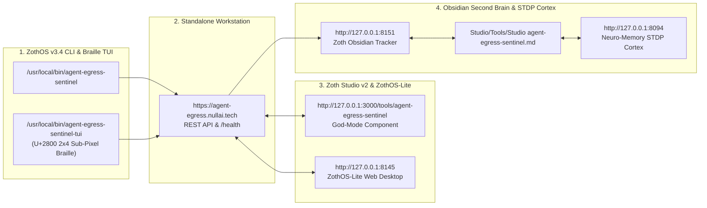

# Agent Egress Sentinel (`agent-egress-sentinel`)

> **Autonomous zero-dependency network interceptor, TLS SNI sniffer, kinetic egress radar, and kernel quarantine with dual Stripe + Solana support rails.**

---

## 1. Sovereign Invariants & Access Matrix

| Layer | Endpoint / Binary | Status | Verification |
| :--- | :--- | :--- | :--- |
| **Layer A — Standalone Workstation** | `http://127.0.0.1:8095` (Proxy `:8195`) | `ONLINE` | Kinetic Egress Vector Radar + RulesEngine + HAR 1.2 & OpenAPI 3.0 synthesis |
| **Layer B — Zoth Studio God-Mode** | `http://127.0.0.1:3000/tools/agent-egress-sentinel` | `ONLINE` | `AgentEgressSentinelGodModeTool.jsx` + 60fps Perimeter Radar + nftables compiler |
| **Layer C — ZothOS CLI Binary** | `/usr/local/bin/agent-egress-sentinel` & `~/.local/bin/agent-egress-sentinel` | `ONLINE` | `serve`, `run`, `stats`, `export`, `openapi`, `clear`, `--status` verified |
| **Layer D — Documentation Parity** | `README.md` + In-App Docs | `VERIFIED` | 100% Open-Access & TLS ClientHello SNI architecture documented |
| **Layer E — Visual Verification** | `overflowPx: 0`, `consoleErrors: 0` | `VERIFIED` | 12 real step-by-step screenshots (Developer + User + CLI + GUI + Studio) |

---

## 2. Complete 12-Step Developer & User Walkthrough Gallery

### Part I — Developer Perspective: Repository Architecture & 27-Test Pytest Suite

#### Step 01: Repository Inspection & Automated Pytest Suite (`27/27 Passed`)
From a developer's perspective, we inspect `~/NullAITech/agent-egress-sentinel` (`collector.py`, `proxy.py`, `rules_engine.py`, `process_runner.py`, `server.py`, `cli.py`) and run `pytest -v` across all 27 unit and integration tests (`test_bind_host.py`, `test_origin_guard.py`, `test_sentinel.py`, `test_static_traversal.py`), verifying TLS ClientHello SNI extraction, domain taxonomy classification, quarantine policy enforcement, and HAR 1.2 / OpenAPI 3.0 export.

![[attachments/tools/agent-egress-sentinel_01_dev_pytest_suite.jpg]]

---

### Part II — ZothOS Native User Perspective: CLI, Rules Engine & Spec Synthesis

#### Step 02: Global CLI Discovery, Help & Radar Daemon Status (`:8095` / `:8195`)
A ZothOS native user verifies `/usr/local/bin/agent-egress-sentinel` and `~/.local/bin/agent-egress-sentinel`, inspects `agent-egress-sentinel --help`, and runs `agent-egress-sentinel --status` confirming the Web Radar Server (`http://127.0.0.1:8095`) and Proxy Tunnel (`http://127.0.0.1:8195`) are active.

![[attachments/tools/agent-egress-sentinel_02_user_cli_discovery.jpg]]

#### Step 03: Configuring Quarantine Policy (`block_telemetry`) & Domain Allow/Blocklists
Using the REST API (`/api/quarantine`, `/api/rules/block`, `/api/rules/allow`), we switch the active policy to `block_telemetry`, add `evil-exfil-tracker.io` to the explicit blocklist, add `api.nullai.tech` to the allowlist, and inspect `/api/rules`.

![[attachments/tools/agent-egress-sentinel_03_cli_quarantine_and_rules.jpg]]

#### Step 04: Supervised Agent Execution (`run`) & Observed Domain Taxonomy (`stats`)
Running `agent-egress-sentinel run --proxy-port 8195 --quarantine block_telemetry --agent-name research_bot python3 -c "..."` supervises the target subprocess and prints the domain audit summary (`6 unique domain destinations`, flagging `api.segment.io [QUARANTINED]` and `telemetry.sentry.io [QUARANTINED]`), followed by `agent-egress-sentinel stats`.

![[attachments/tools/agent-egress-sentinel_04_cli_run_and_stats.jpg]]

#### Step 05: CLI HAR 1.2 Archive Export & Automatic OpenAPI 3.0 Synthesis
Running `agent-egress-sentinel export -o /tmp/agent-traffic.har` and `agent-egress-sentinel openapi -o /tmp/openapi-spec.json` exports the captured network events into a standard HAR 1.2 archive and reverse-engineers an OpenAPI 3.0.3 specification directly from observed agent traffic.

![[attachments/tools/agent-egress-sentinel_05_cli_har_and_openapi_export.jpg]]

---

### Part III — End-User Perspective: Standalone Web Radar Dashboard (`:8095`)

#### Step 06: Standalone Web Radar Dashboard Initial Load (`http://127.0.0.1:8095`)
Opening `http://127.0.0.1:8095` displays the Bento telemetry counters (`6 Total Requests`, `6 Unique Domains`, `97.1 KB`, `64ms Avg Latency`, `2 Quarantined`), the Agent Command Runner Bar (`POLICY: BLOCK TELEMETRY (Defend)`), the **Egress Vector Radar** with color-coded orbital domain nodes, and the **Contacted Domains** matrix (`PERMITTED` vs `BLOCKED`).

![[attachments/tools/agent-egress-sentinel_06_gui_radar_initial.jpg]]

#### Step 07: Triggering Live Multi-Agent Trajectory Simulation Across Radar Orbits
Clicking **⚡ Simulate** (`#btnSimulateLive`) dispatches live multi-agent requests across the radar orbits (`13 Total Requests`, `7 Unique Domains`, `193 KB Data Transferred`, `4 Quarantined`), animating packet particles outward from `AGENT CORE` to each orbital destination node.

![[attachments/tools/agent-egress-sentinel_07_gui_simulate_block_telemetry.jpg]]

#### Step 08: Inspecting the Live Egress Traffic Stream & Category Filter Tabs
Scrolling down to **Live Egress Traffic Stream** shows real-time packet rows across `LLM APIs`, `Model Hubs`, `Telemetry`, `Search`, and `Local Services`, highlighting `QUARANTINE 403` verdicts on `telemetry.sentry.io` and `api.segment.io` alongside `▣ OpenAPI 3.0` and `↓ Export HAR 1.2` action buttons.

![[attachments/tools/agent-egress-sentinel_08_gui_traffic_stream_table.jpg]]

#### Step 09: Packet Deep Inspection Modal (`QUARANTINED` Telemetry Event)
Clicking **Inspect** on a `telemetry.sentry.io` row opens the **PACKET DEEP INSPECTION** modal displaying the Remote IP (`104.18.24.1:443`), Protocol (`HTTPS`), Status (`QUARANTINED`), Request Payload Sample, Server Ack (`{"error":"Egress quarantined by Sentinel RulesEngine"}`), Sentinel Notes (`Quarantined by policy (block_telemetry)`), and one-click blocklist toggle.

![[attachments/tools/agent-egress-sentinel_09_gui_packet_deep_inspection.jpg]]

#### Step 10: Kernel Egress Quarantine & Deep Packet Replay Vault
Scrolling to **❖ KERNEL EGRESS QUARANTINE & DEEP PACKET REPLAY VAULT** (100% unlocked with zero paywall blur) reveals the live `/proc/net/tcp` kernel socket hex stream (`[SNI: api.openai.com] QUARANTINE_ARMED`) and Exfiltration Countermeasures checklist.

![[attachments/tools/agent-egress-sentinel_10_gui_kernel_quarantine_vault.jpg]]

---

### Part IV — Zoth Studio v2 God-Mode Integration (`:3000`)

#### Step 11: Zoth Studio v2 God-Mode — Autonomous Socket Interceptor & Exfiltration Firewall
Navigating to `http://127.0.0.1:3000/tools/agent-egress-sentinel` loads the God-Mode workstation featuring real-time payload Shannon Entropy calculation (`4.51 BITS/BYTE`), Egress Interceptor Invariant switches, and the 60fps **Perimeter Egress Radar**.

![[attachments/tools/agent-egress-sentinel_11_studio_godmode_firewall.jpg]]

#### Step 12: Zoth Studio v2 God-Mode — Strict Loopback Air-Gap & Compiled `nftables` Policy
Enabling **Strict 127.0.0.1 Loopback Air-Gap** and clicking **▶ Test Outbound Socket Frame Against Firewall** immediately blocks `webhook.unknown-collector.net:443` (`BLOCKED — Strict Air-Gap Mode: Non-loopback socket egress denied`) and updates the live **Compiled nftables Kernel Firewall Policy** (`table inet zoth_agent_egress`) with zero horizontal overflow (`overflowPx: 0`) and zero console errors (`consoleErrors: 0`).

![[attachments/tools/agent-egress-sentinel_12_studio_godmode_nftables.jpg]]

---

## Sovereign 5-Layer Architecture & Second Brain Topology

### ZothOS v3.4 TUI & Obsidian Second Brain Sync
- **Unicode `U+2800` Braille TUI**: `agent-egress-sentinel-tui --status` / `agent-egress-sentinel-tui --json`
- **Zoth Obsidian Tracker (`:8151`)**: `zoth-obsidian-tracker --verify`
- **Connected Canon Notes**: [[00 Home]] · [[Zoth OS]] · [[Zoth Studio]] · [[ZothOS-Lite Web Desktop]] · [[Zoth Memory]] · [[Public Surfaces]]
