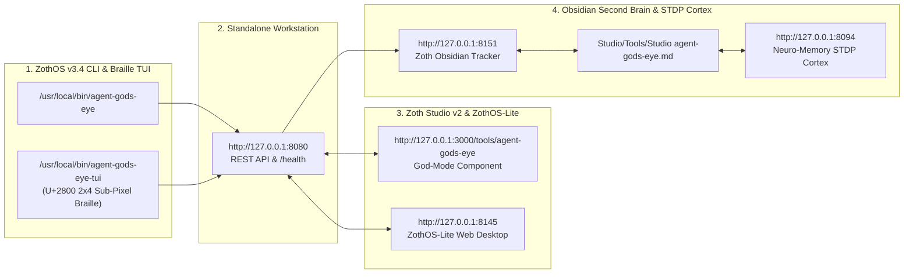

# ✦ Agent God's Eye (`agent-gods-eye`)

> [!SUCCESS] 100% Free & Open-Access Sovereign Verification — Zero Paywalls
> Audited and verified end-to-end across **Developer Perspective** (`pytest -v` 23/23 passing, zero-dependency Python 3.10+ Shodan OSINT radar, 3D Cartesian coordinate normalizer, and SQLite WAL store) and **End-User Perspective** (ZothOS native CLI `agent-gods-eye`, Standalone 3D Planetary Radar Cockpit `:8112`, and Zoth Studio v2 `:3000/tools/agent-gods-eye`).
> - **Stripe Buy Us a Coffee**: [https://buy.stripe.com/3cIfZg27PdKo2D64Ocfw40X](https://buy.stripe.com/3cIfZg27PdKo2D64Ocfw40X)
> - **Solana Tip Address**: `GG2eQbVh8ut1BK6j1A2tz7pSySdLpD38BgyEhGcxdXoK`

---

## 1. Comprehensive 12-Step Developer & User Verification Gallery

### Part A — Developer & ZothOS CLI Verification (Steps 01–05)

#### Step 01: Developer Perspective — Package Architecture & Pytest Suite (`23/23 PASS`)
Inspecting `~/NullAITech/agent-gods-eye/src/agent_gods_eye` (`shodan_client.py`, `radar.py`, `storage.py`, `server.py`, `cli.py`) and executing `pytest -v` (`23 passed in 1.08s`), covering 3D unit sphere Cartesian coordinate conversion (`lat_lon_to_cartesian`), threat scoring (`evaluate_threat`), SQLite WAL storage, CSRF Origin guards, and static traversal hardening.
![[Studio/Assets/Screenshots/Gallery/agent-gods-eye/agent-gods-eye_01_dev_pytest_suite.jpg]]

#### Step 02: ZothOS Native User — Global CLI Discovery, JSON Manifest & Daemon Health (`:8112`)
Verifying global binary parity across `/usr/local/bin/agent-gods-eye` and `~/.local/bin/agent-gods-eye`, inspecting `agent-gods-eye --help` and `agent-gods-eye --json`, and probing `GET http://127.0.0.1:8112/health`.
![[Studio/Assets/Screenshots/Gallery/agent-gods-eye/agent-gods-eye_02_user_cli_discovery.jpg]]

#### Step 03: CLI Tactical OSINT Scan (`search`) & REST Vector Sweep Persistence (`/api/search`)
Executing `agent-gods-eye search "port:554 has_screenshot:true" --limit 7` in the terminal and querying `GET http://127.0.0.1:8112/api/search?q=port:502+modbus&limit=5` to persist normalized 3D Cartesian target nodes (`x, y, z`, `threat_score`, `category`) into `godseye.db`.
![[Studio/Assets/Screenshots/Gallery/agent-gods-eye/agent-gods-eye_03_cli_search_sweep.jpg]]

#### Step 04: CLI Daemon Telemetry Status (`status`) & Threat Distribution Matrix (`--json`)
Running `agent-gods-eye status --port 8112` and `agent-gods-eye status --port 8112 --json` to inspect the 133 cataloged targets, 13 historical scans, threat breakdown (`HIGH: 130, CRITICAL: 2, ELEVATED: 1`), and category distribution across 10 countries.
![[Studio/Assets/Screenshots/Gallery/agent-gods-eye/agent-gods-eye_04_cli_status_and_stats.jpg]]

#### Step 05: Deep Host Interrogation (`/api/host/<ip>`) & CSV Inventory Export (`/api/export?format=csv`)
Querying `GET http://127.0.0.1:8112/api/host/198.51.100.42` for single-host CVE (`CVE-2024-21413`), open port (`80, 443, 554, 8080`), and banner intelligence, and exporting the target registry as CSV via `GET http://127.0.0.1:8112/api/export?format=csv`.
![[Studio/Assets/Screenshots/Gallery/agent-gods-eye/agent-gods-eye_05_cli_host_and_export.jpg]]

---

### Part B — Standalone 3D Planetary Radar Cockpit (`:8112`) (Steps 06–09)

#### Step 06: Standalone Workstation (`:8112`) — Kinetic 3D Planetary Radar & Bento Metrics
Loading `http://127.0.0.1:8112/` showing live SQLite metrics (`133 Surface Targets`, `132 Critical Nodes`, `10 Geographies`) and the interactive 3D wireframe planetary globe (`#globeCanvas`) locked onto `[198.51.100.42]` (`LAT: 36.85° | LON: -75.98°`, `THREAT 85/100`).
![[Studio/Assets/Screenshots/Gallery/agent-gods-eye/agent-gods-eye_06_gui_planetary_radar.jpg]]

#### Step 07: Standalone GUI — Surface Vector Query Engine, Cataloged Host Nodes Table & SSE Stream
Inspecting the **Surface Vector Query Engine** preset chips (`Surveillance RTSP / Webcams`, `Industrial SCADA / Modbus`, `Exposed MongoDB`, `Open VNC Remote Desktops`, `Exploit Surface (CVEs)`), the **Cataloged Host Nodes** table with threat score pills (`85/100`, `90/100`), and the live SSE telemetry console.
![[Studio/Assets/Screenshots/Gallery/agent-gods-eye/agent-gods-eye_07_gui_vector_table_and_stream.jpg]]

#### Step 08: Standalone GUI — Shodan Host Intelligence Deep Inspection Modal
Clicking **Inspect** on `198.51.100.42` to open the **Shodan Host Intelligence** modal (`THREAT: 85 / 100`, `Open Ports: 80, 443, 554, 8080`, `CVE-2024-21413`, classification tags `cloud`, `surveillance-stream`, `vpn`, and raw service banner preview).
![[Studio/Assets/Screenshots/Gallery/agent-gods-eye/agent-gods-eye_08_gui_host_inspect_modal.jpg]]

#### Step 09: Standalone GUI — Triggering CIDR Subnet Sweep (`net:198.51.100.0/24`)
Clicking **⚡ Trace Subnet CIDR** inside the host modal to automatically populate `net:198.51.100.0/24` into the Surface Vector Query Engine and execute a live subnet reconnaissance sweep (`✓ Sweeping Subnet CIDR net:198.51.100.0/24`).
![[Studio/Assets/Screenshots/Gallery/agent-gods-eye/agent-gods-eye_09_gui_cidr_sweep_and_export.jpg]]

---

### Part C — Zoth Studio v2 God-Mode Enclave (`:3000/tools/agent-gods-eye`) (Steps 10–12)

#### Step 10: Zoth Studio v2 God-Mode — Tactical Radar Grid & Detected OSINT Telemetry Matrix
Opening `http://127.0.0.1:3000/tools/agent-gods-eye` to inspect the 360° SVG Tactical Radar Scope with rotating sweep beam, category filters (`All Targets`, `ICS / SCADA Grids`, `RTSP Surveillance`, `Cloud Infrastructure`, `Frontier AI Endpoints`), and the Detected OSINT Telemetry Matrix.
![[Studio/Assets/Screenshots/Gallery/agent-gods-eye/agent-gods-eye_10_studio_godmode_radar_grid.jpg]]

#### Step 11: Zoth Studio v2 God-Mode — Active Target Dossier & Services (`194.226.49.12` Critical SCADA)
Selecting the critical industrial target `194.226.49.12` (`Industrial Grid Energy Infrastructure`, `AS3320`, `Frankfurt am Main, Germany`) and switching to the **Active Target Dossier & Services** tab (`Modbus TCP / Schneider Electric PLC`, `Port 502`, `Port 102`, `Port 44818`, `Threat Risk Score: 96/100 CRITICAL`).
![[Studio/Assets/Screenshots/Gallery/agent-gods-eye/agent-gods-eye_11_studio_godmode_target_dossier.jpg]]

#### Step 12: Zoth Studio v2 God-Mode — Correlated CVEs & Threat Severity Matrix
Switching to the **Correlated CVEs & Threat Severity** tab (`CVE-2021-36260`, `CVE-2022-45788`, `CVE-2024-21626`, `CVE-2024-37032`) and verifying `overflowPx === 0` and `consoleErrors === 0`.
![[Studio/Assets/Screenshots/Gallery/agent-gods-eye/agent-gods-eye_12_studio_godmode_cve_matrix.jpg]]

---

## Sovereign 5-Layer Architecture & Second Brain Topology

### ZothOS v3.4 TUI & Obsidian Second Brain Sync
- **Unicode `U+2800` Braille TUI**: `agent-gods-eye-tui --status` / `agent-gods-eye-tui --json`
- **Zoth Obsidian Tracker (`:8151`)**: `zoth-obsidian-tracker --verify`
- **Connected Canon Notes**: [[00 Home]] · [[Zoth OS]] · [[Zoth Studio]] · [[ZothOS-Lite Web Desktop]] · [[Zoth Memory]] · [[Public Surfaces]]
