# AZOTH Local Archon Agent (`azoth-local-agent`)

> **Swarm & Core** · `v3.0.0` · **100% Free & Open Access (Zero Paywalls)**

Archon Orchestrator core agent for local zero-telemetry task dispatching, multi-engine CLI/API routing (`ollama`, `hermes`, `agy`, `codex`, `grok_cli`, `gemini`, `claude`, `xai`, `openai`, `openrouter`), DuckyScript browser macro automation, persistent Python sandbox execution, and isolated Linux Guest OS terminal bridging.

---

## 📸 Step-by-Step Developer & User Walkthrough Gallery (12 Verified Steps)

### 1. Developer Perspective: Architecture Inspection & Automated Pytest Suite
Developers inspect the sovereign source architecture in `~/NullAITech/azoth-local-agent` (`agent.py`, `web_ui.py`, `mcp_server.py`, `engines/manager.py`, and the `tools/` modules) and run the automated unit test suites (`test_grok_intelligence.py`, `test_manager.py`, `test_mcp.py`, `test_vm_os.py`, `test_code_runner.py`, `test_duckyscript.py`).

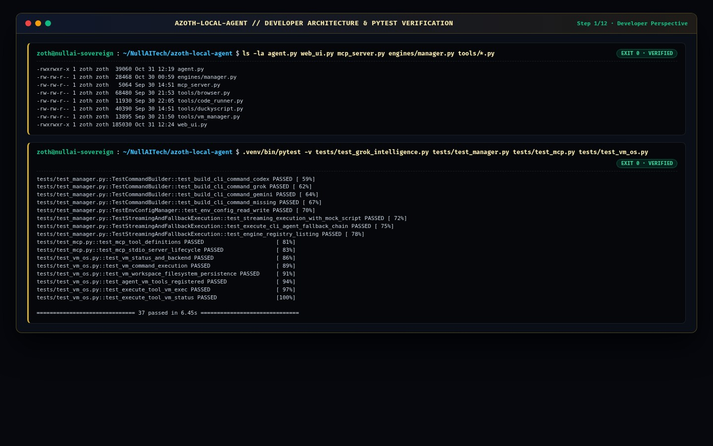

### 2. End-User Perspective: Global ZothOS Binary Resolution, Daemon Health & CLI Help
End-users verify global `PATH` resolution (`which -a azoth azoth-local-agent` across `~/.local/bin/` and `/usr/local/bin/`), query `--version`, verify the `:8136/health` daemon endpoint, and inspect `azoth --help`.

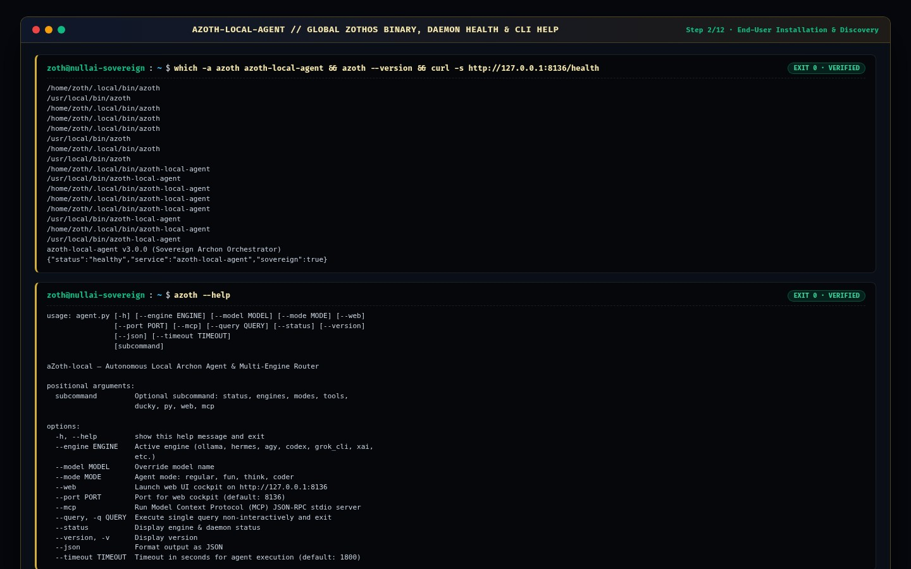

### 3. Terminal TUI Execution (Part 1): Multi-Engine Router Status & Grok Persona Modes
Users inspect all 10 discovered AI engines and CLI binaries (`azoth status`) and list the 4 operating persona modes (`azoth modes`: `regular`, `fun`, `think`, `coder`).

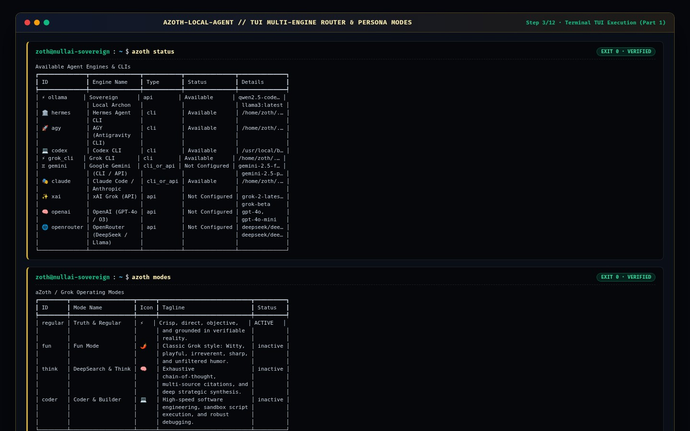

### 4. Terminal TUI Execution (Part 2): 35 Active Archon Tools, DuckyScript Presets & Sandbox Python
Users list all 35 registered Archon tool definitions (`azoth tools`), inspect the 9 built-in DuckyScript browser automation macros (`azoth ducky`), and execute sandboxed Python code (`azoth py`).

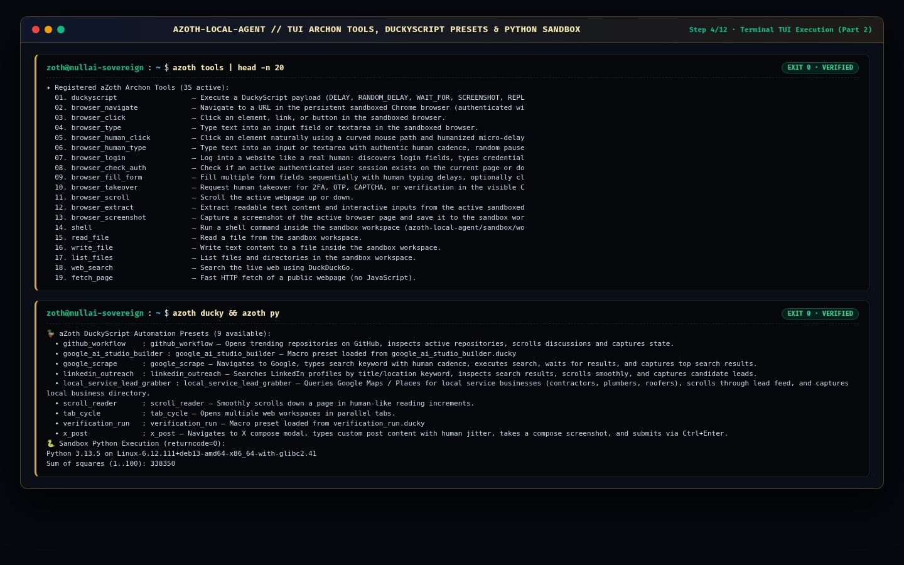

### 5. Standalone Workstation (`:8136`): Main Chat Cockpit, Quick Sparks & Live Browser Panel
Opening `http://127.0.0.1:8136` launches the aZoth-local Grok-grade cockpit with quick-action sparks (`Trending on X`, `DeepSearch AI News`, `Python Sandbox`, `Scout Elon on X`, `Ducky Post to X`), persona mode switches, and the live Sandboxed Chrome browser control panel.

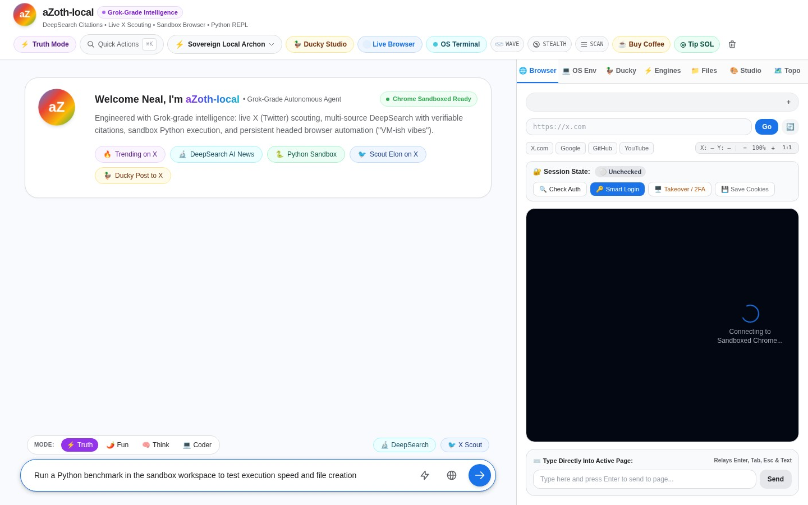

### 6. Standalone Workstation (`:8136`): DuckyScript Studio & Macro Payload Editor
Switching to the **Ducky** tab loads the interactive DuckyScript Studio (`NAVIGATE`, `WAIT_FOR`, `RANDOM_DELAY`, `SCROLL`, `SCREENSHOT`) with preset payload selection (`GitHub Workflow Explorer`) and live execution log.

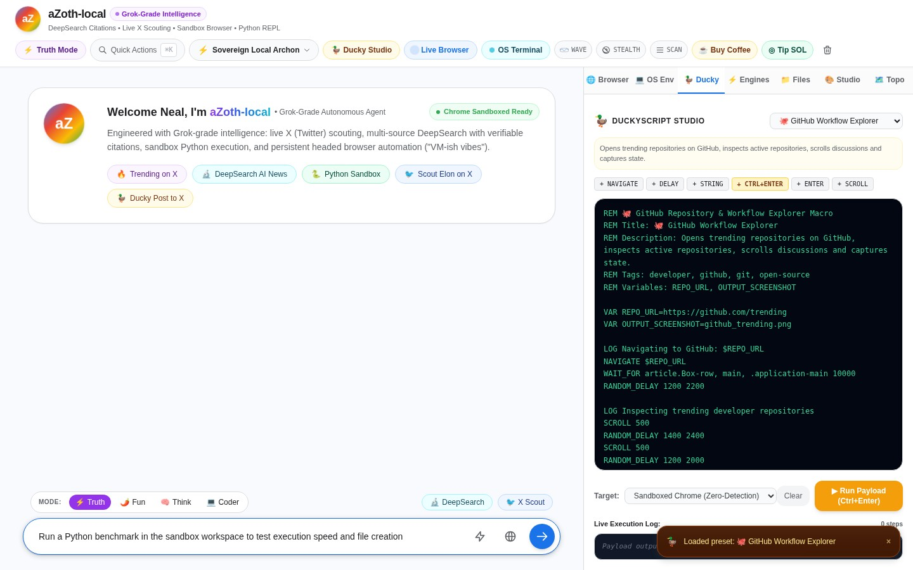

### 7. Standalone Workstation (`:8136`): Multi-Engine Router & Zero-Egress CLI Selector
Switching to the **Engines** tab lets operators hot-swap between `Sovereign Local Archon` (Ollama), `Hermes Agent CLI`, `AGY (Antigravity CLI)`, `Codex CLI`, `Grok CLI`, `Google Gemini`, and `Claude Code`, or manage `.env` API keys.

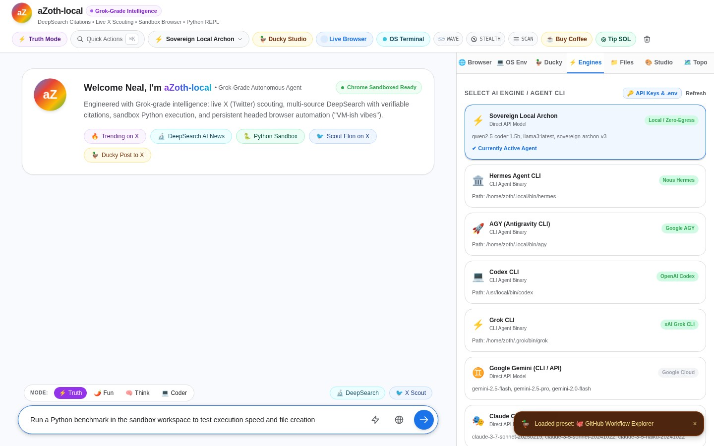

### 8. Standalone Workstation (`:8136`): Isolated Linux Guest OS & Live WebSocket PTY Terminal
Switching to the **OS Env** tab opens the real-time `xterm.js` WebSocket PTY bridge (`/ws/terminal`) connected to the isolated Linux Guest OS (`Debian GNU/Linux 13`, `LOCAL_SANDBOX`) with one-click command chips (`uname -a`, `ls -la`, `python`, `top`, `clear`).

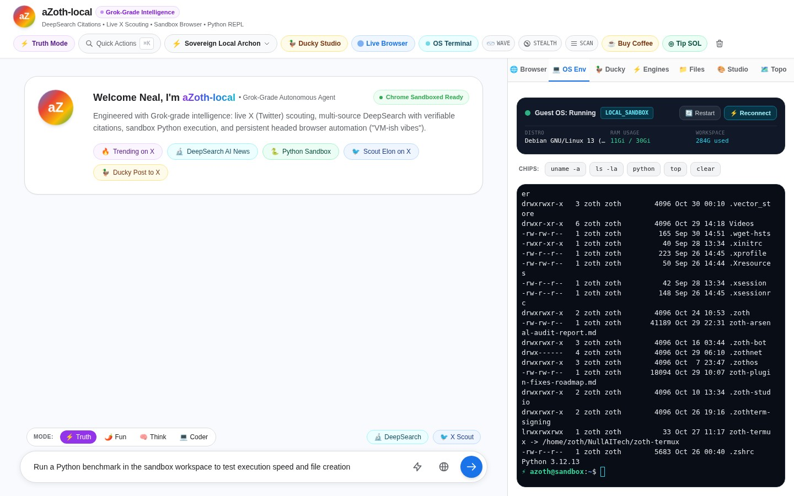

### 9. Standalone Workstation (`:8136`): a-bot Mascot Studio & Quick Commander Palette (`Ctrl+K`)
Switching to the **Studio** tab customizes the a-bot mascot geometry, organic motion style, and radiant aura palette (`Gemini Aurora`), while pressing `Ctrl+K` opens the Quick Commander action palette.

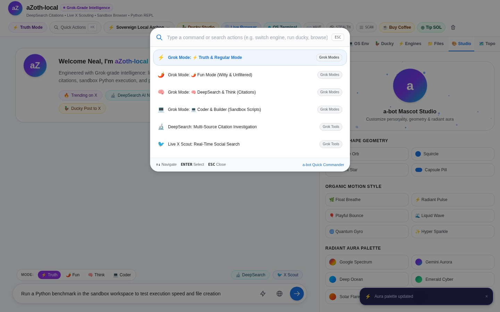

### 10. Standalone Workstation (`:8136`): Interactive Agent Network Topology Map
Switching to the **Topo** tab renders the interactive 12-node, 16-link force-directed network topology canvas (`aZoth Agent`, `Engine Router`, `Sandbox Browser`, `Guest OS Terminal`, `DuckyScript Studio`, `Workspace Files`, `DeepSearch`, `X Intelligence`, `Python REPL`, `Guest OS VM`, `Config Vault`, `Chat Stream`).

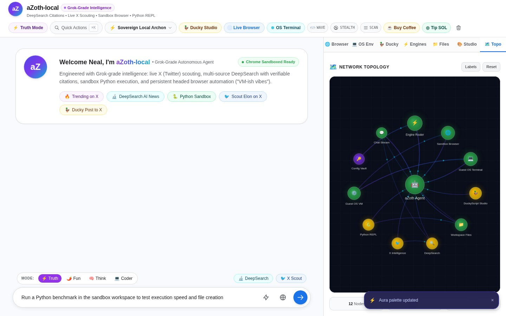

### 11. Zoth Studio v2 God-Mode (`:3000/tools/azoth-local-agent`): Subagent Orbit & Orchestrator
Inside Zoth Studio v2 (`http://127.0.0.1:3000/tools/azoth-local-agent`), the embedded God-Mode workstation renders the live 60fps ASCII-dithered Subagent Orbit canvas connecting `AZOTH :8136` to `Sovereign`, `Hermes`, `Antigravity`, `Codex`, `Grok`, `Claude`, and `Zoth`.

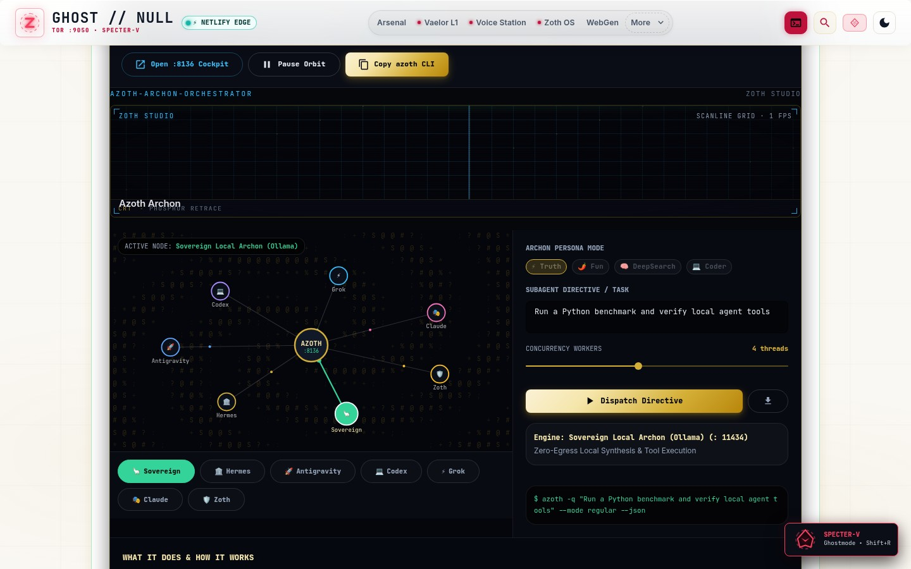

### 12. Zoth Studio v2 God-Mode (`:3000/tools/azoth-local-agent`): Dispatching Directives in DeepSearch Mode
Selecting the `Hermes` node and switching the Archon Persona Mode to `DeepSearch` (`--mode think`) dispatches the multi-step ReAct loop and updates the live CLI invocation preview.

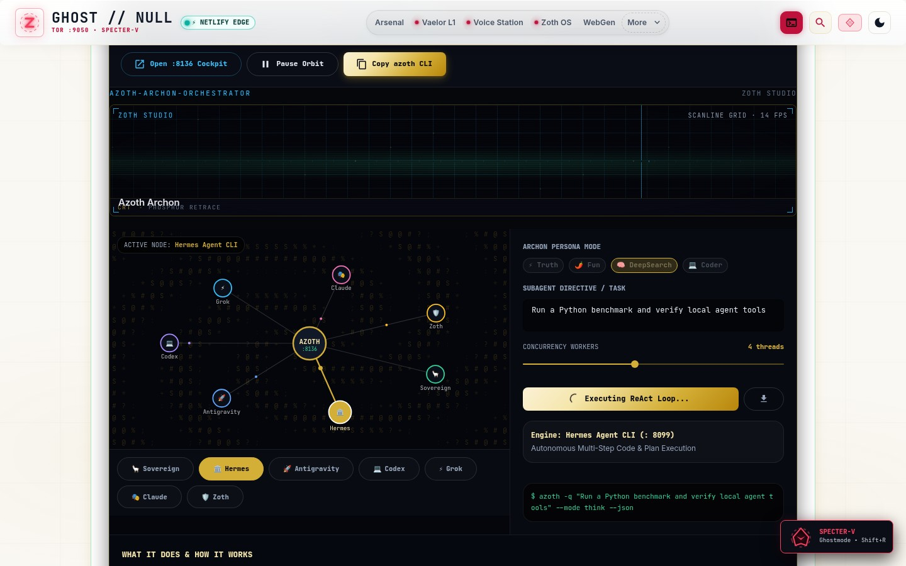

---

## 🛠️ CLI & MCP Reference

```bash
# Inspect multi-engine router & CLI discovery
azoth status

# List Grok-grade operating persona modes
azoth modes

# List all 35 registered Archon tools
azoth tools

# List all 9 DuckyScript browser automation presets
azoth ducky

# Execute Python in the isolated sandbox workspace
azoth py

# Run a single non-interactive query with JSON output
azoth -q "Audit local network listeners" --mode think --json

# Launch standalone web cockpit on port 8136
azoth --web --port 8136

# Start Model Context Protocol (MCP) JSON-RPC stdio server
azoth --mcp
```

---

## ☕ Open-Access Support (Zero Paywalls)
- **Stripe "Buy Us a Coffee"**: [https://buy.stripe.com/3cIfZg27PdKo2D64Ocfw40X](https://buy.stripe.com/3cIfZg27PdKo2D64Ocfw40X)
- **Solana Tip Address**: `GG2eQbVh8ut1BK6j1A2tz7pSySdLpD38BgyEhGcxdXoK`


---

## Sovereign 5-Layer Architecture & Second Brain Topology

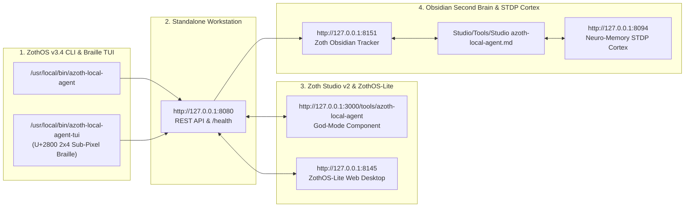

### ZothOS v3.4 TUI & Obsidian Second Brain Sync
- **Unicode `U+2800` Braille TUI**: `azoth-local-agent-tui --status` / `azoth-local-agent-tui --json`
- **Zoth Obsidian Tracker (`:8151`)**: `zoth-obsidian-tracker --verify`
- **Connected Canon Notes**: [[00 Home]] · [[Zoth OS]] · [[Zoth Studio]] · [[ZothOS-Lite Web Desktop]] · [[Zoth Memory]] · [[Public Surfaces]]
