# Badge3D Coin Generator (`badge3d-coin-generator`)

> **Media & 3D** · `v2.5.0` · **100% Free & Open Access (Zero Paywalls)**

Zero-dependency parametric 3D coin, medallion, and relief badge generator with real-time WebGL PBR metallic shaders, SVG/heightmap relief displacement, cylindrical edge reeding & security stamp milling, FDM G-code slicer (`slice`), Model Context Protocol (`mcp`) server, and watertight Binary/ASCII STL & Wavefront OBJ export.

---

## 📸 Step-by-Step Developer & User Walkthrough Gallery (12 Verified Steps)

### 1. Developer Perspective: Pure-Stdlib Architecture & 107-Test Pytest Suite
Developers inspect the zero-dependency Python geometry & slicing modules in `~/NullAITech/badge3d-coin-generator/src/badge3d_coin_generator/` (`cli.py`, `mesh_engine.py`, `slicer_engine.py`, `svg_rasterizer.py`, `edge_milling.py`, `exporters.py`, `mcp_server.py`, `ui_server.py`) and run the 107-test `pytest -v tests` verification suite (`107 passed in 9.10s`).

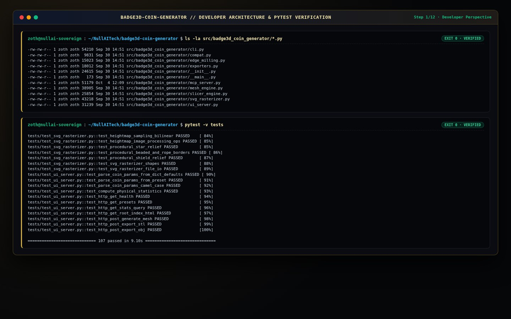

### 2. End-User Perspective: Global ZothOS Binary Resolution, Daemon Status & CLI Help
End-users verify global `PATH` resolution (`which -a badge3d-coin-generator badge3d` across `~/.local/bin/` and `/usr/local/bin/`), query `--status` (`ONLINE (:8084)`), and inspect `badge3d-coin-generator --help`.

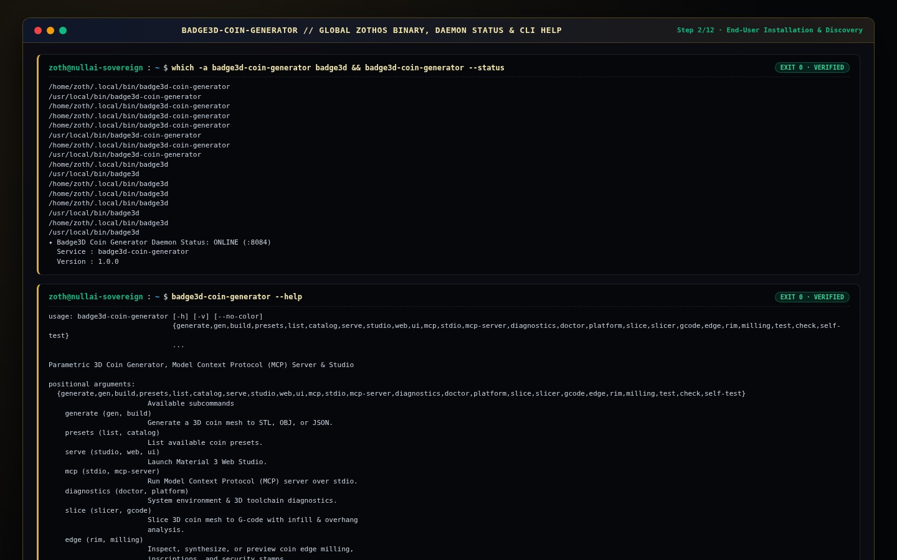

### 3. Terminal TUI Execution (Part 1): 3D Coin Presets Catalog & 3D Toolchain Diagnostics (`doctor`)
Users list all 5 built-in numismatic templates (`badge3d-coin-generator presets`: `commemorative_gold`, `cyberpunk_hex`, `antique_roman`, `military_challenge`, `sovereign_silver`) and run `badge3d-coin-generator doctor` (`15,200 facets`, `Watertight Closed 2-Manifold`, `80,953 triangles/sec`).

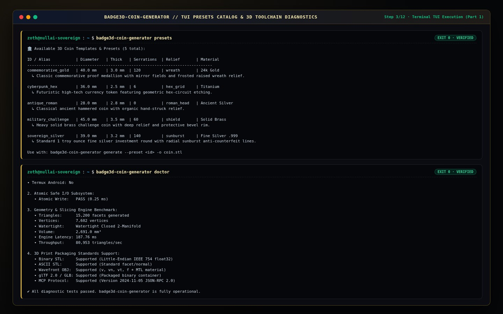

### 4. Terminal TUI Execution (Part 2): Watertight STL Mesh Generation, FDM G-Code Slicing & Edge Milling
Users synthesize a 21,280-triangle watertight Binary STL (`badge3d-coin-generator generate --preset sovereign_silver -o /tmp/sovereign_coin.stl`), slice a challenge coin into 18-layer FDM G-code (`badge3d-coin-generator slice --preset military_challenge -o /tmp/challenge_coin.gcode`), and inspect cylindrical rim inscriptions & security grooves (`badge3d-coin-generator edge -i "NULLAI SOVEREIGN MINT 2026" --inscription-mode incuse -s "ZOTH-OS" -g 8 --serrations 120`).

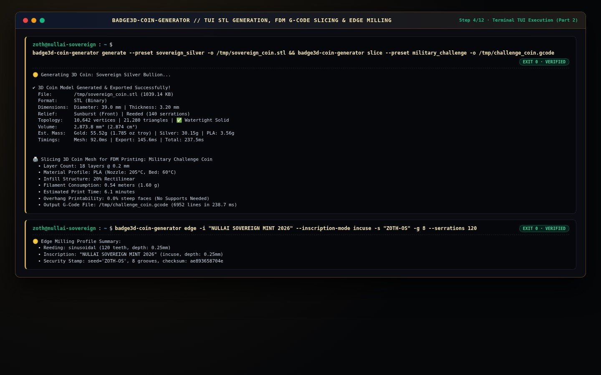

### 5. Standalone Workstation (`:8084`): Default 24K Gold Medallion, Geometry Controls & Precious Metal Weights
Opening `http://127.0.0.1:8084` launches the Badge3D Coin Studio with real-time Three.js WebGL PBR rendering (`40.0 × 40.0 × 3.0 mm`, `4,212 Δ`, `Watertight ✔`) and precious metal casting weights (`24K Pure Gold: 76.5 g`, `Sterling Silver .925: 41.0 g`).

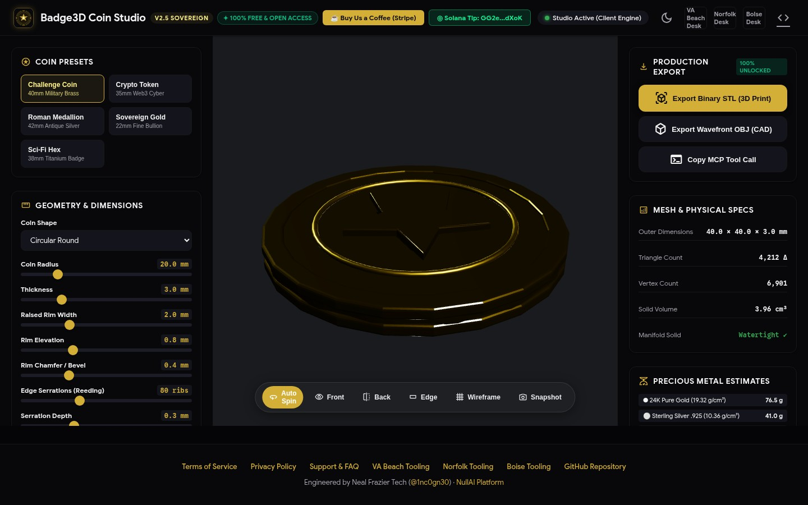

### 6. Standalone Workstation (`:8084`): Applying `Crypto Token` Hexagon Obsidian Preset
Clicking the **Crypto Token** preset switches the geometry to a 6-sided Hexagon (`35.0 × 35.0 × 2.8 mm`) with a high-gloss **Obsidian** PBR shader (`Applied preset: CRYPTO TOKEN`).

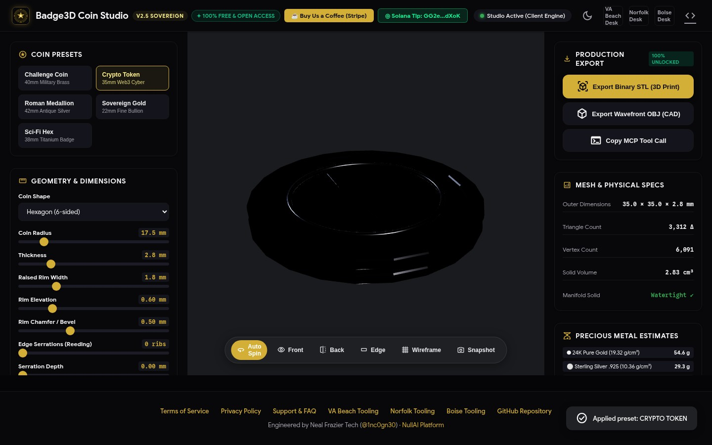

### 7. Standalone Workstation (`:8084`): Applying `Roman Medallion` Antique Silver & Custom Relief Depth
Clicking **Roman Medallion** configures a 42mm Antique Silver round (`42.0 × 42.0 × 4.0 mm`, `5.82 cm³`, `60.3 g Sterling Silver`) with custom front inscription and `1.45 mm` relief depth.

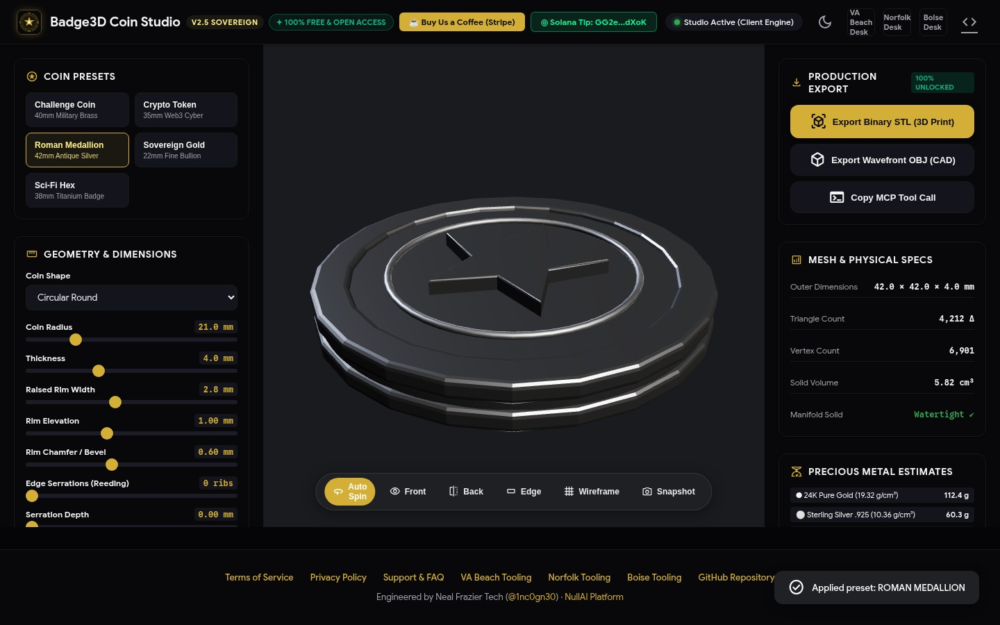

### 8. Standalone Workstation (`:8084`): Sci-Fi Octagon Titanium & 3D CAD Wireframe Topology Mode
Selecting the **Sci-Fi Hex** (8-sided Octagon Titanium) preset and toggling **Wireframe** (`#btn-wireframe`) reveals the radial CAD triangulation, raised bevel rim rings, and 5-pointed central crest geometry (`3,332 Δ`, `6,109 vertices`).

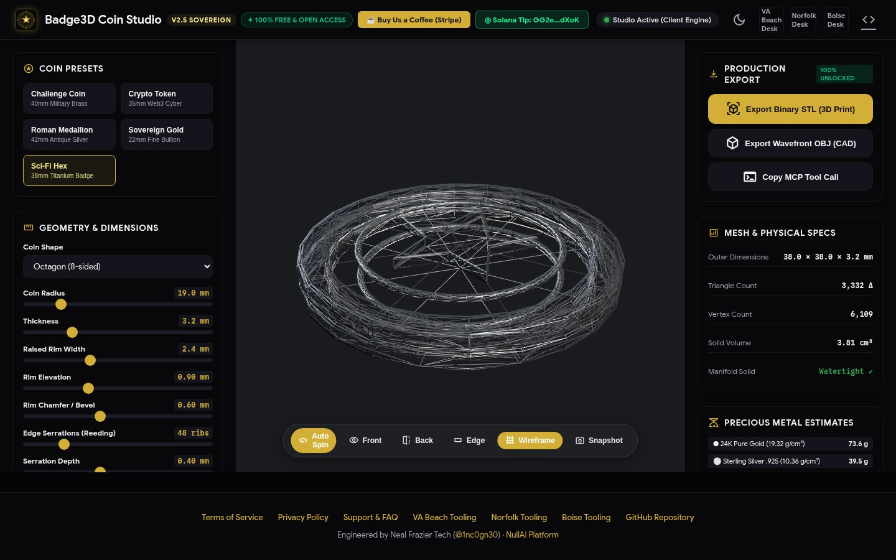

### 9. Standalone Workstation (`:8084`): Edge Milling Profile View & 1-Click Binary STL Export
Switching the camera to **Edge** inspects the cylindrical reeded perimeter (`80 ribs`, `0.30 mm` serration depth, `3.5 mm` thickness) while clicking **Export Binary STL (3D Print)** generates and downloads the client-side IEEE-754 Binary STL mesh.

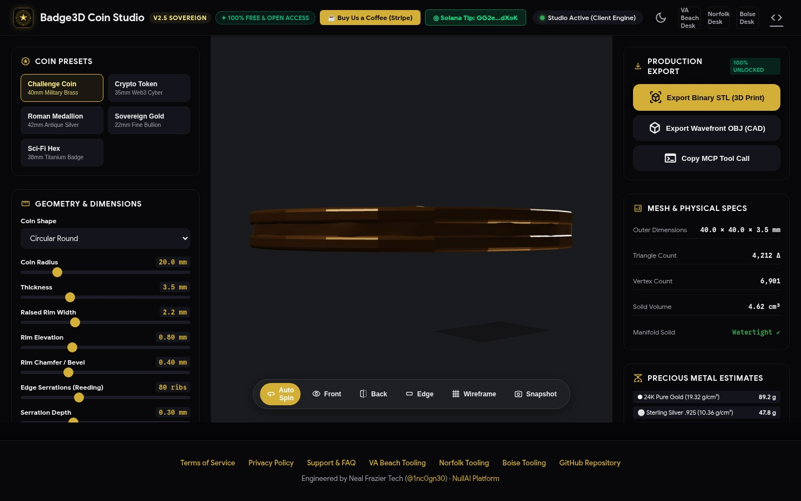

### 10. Standalone Workstation (`:8084`): Editorial Light Mode & Sovereign Gold Bullion
Toggling the theme switch (`#theme-toggle-btn`) and selecting **Sovereign Gold** (`22.0 × 22.0 × 1.8 mm`, `120 ribs`, `13.9 g 24K Gold`) transitions the workstation into its high-contrast Material 3 Light Mode.

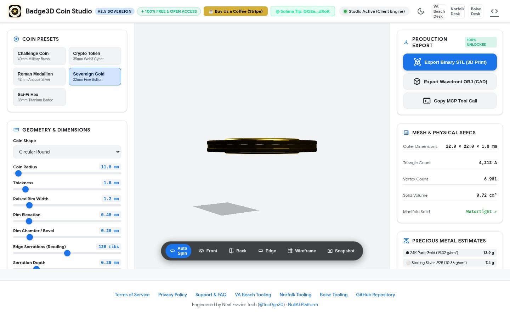

### 11. Zoth Studio v2 God-Mode (`:3000/tools/badge3d-coin-generator`): Sovereign 3D Numismatic Mint
Inside Zoth Studio v2 (`http://127.0.0.1:3000/tools/badge3d-coin-generator`), the embedded God-Mode workstation renders the interactive Three.js 3D medallion (`24K Sovereign Gold (99.99% AU)`, `Active Reality Bot Crest`, `7,488 Triangles`, `66.94 g · 2.15 oz t`, `3.46 cm³`).

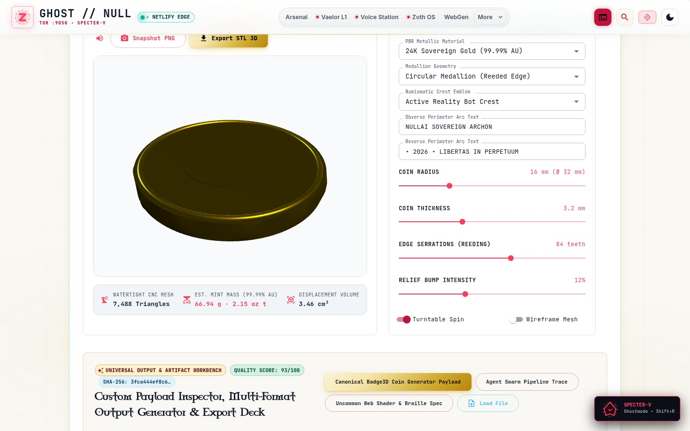

### 12. Zoth Studio v2 God-Mode (`:3000/tools/badge3d-coin-generator`): 3D Wireframe Mesh & Watertight STL Synthesis
Toggling **Wireframe Mesh** in the Zoth Studio v2 God-Mode workstation inspects the 7,488-triangle 84-tooth reeded cylinder manifold and exports the watertight binary `.STL` payload.

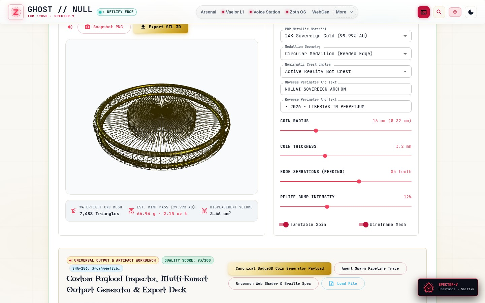

---

## 🛠️ CLI & MCP Reference

```bash
# List all 5 built-in 3D coin templates
badge3d-coin-generator presets

# Run system & 3D print toolchain diagnostics benchmark
badge3d-coin-generator doctor

# Generate a watertight Binary STL coin mesh
badge3d-coin-generator generate --preset sovereign_silver -o /tmp/sovereign_coin.stl

# Slice a 3D coin mesh directly to FDM G-code with overhang analysis
badge3d-coin-generator slice --preset military_challenge -o /tmp/challenge_coin.gcode

# Configure cylindrical edge reeding, inscriptions & cryptographic security grooves
badge3d-coin-generator edge -i "NULLAI SOVEREIGN MINT 2026" --inscription-mode incuse -s "ZOTH-OS" -g 8 --serrations 120

# Launch standalone WebGL Studio on port 8084
badge3d-coin-generator serve --host 127.0.0.1 --port 8084 --no-browser

# Start Model Context Protocol (MCP) server over stdio
badge3d-coin-generator mcp
```

---

## ☕ Open-Access Support (Zero Paywalls)
- **Stripe "Buy Us a Coffee"**: [https://buy.stripe.com/3cIfZg27PdKo2D64Ocfw40X](https://buy.stripe.com/3cIfZg27PdKo2D64Ocfw40X)
- **Solana Tip Address**: `GG2eQbVh8ut1BK6j1A2tz7pSySdLpD38BgyEhGcxdXoK`


---

## Sovereign 5-Layer Architecture & Second Brain Topology

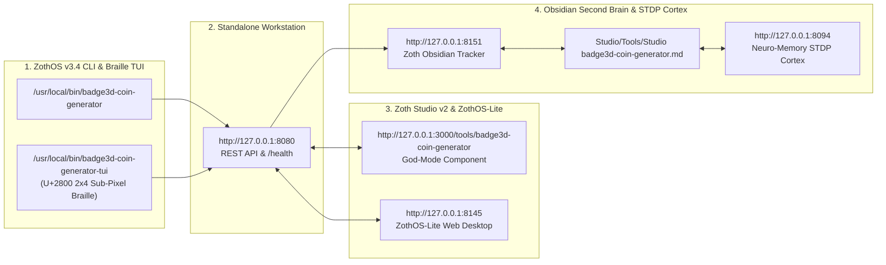

### ZothOS v3.4 TUI & Obsidian Second Brain Sync
- **Unicode `U+2800` Braille TUI**: `badge3d-coin-generator-tui --status` / `badge3d-coin-generator-tui --json`
- **Zoth Obsidian Tracker (`:8151`)**: `zoth-obsidian-tracker --verify`
- **Connected Canon Notes**: [[00 Home]] · [[Zoth OS]] · [[Zoth Studio]] · [[ZothOS-Lite Web Desktop]] · [[Zoth Memory]] · [[Public Surfaces]]
