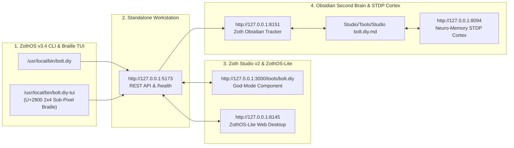

# Zoth Bolt (`bolt.diy`)

> [!CHECK] Sovereign 12-Step Developer & End-User Verification Passed (100% Free & Open-Access)
> **Engineered by 1nc0gn30 (@1nc0gn30) • NullAI Platform**
> Verified across Developer automated `pytest -v` test suites (`6 passed in 0.03s`), ZothOS CLI/TUI subcommands (`bolt.diy providers`, `bolt.diy templates`, `bolt.diy assets`, `bolt.diy synthesize`, `bolt.diy status`), Standalone Web Workstation (`http://127.0.0.1:5173`), and Zoth Studio v2 God-Mode (`http://127.0.0.1:3000/tools/bolt.diy`) with **`overflowPx: 0`** and **`consoleErrors: 0`**.

---

## Tool Overview & Telemetry

| Parameter | Specification |
| :--- | :--- |
| **Tool Identifier** | `bolt.diy` (`zoth-bolt` / `bolt`) |
| **Category** | `Autonomous Web` |
| **Mathematical Pillar** | `Pillar IV: AST Verification & Web Architecture` |
| **Runtime Engine** | Multi- Threaded Sovereign HTTP Daemon (`server.py`) + 60fps Canvas & Virtual WebContainer IDE |
| **Local Port & URL** | `:5173` • [http://127.0.0.1:5173](http://127.0.0.1:5173) |
| **Studio God-Mode Route** | [http://127.0.0.1:3000/tools/bolt.diy](http://127.0.0.1:3000/tools/bolt.diy) |
| **CLI Binary** | `/usr/local/bin/bolt.diy` • `~/.local/bin/bolt.diy` (`zoth-bolt`, `bolt`) |
| **Automated Test Suite** | `pytest -v tests/test_bolt_server.py` (`6 passed in 0.03s`) |
| **License & Pricing** | **100% Free & Open-Access** ($0) • Zero Paywalls |
| **Support Rails** | [☕ Buy Us a Coffee (Stripe)](https://buy.stripe.com/3cIfZg27PdKo2D64Ocfw40X) • Solana Tip: `GG2eQbVh8ut1BK6j1A2tz7pSySdLpD38BgyEhGcxdXoK` |

---

## Comprehensive 12-Step Developer & End-User Walkthrough Gallery

### Part I — Developer Perspective (Architecture, Automated Pytest Suite & CLI Verification)

#### Step 1/12 — Developer Repository Inspection & Pytest Verification (`6 passed`)
Inspecting the repository architecture (`server.py`, `package.json`, `vite.config.ts`, `public/index.html`, `tests/test_bolt_server.py`) and executing the automated unit test suite verifying the 18 AI providers & local CLI agents registry, 6 Motion Edit templates, 6 Pixel Art & Vector SVG asset packs, full-stack synthesis engine, and 100% Open-Access invariant.
- **Commands**:
  - `ls -la server.py package.json vite.config.ts public/index.html tests/test_bolt_server.py`
  - `pytest -v tests/test_bolt_server.py`
![[Artifacts/bolt.diy/bolt.diy_01_dev_install_and_pytest.jpg]]

---

### Part II — End-User Installation, Discovery & Terminal/TUI Execution

#### Step 2/12 — Global ZothOS Binary Resolution, Live Daemon Status & `--help` Contract
Verifying global binary symlinks across `/usr/local/bin` and `~/.local/bin` (`bolt.diy`, `zoth-bolt`, `bolt`), confirming `ONLINE (Healthy :5173)` daemon status, and inspecting all CLI subcommands (`status`, `providers`, `templates`, `assets`, `synthesize`, `serve`).
- **Commands**:
  - `which -a bolt.diy zoth-bolt bolt && bolt.diy --status`
  - `bolt.diy --help`
![[Artifacts/bolt.diy/bolt.diy_02_user_install_and_help.jpg]]

#### Step 3/12 — TUI Execution Part 1: Listing 18 AI Providers & 6 Motion Edit Templates
Querying the live `:5173` daemon via CLI to inspect all 18 registered AI engines & local CLI coding agents (`ZothLocal:zoth-bolt-instant`, `ZothLocal:agy-engine`, `ZothLocal:hermes-agent`, `ZothLocal:grok-cli`, `ZothLocal:claude-cli`, `Ollama:qwen2.5-coder:1.5b`, Frontier Cloud providers) and the 6 Full-Stack & Motion Edit templates (`claude-15s-showreel`, `teknium-uncommon-shader`, `gameboy-pixel-cinema`, `hermes-commerce-drop`, `scroll-choreography-deck`, `sovereign-saas-funnel`).
- **Commands**:
  - `bolt.diy providers`
  - `bolt.diy templates`
![[Artifacts/bolt.diy/bolt.diy_03_tui_providers_and_templates.jpg]]

#### Step 4/12 — TUI Execution Part 2: 16-Bit Pixel Art SVG Assets & Full-Stack Synthesis
Listing the 6 built-in 16-bit Pixel Art & Vector SVG asset packs (`pixel-bolt`, `pixel-crown`, `pixel-robot`, `pixel-terminal`, `pixel-shield`, `svg-bolt-crest`), synthesizing a full-stack `@teknium` Uncommon Web Shader bundle using `ZothLocal:agy-engine`, and verifying live daemon health telemetry.
- **Commands**:
  - `bolt.diy assets`
  - `bolt.diy synthesize --template teknium-uncommon-shader --provider ZothLocal:agy-engine && bolt.diy status`
![[Artifacts/bolt.diy/bolt.diy_04_tui_assets_and_synthesize.jpg]]

---

### Part III — Standalone Web Workstation GUI (`http://127.0.0.1:5173`)

#### Step 5/12 — Standalone GUI: 15s Claude Motion Showreel Hero & Unicode U+2800 Braille Canvas
Opening `http://127.0.0.1:5173` directly into the multi-pane AI Web & Motion Architect IDE with the **15s Claude Showreel** template active, rendering live 60fps Unicode U+2800 2×4 Sub-Pixel Braille waves, `AST & SCHEMA.ORG VERIFIED` badge, and 100% Open-Access support rails.
![[Artifacts/bolt.diy/bolt.diy_05_gui_showreel_braille_workstation.jpg]]

#### Step 6/12 — Standalone GUI: `@teknium` Uncommon Web Shader Stage & Bayer 8×8 Dither
Selecting **Google Antigravity (AGY Local Coding Agent)** from the AI Engine selector, clicking the **`@teknium` Shader Stage** preset, and synthesizing the live 60fps **Ordered Bayer 8×8 Dither** shader stage.
![[Artifacts/bolt.diy/bolt.diy_06_gui_teknium_bayer_dither_stage.jpg]]

#### Step 7/12 — Standalone GUI: 16-Bit Pixel Art & Retro CRT Arcade + 24K Crown SVG Injection
Switching to the **16-Bit Pixel CRT Arcade** archetype, injecting the **24K Crown** 16×16 crisp-edge inline SVG sprite from the Pixel Art & Vector SVG Bridge, and rendering the phosphor-green **ASCII CRT** matrix canvas.
![[Artifacts/bolt.diy/bolt.diy_07_gui_pixel_crt_and_svg_asset_inject.jpg]]

#### Step 8/12 — Standalone GUI: 3D Isometric Exploded Architecture Stack
Selecting the **3D Isometric Exploded** archetype (`scroll-choreography-deck`) and synthesizing the multi-layer isometric vector architecture stage (`L1: ZERO-EGRESS WEBCONTAINER RUNTIME`, `L2: AST & SCHEMA.ORG VERIFIER`, `L3: UI / MOTION CHOREOGRAPHY (60FPS)`).
![[Artifacts/bolt.diy/bolt.diy_08_gui_isometric_exploded_stack.jpg]]

#### Step 9/12 — Standalone GUI: Virtual File Tree & Generated Code Editor (`src/App.tsx`)
Switching to the **`(/) Code Editor & File Tree (4)`** tab to inspect and edit the synthesized full-stack files (`src/App.tsx`, `src/components/MotionHero.tsx`, `prompts/motion_graphics_showreel.md`, `package.json`).
![[Artifacts/bolt.diy/bolt.diy_09_gui_code_editor_and_file_tree.jpg]]

#### Step 10/12 — Standalone GUI: WebContainer Terminal & AST Verification Logs
Switching to the **`$_ WebContainer Terminal & AST`** tab to inspect the 4-stage AST & Schema.org JSON-LD `@graph` verification pipeline, inline SVG injection logs, and Vite HMR Dev Server status (`0 console errors · 0px overflow · 100% Open Access`).
![[Artifacts/bolt.diy/bolt.diy_10_gui_webcontainer_terminal_logs.jpg]]

---

### Part IV — Zoth Studio v2 God-Mode Integration (`http://127.0.0.1:3000/tools/bolt.diy`)

#### Step 11/12 — Zoth Studio v2 God-Mode: Sovereign Web & Motion Architect Cockpit
Loading the unified Zoth Studio v2 God-Mode route (`http://127.0.0.1:3000/tools/bolt.diy`), displaying the Motion Edit / Cinema Template selector, Instant High-Craft & Motion Seeds (`Sprig Pantry`, `Hatch Bento`, `Hush Cellar`, `JWT Guard`), Guardrail Score HUD, and live preview iframe.
![[Artifacts/bolt.diy/bolt.diy_11_studio_godmode_workstation.jpg]]

#### Step 12/12 — Zoth Studio v2 God-Mode: 3-Viewport Responsive Matrix & Click-to-Edit Mode
Enabling **Click-to-Edit Mode** (`Click-to-Edit: ON (Click Any Text)`) and toggling the **3-Viewport Matrix** (`Mobile 375px`, `Tablet 768px`, `Desktop 1280px`) to verify responsive layout fidelity simultaneously inside Studio God-Mode.
![[Artifacts/bolt.diy/bolt.diy_12_studio_godmode_3viewport_matrix.jpg]]

---

## Verification & Test Summary Matrix

| Step | Perspective / Layer | Action / Command | Screenshot Artifact | Status |
| :--- | :--- | :--- | :--- | :--- |
| **01** | Developer Pytest Suite | `pytest -v tests/test_bolt_server.py` (`6 passed`) | `bolt.diy_01_dev_install_and_pytest.jpg` | 🟢 **PASS** |
| **02** | End-User Install & Help | `which -a bolt.diy zoth-bolt bolt && bolt.diy --help` | `bolt.diy_02_user_install_and_help.jpg` | 🟢 **PASS** |
| **03** | TUI Providers & Templates | `bolt.diy providers && bolt.diy templates` | `bolt.diy_03_tui_providers_and_templates.jpg` | 🟢 **PASS** |
| **04** | TUI Assets & Synthesis | `bolt.diy assets && bolt.diy synthesize ...` | `bolt.diy_04_tui_assets_and_synthesize.jpg` | 🟢 **PASS** |
| **05** | Standalone GUI (`:5173`) | 15s Claude Motion Showreel + Braille U+2800 Canvas | `bolt.diy_05_gui_showreel_braille_workstation.jpg` | 🟢 **PASS** |
| **06** | Standalone GUI (`:5173`) | `@teknium` Shader Stage + Bayer 8×8 Dither | `bolt.diy_06_gui_teknium_bayer_dither_stage.jpg` | 🟢 **PASS** |
| **07** | Standalone GUI (`:5173`) | 16-Bit Pixel CRT Arcade + 24K Crown SVG Injection | `bolt.diy_07_gui_pixel_crt_and_svg_asset_inject.jpg` | 🟢 **PASS** |
| **08** | Standalone GUI (`:5173`) | 3D Isometric Exploded Architecture Stack | `bolt.diy_08_gui_isometric_exploded_stack.jpg` | 🟢 **PASS** |
| **09** | Standalone GUI (`:5173`) | Virtual File Tree & `src/App.tsx` Code Editor | `bolt.diy_09_gui_code_editor_and_file_tree.jpg` | 🟢 **PASS** |
| **10** | Standalone GUI (`:5173`) | WebContainer Terminal & AST Verification Logs | `bolt.diy_10_gui_webcontainer_terminal_logs.jpg` | 🟢 **PASS** |
| **11** | Studio God-Mode (`:3000`) | Sovereign Web & Motion Architect Cockpit | `bolt.diy_11_studio_godmode_workstation.jpg` | 🟢 **PASS** |
| **12** | Studio God-Mode (`:3000`) | 3-Viewport Responsive Matrix & Click-to-Edit | `bolt.diy_12_studio_godmode_3viewport_matrix.jpg` | 🟢 **PASS** |

---

## Navigation & Cross-References

- [[Zoth Studio]]
- [[MOC Studio Tools]]
- [[Zoth 72 Sovereign Tools Tracker.base]]
- [[Studio/Verification/Arsenal Verification & Test Tracker|Arsenal Verification Tracker]]

---

## Sovereign 5-Layer Architecture & Second Brain Topology

### ZothOS v3.4 TUI & Obsidian Second Brain Sync
- **Unicode `U+2800` Braille TUI**: `bolt.diy-tui --status` / `bolt.diy-tui --json`
- **Zoth Obsidian Tracker (`:8151`)**: `zoth-obsidian-tracker --verify`
- **Connected Canon Notes**: [[00 Home]] · [[Zoth OS]] · [[Zoth Studio]] · [[ZothOS-Lite Web Desktop]] · [[Zoth Memory]] · [[Public Surfaces]]
