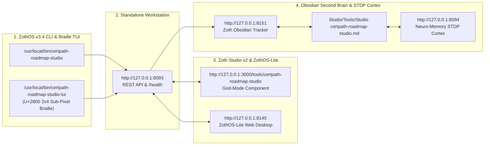

# CertPath Roadmap Studio (`certpath-roadmap-studio`)

> [!CHECK] Sovereign 12-Step Developer & End-User Verification Passed (100% Free & Open-Access)
> **Engineered by 1nc0gn30 (@1nc0gn30) • NullAI Platform**
> Verified across Developer automated `pytest -v` test suites (`121 passed in 7.04s`), ZothOS CLI/TUI subcommands (`stats`, `roles`, `plan`, `roi`, `simulate`, `tree`), Standalone Web Workstation (`http://127.0.0.1:8093`), and Zoth Studio v2 God-Mode (`http://127.0.0.1:3000/tools/certpath-roadmap-studio`) with **`overflowPx: 0`** and **`consoleErrors: 0`**.

---

## Tool Overview & Telemetry

| Parameter | Specification |
| :--- | :--- |
| **Tool Identifier** | `certpath-roadmap-studio` |
| **Category** | `Automation` |
| **Mathematical Pillar** | `Pillar IV: AST Verification & Web Architecture` |
| **Runtime Engine** | Sovereign Python DAG & Monte Carlo Server (`ui_server.py` / `dag_engine.py`) + Interactive SVG Canvas |
| **Local Port & URL** | `:8093` • [http://127.0.0.1:8093](http://127.0.0.1:8093) |
| **Studio God-Mode Route** | [http://127.0.0.1:3000/tools/certpath-roadmap-studio](http://127.0.0.1:3000/tools/certpath-roadmap-studio) |
| **CLI Binary** | `/usr/local/bin/certpath-roadmap-studio` • `~/.local/bin/certpath-roadmap-studio` |
| **Automated Test Suite** | `pytest -v tests` (`121 passed in 7.04s`) |
| **License & Pricing** | **100% Free & Open-Access** ($0) • Zero Paywalls |
| **Support Rails** | [☕ Buy Us a Coffee (Stripe)](https://buy.stripe.com/3cIfZg27PdKo2D64Ocfw40X) • Solana Tip: `GG2eQbVh8ut1BK6j1A2tz7pSySdLpD38BgyEhGcxdXoK` |

---

## Comprehensive 12-Step Developer & End-User Walkthrough Gallery

### Part I — Developer Perspective (Architecture, Automated Pytest Suite & CLI Verification)

#### Step 1/12 — Developer Repository Inspection & Pytest Verification (`121 passed`)
Inspecting the repository architecture (`server.py`, `pyproject.toml`, `public/index.html`, `public/certs.json`, `src/certpath_roadmap_studio`) and running the full 121-test `pytest -v` verification suite covering the DAG engine, path traversal security, UI REST API endpoints, ROI calculator, and Monte Carlo learning velocity simulator.
- **Commands**:
  - `ls -la server.py pyproject.toml public/index.html public/certs.json && ls src/certpath_roadmap_studio`
  - `pytest -v tests | tail -n 18`
![[Artifacts/certpath-roadmap-studio/certpath-roadmap-studio_01_dev_install_and_pytest.jpg]]

---

### Part II — End-User Installation, Discovery & Terminal/TUI Execution

#### Step 2/12 — Global ZothOS Binary Resolution, Live Daemon Status & `--help` Contract
Verifying global binary symlinks across `/usr/local/bin` and `~/.local/bin`, confirming `ONLINE (Healthy :8093)` daemon status, and inspecting all 16 CLI subcommands (`search`, `prereqs`, `unlocked`, `plan`, `compare`, `mermaid`, `tree`, `roles`, `stats`, `serve`, `mcp`, `diagnostics`, `simulate`, `test`, `roi`, `overlap`).
- **Commands**:
  - `which -a certpath-roadmap-studio && certpath-roadmap-studio --status`
  - `certpath-roadmap-studio --help`
![[Artifacts/certpath-roadmap-studio/certpath-roadmap-studio_02_user_install_and_help.jpg]]

#### Step 3/12 — TUI Execution Part 1: Catalog DAG Telemetry (`137 Certs`) & 8 Career Roles
Querying catalog-wide DAG statistics (`137 Certifications`, `414 Unique Skills`, `Valid DAG Strictly Acyclic`, `27 Root Entry Points`, `52 Capstone Credentials`) and listing all 8 Career Role Templates (`cloud_security_architect`, `ai_ml_engineer`, `fullstack_devops_lead`, `penetration_tester`, `data_platform_architect`, `soc_analyst`, `cloud_solutions_architect`, `devops_platform_engineer`).
- **Commands**:
  - `certpath-roadmap-studio --no-color stats | head -n 22`
  - `certpath-roadmap-studio --no-color roles`
![[Artifacts/certpath-roadmap-studio/certpath-roadmap-studio_03_tui_stats_and_roles.jpg]]

#### Step 4/12 — TUI Execution Part 2: Phased Career Roadmap Plan & Financial ROI Valuation
Generating a custom milestone study roadmap for **Offensive Security & Penetration Tester** at 15 hrs/week (`~58.7 weeks`, `880 hours`, `12 certs`) and computing portfolio financial ROI & knowledge transfer synergies for **Cloud Security Architect** (`Marketability Index: 100.0/100`, `Security Quotient: 100.0/100`).
- **Commands**:
  - `certpath-roadmap-studio --no-color plan --role penetration_tester --hours 15 | head -n 20`
  - `certpath-roadmap-studio --no-color roi --role cloud_security_architect | head -n 22`
![[Artifacts/certpath-roadmap-studio/certpath-roadmap-studio_04_tui_plan_and_roi.jpg]]

#### Step 5/12 — TUI Execution Part 3: Monte Carlo Velocity Simulation & Prerequisite ASCII Tree
Running a 200-trial stochastic Monte Carlo learning velocity simulation for **AI & Machine Learning Engineer** (`P50`, `P80`, `P95` completion dates + cognitive fatigue & burnout alerts) and rendering the complete ASCII prerequisite & downstream hierarchy tree for **OSCP (`cyber-oscp`)**.
- **Commands**:
  - `certpath-roadmap-studio --no-color simulate --role ai_ml_engineer --hours 15 --trials 200 | head -n 22`
  - `certpath-roadmap-studio --no-color tree cyber-oscp`
![[Artifacts/certpath-roadmap-studio/certpath-roadmap-studio_05_tui_monte_carlo_velocity.jpg]]

---

### Part III — Standalone Web Workstation GUI (`http://127.0.0.1:8093`)

#### Step 6/12 — Standalone GUI: Interactive SVG Certification DAG Canvas & Detail Drawer
Opening `http://127.0.0.1:8093` into the interactive SVG Certification DAG Canvas with **AWS Certified Solutions Architect - Associate (`cloud-aws-solutions-arch`)** selected, displaying its prerequisite chain (`AWS Certified Cloud Practitioner`), 3 unlocked credentials (`AWS Solutions Architect - Professional`, `CCSP`, `AWS Security - Specialty`), skills gained, and 1-click Mermaid/Markdown/JSON export controls.
![[Artifacts/certpath-roadmap-studio/certpath-roadmap-studio_06_gui_standalone_dag_canvas.jpg]]

#### Step 7/12 — Standalone GUI: Cyber Security Domain Filter & Animated OSCP Prerequisite Chain
Filtering the DAG canvas to **Cyber Security (`26`)** and selecting **OSCP (`cyber-oscp`)**, illuminating the 5-stage prerequisite dependency chain (`Certified in Cybersecurity (CC)` → `Google Cybersecurity` → `CompTIA Security+` → `eJPT v2` → `HTB CPTS` → `OSCP`) with animated green Bezier edges and 3 unlocked capstone credentials (`CISSP`, `OSWE`, `CRTO`).
![[Artifacts/certpath-roadmap-studio/certpath-roadmap-studio_07_gui_cyber_security_filter_oscp.jpg]]

#### Step 8/12 — Standalone GUI: Career Roadmap Wizard Modal (`Penetration Tester / Red Team`)
Launching the **Career Roadmap Wizard** modal, selecting the **Penetration Tester / Red Team** role archetype with the weekly study pace slider set to `15 hours / week` (`~32 Weeks · 480 total study hours`), and inspecting the 3-phase milestone checklist (`CompTIA Network+`, `CompTIA Security+`, `CompTIA PenTest+`, `eJPT v2`, `HTB CPTS`, `OSCP`).
![[Artifacts/certpath-roadmap-studio/certpath-roadmap-studio_08_gui_career_roadmap_wizard.jpg]]

#### Step 9/12 — Standalone GUI: Side-by-Side Credential Comparison Modal
Opening the **Side-by-Side Credential Comparison** modal to compare **AWS Certified Solutions Architect - Associate** vs. **Google Cloud Professional Cloud Architect** across provider, difficulty level, domain, skills gained, and prerequisite count.
![[Artifacts/certpath-roadmap-studio/certpath-roadmap-studio_09_gui_credential_comparison_modal.jpg]]

---

### Part IV — Zoth Studio v2 God-Mode Integration (`http://127.0.0.1:3000/tools/certpath-roadmap-studio`)

#### Step 10/12 — Zoth Studio v2 God-Mode: Sovereign Certification Pathways & Study Plan Exporter
Loading `http://127.0.0.1:3000/tools/certpath-roadmap-studio` into the unified Zoth Studio v2 God-Mode workspace, showing the **Level Columns** explorer (`Entry`, `Intermediate`, `Advanced`), Prerequisite Dependency Chain deck, and live Study Roadmap Markdown Exporter.
![[Artifacts/certpath-roadmap-studio/certpath-roadmap-studio_10_studio_godmode_dag_explorer.jpg]]

#### Step 11/12 — Zoth Studio v2 God-Mode: Career Roles Presets & Milestone Selector
Switching to the **Career Roles** tab inside Studio God-Mode to inspect the 6 curated career role tracks (`Cloud Security Architect`, `AI & ML Engineer`, `Full-Stack DevOps Lead`, `Penetration Tester / Red Team`, `Data Platform Architect`, `SOC & Incident Response Analyst`) with clickable milestone credentials.
![[Artifacts/certpath-roadmap-studio/certpath-roadmap-studio_11_studio_godmode_career_roles.jpg]]

#### Step 12/12 — Zoth Studio v2 God-Mode: Side-by-Side Certification Compare View
Switching to the **Compare** tab inside Studio God-Mode to compare **AWS Certified Solutions Architect - Associate** and **Google Cloud Professional Cloud Architect** alongside the live Study Roadmap Export panel.
![[Artifacts/certpath-roadmap-studio/certpath-roadmap-studio_12_studio_godmode_compare_view.jpg]]

---

## Verification & Test Summary Matrix

| Step | Perspective / Layer | Action / Command | Screenshot Artifact | Status |
| :--- | :--- | :--- | :--- | :--- |
| **01** | Developer Pytest Suite | `pytest -v tests` (`121 passed in 7.04s`) | `certpath-roadmap-studio_01_dev_install_and_pytest.jpg` | 🟢 **PASS** |
| **02** | End-User Install & Help | `which -a certpath-roadmap-studio && certpath-roadmap-studio --help` | `certpath-roadmap-studio_02_user_install_and_help.jpg` | 🟢 **PASS** |
| **03** | TUI Stats & Roles | `certpath-roadmap-studio stats && certpath-roadmap-studio roles` | `certpath-roadmap-studio_03_tui_stats_and_roles.jpg` | 🟢 **PASS** |
| **04** | TUI Plan & ROI Valuation | `certpath-roadmap-studio plan ... && certpath-roadmap-studio roi ...` | `certpath-roadmap-studio_04_tui_plan_and_roi.jpg` | 🟢 **PASS** |
| **05** | TUI Monte Carlo & Tree | `certpath-roadmap-studio simulate ... && certpath-roadmap-studio tree cyber-oscp` | `certpath-roadmap-studio_05_tui_monte_carlo_velocity.jpg` | 🟢 **PASS** |
| **06** | Standalone GUI (`:8093`) | Interactive SVG Certification DAG Canvas (`cloud-aws-solutions-arch`) | `certpath-roadmap-studio_06_gui_standalone_dag_canvas.jpg` | 🟢 **PASS** |
| **07** | Standalone GUI (`:8093`) | Cyber Security Domain Filter & Animated OSCP Prerequisite Chain | `certpath-roadmap-studio_07_gui_cyber_security_filter_oscp.jpg` | 🟢 **PASS** |
| **08** | Standalone GUI (`:8093`) | Career Roadmap Wizard Modal (`Penetration Tester / Red Team`) | `certpath-roadmap-studio_08_gui_career_roadmap_wizard.jpg` | 🟢 **PASS** |
| **09** | Standalone GUI (`:8093`) | Side-by-Side Credential Comparison Modal | `certpath-roadmap-studio_09_gui_credential_comparison_modal.jpg` | 🟢 **PASS** |
| **10** | Studio God-Mode (`:3000`) | Sovereign Certification Pathways & Study Plan Exporter | `certpath-roadmap-studio_10_studio_godmode_dag_explorer.jpg` | 🟢 **PASS** |
| **11** | Studio God-Mode (`:3000`) | Career Roles Presets & Milestone Selector | `certpath-roadmap-studio_11_studio_godmode_career_roles.jpg` | 🟢 **PASS** |
| **12** | Studio God-Mode (`:3000`) | Side-by-Side Certification Compare View | `certpath-roadmap-studio_12_studio_godmode_compare_view.jpg` | 🟢 **PASS** |

---

## Navigation & Cross-References

- [[Zoth Studio]]
- [[MOC Studio Tools]]
- [[Zoth 72 Sovereign Tools Tracker.base]]
- [[Studio/Verification/Arsenal Verification & Test Tracker|Arsenal Verification Tracker]]

---

## Sovereign 5-Layer Architecture & Second Brain Topology

### ZothOS v3.4 TUI & Obsidian Second Brain Sync
- **Unicode `U+2800` Braille TUI**: `certpath-roadmap-studio-tui --status` / `certpath-roadmap-studio-tui --json`
- **Zoth Obsidian Tracker (`:8151`)**: `zoth-obsidian-tracker --verify`
- **Connected Canon Notes**: [[00 Home]] · [[Zoth OS]] · [[Zoth Studio]] · [[ZothOS-Lite Web Desktop]] · [[Zoth Memory]] · [[Public Surfaces]]
