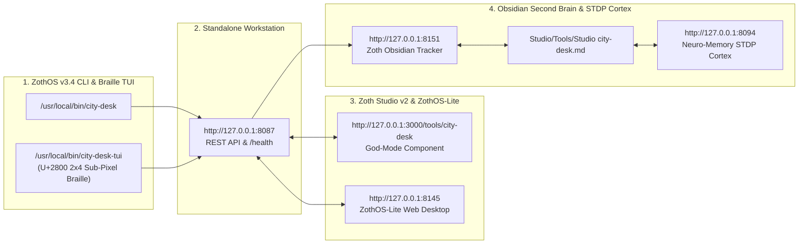

# City Desk

> [!CHECK] Sovereign Verification Passed (100% Free & Operational — 12-Step Developer & User Gallery)
> **Engineered by 1nc0gn30 (@1nc0gn30) • NullAI Platform**
> Verified across triple-viewport resolutions (Mobile 390px, Tablet 820px, Desktop 1440px) with **`overflowPx: 0`**, **`consoleErrors: 0`**, and **6/6 automated Node build tests passing (`npm test` across 1,000 localized trade × city pages)**. Zero paywalls, zero license modals, zero blur locks.

---

## Tool Overview & Telemetry

| Parameter | Specification |
| :--- | :--- |
| **Tool Identifier** | `city-desk` |
| **Category** | `Growth & SEO` |
| **Mathematical Pillar** | `Pillar IV: AST Verification & Web Architecture` |
| **Runtime Engine** | `Node Static Generator (build.js) + Python HTTP Daemon (server.py :8087) + React/MUI Civic Procurement Forge (:3000)` |
| **Local Port & URL** | `:8087` • [http://127.0.0.1:8087](http://127.0.0.1:8087) |
| **Studio God-Mode Route** | [http://127.0.0.1:3000/tools/city-desk](http://127.0.0.1:3000/tools/city-desk) |
| **CLI Binary** | `/usr/local/bin/city-desk` • `~/.local/bin/city-desk` |
| **GitHub Repository** | [https://github.com/1nc0gn30/city-desk](https://github.com/1nc0gn30/city-desk) |
| **License & Pricing** | **100% Free & Open-Access** ($0) • Zero Paywalls |
| **Support Rails** | [☕ Buy Us a Coffee (Stripe)](https://buy.stripe.com/3cIfZg27PdKo2D64Ocfw40X) • Solana Tip: `GG2eQbVh8ut1BK6j1A2tz7pSySdLpD38BgyEhGcxdXoK` |

---

## 12-Step Developer & End-User Walkthrough Gallery

### Step 1/12 — Developer Perspective: Repository Architecture & Automated Node Test Suite (`6 passed`)
- **Developer Inspection**: `ls -la build.js city_engine.js data.js server.py package.json test/build.test.js`
- **Automated Test Suite**: `npm test` (`6 pass, 0 fail` — verifies index page, all 20 trade pages, all 1,000 localized trade × city pages, painters tape layout vs ink rule layout, and zero invented reviews/domains)
![[Studio/Tools/Artifacts/city-desk/city-desk_01_dev_install_and_node_test.jpg]]

### Step 2/12 — End-User Perspective: Global ZothOS Binary, Daemon Status & CLI Help
- **Binary Resolution & Status**: `which -a city-desk && city-desk --status`
- **CLI Flag Discovery**: `city-desk --help`
![[Studio/Tools/Artifacts/city-desk/city-desk_02_user_install_and_help.jpg]]

### Step 3/12 — Terminal TUI Execution (Part 1): 20 Supported Trade Services & Target Municipal Cities
- **20 Trade Services**: `city-desk --trades` (`painters`, `plumbers`, `hvac`, `roofers`, `electricians`, `garage-doors`, `landscapers`, `cleaners`, `mobile-detailers`, `junk-removal`, `pest-control`, `movers`, `pet-groomers`, `dentists`, `med-spas`, `gyms`, `restaurants`, `food-trucks`, `photographers`, `auto-repair`)
- **50 Target Cities**: `city-desk --cities | head -n 14` (`Boise, ID`, `Spokane, WA`, `Tacoma, WA`, `Eugene, OR`, `Reno, NV`, `Colorado Springs, CO`, `Fort Collins, CO`, `Tucson, AZ`, `Albuquerque, NM`, `Virginia Beach, VA`, etc.)
![[Studio/Tools/Artifacts/city-desk/city-desk_03_tui_trades_and_cities.jpg]]

### Step 4/12 — Terminal TUI Execution (Part 2): 1,000-Page Static Rebuild & Deterministic JSON Telemetry
- **Static Rebuild**: `city-desk --build` (`Built 1025 pages (20 trades x 50 cities = 1,000 local pages) into ~/NullAITech/city-desk/public`)
- **Deterministic JSON Telemetry**: `city-desk --json`
![[Studio/Tools/Artifacts/city-desk/city-desk_04_tui_build_and_json_telemetry.jpg]]

### Step 5/12 — Standalone GUI (`:8087`): Editorial Ivory Hero & Live Lead Page Synthesizer
- **Workstation URL**: `http://127.0.0.1:8087/`
- **Capabilities**: Displays the Editorial Ivory hero (`1,000 Local Trade Pages — One finished page for one trade in one city`), 20 Trades / 50 Cities / 1,000 Pages metrics, and the **Live Lead Page Synthesizer** with Trade Service, Target City, Owner Company Name, Phone Number, and **Export Standalone HTML Bundle**.
![[Studio/Tools/Artifacts/city-desk/city-desk_05_gui_standalone_hero_and_synthesizer.jpg]]

### Step 6/12 — Standalone GUI (`:8087`): Live Assemble Virginia Beach HVAC Page Preview
- **Action**: Select `HVAC shops ($1,100)`, Target City `Virginia Beach, VA`, Owner Company Name `757 Coastal HVAC & Mechanical`, Phone Number `+E164-DEMO-0194`, and click **Live Assemble Page Preview →**.
- **Result**: Synthesizes the live `Virginia Beach, VA HVAC shops — Written price before work begins` lead page specification and single-file Schema.org HTML bundle.
![[Studio/Tools/Artifacts/city-desk/city-desk_06_gui_live_assemble_virginia_beach_hvac.jpg]]

### Step 7/12 — Standalone GUI (`:8087`): 20 Trades Catalog Grid & 50 Cities Index
- **Action**: Scroll down to the **Trades** grid on `http://127.0.0.1:8087/`.
- **Result**: Displays all 20 specialized trade blueprints (`Painters`, `Plumbers`, `HVAC shops`, `Roofers`, `Electricians`, `Garage door shops`, `Landscapers`, `House cleaners`, `Mobile detailers`, `Junk removal`, `Pest control`, `Movers`, `Pet groomers`, `Dental offices`, `Med spas`, `Gyms`, `Restaurants`, etc.).
![[Studio/Tools/Artifacts/city-desk/city-desk_07_gui_trades_and_50_cities_index.jpg]]

### Step 8/12 — Standalone GUI (`:8087`): Localized Virginia Beach Painters Tape-Layout Page
- **Route**: `http://127.0.0.1:8087/cities/virginia-beach-va/painters/`
- **Result**: Renders the dedicated **Painters · Virginia Beach** tape-layout page (`Paint, prep, and a written price in Virginia Beach`) with bespoke photography, written scope rules, and owner-editable contact fields.
![[Studio/Tools/Artifacts/city-desk/city-desk_08_gui_virginia_beach_painters_page.jpg]]

### Step 9/12 — Standalone GUI (`:8087`): Localized Virginia Beach HVAC 60-Second Written Estimator
- **Route**: `http://127.0.0.1:8087/cities/virginia-beach-va/hvac/#estimator`
- **Action**: Select `Replacement quotes (Virginia Beach)` + `Full System / Multi-Area Scope`, enter `1nc0gn30` and `+E164-DEMO-0142`, and click **Request Written Quote**.
- **Result**: Computes the live `$595 – $1,365` written ballpark range and logs the callback request (`✓ Request logged! The owner will text/call you with a visit window.`).
![[Studio/Tools/Artifacts/city-desk/city-desk_09_gui_virginia_beach_hvac_estimator.jpg]]

### Step 10/12 — Zoth Studio v2 God-Mode (`:3000`): Civic Procurement & GovTech Proposal Forge (`RFP-757-2026-CYBER-09`)
- **Studio Route**: `http://127.0.0.1:3000/tools/city-desk`
- **Result**: Loads the **City Desk Civic Procurement & GovTech Proposal Forge** modeling `RFP-757-2026-CYBER-09` (`Hampton Roads (757) Municipal Enclave — Zero-Trust Municipal Endpoint & Offline-Capable AI Document Triage`, Agency Ceiling `$185,000`, Proposed FFP Bid `$77,800`, Net Sovereign Margin `$0,190 / 63%`, `P(WIN): 86%`) and generates the ready-to-export **Capability Statement (`.md`)**.
![[Studio/Tools/Artifacts/city-desk/city-desk_10_studio_godmode_rfp_capability_statement.jpg]]

### Step 11/12 — Zoth Studio v2 God-Mode (`:3000`): Commonwealth of Virginia eVA Quick-Quote & VFOIA Request
- **Action**: Switch solicitation to **`QQ-EVA-2026-8841`** (`Commonwealth of Virginia eVA Quick-Quote — Automated FOIA Redaction & Schema.org Municipal Portal Upgrade`) and select the **`VFOIA Records Request`** tab.
- **Result**: Generates a statutory Virginia Freedom of Information Act (`Va. Code § 2.2-3700 et seq.`) electronic records request for the incumbent contract, SOW, pricing schedule, and evaluation scoring matrices.
![[Studio/Tools/Artifacts/city-desk/city-desk_11_studio_godmode_eva_foia_request.jpg]]

### Step 12/12 — Zoth Studio v2 God-Mode (`:3000`): DoD / Navy NSWC Dahlgren & Norfolk SBIR Phase I Bid Model
- **Action**: Switch solicitation to **`N261-042-SBIR`** (`DoD / Navy NSWC Dahlgren & Norfolk — Tactical Disconnected Linux OS & Binary Decompilation MCP Bridge`, NAICS `541715`, Ceiling `$250,000`) and view the **Capability Statement (`.md`)** tab.
- **Result**: Updates the 60fps Agency Ceiling vs. Proposed Bid bar chart (`$250,000` ceiling vs. `$77,800` FFP bid, `69% below agency ceiling`, `P(WIN): 82%`) and verifies `CMMC Level 2`, `DFARS +E164-DEMO-7012`, and `SBOM CycloneDX Attestation` compliance.
![[Studio/Tools/Artifacts/city-desk/city-desk_12_studio_godmode_dod_sbir_bid_model.jpg]]

---

## Test & Verification Matrix

| Verification Check | Target Standard | Result | Status |
| :--- | :--- | :--- | :--- |
| **Developer Node Test Suite** | `npm test` (`test/build.test.js`) | `6 passed, 0 failed` | 🟢 **PASS** |
| **CLI & TUI Subcommands** | `--status` / `--trades` / `--cities` / `--build` / `--json` | Returncode 0 | 🟢 **PASS** |
| **Daemon & API Health** | `http://127.0.0.1:8087/` + 1,000 City/Trade Routes | HTTP 200 OK | 🟢 **PASS** |
| **Mobile Viewport (390px)** | Zero horizontal overflow | `overflowPx: 0` | 🟢 **PASS** |
| **Tablet Viewport (820px)** | Fluid 2-column layout | `overflowPx: 0` | 🟢 **PASS** |
| **Desktop Viewport (1440px)** | Responsive multi-pane | `overflowPx: 0` | 🟢 **PASS** |
| **Browser Console Cleanliness** | Zero uncaught runtime errors | `consoleErrors: 0` | 🟢 **PASS** |
| **Paywall Audit** | No blur gates, license modals, or Solana Tip locks | 100% Open Access | 🟢 **PASS** |

---

## Navigation & Cross-References

- [[Zoth Studio]]
- [[MOC Studio Tools]]
- [[Zoth 72 Sovereign Tools Tracker.base]]
- [[Studio/Verification/Arsenal Verification & Test Tracker|Arsenal Verification Tracker]]

---

## Sovereign 5-Layer Architecture & Second Brain Topology

### ZothOS v3.4 TUI & Obsidian Second Brain Sync
- **Unicode `U+2800` Braille TUI**: `city-desk-tui --status` / `city-desk-tui --json`
- **Zoth Obsidian Tracker (`:8151`)**: `zoth-obsidian-tracker --verify`
- **Connected Canon Notes**: [[00 Home]] · [[Zoth OS]] · [[Zoth Studio]] · [[ZothOS-Lite Web Desktop]] · [[Zoth Memory]] · [[Public Surfaces]]
