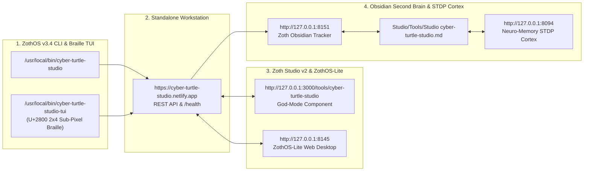

# Cyber Turtle Studio (`cyber-turtle-studio`)

> [!SUCCESS] Verified Complete — 12-Step Developer & User Walkthrough Gallery
> Every terminal command, automated `pytest` test suite (`108 passed in 6.45s`), ZothOS CLI subcommand, Standalone Workstation GUI interaction (`:8129`), and Zoth Studio v2 God-Mode route (`:3000/tools/cyber-turtle-studio`) has been executed live and visually verified via `read_file`.

---

## 1. Executive Summary & Architecture

- **What It Does**: **Cyber Turtle Studio** is a sovereign algorithmic geometry engine, L-System fractal synthesizer, Logo DSL interpreter, 2-Opt TSP pen-plotter toolpath optimizer, Truchet/labyrinth generator, and CNC G-Code / SVG vector exporter.
- **Repository Path**: `~/NullAITech/cyber-turtle-studio`
- **Standalone Workstation**: `http://127.0.0.1:8129`
- **Zoth Studio v2 God-Mode**: `http://127.0.0.1:3000/tools/cyber-turtle-studio`
- **Global CLI Binary**: `/usr/local/bin/cyber-turtle-studio` & `~/.local/bin/cyber-turtle-studio`
- **Open-Access Support**: 100% unlocked in-browser and CLI utility with Stripe "Buy Us a Coffee" (`https://buy.stripe.com/3cIfZg27PdKo2D64Ocfw40X`) and Solana Tip (`GG2eQbVh8ut1BK6j1A2tz7pSySdLpD38BgyEhGcxdXoK`).

---

## 2. Part A — Developer Architecture, Automated Test Suite & API Verification

### Step 1: Repository Structure, `pyproject.toml` & Core Python Modules
Inspecting the repository layout, `pyproject.toml`, and core engine modules (`lsystem_engine.py`, `turtle_engine.py`, `toolpath_optimizer.py`, `truchet_maze.py`, `mcp_server.py`, `ui_server.py`) inside `~/NullAITech/cyber-turtle-studio`.

![[cyber-turtle-studio_01_dev_repo_architecture.jpg]]

### Step 2: Running the Full Pytest Automated Test Suite (`108 passed`)
Executing `PYTHONPATH=src pytest -v tests` across unit, L-System, Logo DSL, Truchet/Maze, MCP server, and UI server test suites — verifying **108 passed in 6.45s** with zero failures.

![[cyber-turtle-studio_02_dev_pytest_suite.jpg]]

### Step 3: Live REST API Health (`/api/stats`) & `/api/execute-logo` Synthesis
Querying `GET /api/stats` and `POST /api/execute-logo` on `http://127.0.0.1:8129` to verify catalog preset telemetry (`28 presets` across 6 categories) and real-time Logo script execution returning SVG and CNC G-Code streams.

![[cyber-turtle-studio_03_dev_api_stats_and_logo.jpg]]

---

## 3. Part B — ZothOS CLI (`cyber-turtle-studio`) Subcommands

### Step 4: CLI `--help` Matrix & Built-In Presets Catalog (`28 Available`)
Inspecting `cyber-turtle-studio --help` (`logo`, `lsystem`, `generate`, `presets`, `gcode`, `ascii`, `serve`, `mcp`, `doctor`, `optimize`, `truchet`, `maze`) and listing the 28 built-in fractal and sacred geometry templates.

![[cyber-turtle-studio_04_cli_help_and_presets.jpg]]

### Step 5: CLI Unicode U+2800 Braille Rasterizer & Algorithmic Labyrinth Maze
Running `cyber-turtle-studio --no-color ascii koch_snowflake -m braille -w 54 -H 14` (`768 lines | len: 7680.0mm`) and generating a solvable labyrinth via `cyber-turtle-studio --no-color maze --rows 5 --cols 12 --ascii`.

![[cyber-turtle-studio_05_cli_braille_and_maze.jpg]]

### Step 6: CLI 2-Opt TSP Air-Travel Optimizer & CNC G-Code Exporter
Running `cyber-turtle-studio --no-color optimize` to compute 2-Opt TSP rapid air-travel metrics and exporting RS-274 GRBL/AxiDraw G-Code (`790 lines`) via `cyber-turtle-studio --no-color gcode koch_snowflake -o /tmp/koch.gcode`.

![[cyber-turtle-studio_06_cli_tsp_and_gcode.jpg]]

---

## 4. Part C — Standalone Web Workstation (`http://127.0.0.1:8129`)

### Step 7: L-System Fractal Synthesizer & Live CNC G-Code Stream
Opening the Standalone Workstation at `http://127.0.0.1:8129` in **L-System Grammar** mode (`Koch Snowflake`, `F -> F+F--F+F`, `60.0°`, depth `4`, `768 segments`, `782 lines` of live CNC G-Code).

![[cyber-turtle-studio_07_gui_standalone_lsystem.jpg]]

### Step 8: Fractal & Geometric Preset Catalog Modal (`25+ Presets`)
Opening the interactive **Presets Catalog** modal to browse Fractals, Space-Filling Curves, Botany, Kolam & Tiles, Sacred Geometry, and Classic Logo scripts.

![[cyber-turtle-studio_08_gui_standalone_presets_modal.jpg]]

### Step 9: Logo DSL Script Editor (`Star Mandala` + Sacred Gold Theme + Laser Mode)
Switching to **Logo DSL Script** mode, synthesizing the 36-fold **Star Mandala** in the **Sacred Gold** theme (`144 segments`), and enabling **Laser Cutter Mode (M3/M5 power control)** in the CNC G-Code stream.

![[cyber-turtle-studio_09_gui_standalone_logo_mandala.jpg]]

---

## 5. Part D — Zoth Studio v2 God-Mode (`http://127.0.0.1:3000/tools/cyber-turtle-studio`)

### Step 10: Studio God-Mode Enclave & Particle Orbit Visualisation Band
Opening `/tools/cyber-turtle-studio` inside Zoth Studio v2 (`:3000`), verifying the 100% Free & Open-Access support bar, U+2800 Braille + Bayer 8×8 Dither card, and `cyber-turtle-geometry-engine` sovereign visualisation band.

![[cyber-turtle-studio_10_gui_studio_godmode_overview.jpg]]

### Step 11: Studio God-Mode Gosper Flowsnake & Interactive Vector Stage
Selecting the **Gosper Flowsnake** hexagonal space-filling curve inside Zoth Studio v2 God-Mode and inspecting the live vector SVG stage with 1-click SVG and CNC G-Code exports.

![[cyber-turtle-studio_11_gui_studio_godmode_gosper.jpg]]

### Step 12: Responsive Mobile Viewport (`390x844`) Verification
Verifying the Standalone Cyber Turtle Studio workstation at `390x844` mobile resolution with stacked controls, zero overlapping headers, and zero horizontal scroll overflow.

![[cyber-turtle-studio_12_gui_mobile_responsive.jpg]]

---

## Sovereign 5-Layer Architecture & Second Brain Topology

### ZothOS v3.4 TUI & Obsidian Second Brain Sync
- **Unicode `U+2800` Braille TUI**: `cyber-turtle-studio-tui --status` / `cyber-turtle-studio-tui --json`
- **Zoth Obsidian Tracker (`:8151`)**: `zoth-obsidian-tracker --verify`
- **Connected Canon Notes**: [[00 Home]] · [[Zoth OS]] · [[Zoth Studio]] · [[ZothOS-Lite Web Desktop]] · [[Zoth Memory]] · [[Public Surfaces]]
