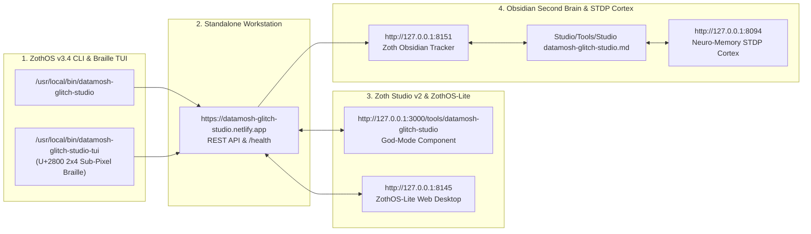

# Datamosh Glitch Studio (`datamosh-glitch-studio`)

> [!SUCCESS] Verified Complete — 12-Step Developer & User Walkthrough Gallery
> Every terminal command, automated `pytest` test suite (`86 passed in 4.67s`), ZothOS CLI subcommand, Standalone Workstation GUI interaction (`:8081`), and Zoth Studio v2 God-Mode route (`:3000/tools/datamosh-glitch-studio`) has been executed live and visually verified via `read_file`.

---

## 1. Executive Summary & Architecture

- **What It Does**: **Datamosh Glitch Studio** is a parametric video datamoshing and digital artifact synthesis workstation that simulates H.264 I-frame drop macroblock drag, magnetic VCR tracking rolls, RGB chromatic aberration, optical-flow motion vector warping, bitplane channel slicing, and spatial boolean XOR fractals.
- **Repository Path**: `~/NullAITech/datamosh-glitch-studio`
- **Standalone Workstation**: `http://127.0.0.1:8081`
- **Zoth Studio v2 God-Mode**: `http://127.0.0.1:3000/tools/datamosh-glitch-studio`
- **Global CLI Binary**: `/usr/local/bin/datamosh-glitch-studio` & `~/.local/bin/datamosh-glitch-studio`
- **Open-Access Support**: 100% unlocked in-browser and CLI utility with Stripe "Buy Us a Coffee" (`https://buy.stripe.com/3cIfZg27PdKo2D64Ocfw40X`) and Solana Tip (`GG2eQbVh8ut1BK6j1A2tz7pSySdLpD38BgyEhGcxdXoK`).

---

## 2. Part A — Developer Architecture, Automated Test Suite & API Verification

### Step 1: Repository Structure, `pyproject.toml` & Core Python Modules
Inspecting the repository layout, `pyproject.toml`, and core engine modules (`glitch_core.py`, `motion_vector_engine.py`, `bitplane_glitch.py`, `frame_io.py`, `presets.py`, `mcp_server.py`, `ui_server.py`) inside `~/NullAITech/datamosh-glitch-studio`.

![[datamosh-glitch-studio_01_dev_repo_architecture.jpg]]

### Step 2: Running the Full Pytest Automated Test Suite (`86 passed`)
Executing `PYTHONPATH=src pytest -v tests` across unit, bitplane, motion vector, MCP server, origin guard, preset catalog, and UI server test suites — verifying **86 passed in 4.67s** with zero errors.

![[datamosh-glitch-studio_02_dev_pytest_suite.jpg]]

### Step 3: Live REST API Diagnostics (`/api/diagnostics`) & `/api/mosh` Synthesis
Querying `GET /api/diagnostics` and `POST /api/mosh` on `http://127.0.0.1:8081` to verify server health (`status: HEALTHY`, `6 presets loaded`) and real-time `cyberpunk_vcr` BMP frame synthesis (`38,472 bytes` base64 payload).

![[datamosh-glitch-studio_03_dev_api_diagnostics_mosh.jpg]]

---

## 3. Part B — ZothOS CLI (`datamosh-glitch-studio`) Subcommands

### Step 4: CLI `--help` Matrix & Parametric Glitch Presets Catalog
Inspecting `datamosh-glitch-studio --help` (`mosh`, `presets`, `corrupt`, `motion`, `melt`, `serve`, `mcp`, `doctor`, `bitplane`, `xor`, `test`) and listing the 6 built-in parametric glitch presets.

![[datamosh-glitch-studio_04_cli_help_and_presets.jpg]]

### Step 5: CLI Macroblock Optical Flow Motion Vectors & System Diagnostics
Running `datamosh-glitch-studio motion --no-color --width 96 --height 64 --block-size 16 --shift-dx 6 --shift-dy 4` to compute macroblock optical flow direction grids (`24 macroblocks`, `7.30px` average magnitude) and `datamosh-glitch-studio doctor --no-color`.

![[datamosh-glitch-studio_05_cli_motion_and_doctor.jpg]]

### Step 6: CLI Bitplane Channel Slicing & Spatial XOR Fractal Glitch
Executing `datamosh-glitch-studio bitplane --no-color -o /tmp/bitplane.bmp --keep-bits 7,6,5 --invert-bits 7` (`320x240px`, `226K`) and `datamosh-glitch-studio xor --no-color -o /tmp/xor.bmp --formula xor --scale 2` (`226K`).

![[datamosh-glitch-studio_06_cli_bitplane_and_xor.jpg]]

---

## 4. Part C — Standalone Web Workstation (`http://127.0.0.1:8081`)

### Step 7: SMPTE Color Bars + H.264 I-Frame Drop Live Mosh Buffer
Opening the Standalone Workstation at `http://127.0.0.1:8081` with the **H.264 I-Frame Drop** preset (`16px` slice height, `28px` shift magnitude, `8px` RGB chromatic split, `25%` CRT scanlines) and unlocked Pro Video Loop / RAW Frame exports.

![[datamosh-glitch-studio_07_gui_standalone_iframe.jpg]]

### Step 8: Cyber Grid Source + Cyberpunk VCR Tracking Glitch
Switching the test pattern to **Cyber Grid** (`NULLAI // CYBER GRID`) and applying the **Cyberpunk VCR** preset (`6px` slice height, `48px` shift magnitude, `14px` RGB split, `65%` CRT scanline roll).

![[datamosh-glitch-studio_08_gui_standalone_cybergrid_vcr.jpg]]

### Step 9: Neon Sunrise Gradient + Bitplane Slicer Solarization
Switching the source to **Neon Sunrise** (`NEON HORIZON`) and applying the **Bitplane Slicer** preset (`14px` slice height, `28px` shift magnitude, `12px` RGB split, `35%` scanlines, MSB XOR bitplane corruption).

![[datamosh-glitch-studio_09_gui_standalone_neon_bitplane.jpg]]

---

## 5. Part D — Zoth Studio v2 God-Mode (`http://127.0.0.1:3000/tools/datamosh-glitch-studio`)

### Step 10: Studio God-Mode Interactive Mosh Buffer (`DAEMON :8081 ONLINE`)
Opening `/tools/datamosh-glitch-studio` inside Zoth Studio v2 (`:3000`), verifying live daemon telemetry (`DAEMON :8081 ONLINE`, `100% UNLOCKED`), and interacting with the live 480×320 RGB mosh buffer and parametric sliders.

![[datamosh-glitch-studio_10_gui_studio_godmode_buffer.jpg]]

### Step 11: Studio God-Mode Mathematical Glitch & Mosh Foundations Catalog
Switching to the **Preset Catalog & Math** tab inside Zoth Studio v2 God-Mode to inspect the macroblock slice, shift magnitude, RGB aberration, and scanline attenuation specifications for each preset.

![[datamosh-glitch-studio_11_gui_studio_godmode_catalog.jpg]]

### Step 12: Responsive Mobile Viewport (`390x844`) Verification
Verifying the Standalone Datamosh Glitch Studio workstation at `390x844` mobile resolution with stacked preset/source grids, touch-friendly sliders, and zero horizontal overflow.

![[datamosh-glitch-studio_12_gui_mobile_responsive.jpg]]

---

## Sovereign 5-Layer Architecture & Second Brain Topology

### ZothOS v3.4 TUI & Obsidian Second Brain Sync
- **Unicode `U+2800` Braille TUI**: `datamosh-glitch-studio-tui --status` / `datamosh-glitch-studio-tui --json`
- **Zoth Obsidian Tracker (`:8151`)**: `zoth-obsidian-tracker --verify`
- **Connected Canon Notes**: [[00 Home]] · [[Zoth OS]] · [[Zoth Studio]] · [[ZothOS-Lite Web Desktop]] · [[Zoth Memory]] · [[Public Surfaces]]
