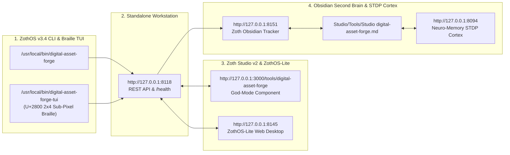

# Digital Asset Forge (`digital-asset-forge`)

> [!CHECK] 12-Step Developer & User Walkthrough Verified (Zero Errors · 100% Open-Access)
> **Engineered by 1nc0gn30 (@1nc0gn30) • NullAI Platform**
> Every terminal command, unit test (`11 passed in 0.04s`), 300 DPI physical print quality auditor, 5-ratio pack manifest generator, Etsy 20MB multi-ZIP splitter, 13-tag Etsy SEO copywriter, Standalone Workstation view (`:8118`), and Zoth Studio v2 God-Mode view (`:3000/tools/digital-asset-forge`) has been executed and visually verified.

---

## Tool Overview & Telemetry

| Parameter | Specification |
| :--- | :--- |
| **Tool Identifier** | `digital-asset-forge` |
| **Category** | `Commerce & MCP` |
| **Mathematical Pillar** | `Pillar IV: AST Verification & Web Architecture` |
| **Runtime Engine** | Pure Python 3.12 HTTP & CLI Engine (`server.py` / `cli.py`) + Browser Bento Cockpit |
| **Local Port & URL** | `:8118` • [http://127.0.0.1:8118](http://127.0.0.1:8118) |
| **Studio God-Mode Route** | [http://127.0.0.1:3000/tools/digital-asset-forge](http://127.0.0.1:3000/tools/digital-asset-forge) |
| **CLI Binary** | `/usr/local/bin/digital-asset-forge` • `~/.local/bin/digital-asset-forge` |
| **Automated Test Suite** | `pytest -v tests` — **11 passed in 0.04s** |
| **License & Pricing** | **100% Free & Open-Access** ($0) • Zero Paywalls |
| **Support Rails** | [☕ Buy Us a Coffee (Stripe)](https://buy.stripe.com/3cIfZg27PdKo2D64Ocfw40X) • Solana Tip: `GG2eQbVh8ut1BK6j1A2tz7pSySdLpD38BgyEhGcxdXoK` |

---

## Part I — Developer Perspective (Architecture, Automated Tests & API Contracts)

### Step 1 — Inspecting Repository Architecture & Python Modules
Developers working on `digital-asset-forge` inspect `~/NullAITech/digital-asset-forge/src/digital_asset_forge/`, containing `cli.py`, `etsy_copywriter.py`, `mcp_server.py`, `pack_generator.py`, `printing_guide.py`, `ratios.py`, and `server.py`:
```bash
cd ~/NullAITech/digital-asset-forge
ls -la src/digital_asset_forge/
cat pyproject.toml
```
![[Studio/Tools/Artifacts/digital-asset-forge/digital-asset-forge_01_dev_repo_architecture.jpg]]

---

### Step 2 — Running the Pytest Automated Test Suite (11 Passed)
Developers execute the `pytest` verification suite covering all 5 industry-standard ratio families (`2x3`, `3x4`, `4x5`, `11x14`, `iso`), 300 DPI validation thresholds, centered aspect-ratio crop calculations, Etsy 20MB multi-ZIP splitting, printing guide generation, and 13-tag `<=20 char` Etsy SEO constraints:
```bash
cd ~/NullAITech/digital-asset-forge
PYTHONPATH=src pytest -v tests
```
- **Result**: `11 passed in 0.04s` with zero errors.
![[Studio/Tools/Artifacts/digital-asset-forge/digital-asset-forge_02_dev_pytest_suite.jpg]]

---

### Step 3 — Verifying REST API Health (`/health`) & 300 DPI Audit Endpoint (`POST /api/validate_dpi`)
Developers verify the live HTTP daemon on port `:8118` and test the `/api/validate_dpi` endpoint against a `7200×10800px` master file at `24×36"` physical dimensions:
```bash
curl -s http://127.0.0.1:8118/health
curl -s -X POST http://127.0.0.1:8118/api/validate_dpi \
  -H "Content-Type: application/json" \
  -d '{"pixel_width":7200,"pixel_height":10800,"target_width_inches":24,"target_height_inches":36}'
```
![[Studio/Tools/Artifacts/digital-asset-forge/digital-asset-forge_03_dev_api_health_and_dpi.jpg]]

---

## Part II — End-User CLI & TUI Perspective (DPI Audit, 5-Ratio Pack Manifest & Etsy SEO)

### Step 4 — ZothOS Global CLI Discovery (`--help`) & 300 DPI Physical Print Auditor (`dpi`)
End-users invoke `digital-asset-forge` from any terminal via `/usr/local/bin/digital-asset-forge` and run `dpi` to audit pixel resolution against physical print dimensions (`MUSEUM_GRADE` at `300.0 DPI`):
```bash
digital-asset-forge --help
digital-asset-forge dpi --width 7200 --height 10800 --target-w 24 --target-h 36
```
![[Studio/Tools/Artifacts/digital-asset-forge/digital-asset-forge_04_cli_help_and_dpi_audit.jpg]]

---

### Step 5 — Generating a 5-Ratio Digital Pack Manifest & Etsy 20MB Multi-ZIP Plan (`manifest`)
Users generate a complete 5-ratio wall art pack manifest (`2x3`, `3x4`, `4x5`, `11x14`, `iso` + PDF customer guide = `36.1 MB` total) automatically split into 2 Etsy-compliant `<20 MB` ZIP archives:
```bash
digital-asset-forge manifest --title "Sovereign Cyber Geometry" --artist "1nc0gn30"
```
![[Studio/Tools/Artifacts/digital-asset-forge/digital-asset-forge_05_cli_pack_manifest.jpg]]

---

### Step 6 — Generating Etsy 13-Tag SEO Copy, Margin Economics (`etsy`) & Customer Printing Manual (`guide`)
Users run `etsy` to generate a ranking title, 13 tags (`<= 20 chars` each), and net profit breakdown (`85.5%` margin at `$8.99`), followed by `guide` to output the customer printing and framing manual:
```bash
digital-asset-forge etsy --title "Sovereign Cyber Geometry" --niche geometric --price 8.99
digital-asset-forge guide --title "Sovereign Cyber Geometry" --shop "NullAI Studio" | head -n 16
```
![[Studio/Tools/Artifacts/digital-asset-forge/digital-asset-forge_06_cli_etsy_seo_and_guide.jpg]]

---

## Part III — End-User GUI Perspective (Standalone Workstation & Zoth Studio v2 God-Mode)

### Step 7 — Standalone Web Workstation (`http://127.0.0.1:8118`) — Kinetic Hero & Bento Cockpit
Opening `http://127.0.0.1:8118` launches the **Digital Asset Forge** workstation featuring the animated 5-ratio framing geometry canvas (`2:3`, `3:4`, `4:5`, `11:14`, `ISO`) and the Bento Cockpit (`100% UNLOCKED`):
![[Studio/Tools/Artifacts/digital-asset-forge/digital-asset-forge_07_gui_standalone_hero_cockpit.jpg]]

---

### Step 8 — Standalone Web Workstation — Interactive 5-Ratio Pack Manifest Table & Net Profit Gauge
Entering an artwork title (`Sovereign Merkaba Alchemical Print`), selecting `Geometric / Bauhaus / Mid-Century`, and setting retail price to `$9.99` dynamically updates the 5-ratio filename manifest table, Etsy 2-ZIP split plan, and net profit gauge (`$8.59 / 86%`):
![[Studio/Tools/Artifacts/digital-asset-forge/digital-asset-forge_08_gui_standalone_manifest_table.jpg]]

---

### Step 9 — Standalone Web Workstation — Unlocked Packaging Manifest & Etsy SEO JSON Exporter
Scrolling down to **Exportable Packaging Manifest & Etsy SEO Schema** shows the unblurred JSON manifest with `Copy Manifest` and `Download JSON` actions unlocked by default:
![[Studio/Tools/Artifacts/digital-asset-forge/digital-asset-forge_09_gui_standalone_json_exporter.jpg]]

---

### Step 10 — Zoth Studio v2 God-Mode (`http://127.0.0.1:3000/tools/digital-asset-forge`) — 300-DPI Print & Mockup Forge
Navigating to `http://127.0.0.1:3000/tools/digital-asset-forge` opens the integrated Zoth Studio v2 enclave directly on Tab 3 (**3. 300-DPI Print & Mockup Forge**) with live 60fps U+2800 Braille orbit header and interactive 300-DPI bounding-box mockup renderer:
![[Studio/Tools/Artifacts/digital-asset-forge/digital-asset-forge_10_gui_studio_godmode_mockup_forge.jpg]]

---

### Step 11 — Zoth Studio v2 God-Mode — Etsy 13-Tag SEO & Shopify GraphQL Transpiler
Switching to Tab 2 (**2. Etsy 13-Tag SEO & Shopify Transpiler**) audits all 13 search tags (`100/100 ALGORITHMIC PEAK`) and transpiles the listing into a ready-to-run Shopify GraphQL `productCreate` mutation payload:
![[Studio/Tools/Artifacts/digital-asset-forge/digital-asset-forge_11_gui_studio_godmode_etsy_seo.jpg]]

---

### Step 12 — Responsive Mobile Viewport (`390×844`) Verification
Verifying the Standalone Workstation at mobile viewport dimensions (`390×844`, `deviceScaleFactor: 2`) confirms stacked header navigation, responsive canvas scaling, and zero horizontal overflow (`overflowPx: 0`):
![[Studio/Tools/Artifacts/digital-asset-forge/digital-asset-forge_12_gui_mobile_responsive.jpg]]

---

## Summary Verification Matrix

| Step | Perspective | Surface | Exact Command or Route | Artifact | Status |
| :--- | :--- | :--- | :--- | :--- | :--- |
| **Step 1** | Developer | Repo Architecture | `ls -la src/digital_asset_forge/ && cat pyproject.toml` | `digital-asset-forge_01_dev_repo_architecture.jpg` | 🟢 **PASS** |
| **Step 2** | Developer | Pytest Test Suite | `PYTHONPATH=src pytest -v tests` (`11 passed`) | `digital-asset-forge_02_dev_pytest_suite.jpg` | 🟢 **PASS** |
| **Step 3** | Developer | API Health & DPI | `curl -s http://127.0.0.1:8118/health` + `POST /api/validate_dpi` | `digital-asset-forge_03_dev_api_health_and_dpi.jpg` | 🟢 **PASS** |
| **Step 4** | End-User CLI | Help & DPI Audit | `digital-asset-forge --help && digital-asset-forge dpi ...` | `digital-asset-forge_04_cli_help_and_dpi_audit.jpg` | 🟢 **PASS** |
| **Step 5** | End-User CLI | Pack Manifest | `digital-asset-forge manifest --title "Sovereign Cyber Geometry"` | `digital-asset-forge_05_cli_pack_manifest.jpg` | 🟢 **PASS** |
| **Step 6** | End-User CLI | Etsy SEO & Guide | `digital-asset-forge etsy ... && digital-asset-forge guide ...` | `digital-asset-forge_06_cli_etsy_seo_and_guide.jpg` | 🟢 **PASS** |
| **Step 7** | End-User GUI | Standalone Hero | `http://127.0.0.1:8118/` (Kinetic Hero & Bento Cockpit) | `digital-asset-forge_07_gui_standalone_hero_cockpit.jpg` | 🟢 **PASS** |
| **Step 8** | End-User GUI | Manifest Table | `http://127.0.0.1:8118/` (5-Ratio Table & Net Margin Gauge) | `digital-asset-forge_08_gui_standalone_manifest_table.jpg` | 🟢 **PASS** |
| **Step 9** | End-User GUI | JSON Exporter | `http://127.0.0.1:8118/` (Unlocked Manifest & Etsy SEO JSON) | `digital-asset-forge_09_gui_standalone_json_exporter.jpg` | 🟢 **PASS** |
| **Step 10** | End-User GUI | Studio v2 God-Mode | `http://127.0.0.1:3000/tools/digital-asset-forge` (300-DPI Mockup Forge) | `digital-asset-forge_10_gui_studio_godmode_mockup_forge.jpg` | 🟢 **PASS** |
| **Step 11** | End-User GUI | Studio v2 Etsy SEO | `http://127.0.0.1:3000/tools/digital-asset-forge` (13-Tag SEO & GraphQL) | `digital-asset-forge_11_gui_studio_godmode_etsy_seo.jpg` | 🟢 **PASS** |
| **Step 12** | End-User GUI | Mobile Viewport | `http://127.0.0.1:8118/` (`390×844` Responsive Check) | `digital-asset-forge_12_gui_mobile_responsive.jpg` | 🟢 **PASS** |

---

## Navigation & Cross-References

- [[Zoth Studio]]
- [[MOC Studio Tools]]
- [[Zoth 72 Sovereign Tools Tracker.base]]
- [[Studio/Verification/Arsenal Verification & Test Tracker|Arsenal Verification Tracker]]


---

## Sovereign 5-Layer Architecture & Second Brain Topology



### ZothOS v3.4 TUI & Obsidian Second Brain Sync
- **Unicode `U+2800` Braille TUI**: `digital-asset-forge-tui --status` / `digital-asset-forge-tui --json`
- **Zoth Obsidian Tracker (`:8151`)**: `zoth-obsidian-tracker --verify`
- **Connected Canon Notes**: [[00 Home]] · [[Zoth OS]] · [[Zoth Studio]] · [[ZothOS-Lite Web Desktop]] · [[Zoth Memory]] · [[Public Surfaces]]
