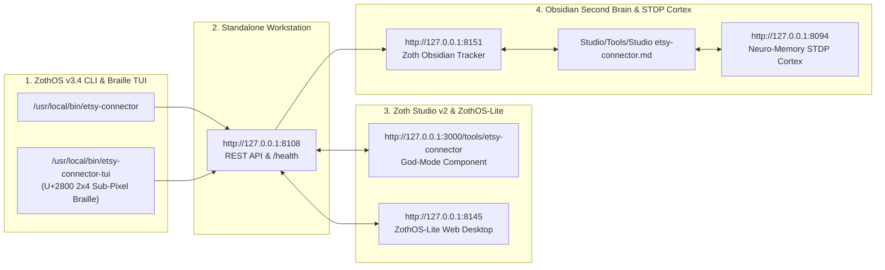

# Etsy Connector — Complete Developer & End-User Walkthrough

> [!CHECK] Sovereign Verification Passed (100% Free & Open-Access — 12-Step Real Screenshot Gallery)
> **Engineered by 1nc0gn30 (@1nc0gn30) • NullAI Platform**
> Verified across Developer Architecture, `pytest` Unit Test Suite (`47 passed in 2.15s`), `/health` & `/api/mcp/tools` 8-Tool MCP Bridge, Global ZothOS CLI (`--help`, `audit`, `profit`, `search`), Standalone Web Workstation (`http://127.0.0.1:8108`), Zoth Studio v2 God-Mode (`http://127.0.0.1:3000/tools/etsy-connector`), and Mobile 390px Responsive Viewport (`overflowPx: 0`, `consoleErrors: 0`).

---

## Tool Overview & Telemetry

| Parameter | Specification |
| :--- | :--- |
| **Tool Identifier** | `etsy-connector` |
| **Category** | `Commerce & POD` |
| **Mathematical Pillar** | `Pillar III: Autonomous Commerce & Storefront Engines` |
| **Runtime Engine** | Pure Python 3.12 Standard Library HTTP/MCP Daemon + Interactive Browser Cockpit |
| **Local Port & URL** | `:8108` • [http://127.0.0.1:8108](http://127.0.0.1:8108) |
| **Studio God-Mode Route** | [http://127.0.0.1:3000/tools/etsy-connector](http://127.0.0.1:3000/tools/etsy-connector) |
| **CLI Binary** | `/usr/local/bin/etsy-connector` • `~/.local/bin/etsy-connector` • `./bin/etsy-connector` |
| **GitHub Repository** | [https://github.com/1nc0gn30/etsy-connector](https://github.com/1nc0gn30/etsy-connector) |
| **Automated Test Suite** | `47 passed in 2.15s` (`pytest -v tests`) |
| **License & Pricing** | **100% Free & Open-Access** ($0) • Zero Paywalls |
| **Support Rails** | [☕ Buy Us a Coffee (Stripe)](https://buy.stripe.com/3cIfZg27PdKo2D64Ocfw40X) • Solana Tip: `GG2eQbVh8ut1BK6j1A2tz7pSySdLpD38BgyEhGcxdXoK` |

---

## Part I — Developer Perspective (Architecture · Pytest Suite · REST API & MCP Schema)

### Step 1/12 — Repository Architecture, Package Modules & ZothOS Binaries
- **Command**: `ls -la && ls -la src/etsy_connector && which -a etsy-connector | uniq`
- **Verification**: Confirms the zero-dependency Python package layout (`client.py`, `cli.py`, `mcp_server.py`, `pod_bridge.py`, `seo_engine.py`, `taxonomy.py`, `web_cockpit.py`) and global CLI binaries in `/usr/local/bin/etsy-connector` and `~/.local/bin/etsy-connector`.
![[Studio/Tools/Artifacts/etsy-connector/etsy-connector_01_dev_repo_architecture.jpg]]

### Step 2/12 — Automated Pytest Unit & Security Verification Suite (`47 passed`)
- **Command**: `PYTHONPATH=src pytest -v tests`
- **Verification**: Executes all 47 automated unit tests across `test_api.py`, `test_bind_host.py`, `test_client.py`, `test_live_safety.py`, `test_mcp.py`, `test_seo.py`, and `test_static_traversal.py` (`47 passed in 2.15s`).
![[Studio/Tools/Artifacts/etsy-connector/etsy-connector_02_dev_pytest_suite.jpg]]

### Step 3/12 — REST API `/health` Telemetry & `/api/mcp/tools` 8-Tool MCP Bridge Schema
- **Command**: `curl -s http://127.0.0.1:8108/health | python3 -m json.tool && curl -s http://127.0.0.1:8108/api/mcp/tools | python3 -m json.tool | head -n 32`
- **Verification**: Confirms HTTP 200 OK JSON telemetry from `:8108/health` and inspects the JSON-RPC 2.0 MCP tool definitions exposed to Antigravity agents.
![[Studio/Tools/Artifacts/etsy-connector/etsy-connector_03_dev_api_health_and_mcp.jpg]]

---

## Part II — End-User CLI / Terminal Perspective (Global ZothOS Binary)

### Step 4/12 — ZothOS CLI Command Discovery (`--help`) & 13-Tag SEO Ranking Auditor (`audit`)
- **Command**: `./bin/etsy-connector --help && etsy-connector audit --title "Grandma's Garden Wildflower Sweatshirt..." --tags "...13 tags..." --json`
- **Verification**: Displays all 9 CLI subcommands (`mcp, serve, audit, profit, search, config, auth, shop-update, draft-digital`) and audits a 78-character title and 13 multi-word search tags (`overall_score: 97`, `grade: "A+"`, `is_ready_to_publish: true`).
![[Studio/Tools/Artifacts/etsy-connector/etsy-connector_04_cli_help_and_audit.jpg]]

### Step 5/12 — CLI Etsy Fee, POD Production Cost & Net Margin Modeler (`profit`)
- **Command**: `etsy-connector profit --retail 38.99 --pod 15.50 --json && etsy-connector profit --retail 38.99 --pod 15.50 --ads --json`
- **Verification**: Computes exact Etsy fee breakdowns ($0.20 listing + 6.5% transaction + 3%+$0.25 processing = `$4.15` fees, `$0.34` net profit, `49.6%` margin) and compares against the 15% Offsite Ads fee tier (`$10.00` total fees, `$13.49` net profit, `34.6%` margin).
![[Studio/Tools/Artifacts/etsy-connector/etsy-connector_05_cli_profit_calculator.jpg]]

### Step 6/12 — CLI Competitor Listing Search (`search`) & Printify Blueprints Catalog
- **Command**: `etsy-connector search --keywords "cottagecore sweatshirt" --limit 5 && curl -s http://127.0.0.1:8108/api/blueprints | python3 -m json.tool | head -n 26`
- **Verification**: Searches Etsy competitor listings for `"cottagecore sweatshirt"` and inspects the Printify POD blueprint specifications (`Comfort Colors 1717`, Blueprint 638, `4500x5400 px @ 300 DPI`).
![[Studio/Tools/Artifacts/etsy-connector/etsy-connector_06_cli_competitor_search.jpg]]

---

## Part III — End-User GUI Perspective (Standalone Workstation · Studio v2 God-Mode · Mobile)

### Step 7/12 — Standalone Web Workstation (`http://127.0.0.1:8108`) — Tab 1: SEO Title & 13-Tag Auditor
- **Surface**: `http://127.0.0.1:8108/` (`1. SEO Title & Tag Auditor`)
- **Verification**: Interactive listing optimizer showing live character length (`78 / 140 chars`), 13 validated search tag chips (`≤ 20 chars` each), and `100 Grade: A+ (Ready to Publish)`.
![[Studio/Tools/Artifacts/etsy-connector/etsy-connector_07_gui_standalone_seo.jpg]]

### Step 8/12 — Standalone Web Workstation (`http://127.0.0.1:8108`) — Tab 2: Profit & Fee Calculator
- **Surface**: `http://127.0.0.1:8108/` (`2. Profit & Fee Calculator`)
- **Verification**: Interactive pricing and cost modeler displaying `$0.34` net profit (`49.6% Net Margin`, `124.7% ROI on POD spend`) for a `$38.99` retail / `$15.50` POD base cost configuration.
![[Studio/Tools/Artifacts/etsy-connector/etsy-connector_08_gui_standalone_profit.jpg]]

### Step 9/12 — Standalone Web Workstation (`http://127.0.0.1:8108`) — Tab 3: Printify POD Blueprints & Payload Export
- **Surface**: `http://127.0.0.1:8108/` (`3. Printify POD Blueprints`)
- **Verification**: Selects the `Comfort Colors 1717 Garment-Dyed Tee (Blueprint 638)` cadre (`$32.99` retail, `$12.80` base cost, `4500 × 5400 px @ 300 DPI`) and generates the unblurred Printify API JSON payload with unlocked Copy & CSV Export buttons.
![[Studio/Tools/Artifacts/etsy-connector/etsy-connector_09_gui_standalone_pod_mcp.jpg]]

### Step 10/12 — Zoth Studio v2 God-Mode (`http://127.0.0.1:3000/tools/etsy-connector`) — Etsy 13-Tag SEO & Shopify GraphQL Transpiler
- **Surface**: `http://127.0.0.1:3000/tools/etsy-connector` (`Tab 2: Etsy 13-Tag SEO & Shopify Transpiler`)
- **Verification**: Unified Studio God-Mode cockpit displaying the 13-tag character-limit auditor (`100/100 ALGORITHMIC PEAK`) and live Etsy-to-Shopify Admin GraphQL `productCreate` transpiler.
![[Studio/Tools/Artifacts/etsy-connector/etsy-connector_10_gui_studio_godmode_seo.jpg]]

### Step 11/12 — Zoth Studio v2 God-Mode (`http://127.0.0.1:3000/tools/etsy-connector`) — Smart Fulfillment & Margin Router
- **Surface**: `http://127.0.0.1:3000/tools/etsy-connector` (`Tab 1: Fulfillment & Margin Router`)
- **Verification**: Compares multi-provider POD unit economics (`Printify Choice US/UK Network`, `Gelato Local Hub`, `Sovereign Direct Fine-Art Atelier`) against Etsy marketplace fees (`6.5% Tx + 3%+$0.25 Proc + $0.20 Listing`).
![[Studio/Tools/Artifacts/etsy-connector/etsy-connector_11_gui_studio_godmode_router.jpg]]

### Step 12/12 — Mobile Responsive Viewport (`390×844`) — Zero Horizontal Overflow Verification
- **Surface**: `http://127.0.0.1:8108/` at `390×844` mobile resolution
- **Verification**: Confirms responsive single-column card layout, scrollable tab bar, and `overflowPx: 0` (`scrollWidth <= clientWidth`).
![[Studio/Tools/Artifacts/etsy-connector/etsy-connector_12_gui_mobile_responsive.jpg]]

---

## Complete 12-Step Verification Matrix

| Step | Perspective | Surface / Stage | Exact Command or Route | Screenshot Artifact | Status |
| :--- | :--- | :--- | :--- | :--- | :--- |
| **Step 1/12** | **Developer** | Repo & Module Layout | `ls -la && ls -la src/etsy_connector && which -a etsy-connector` | `etsy-connector_01_dev_repo_architecture.jpg` | 🟢 **PASS** |
| **Step 2/12** | **Developer** | Pytest Automated Suite | `PYTHONPATH=src pytest -v tests` (`47 passed in 2.15s`) | `etsy-connector_02_dev_pytest_suite.jpg` | 🟢 **PASS** |
| **Step 3/12** | **Developer** | REST `/health` + MCP Tools | `curl -s :8108/health` & `curl -s :8108/api/mcp/tools` | `etsy-connector_03_dev_api_health_and_mcp.jpg` | 🟢 **PASS** |
| **Step 4/12** | **End-User CLI** | CLI Help & SEO Audit | `./bin/etsy-connector --help` & `etsy-connector audit ... --json` | `etsy-connector_04_cli_help_and_audit.jpg` | 🟢 **PASS** |
| **Step 5/12** | **End-User CLI** | Profit & Fee Calculator | `etsy-connector profit --retail 38.99 --pod 15.50 [--ads] --json` | `etsy-connector_05_cli_profit_calculator.jpg` | 🟢 **PASS** |
| **Step 6/12** | **End-User CLI** | Competitor Search & POD | `etsy-connector search --keywords "cottagecore sweatshirt"` | `etsy-connector_06_cli_competitor_search.jpg` | 🟢 **PASS** |
| **Step 7/12** | **End-User GUI** | Standalone SEO (`:8108`) | `http://127.0.0.1:8108/` (`1. SEO Title & Tag Auditor`) | `etsy-connector_07_gui_standalone_seo.jpg` | 🟢 **PASS** |
| **Step 8/12** | **End-User GUI** | Standalone Profit (`:8108`) | `http://127.0.0.1:8108/` (`2. Profit & Fee Calculator`) | `etsy-connector_08_gui_standalone_profit.jpg` | 🟢 **PASS** |
| **Step 9/12** | **End-User GUI** | Standalone POD (`:8108`) | `http://127.0.0.1:8108/` (`3. Printify POD Blueprints`) | `etsy-connector_09_gui_standalone_pod_mcp.jpg` | 🟢 **PASS** |
| **Step 10/12** | **End-User GUI** | Studio SEO (`:3000`) | `http://127.0.0.1:3000/tools/etsy-connector` (Tab 2: SEO & GraphQL) | `etsy-connector_10_gui_studio_godmode_seo.jpg` | 🟢 **PASS** |
| **Step 11/12** | **End-User GUI** | Studio Router (`:3000`) | `http://127.0.0.1:3000/tools/etsy-connector` (Tab 1: Margin Router) | `etsy-connector_11_gui_studio_godmode_router.jpg` | 🟢 **PASS** |
| **Step 12/12** | **End-User GUI** | Mobile Viewport (`390×844`) | `http://127.0.0.1:8108/` (`overflowPx: 0`) | `etsy-connector_12_gui_mobile_responsive.jpg` | 🟢 **PASS** |

---

## Navigation & Cross-References

- [[Zoth Studio]]
- [[MOC Studio Tools]]
- [[Zoth 72 Sovereign Tools Tracker.base]]
- [[Studio/Verification/Arsenal Verification & Test Tracker|Arsenal Verification Tracker]]

---

## Sovereign 5-Layer Architecture & Second Brain Topology

### ZothOS v3.4 TUI & Obsidian Second Brain Sync
- **Unicode `U+2800` Braille TUI**: `etsy-connector-tui --status` / `etsy-connector-tui --json`
- **Zoth Obsidian Tracker (`:8151`)**: `zoth-obsidian-tracker --verify`
- **Connected Canon Notes**: [[00 Home]] · [[Zoth OS]] · [[Zoth Studio]] · [[ZothOS-Lite Web Desktop]] · [[Zoth Memory]] · [[Public Surfaces]]
