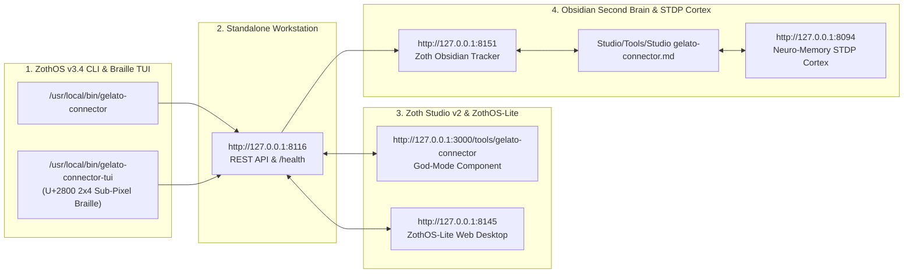

# Gelato Connector — Complete Developer & End-User Walkthrough

> [!CHECK] Sovereign Verification Passed (100% Free & Open-Access — 12-Step Real Screenshot Gallery)
> **Engineered by 1nc0gn30 (@1nc0gn30) • NullAI Platform**
> Verified across Developer Architecture, `pytest` Unit Test Suite (`17 passed in 0.15s`), `/health`, `/api/stats` & `/api/hubs` REST API, Global ZothOS CLI (`--help`, `status`, `shipping`, `audit`, `margins`, `catalog`), Standalone Web Workstation (`http://127.0.0.1:8116`), Zoth Studio v2 God-Mode (`http://127.0.0.1:3000/tools/gelato-connector`), and Mobile 390px Responsive Viewport (`overflowPx: 0`, `consoleErrors: 0`).

---

## Tool Overview & Telemetry

| Parameter | Specification |
| :--- | :--- |
| **Tool Identifier** | `gelato-connector` |
| **Category** | `Commerce & POD` |
| **Mathematical Pillar** | `Pillar III: Autonomous Commerce & Storefront Engines` |
| **Runtime Engine** | Pure Python 3.12 Standard Library HTTP/MCP Daemon + Interactive Browser Cockpit |
| **Local Port & URL** | `:8116` • [http://127.0.0.1:8116](http://127.0.0.1:8116) |
| **Studio God-Mode Route** | [http://127.0.0.1:3000/tools/gelato-connector](http://127.0.0.1:3000/tools/gelato-connector) |
| **CLI Binary** | `/usr/local/bin/gelato-connector` • `~/.local/bin/gelato-connector` • `./bin/gelato-connector` |
| **GitHub Repository** | [https://github.com/1nc0gn30/gelato-connector](https://github.com/1nc0gn30/gelato-connector) |
| **Automated Test Suite** | `17 passed in 0.15s` (`pytest -v tests`) |
| **License & Pricing** | **100% Free & Open-Access** ($0) • Zero Paywalls |
| **Support Rails** | [☕ Buy Us a Coffee (Stripe)](https://buy.stripe.com/3cIfZg27PdKo2D64Ocfw40X) • Solana Tip: `GG2eQbVh8ut1BK6j1A2tz7pSySdLpD38BgyEhGcxdXoK` |

---

## Part I — Developer Perspective (Architecture · Pytest Suite · REST API & Hubs)

### Step 1/12 — Repository Architecture, Package Modules & ZothOS Binaries
- **Command**: `ls -la && ls -la src/gelato_connector && which -a gelato-connector | uniq`
- **Verification**: Confirms the zero-dependency Python package layout (`artwork_auditor.py`, `catalog.py`, `client.py`, `cli.py`, `margin_engine.py`, `mcp_server.py`, `server.py`, `shipping_engine.py`) and global CLI binaries in `/usr/local/bin/gelato-connector` and `~/.local/bin/gelato-connector`.
![[Studio/Tools/Artifacts/gelato-connector/gelato-connector_01_dev_repo_architecture.jpg]]

### Step 2/12 — Automated Pytest Unit & Routing Verification Suite (`17 passed`)
- **Command**: `PYTHONPATH=src pytest -v tests`
- **Verification**: Executes all 17 automated unit tests across `test_bind_host.py`, `test_gelato_connector.py` (`TestGelatoCatalog`, `TestGelatoShipping`, `TestGelatoMargins`, `TestGelatoArtworkAuditor`, `TestGelatoClientAndMCP`), and `test_origin_guard.py` (`17 passed in 0.15s`).
![[Studio/Tools/Artifacts/gelato-connector/gelato-connector_02_dev_pytest_suite.jpg]]

### Step 3/12 — REST API `/health`, `/api/stats` & `/api/hubs` 32-Country Telemetry
- **Command**: `curl -s http://127.0.0.1:8116/health && curl -s http://127.0.0.1:8116/api/stats && curl -s http://127.0.0.1:8116/api/hubs | python3 -m json.tool | head -n 26`
- **Verification**: Confirms HTTP 200 OK JSON telemetry from `:8116/health` and inspects domestic print hub specifications (`US`, `CA`, `UK`, `DE`, `FR`, `NL`, `AU`).
![[Studio/Tools/Artifacts/gelato-connector/gelato-connector_03_dev_api_health_and_stats.jpg]]

---

## Part II — End-User CLI / Terminal Perspective (Global ZothOS Binary)

### Step 4/12 — ZothOS CLI Command Discovery (`--help`) & Live Daemon Status (`status`)
- **Command**: `gelato-connector --help && gelato-connector status --port 8116 && gelato-connector status --port 8116 --json`
- **Verification**: Displays all 8 CLI subcommands (`status, serve, mcp, catalog, shipping, margins, audit, info`) and verifies live daemon readiness across 7 cataloged products and 32 sovereign countries.
![[Studio/Tools/Artifacts/gelato-connector/gelato-connector_04_cli_help_and_status.jpg]]

### Step 5/12 — CLI Localized Shipping Router (`shipping`) & Museum Print DPI Auditor (`audit`)
- **Command**: `gelato-connector shipping --product acrylic_print_16x24 --country DE && gelato-connector audit --product acrylic_print_16x24 --width 4800 --height 7200 --name botanical_master.png`
- **Verification**: Routes an `Acrylic Glass Print (16x24 in)` order to the `Domestic Germany Print Facility` (`Deutsche Post / DHL`, `€4.20` shipping, `0 days` customs delay, `67.0%` CO₂ reduction) and audits a `4800×7200 px` master file (`effective_dpi: 300`, `print_quality_grade: "EXCELLENT"`).
![[Studio/Tools/Artifacts/gelato-connector/gelato-connector_05_cli_shipping_and_audit.jpg]]

### Step 6/12 — CLI Multi-Channel Profit Margins (`margins`) & Product Catalog (`catalog`)
- **Command**: `gelato-connector margins --product acrylic_print_16x24 --price 68.00 --currency EUR --country DE | head -n 36 && gelato-connector catalog | head -n 22`
- **Verification**: Calculates multi-channel net profit margins in EUR (`€68.00` retail -> `€29.69` Etsy net / `43.7%` margin, `€34.33` Shopify net / `50.5%` margin) and lists catalog print specifications.
![[Studio/Tools/Artifacts/gelato-connector/gelato-connector_06_cli_margins_and_catalog.jpg]]

---

## Part III — End-User GUI Perspective (Standalone Workstation · Studio v2 God-Mode · Mobile)

### Step 7/12 — Standalone Web Workstation (`http://127.0.0.1:8116`) — Bento Metrics & Multi-Currency Margin Engine
- **Surface**: `http://127.0.0.1:8116/` (Top Bento Deck & Margin Calculator)
- **Verification**: Displays global routing telemetry (`7 Curated`, `32 Countries`, `-67% CO₂`, `6 Tools`) and interactive margin calculation (`46.7%` Net Margin, `$31.73` Net Profit per sale via `Domestic United States Hub`).
![[Studio/Tools/Artifacts/gelato-connector/gelato-connector_07_gui_standalone_margin_router.jpg]]

### Step 8/12 — Standalone Web Workstation (`http://127.0.0.1:8116`) — Museum Print DPI & Bleed Auditor + Hubs Matrix
- **Surface**: `http://127.0.0.1:8116/` (`Gelato Museum Print DPI & Bleed Auditor`)
- **Verification**: Client-side dimension analyzer verifying `4800 × 7200 px @ 300 DPI (3mm Bleed)` (`EXCELLENT — Museum Grade Gallery Standard`) alongside the `Local Manufacturing Hubs & Carrier Matrix` table.
![[Studio/Tools/Artifacts/gelato-connector/gelato-connector_08_gui_standalone_dpi_auditor.jpg]]

### Step 9/12 — Standalone Web Workstation (`http://127.0.0.1:8116`) — Gelato API v2 Order Payload Generator
- **Surface**: `http://127.0.0.1:8116/` (`Schema-Valid Gelato API v2 Order Payload Generator`)
- **Verification**: Generates a schema-valid Gelato API v2 order payload routed to `Berlin, DE` (`currency: "EUR"`, `orderReferenceId: "SOV-GELATO-8116"`) and copies it to clipboard (`✅ Gelato Order Creation Payload copied to clipboard!`).
![[Studio/Tools/Artifacts/gelato-connector/gelato-connector_09_gui_standalone_order_payload.jpg]]

### Step 10/12 — Zoth Studio v2 God-Mode (`http://127.0.0.1:3000/tools/gelato-connector`) — Smart Fulfillment & Margin Router
- **Surface**: `http://127.0.0.1:3000/tools/gelato-connector` (`Tab 1: Fulfillment & Margin Router`)
- **Verification**: Unified Studio God-Mode cockpit comparing `Gelato Local Hub (32-Country Mesh)` (`2d transit`, `ZERO Local Print customs risk`) against global fulfillment networks.
![[Studio/Tools/Artifacts/gelato-connector/gelato-connector_10_gui_studio_godmode_router.jpg]]

### Step 11/12 — Zoth Studio v2 God-Mode (`http://127.0.0.1:3000/tools/gelato-connector`) — 300-DPI Print & Mockup Forge
- **Surface**: `http://127.0.0.1:3000/tools/gelato-connector` (`Tab 3: 300-DPI Print & Mockup Forge`)
- **Verification**: Interactive 300-DPI substrate and sacred geometry print preview with 1-click `.PNG` download.
![[Studio/Tools/Artifacts/gelato-connector/gelato-connector_11_gui_studio_godmode_forge.jpg]]

### Step 12/12 — Mobile Responsive Viewport (`390×844`) — Zero Horizontal Overflow Verification
- **Surface**: `http://127.0.0.1:8116/` at `390×844` mobile resolution
- **Verification**: Confirms responsive single-column Bento card stacking and `overflowPx: 0` (`scrollWidth <= clientWidth`).
![[Studio/Tools/Artifacts/gelato-connector/gelato-connector_12_gui_mobile_responsive.jpg]]

---

## Complete 12-Step Verification Matrix

| Step | Perspective | Surface / Stage | Exact Command or Route | Screenshot Artifact | Status |
| :--- | :--- | :--- | :--- | :--- | :--- |
| **Step 1/12** | **Developer** | Repo & Module Layout | `ls -la && ls -la src/gelato_connector && which -a gelato-connector` | `gelato-connector_01_dev_repo_architecture.jpg` | 🟢 **PASS** |
| **Step 2/12** | **Developer** | Pytest Automated Suite | `PYTHONPATH=src pytest -v tests` (`17 passed in 0.15s`) | `gelato-connector_02_dev_pytest_suite.jpg` | 🟢 **PASS** |
| **Step 3/12** | **Developer** | REST `/health` + Hubs | `curl -s :8116/health` & `curl -s :8116/api/hubs` | `gelato-connector_03_dev_api_health_and_stats.jpg` | 🟢 **PASS** |
| **Step 4/12** | **End-User CLI** | CLI Help & Live Status | `gelato-connector --help` & `gelato-connector status --port 8116` | `gelato-connector_04_cli_help_and_status.jpg` | 🟢 **PASS** |
| **Step 5/12** | **End-User CLI** | Shipping & DPI Auditor | `gelato-connector shipping ...` & `gelato-connector audit ...` | `gelato-connector_05_cli_shipping_and_audit.jpg` | 🟢 **PASS** |
| **Step 6/12** | **End-User CLI** | Multi-Channel Margins | `gelato-connector margins ...` & `gelato-connector catalog` | `gelato-connector_06_cli_margins_and_catalog.jpg` | 🟢 **PASS** |
| **Step 7/12** | **End-User GUI** | Margin Engine (`:8116`) | `http://127.0.0.1:8116/` (Bento Metrics & Margin Router) | `gelato-connector_07_gui_standalone_margin_router.jpg` | 🟢 **PASS** |
| **Step 8/12** | **End-User GUI** | DPI Auditor (`:8116`) | `http://127.0.0.1:8116/` (`300 DPI` Auditor & Hubs Matrix) | `gelato-connector_08_gui_standalone_dpi_auditor.jpg` | 🟢 **PASS** |
| **Step 9/12** | **End-User GUI** | Order Payload (`:8116`) | `http://127.0.0.1:8116/` (`SOV-GELATO-8116` Order Payload) | `gelato-connector_09_gui_standalone_order_payload.jpg` | 🟢 **PASS** |
| **Step 10/12** | **End-User GUI** | Studio Router (`:3000`) | `http://127.0.0.1:3000/tools/gelato-connector` (Tab 1: Margin Router) | `gelato-connector_10_gui_studio_godmode_router.jpg` | 🟢 **PASS** |
| **Step 11/12** | **End-User GUI** | Studio Forge (`:3000`) | `http://127.0.0.1:3000/tools/gelato-connector` (Tab 3: 300-DPI Forge) | `gelato-connector_11_gui_studio_godmode_forge.jpg` | 🟢 **PASS** |
| **Step 12/12** | **End-User GUI** | Mobile Viewport (`390×844`) | `http://127.0.0.1:8116/` (`overflowPx: 0`) | `gelato-connector_12_gui_mobile_responsive.jpg` | 🟢 **PASS** |

---

## Navigation & Cross-References

- [[Zoth Studio]]
- [[MOC Studio Tools]]
- [[Zoth 72 Sovereign Tools Tracker.base]]
- [[Studio/Verification/Arsenal Verification & Test Tracker|Arsenal Verification Tracker]]

---

## Sovereign 5-Layer Architecture & Second Brain Topology

### ZothOS v3.4 TUI & Obsidian Second Brain Sync
- **Unicode `U+2800` Braille TUI**: `gelato-connector-tui --status` / `gelato-connector-tui --json`
- **Zoth Obsidian Tracker (`:8151`)**: `zoth-obsidian-tracker --verify`
- **Connected Canon Notes**: [[00 Home]] · [[Zoth OS]] · [[Zoth Studio]] · [[ZothOS-Lite Web Desktop]] · [[Zoth Memory]] · [[Public Surfaces]]
