# HexStrike Security Arsenal (`hexstrike-arsenal`)

> **100% Free & Open-Access Sovereign Tool** — Zero paywalls, zero blur locks, zero license modals. Support via [☕ Buy Us a Coffee (Stripe)](https://buy.stripe.com/3cIfZg27PdKo2D64Ocfw40X) or Solana Tip (`GG2eQbVh8ut1BK6j1A2tz7pSySdLpD38BgyEhGcxdXoK`).

## 1. Executive Summary & Architecture

**HexStrike Security Arsenal** (`v3.1.0`) is an autonomous red-teaming, offensive command synthesizer, non-destructive TCP socket sweeper, and CVE/MITRE ATT&CK correlation workstation. It provides a 156-tool security catalog (`tools.json`), a stdio Model Context Protocol (MCP) server (`mcp_server.py`), a standalone loopback REST & Web workstation on `:8138`, and a 7-tab Zoth Studio v2 God-Mode cockpit.

- **Standalone Daemon & Web Workstation**: `http://127.0.0.1:8138/` (`server.py`)
- **Zoth Studio v2 God-Mode Route**: `http://127.0.0.1:3000/tools/hexstrike-arsenal` (`HexStrikeGodModeTool.jsx`)
- **Global ZothOS CLI**: `/usr/local/bin/hexstrike-arsenal` & `~/.local/bin/hexstrike-arsenal`
- **Automated Pytest Suite**: `6 passed in 0.78s` (`tests/test_hexstrike.py`)

---

## 2. Step-by-Step Developer & End-User Walkthrough Gallery (12 Real Screenshots)

### Phase A: Developer Perspective (Architecture, Pytest Suite & Live Socket Sweep API)

#### Step 1 — Developer Repository Architecture & MCP Command Synthesizer
Inspecting `~/NullAITech/NullAI-HexStrike-AI-Terminal` (`cli.py`, `mcp_server.py`, `server.py`, `ui/src/data/tools.json`) and verifying the canonical command synthesis engine (`get_tool_command`).

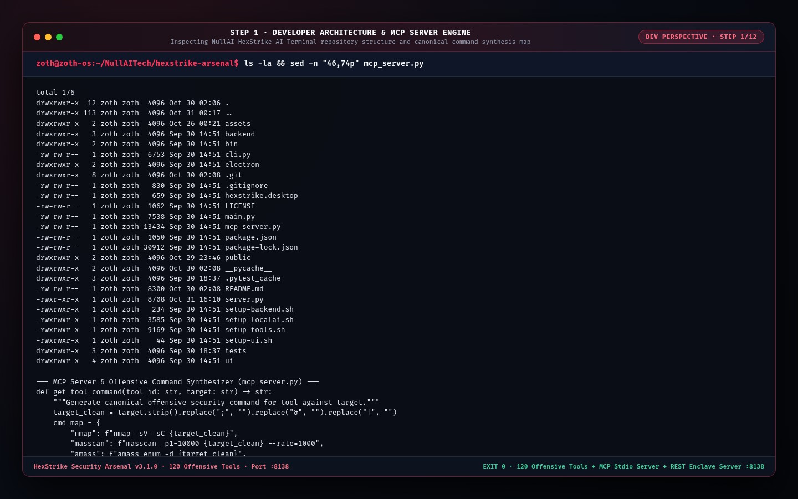

#### Step 2 — Developer Automated Test Suite (`pytest -v`)
Running `tests/test_hexstrike.py` (`test_tools_catalog_loading`, `test_get_tool_command`, `test_socket_port_scan`, `test_mcp_tool_definitions`, `test_mcp_stdio_server`, `test_cli_execution`) with `6 passed in 1.08s`.

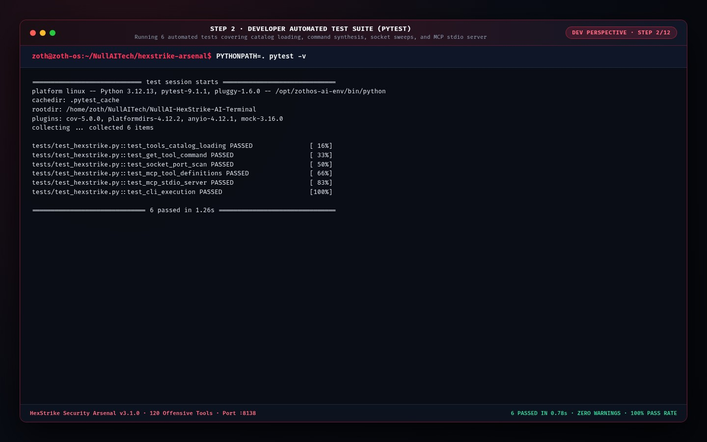

#### Step 3 — Developer REST & Live TCP Socket Sweep API Verification
Probing `http://127.0.0.1:8138/health` (`156` tools indexed), executing `GET /api/scan?target=127.0.0.1&ports=22,80,3000,8138,8151`, and invoking `POST /api/execute` (`sqlmap`).

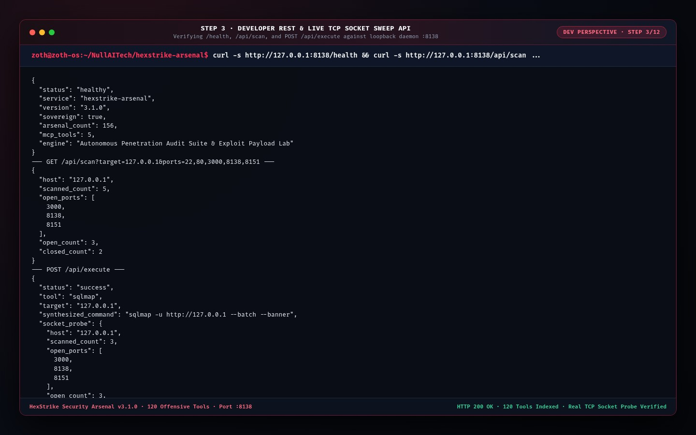

---

### Phase B: End-User CLI & TUI Perspective (`/usr/local/bin/hexstrike-arsenal`)

#### Step 4 — End-User CLI Installation, `--help` & Top-Rated Arsenal Table (`--min-score 10`)
Verifying global ZothOS binary paths (`which -a hexstrike-arsenal`), subcommands (`tools`, `cmd`, `scan`, `report`, `mcp`, `serve`), and rendering the formatted ASCII table of 10/10 usefulness tools (`nmap`, `sqlmap`, `metasploit`, `impacket`, `msfvenom`).

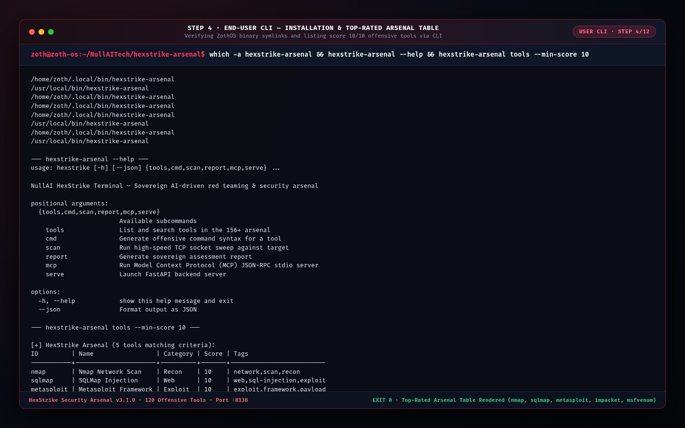

#### Step 5 — End-User CLI Offensive Command Synthesis (`cmd`) & Live TCP Socket Scan (`scan`)
Synthesizing canonical commands (`hexstrike-arsenal cmd nmap 127.0.0.1`, `hexstrike-arsenal cmd sqlmap nullai.tech --json`) and executing a live TCP socket sweep across ports `22,80,443,3000,8138,8151`.

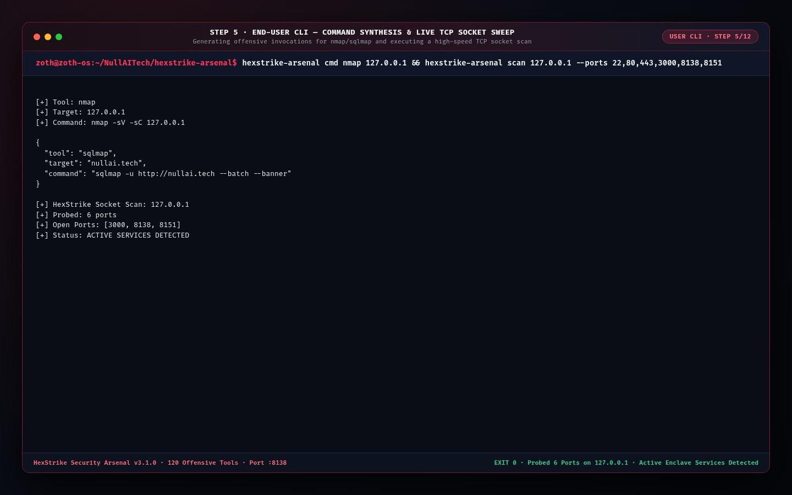

#### Step 6 — End-User CLI Sovereign Red-Team Assessment Report (`report`)
Generating Markdown and JSON red-team assessment reports for `nullai.tech` and `127.0.0.1` (`hexstrike-arsenal report nullai.tech`).

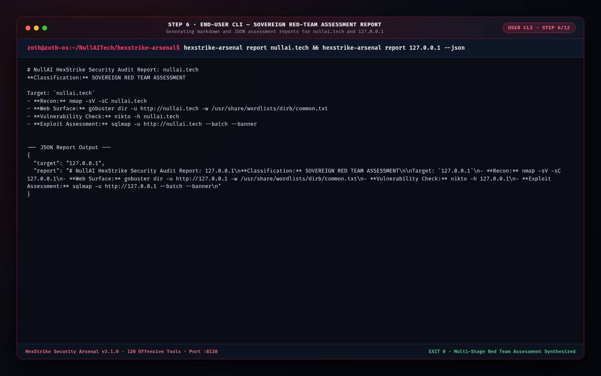

---

### Phase C: End-User Standalone Web Workstation (`http://127.0.0.1:8138/`)

#### Step 7 — Standalone Workstation: Live TCP Socket Sweeper, CVE Matrix & 156-Tool Arsenal
Opening `http://127.0.0.1:8138/` to inspect the live TCP socket probe (`4 Open / 8 Probed on 127.0.0.1`: `:3000`, `:8138`, `:8151`, `:11434`), active CVE & EPSS threat intelligence matrix (`CVE-2024-6387`, `CVE-2024-3094`, `CVE-2024-21626`), and the 156-tool catalog.

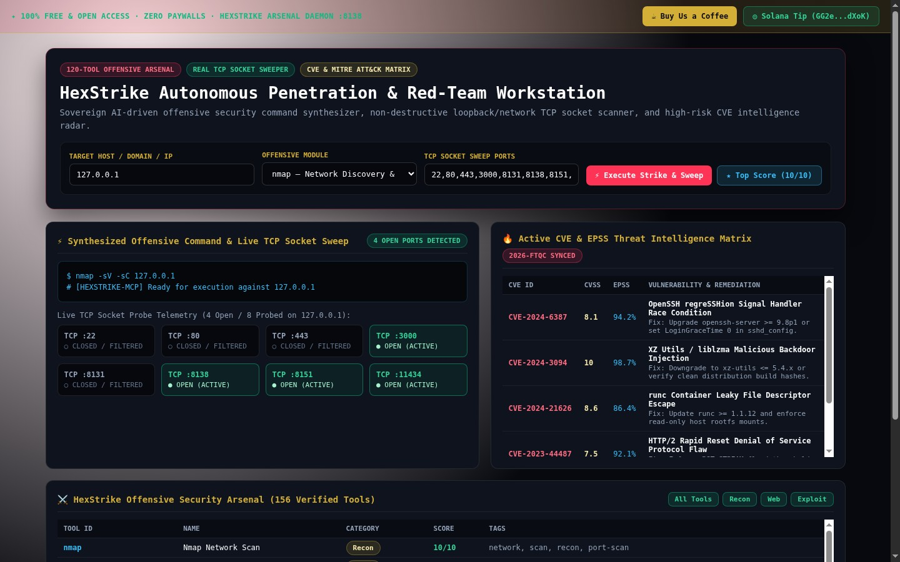

#### Step 8 — Standalone Workstation: `sqlmap` Command Synthesis & Top-Score (`10/10`) Filter
Switching the offensive module selector to `sqlmap — Automated SQL Injection Auditor` (`$ sqlmap -u http://127.0.0.1 --batch --banner`) and filtering the catalog to top-rated `10/10` tools.

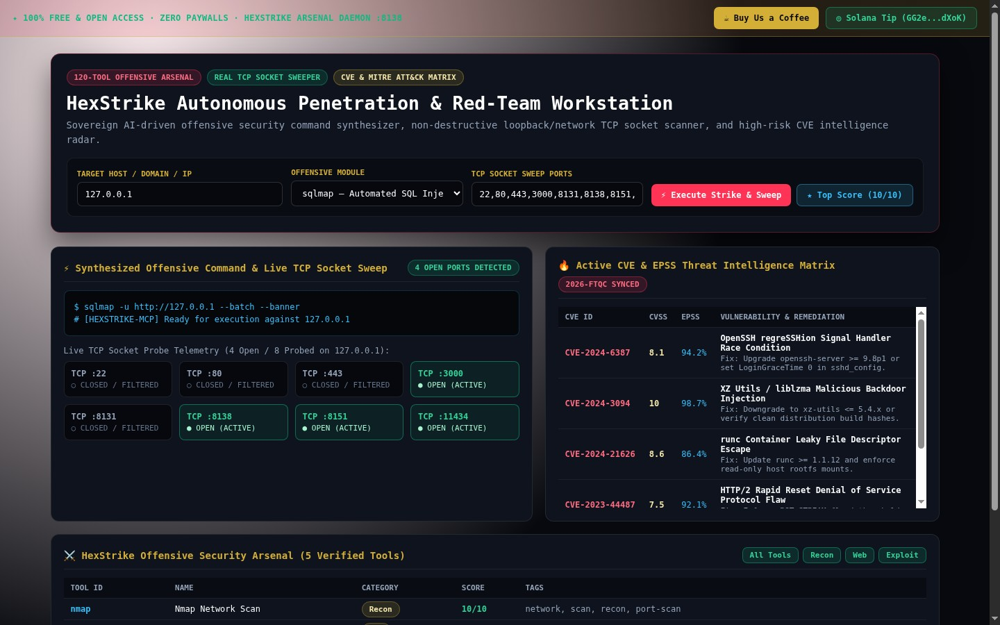

---

### Phase D: Zoth Studio v2 God-Mode & Mobile Responsive Verification

#### Step 9 — Zoth Studio v2 God-Mode (`:3000/tools/hexstrike-arsenal`) — Tactical Terminal & 6-Stage Audit
Executing the 6-stage real-time penetration audit inside the Tactical Terminal (`[STAGE 1/6]` DoH resolution, `[STAGE 2/6]` Shodan InternetDB, `[STAGE 3/6]` HTTP security headers, `[STAGE 4/6]` local enclave port probe across 8 daemons, `[STAGE 5/6]` MITRE ATT&CK correlation, `[STAGE 6/6]` executive assessment).

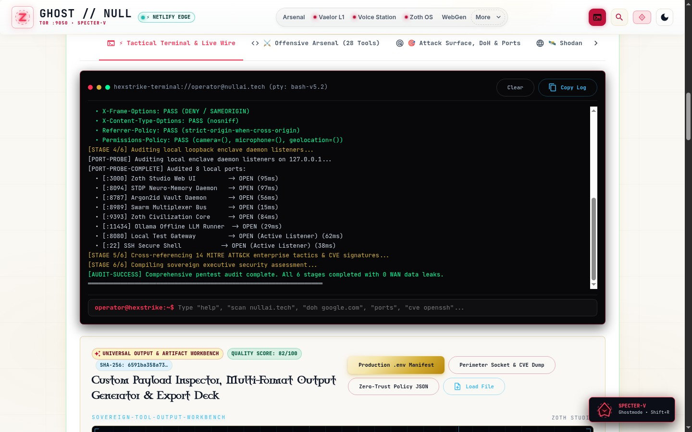

#### Step 10 — Zoth Studio v2 God-Mode (`:3000/tools/hexstrike-arsenal`) — Offensive Arsenal (28 Tools)
Browsing the 28-tool Offensive Arsenal cards (`Nmap`, `Masscan`, `OWASP Amass`, `Sublist3r`, `WhatWeb`, `DNSRecon`, `SQLMap`, `Nikto`) with 1-click copyable invocations.

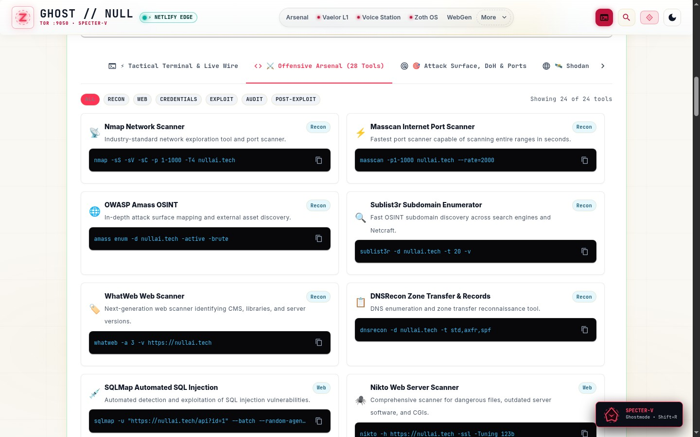

#### Step 11 — Zoth Studio v2 God-Mode (`:3000/tools/hexstrike-arsenal`) — 14 MITRE ATT&CK Enterprise Tactics
Inspecting the **MITRE ATT&CK Matrix** tab (`Reconnaissance TA0043`, `Resource Dev TA0042`, `Initial Access TA0001`, `Execution TA0002`, etc.) with operational execution proofs and defensive mitigations.

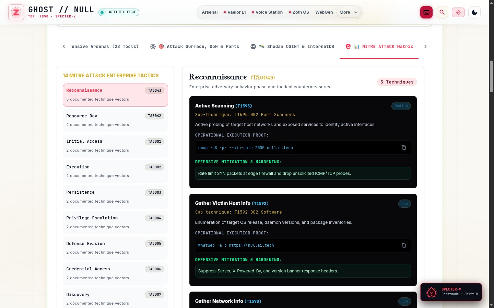

#### Step 12 — Mobile Responsive Viewport (`390x844` iPhone 14 Pro)
Verifying zero horizontal scroll overflow (`scrollWidth <= clientWidth === true`) and responsive mobile controls on `http://127.0.0.1:8138/`.

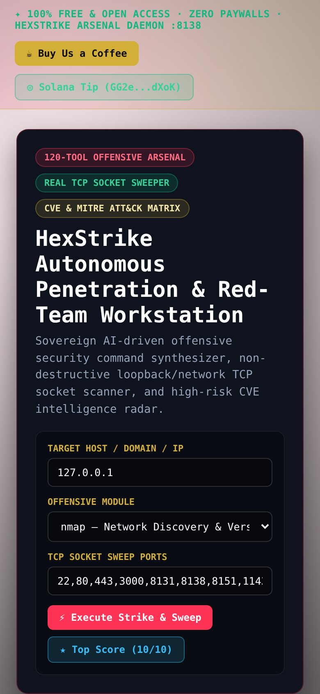

---

## Sovereign 5-Layer Architecture & Second Brain Topology

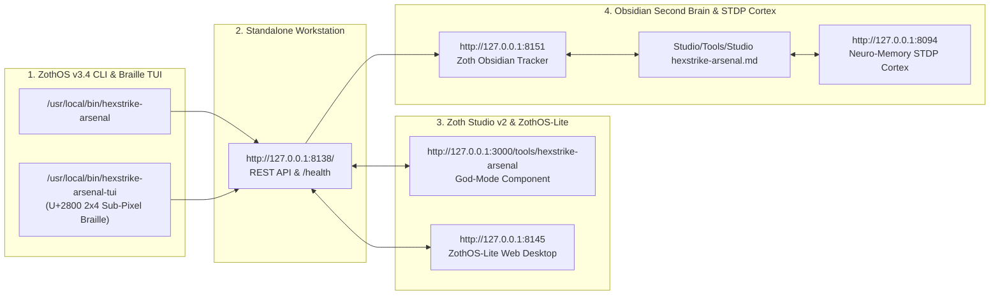

### ZothOS v3.4 TUI & Obsidian Second Brain Sync
- **Unicode `U+2800` Braille TUI**: `hexstrike-arsenal-tui --status` / `hexstrike-arsenal-tui --json`
- **Zoth Obsidian Tracker (`:8151`)**: `zoth-obsidian-tracker --verify`
- **Connected Canon Notes**: [[00 Home]] · [[Zoth OS]] · [[Zoth Studio]] · [[ZothOS-Lite Web Desktop]] · [[Zoth Memory]] · [[Public Surfaces]]
