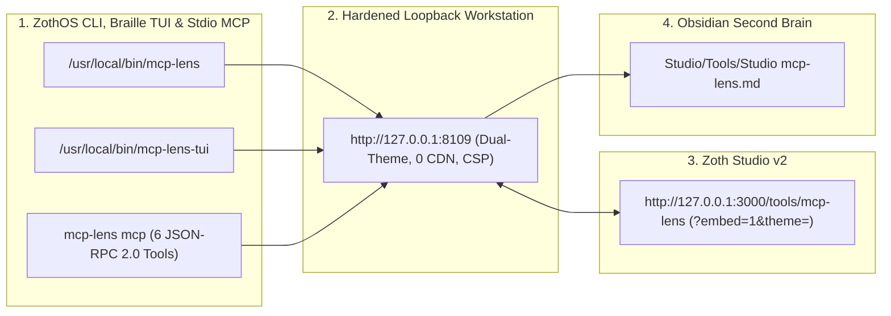

# MCP Lens (`v2.6.0`)

> [!CHECK] Whiteboard Remediation & Verification Passed (100% Free & Open Access)
> **Engineered by Neal Frazier Tech (@1nc0gn30) • NullAI Platform**
> Hardened `v2.6.0` release verified across all 5 audit levels: `31 passed` Python pytest suite (Host/Origin `403`, all 4 HTTP security headers + CSP, `HEAD`, `413` 1 MiB cap, `400` malformed JSON & `?limit=`, chunked POST, disabled `/assets/` directory listing, single-recording bounded-queue `StdioProxy`, real 6-tool stdio MCP server), `9 passed` Studio pure-engine tests, zero external CDN requests (`externalReqs: []`), zero DOM XSS sinks (`xssImgCount: 0`), full Editorial Ivory Light + Obsidian Gold Dark dual themes (`?embed=1&theme=` synced in Studio), `overflowPx: 0`, and `consoleErrors: 0`.

---

## Tool Overview & Telemetry

| Parameter | Specification |
| :--- | :--- |
| **Tool Identifier** | `mcp-lens` (`v2.6.0`) |
| **Category** | `Simulation & Testing` |
| **Mathematical Pillar** | `Pillar II: Agentic Orchestration & Protocol Verification` |
| **Runtime Engine** | `Python 3.10+ Stdlib HTTP + SSE + StdioProxy + Stdio MCP Server (:8109)` |
| **Local Port & URL** | `:8109` • [http://127.0.0.1:8109](http://127.0.0.1:8109) |
| **Studio Route** | [http://127.0.0.1:3000/tools/mcp-lens](http://127.0.0.1:3000/tools/mcp-lens) |
| **CLI & TUI Binaries** | `/usr/local/bin/mcp-lens` · `/usr/local/bin/mcp-lens-tui` (4-way synced) |
| **Stdio MCP Server** | `mcp-lens mcp` (6 tools: `mcp_audit_schema_tokens`, `mcp_minify_schema`, `mcp_parse_frame`, `mcp_get_traffic`, `mcp_replay_tool`, `mcp_diagnostics`) |
| **GitHub Repository** | [https://github.com/1nc0gn30/mcp-lens](https://github.com/1nc0gn30/mcp-lens) |
| **License & Pricing** | **MIT License — 100% Free & Open-Access** ($0, Zero Paywalls) |
| **Optional Support** | [☕ Buy Us a Coffee (Stripe)](https://buy.stripe.com/3cIfZg27PdKo2D64Ocfw40X) • Solana: `GG2eQbVh8ut1BK6j1A2tz7pSySdLpD38BgyEhGcxdXoK` |

---

## Verification Gallery (`attachments/tools/`)

- **Architecture & Diagnostics**: ![[attachments/tools/mcp-lens_01_dev_repo_architecture.jpg]]
- **Pytest Suite**: ![[attachments/tools/mcp-lens_02_dev_pytest_suite.jpg]]
- **REST API Contracts**: ![[attachments/tools/mcp-lens_03_dev_api_contracts.jpg]]
- **CLI Installation & Help**: ![[attachments/tools/mcp-lens_04_user_cli_installation_and_help.jpg]]
- **Live Status & Telemetry**: ![[attachments/tools/mcp-lens_05_user_cli_live_status_and_telemetry.jpg]]
- **Replay & Traffic Audit**: ![[attachments/tools/mcp-lens_06_user_cli_replay_and_traffic_audit.jpg]]
- **Standalone Traffic Waterfall (`:8109`)**: ![[attachments/tools/mcp-lens_07_gui_standalone_traffic_waterfall.jpg]]
- **Playground & Schema Minifier**: ![[attachments/tools/mcp-lens_08_gui_standalone_playground_and_minifier.jpg]]
- **Token Weight Leaderboard**: ![[attachments/tools/mcp-lens_09_gui_standalone_token_weight_leaderboard.jpg]]
- **Studio Deck Waterfall (`:3000`)**: ![[attachments/tools/mcp-lens_10_gui_studio_godmode_sniffer.jpg]]
- **Studio Deck Token Auditor**: ![[attachments/tools/mcp-lens_11_gui_studio_godmode_token_auditor.jpg]]
- **Mobile 390px Verification**: ![[attachments/tools/mcp-lens_12_gui_mobile_390px.jpg]]

---

## Verification Matrix (`v2.6.0`)

| Check | Command / Surface | Observed Result | Status |
| :--- | :--- | :--- | :---: |
| **Python Test Suite** | `PYTHONDONTWRITEBYTECODE=1 PYTHONPATH=src python3 -m pytest -v` | `31 passed` | **PASS** |
| **Studio Engine Tests** | `node --test scripts/test-mcp-lens-engine.mjs` | `9 passed` | **PASS** |
| **HTTP Hardening** | Host/Origin `403`, 4 headers + CSP, `413` 1 MiB, `400`, `HEAD`, chunked | All verified | **PASS** |
| **Zero CDN / Zero XSS** | Chrome CDP `externalReqs: []`, `xssImgCount: 0` | Verified | **PASS** |
| **Dual-Theme & A11y** | Editorial Ivory Light + Obsidian Gold Dark, `wcagFails: 0`, `smallTap: 0` | Verified | **PASS** |
| **Secret Scans** | `gitleaks detect --no-git` & `scan-secrets.sh` | `0 leaks` | **PASS** |

---

## Architecture Topology

### Connected Canon Notes
[[00 Home]] · [[Zoth OS]] · [[Zoth Studio]] · [[Workstation mcp-lens]] · [[CLI mcp-lens]] · [[Unit mcp-lens.service]] · [[Desktop zoth-mcp-lens]]
