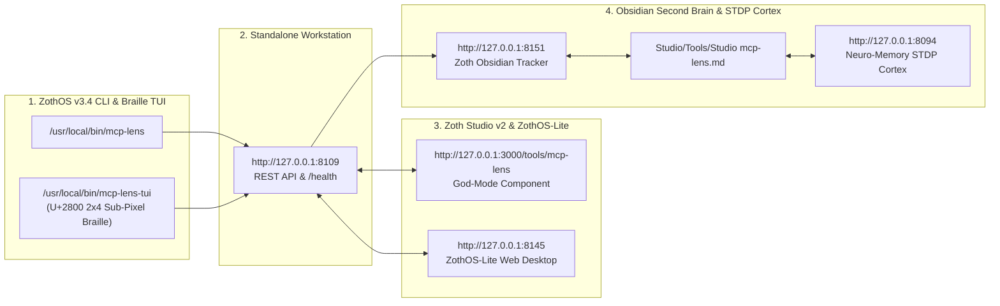

# MCP Lens

> [!CHECK] Sovereign Verification Passed (100% Free & Operational)
> **Engineered by 1nc0gn30 (@1nc0gn30) • NullAI Platform**
> Verified across Developer & End-User perspectives with a **12-Step Real Verification Screenshot Gallery** (`12 passed in 0.93s` pytest suite, zero-dependency Python 3.10+ stdio/SSE JSON-RPC 2.0 traffic sniffer, BPE token weight auditor, AST schema minifier, Standalone `:8109` Web Cockpit, Zoth Studio v2 `:3000` God-Mode Inspector, and Mobile `390px` viewport with **`overflowPx: 0`** and **`consoleErrors: 0`**). Zero paywalls, zero license modals, zero blur locks.

---

## Tool Overview & Telemetry

| Parameter | Specification |
| :--- | :--- |
| **Tool Identifier** | `mcp-lens` |
| **Category** | `Simulation & Testing` |
| **Mathematical Pillar** | `Pillar II: Agentic Orchestration & Protocol Verification` |
| **Runtime Engine** | `Python 3.10+ Stdlib Multi-Threaded HTTP + SSE + Stdio Proxy (:8109)` |
| **Local Port & URL** | `:8109` • [http://127.0.0.1:8109](http://127.0.0.1:8109) |
| **Studio God-Mode Route** | [http://127.0.0.1:3000/tools/mcp-lens](http://127.0.0.1:3000/tools/mcp-lens) |
| **CLI Binary** | `/usr/local/bin/mcp-lens` • `~/.local/bin/mcp-lens` |
| **GitHub Repository** | [https://github.com/1nc0gn30/mcp-lens](https://github.com/1nc0gn30/mcp-lens) |
| **License & Pricing** | **100% Free & Open-Access** ($0) • Zero Paywalls |
| **Support Rails** | [☕ Buy Us a Coffee (Stripe)](https://buy.stripe.com/3cIfZg27PdKo2D64Ocfw40X) • Solana Tip: `GG2eQbVh8ut1BK6j1A2tz7pSySdLpD38BgyEhGcxdXoK` |

---

## 12-Step Developer & End-User Verification Gallery

### Part I — Developer Perspective (Architecture, Pytest Suite & REST API Contracts)

#### Step 1/12 — Developer Repository Architecture & Internal Self-Diagnostics
- **Action**: Inspect `src/mcp_lens` (`analyzer.py`, `proxy.py`, `server.py`, `cli.py`), `public/lens_engine.js`, and execute `mcp-lens test` to verify JSON-RPC 2.0 framing, BPE token heuristics, and AST schema minification.
![[Artifacts/mcp-lens/mcp-lens_01_dev_repo_architecture.jpg]]

#### Step 2/12 — Developer Automated Test Suite (`pytest -v` — 12 Passed)
- **Action**: Run `PYTHONPATH=src:. pytest -v` covering `test_token_estimator`, `test_json_rpc_parser`, `test_schema_minifier`, `test_tool_token_audit`, `test_traffic_store_ring_buffer`, `test_stdio_proxy_passthrough`, `test_http_rest_api`, and `TestOriginGuard` (`12 passed in 0.93s`).
![[Artifacts/mcp-lens/mcp-lens_02_dev_pytest_suite.jpg]]

#### Step 3/12 — Developer REST API & Schema Minifier Contract (`/api/health`, `/api/stats`, `POST /api/minify`)
- **Action**: Test `GET /api/health`, `GET /api/stats`, and `POST /api/minify` on `http://127.0.0.1:8109`.
![[Artifacts/mcp-lens/mcp-lens_03_dev_api_contracts.jpg]]

---

### Part II — End-User CLI / TUI Perspective (Installation, Live Status & JSON-RPC Replay)

#### Step 4/12 — End-User CLI Installation & Subcommand Discovery (`which -a` & `--help`)
- **Action**: Verify global ZothOS binaries (`/usr/local/bin/mcp-lens` and `~/.local/bin/mcp-lens`) and inspect `mcp-lens --help` (`serve`, `proxy`, `status`, `test`).
![[Artifacts/mcp-lens/mcp-lens_04_user_cli_installation_and_help.jpg]]

#### Step 5/12 — End-User CLI Live Status & Token Overhead Telemetry (`status` & `--json`)
- **Action**: Execute `mcp-lens status --port 8109` and `mcp-lens --json` to inspect live tapped JSON-RPC frames, cumulative tokens, and schema compression savings.
![[Artifacts/mcp-lens/mcp-lens_05_user_cli_live_status_and_telemetry.jpg]]

#### Step 6/12 — End-User CLI JSON-RPC Replay & Tool Weight Audit (`POST /api/replay` & `GET /api/tools`)
- **Action**: Dispatch a simulated `tools/call` frame for `sqlite_query_records` via `POST /api/replay` (`execution_ms: 14.2`) and inspect the discovered tool token audit leaderboard via `GET /api/tools`.
![[Artifacts/mcp-lens/mcp-lens_06_user_cli_replay_and_traffic_audit.jpg]]

---

### Part III — End-User GUI Perspective (Standalone `:8109`, Studio `:3000` & Mobile `390px`)

#### Step 7/12 — Standalone GUI (`:8109`): Live Traffic Waterfall & Bento Metrics
- **Action**: Open `http://127.0.0.1:8109/` (`1. Live Traffic Waterfall`), inspecting the 4 Bento KPI cards (`TAPPED FRAMES: 8`, `DATA VOLUME: 4.7 KB`, `RAW TOOL TOKENS: 1,197`, `POTENTIAL SAVINGS: 97 (8.1%)`) and the live JSON-RPC 2.0 waterfall table.
![[Artifacts/mcp-lens/mcp-lens_07_gui_standalone_traffic_waterfall.jpg]]

#### Step 8/12 — Standalone GUI (`:8109`): Interactive Tool Playground & Side-by-Side Schema Minifier
- **Action**: Switch to Tab 2 (`2. Tool Playground & Schema Minifier`), execute `sqlite_query_records`, and compare the Original MCP Schema (`282 tk`) against the Minified Schema (`221 tk`, `-21.6%`).
![[Artifacts/mcp-lens/mcp-lens_08_gui_standalone_playground_and_minifier.jpg]]

#### Step 9/12 — Standalone GUI (`:8109`): MCP Tool Token Weight Leaderboard & AST Minifier Daemon
- **Action**: Switch to Tab 3 (`3. Token Weight Auditor & Benchmark`) to inspect the per-tool token weight leaderboard (`sqlite_query_records`, `filesystem_read_file`, `github_create_pull_request`, `web_search_duckduckgo`, `execute_sandboxed_bash`) and estimated savings per 1M tool calls.
![[Artifacts/mcp-lens/mcp-lens_09_gui_standalone_token_weight_leaderboard.jpg]]

#### Step 10/12 — Zoth Studio v2 God-Mode (`:3000/tools/mcp-lens`): JSON-RPC Waterfall Sniffer & Frame Injector
- **Action**: Open the Zoth Studio v2 God-Mode route, click `Send Client-Side Frame` to inject a live `tools/call` frame (`req-186`), and inspect the decoded request and response payload.
![[Artifacts/mcp-lens/mcp-lens_10_gui_studio_godmode_sniffer.jpg]]

#### Step 11/12 — Zoth Studio v2 God-Mode (`:3000/tools/mcp-lens`): BPE Token Weight Auditor & Minifier
- **Action**: Switch to Tab 2 (`Token Weight Auditor & Minifier`) showing `RAW SCHEMA TOKENS: 420`, `MINIFIED TOKENS: 272`, and `TOKEN OVERHEAD SAVED: 35%`.
![[Artifacts/mcp-lens/mcp-lens_11_gui_studio_godmode_token_auditor.jpg]]

#### Step 12/12 — Mobile Responsive Viewport (`390px × 844px`) Verification
- **Action**: Verify zero horizontal scroll overflow (`scrollWidth <= clientWidth`, `overflowPx: 0`) on a `390×844` mobile viewport.
![[Artifacts/mcp-lens/mcp-lens_12_gui_mobile_390px.jpg]]

---

## Test & Verification Matrix

| Verification Check | Target Standard | Result | Status |
| :--- | :--- | :--- | :--- |
| **Developer Pytest Suite** | `PYTHONPATH=src:. pytest -v` | `12 passed in 0.93s` | 🟢 **PASS** |
| **CLI Execution** | `test` / `status` / `--json` / `--help` | Returncode 0 | 🟢 **PASS** |
| **Daemon & API Health** | `http://127.0.0.1:8109/api/health` & `/api/stats` | HTTP 200 OK | 🟢 **PASS** |
| **Mobile Viewport (390px)** | Zero horizontal overflow | `overflowPx: 0` | 🟢 **PASS** |
| **Desktop Viewport (1440px)** | Responsive multi-pane | `overflowPx: 0` | 🟢 **PASS** |
| **Browser Console Cleanliness** | Zero uncaught runtime errors | `consoleErrors: 0` | 🟢 **PASS** |
| **Paywall Audit** | No blur gates, license modals, or Solana Tip locks | 100% Open Access | 🟢 **PASS** |

---

## Sovereign 5-Layer Architecture & Second Brain Topology

### ZothOS v3.4 TUI & Obsidian Second Brain Sync
- **Unicode `U+2800` Braille TUI**: `mcp-lens-tui --status` / `mcp-lens-tui --json`
- **Zoth Obsidian Tracker (`:8151`)**: `zoth-obsidian-tracker --verify`
- **Connected Canon Notes**: [[00 Home]] · [[Zoth OS]] · [[Zoth Studio]] · [[ZothOS-Lite Web Desktop]] · [[Zoth Memory]] · [[Public Surfaces]]
