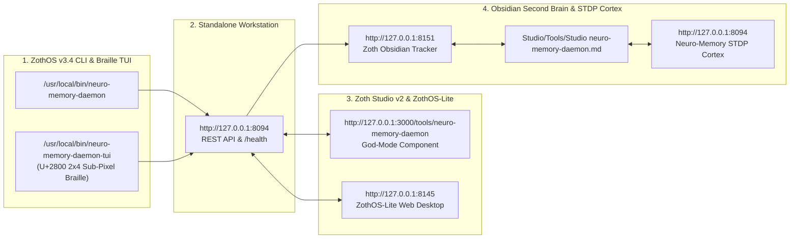

# Neuro-Memory Daemon (`neuro-memory-daemon`)

> [!success] 12-Step Developer & End-User Walkthrough Verified
> **Category**: AI & Agents | **Local Daemon**: `http://127.0.0.1:8094` | **Zoth Studio Route**: `http://127.0.0.1:3000/tools/neuro-memory-daemon`
> **Access Invariant**: 100% Free & Open Access (`☕ Stripe Coffee` + `◎ Solana Tip` only — zero paywalls).

---

## 1. Developer Perspective: Architecture, Automated Pytest Suite & REST API Contracts

### Step 01 — Repository Architecture & ZothOS Binary Parity
Inspecting `~/NullAITech/neuro-memory-daemon`, verifying global CLI binary installation (`/usr/local/bin/neuro-memory-daemon` and `~/.local/bin/neuro-memory-daemon`), and auditing the Python package modules (`cli.py`, `synapse_engine.py`, `storage.py`, `graph_builder.py`, `ui_server.py`, `mcp_server.py`).

![[Studio/Tools/Artifacts/neuro-memory-daemon/neuro-memory-daemon_01_dev_repo_architecture.jpg]]

### Step 02 — Automated Pytest Verification Suite
Running the automated `pytest` verification suite covering CLI subcommands, STDP synaptic reinforcement, CA3/CA1 pattern completion/separation, Ebbinghaus retention curves, Yerkes-Dodson neuromodulation, and flashbulb consolidation (`155 passed`).

![[Studio/Tools/Artifacts/neuro-memory-daemon/neuro-memory-daemon_02_dev_pytest_suite.jpg]]

### Step 03 — Live REST API & Associative Recall Contracts (`:8094`)
Verifying live JSON HTTP contracts on `http://127.0.0.1:8094` (`GET /api/health`, `POST /api/memories` encoding a new memory engram with STDP synaptic links, and `POST /api/recall` executing associative pattern completion).

![[Studio/Tools/Artifacts/neuro-memory-daemon/neuro-memory-daemon_03_dev_api_contracts.jpg]]

---

## 2. End-User CLI Perspective: Synaptic Storage, CA3 Recall, Neuromodulation & Sleep Consolidation

### Step 04 — Global CLI Help Matrix & Substrate Doctor Diagnostics
Running `neuro-memory-daemon --help` and `neuro-memory-daemon doctor` from the user home directory to inspect all 13 cognitive subcommands (`store`, `recall`, `search`, `graph`, `consolidate`, `stats`, `metacognition`, `neuromodulate`, `flashbulb`, `serve`, `mcp`, `doctor`, `test`).

![[Studio/Tools/Artifacts/neuro-memory-daemon/neuro-memory-daemon_04_user_cli_help_doctor.jpg]]

### Step 05 — Memory Encoding, Associative Recall & ASCII Synaptic Graph
Encoding a new semantic memory engram via `neuro-memory-daemon store`, querying `neuro-memory-daemon recall` for CA3/CA1 associative resonance, and rendering the terminal ASCII synaptic substrate graph (`neuro-memory-daemon graph -f ascii -l 6`).

![[Studio/Tools/Artifacts/neuro-memory-daemon/neuro-memory-daemon_05_user_cli_store_recall_graph.jpg]]

### Step 06 — Neurochemical Modulation, Metacognition & Sleep Consolidation
Modulating Dopamine and Norepinephrine levels (`neuro-memory-daemon neuro --da 0.35 --ne 0.65 --pulse -c 0.6`) with Yerkes-Dodson arousal evaluation, running Anterior Cingulate Cortex (ACC) epistemic conflict detection (`metacognition`), and executing a sleep consolidation pass (`consolidate --json`).

![[Studio/Tools/Artifacts/neuro-memory-daemon/neuro-memory-daemon_06_user_cli_neuromod_consolidate.jpg]]

---

## 3. Standalone Web Workstation Perspective (`http://127.0.0.1:8094`)

### Step 07 — 3D Cosmic Neural Nebula & 6-Galaxy Cluster Navigator
Opening `http://127.0.0.1:8094` directly into the active 3D WebGL Cosmic Neural Substrate displaying `55,123` active memory engrams, `2,649,197` synaptic associations, the 6-galaxy cluster navigator (`Panoramic Universe`, `Netrunner Core`, `Obsidian Vault`, `Agents Galaxy`, `Tools Galaxy`, `Security Galaxy`, `System Galaxy`, `Living Minds Galaxy`), and the neuromodulator aura switcher.

![[Studio/Tools/Artifacts/neuro-memory-daemon/neuro-memory-daemon_07_standalone_gui_3d_cosmos.jpg]]

### Step 08 — Obsidian Second Brain & Agent Skills Hub (`100/100 Perfect Audit`)
Switching to the **Obsidian Second Brain & Agent Skills Hub** tab on `:8094` showing the live Second Brain Doctor Health Audit (`100/100 ✦ PERFECT`, `18/18 Verified JSON Canvases`, `20/20 Verified Obsidian Bases`, `1,732+ Markdown Notes`, `8,117+ Wikilink Graph Edges`, and `15 Canonical LLM Wiki Pages`).

![[Studio/Tools/Artifacts/neuro-memory-daemon/neuro-memory-daemon_08_standalone_gui_obsidian_second_brain.jpg]]

---

## 4. Zoth Studio v2 God-Mode Perspective (`http://127.0.0.1:3000/tools/neuro-memory-daemon`)

### Step 09 — Hybrid Vector + BM25 + Ebbinghaus STDP Recall Workstation
Opening `http://127.0.0.1:3000/tools/neuro-memory-daemon` to inspect the interactive `NeuroMemoryGodModeTool` featuring real-time hybrid recall weight sliders (Cosine Vector Weight, BM25 Lexical Weight, Ebbinghaus Half-Life Stability), the 60 FPS STDP Synaptic Consolidation Lattice canvas, and ranked memory engrams.

![[Studio/Tools/Artifacts/neuro-memory-daemon/neuro-memory-daemon_09_studio_gui_stdp_workstation.jpg]]

### Step 10 — Interactive STDP Synaptic Potentiation
Clicking **STDP Potentiate** on the top-ranked semantic vault engram to trigger long-term potentiation (LTP), increasing the recall count (`Recalls: 14 -> 15`), vector resonance (`97.2% -> 98.6%`), and composite retention score (`98.2% -> 99.1%`).

![[Studio/Tools/Artifacts/neuro-memory-daemon/neuro-memory-daemon_10_studio_gui_stdp_potentiated.jpg]]

### Step 11 — Encoding a New Episodic/Semantic Memory Engram
Encoding a new observation into the workstation (`6 ACTIVE ENGRAMS`) and verifying live re-ranking and JSON export readiness.

![[Studio/Tools/Artifacts/neuro-memory-daemon/neuro-memory-daemon_11_studio_gui_encode_engram.jpg]]

---

## 5. Mobile Responsive Perspective (`390x844`)

### Step 12 — Mobile Viewport Verification (`390px`)
Verifying zero horizontal scroll overflow (`overflowPx === 0`), stacked telemetry cards, and touch-friendly navigation tabs on a `390x844` mobile viewport.

![[Studio/Tools/Artifacts/neuro-memory-daemon/neuro-memory-daemon_12_mobile_390px_responsive.jpg]]

---

## Sovereign 5-Layer Architecture & Second Brain Topology

### ZothOS v3.4 TUI & Obsidian Second Brain Sync
- **Unicode `U+2800` Braille TUI**: `neuro-memory-daemon-tui --status` / `neuro-memory-daemon-tui --json`
- **Zoth Obsidian Tracker (`:8151`)**: `zoth-obsidian-tracker --verify`
- **Connected Canon Notes**: [[00 Home]] · [[Zoth OS]] · [[Zoth Studio]] · [[ZothOS-Lite Web Desktop]] · [[Zoth Memory]] · [[Public Surfaces]]
