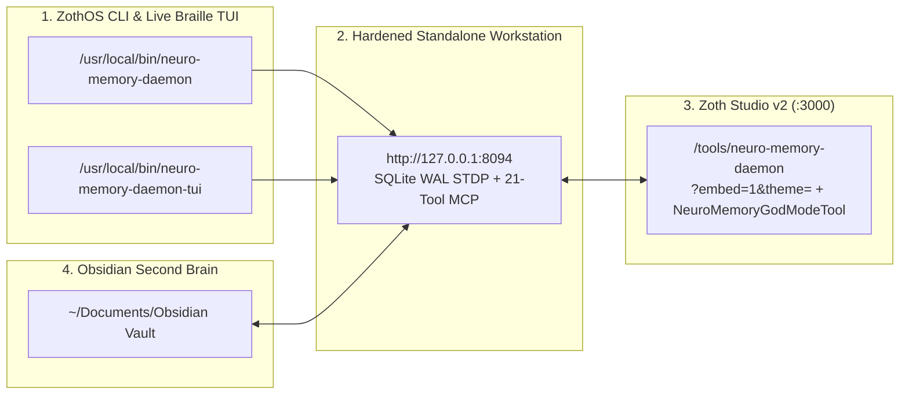

# Neuro-Memory Daemon (`neuro-memory-daemon` v2.9.0)

> [!success] v2.9.0 Hardened & Verified Across All 5 Layers
> **Category**: Memory & Brain | **Local Daemon**: `http://127.0.0.1:8094` | **Zoth Studio Route**: `http://127.0.0.1:3000/tools/neuro-memory-daemon`
> **Repository**: [https://github.com/1nc0gn30/neuro-memory-daemon](https://github.com/1nc0gn30/neuro-memory-daemon) | **License**: `Apache-2.0`
> **Access Invariant**: 100% Free & Open Access (zero paywalls, single footer `☕ Buy Us a Coffee` + Solana tip).
> **Attribution**: Engineered by **Neal Frazier Tech** (`@1nc0gn30`) • [NullAI Platform](https://nullai.tech)

---

## 1. Architecture, Security Hardening & Automated Test Suite (`171` Tests, `0` Skipped)

- **Zero-Dependency Python 3.9+ Core**: `sqlite3` WAL persistence (`~/.neuro-memory/`), 3-factor STDP synaptic plasticity, Hippocampal CA3/CA1 associative recall, Ebbinghaus retention decay, neuromodulation (`NE`, `DA`, `ACh`, `5-HT`), and a **21-tool MCP server** (`11` cognitive + `10` Obsidian/Vaelor tools).
- **Standing Substrate Telemetry (`127.0.0.1:8094`)**: `5,469` live engrams, `266,858` synapses (`48.79` synaptic density), `14` categories.
- **Loopback Security Controls (`ui_server.py`)**: Strict loopback `Host` and exact-port `Origin` (`403 Forbidden`) across `GET`/`HEAD`/`POST`/`PUT`/`DELETE`/`OPTIONS`, reflected loopback CORS (`Vary: Origin`, zero `*` wildcard), all 4 HTTP security headers (`X-Frame-Options`, `X-Content-Type-Options`, `Referrer-Policy`, strict loopback `CSP`), stripped `Server: Neuro-Memory`, `1 MiB` HTTP `413` body cap, strict JSON / numeric query parameter HTTP `400` validation (and JSON-RPC `-32700` on `/api/mcp`), and `Path.resolve().is_relative_to()` fixed-root confinement for Obsidian note, wiki, and `.canvas` writes.
- **Automated Verification**: `171 passed, 0 skipped` in isolated `HOME=/tmp/... pytest tests/ -q` (self-contained Obsidian vault fixtures + security/HTTP/XSS regression suite) and `0 leaks` on `gitleaks`.

![[Studio/Tools/Artifacts/neuro-memory-daemon/neuro-memory-daemon_01_dev_repo_architecture.jpg]]
![[Studio/Tools/Artifacts/neuro-memory-daemon/neuro-memory-daemon_02_dev_pytest_suite.jpg]]
![[Studio/Tools/Artifacts/neuro-memory-daemon/neuro-memory-daemon_03_dev_api_contracts.jpg]]

---

## 2. 4-Way CLI, Live Braille TUI & Desktop Parity

- **Synced Bit-Identically Across 4 Surfaces** (`repo/bin/`, `~/.local/bin/`, `/usr/local/bin/`, `zoth-os/config/includes.chroot/usr/local/bin/`): `neuro-memory-daemon`, `neuro-memory`, `zoth-neuro-memory`, `zoth-memory`, and `neuro-memory-daemon-tui` (live read-only `:8094/health` & `/api/stats` Braille telemetry).
- **Sandboxed Electron Wrapper (`electron/main.cjs`)**: `sandbox: true`, `contextIsolation: true`, `nodeIntegration: false`, `webSecurity: true`, `will-navigate` loopback lock, and clean child teardown on `before-quit` / `window-all-closed`.

![[Studio/Tools/Artifacts/neuro-memory-daemon/neuro-memory-daemon_04_user_cli_help_doctor.jpg]]
![[Studio/Tools/Artifacts/neuro-memory-daemon/neuro-memory-daemon_05_user_cli_store_recall_graph.jpg]]
![[Studio/Tools/Artifacts/neuro-memory-daemon/neuro-memory-daemon_06_user_cli_neuromod_consolidate.jpg]]

---

## 3. Standalone Dual-Theme Workstation (`:8094`) & Zoth Studio v2 Route (`:3000`)

- **Standalone `:8094`**: True Editorial Ivory Light Mode + Obsidian Gold Dark Mode with `?embed=1&theme=light|dark` Studio sync, DOM-safe tag/toast rendering (zero XSS sinks), zero external font/CDN egress (`externalReqs: []`), WCAG AA contrast (`wcagF === 0`), `>= 44×44 px` mobile tap targets, custom scrollbars, and labeled form controls.
- **Studio `/tools/neuro-memory-daemon` (`NeuroMemoryGodModeTool.jsx`)**: Powered by `netrunnerMemoryEngine.js` (Robertson-Sparck Jones BM25 + 96-dim hashed n-gram cosine + asymmetric STDP `Δw(0) = 0` + Ebbinghaus retention + strictly read-only `/api/studio/netrunner-memory` bridge) with Editorial Ivory Light & Obsidian Gold Dark themes (`darkSlabs === 0`, `wcagF === 0`, `FAQPage` JSON-LD).

![[Studio/Tools/Artifacts/neuro-memory-daemon/neuro-memory-daemon_07_standalone_gui_3d_cosmos.jpg]]
![[Studio/Tools/Artifacts/neuro-memory-daemon/neuro-memory-daemon_08_standalone_gui_obsidian_second_brain.jpg]]
![[Studio/Tools/Artifacts/neuro-memory-daemon/neuro-memory-daemon_09_studio_gui_stdp_workstation.jpg]]
![[Studio/Tools/Artifacts/neuro-memory-daemon/neuro-memory-daemon_12_mobile_390px_responsive.jpg]]

---

## Sovereign 5-Layer Topology

- **Connected Canon Notes**: [[00 Home]] · [[Zoth OS]] · [[Zoth Studio]] · [[Zoth Memory]] · [[Daemon neuro_memory]] · [[MCP neuro-memory]]
