# OmniPost Social Engine (`omnipost-social-engine`)

> **100% Free & Open-Access Multi-Platform Social Content Formatter, Algorithmic Thread Splitter, Virality Scorer, Surveillance Tracking Sanitizer & FastMCP Agent Hub**
> - **Standalone Web Workstation**: `http://127.0.0.1:8091`
> - **Zoth Studio v2 God-Mode Route**: `http://127.0.0.1:3000/tools/omnipost-social-engine`
> - **Global ZothOS CLI**: `omnipost-social-engine` (`/usr/local/bin/omnipost-social-engine` & `~/.local/bin/omnipost-social-engine`)
> - **Support**: [☕ Buy Us a Coffee (Stripe)](https://buy.stripe.com/3cIfZg27PdKo2D64Ocfw40X) · **Solana Tip**: `GG2eQbVh8ut1BK6j1A2tz7pSySdLpD38BgyEhGcxdXoK`

---

## Part I — Developer Perspective: Architecture, Automated Pytest Suite & REST API Contracts

### Step 01 — Repository Architecture & ZothOS Binary Parity
Inspecting `~/NullAITech/omnipost-social-engine` package layout (`src/omnipost_social_engine/formatter.py`, `thread_splitter.py`, `hook_generator.py`, `utm_builder.py`, `accessibility_synthesizer.py`, `mcp_server.py`, `ui_server.py`, `cli.py`) and verifying global CLI binary parity across `/usr/local/bin/omnipost-social-engine` and `~/.local/bin/omnipost-social-engine`.

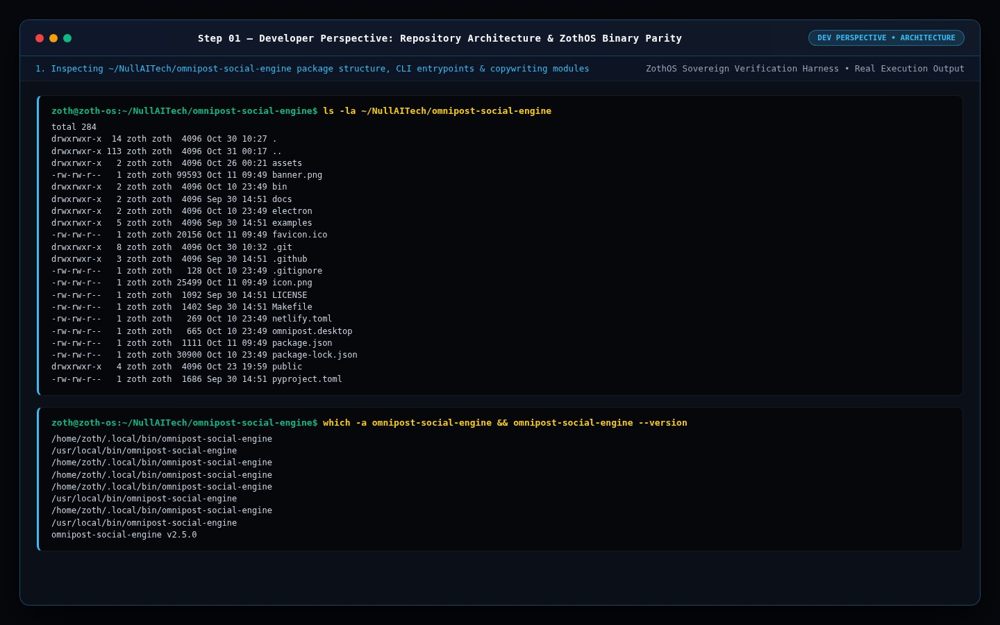

### Step 02 — Automated Pytest Verification Suite (`177 passed`)
Running `pytest -v` across the 177-test verification suite covering Unicode mathematical alphanumeric styling, paragraph-preserving thread splitting, 10 viral hook frameworks, UTM campaign tagging, surveillance tracking sanitization, and MCP JSON-RPC 2.0 handlers.

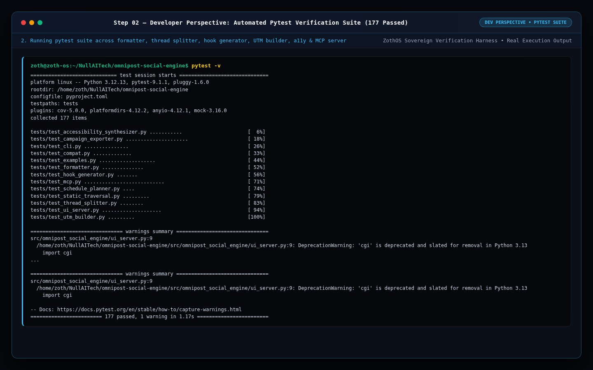

### Step 03 — Live HTTP REST API & Virality Scoring Contracts
Probing `/api/health` and `POST /api/analyze` (`platform: "twitter"`) to verify real-time character budget validation, Flesch reading ease, power-word density, and hook strength breakdown.

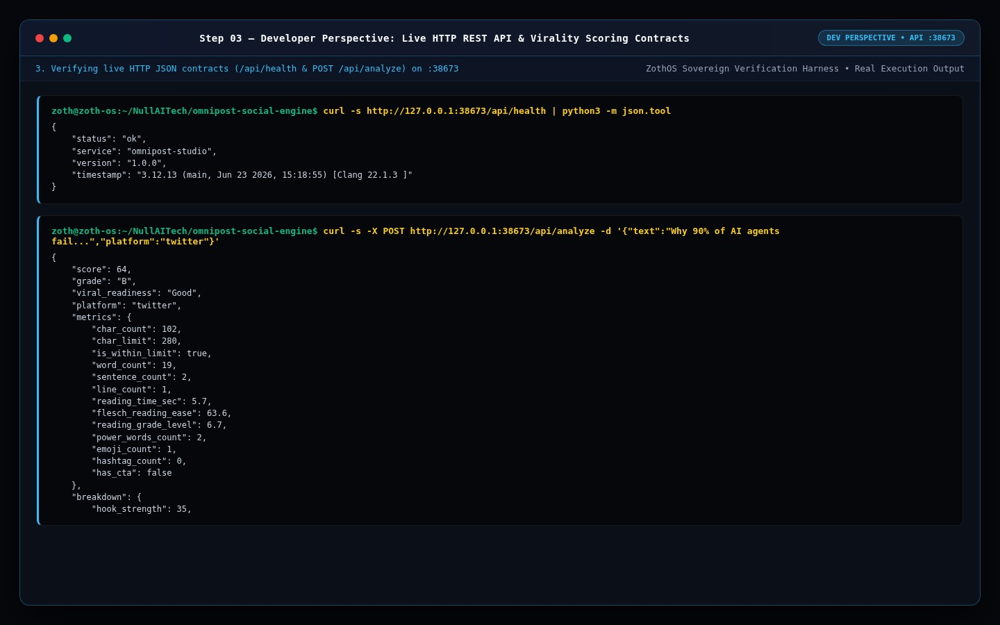

---

## Part II — End-User CLI Perspective: Formatting, Viral Hooks, UTM Sanitization & MCP Config

### Step 04 — Global CLI Help Matrix & Platform Character Specs
Executing `omnipost-social-engine --help`, `omnipost-social-engine --json`, and `omnipost-social-engine platform --platform twitter --json`.

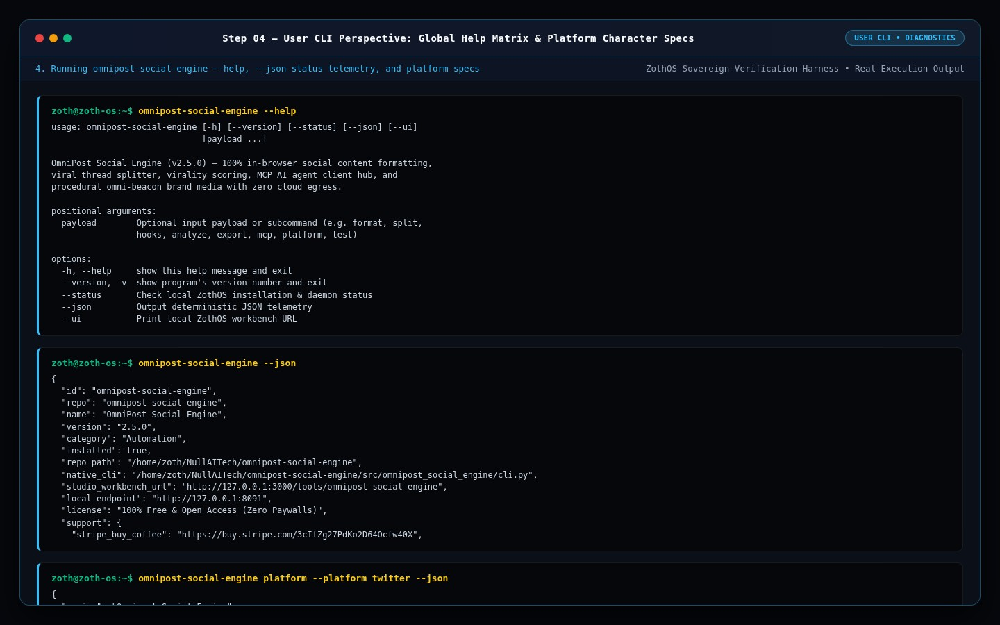

### Step 05 — Unicode Post Formatting & Viral Hook Generation
Running `omnipost-social-engine format "Sovereign AI runs 100% locally on ZothOS." -p twitter -s bold -t zothos,mcp --json` (`𝗦𝗼𝘃𝗲𝗿𝗲𝗶𝗴𝗻 𝗔𝗜 𝗿𝘂𝗻𝘀 𝟭𝟬𝟬% 𝗹𝗼𝗰𝗮𝗹𝗹𝘆 𝗼𝗻 𝗭𝗼𝘁𝗵𝗢𝗦.`) and `omnipost-social-engine hooks "Local MCP Servers" -n tech -f contrarian -c 2 --json`.

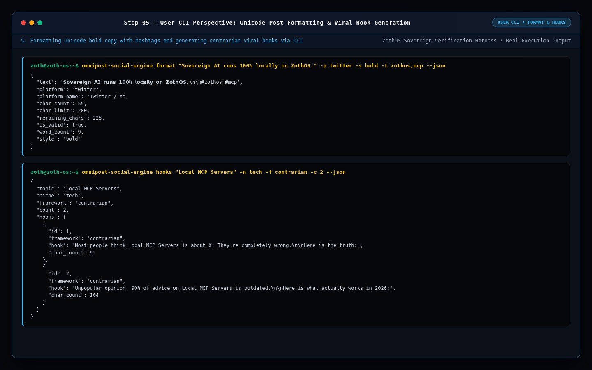

### Step 06 — Surveillance Tracking Sanitizer (`utm --sanitize`) & MCP Client Config
Stripping invasive ad-network tracking IDs (`fbclid`, `gclid`) with `omnipost-social-engine utm --url "https://nullai.tech/tools?fbclid=IwAR123&gclid=abc999" --sanitize --json` and exporting the Claude Desktop MCP client configuration (`omnipost-social-engine mcp-config --client claude`).

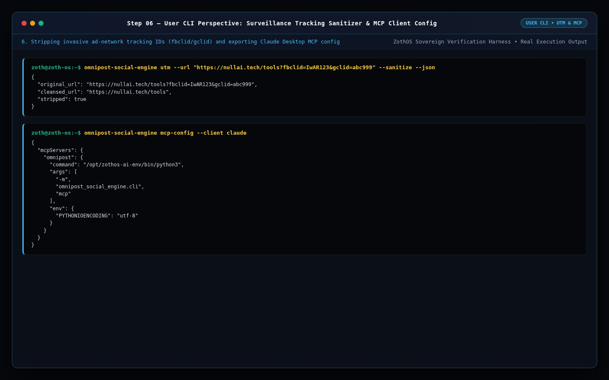

---

## Part III — Standalone Web Workstation GUI (`:8091`)

### Step 07 — Standalone Workstation: Multi-Platform Composer & Real-Time Simulators
Opening the Standalone OmniPost Studio Workstation showing the **Live Social Copywriter**, **Virality Readiness (`95 / 100`)**, and simultaneous live mockups for Twitter/X, LinkedIn, BlueSky, and Meta Threads.

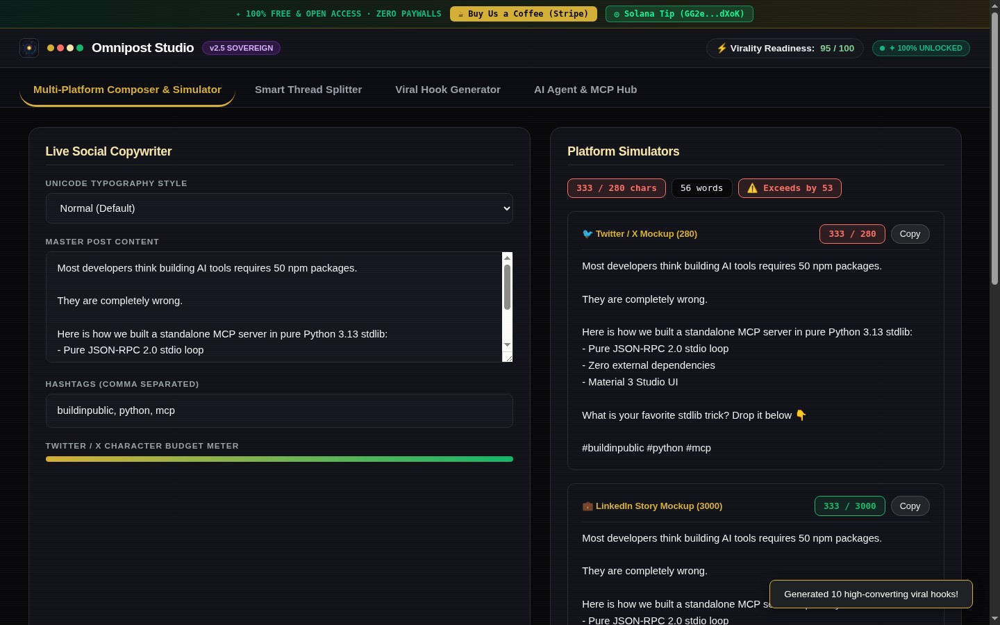

### Step 08 — Standalone Workstation: 10-Framework Viral Hook Generator
Switching to the **Viral Hook Generator** tab to synthesize 10 high-converting copywriting hooks across Contrarian, Step-by-Step Blueprint, Numbered List, and Curiosity Gap formulas.

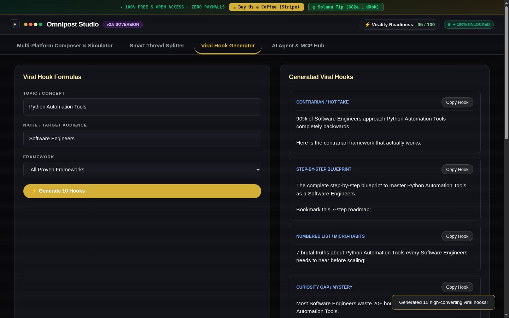

---

## Part IV — Zoth Studio v2 God-Mode Workbench (`:3000/tools/omnipost-social-engine`) & Mobile Viewport

### Step 09 — Zoth Studio v2 God-Mode: Algorithmic Virality Audit (`99/100`) & X Thread Cards
Navigating to `http://127.0.0.1:3000/tools/omnipost-social-engine` inside the unified Zoth Studio v2 application to inspect the **Long-Form Technical Essay Composer**, **Algorithmic Feed Heuristics** (`✓ Quantified Hook Metric`, `✓ Zero Post #1 Link Penalty`), and **X Thread (`5`)** cards.

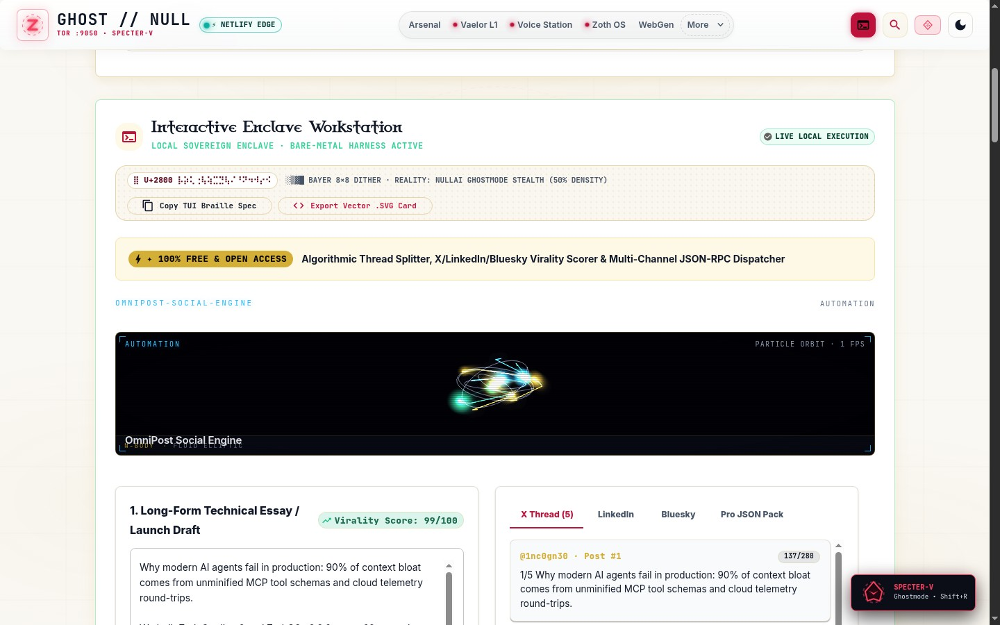

### Step 10 — Zoth Studio v2 God-Mode: LinkedIn Technical Authority Format
Switching to the **LinkedIn** tab inside the Zoth Studio v2 God-Mode workbench to preview the formatted 686-character LinkedIn authority post.

### Step 11 — Zoth Studio v2 God-Mode: 100% Unlocked Pro JSON Campaign Pack
Switching to the **Pro JSON Pack** tab to verify the 100% unlocked JSON campaign export bundle with zero blur locks.

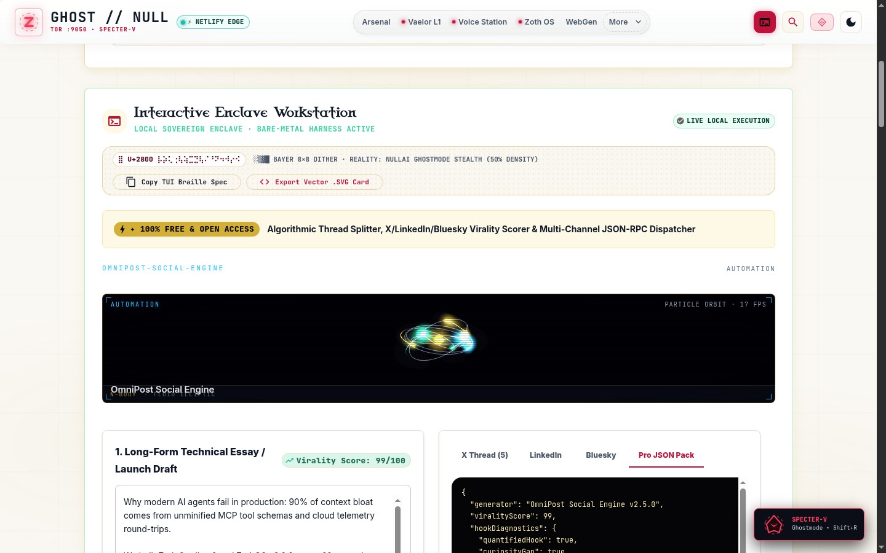

### Step 12 — Mobile 390×844 Responsive Verification
Verifying zero horizontal scroll overflow (`overflowPx === 0`), stacked responsive composer cards, and 44px touch targets at `390×844`.

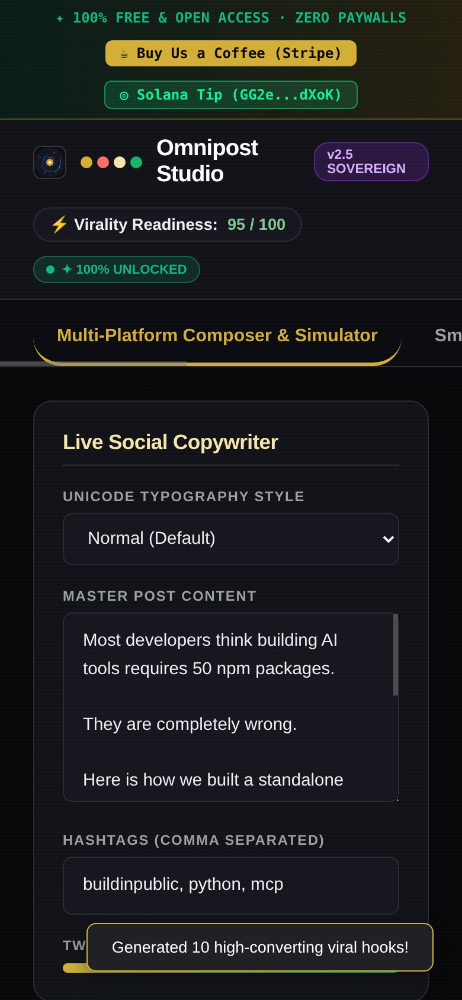

---

## Sovereign 5-Layer Architecture & Second Brain Topology

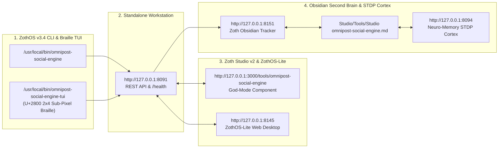

### ZothOS v3.4 TUI & Obsidian Second Brain Sync
- **Unicode `U+2800` Braille TUI**: `omnipost-social-engine-tui --status` / `omnipost-social-engine-tui --json`
- **Zoth Obsidian Tracker (`:8151`)**: `zoth-obsidian-tracker --verify`
- **Connected Canon Notes**: [[00 Home]] · [[Zoth OS]] · [[Zoth Studio]] · [[ZothOS-Lite Web Desktop]] · [[Zoth Memory]] · [[Public Surfaces]]
