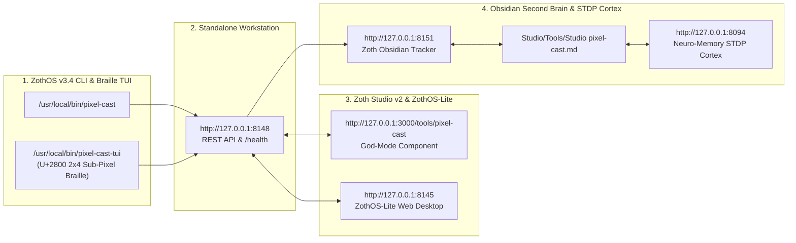

# PixelCast (`pixel-cast`) — Full Developer & End-User Walkthrough

**PixelCast** is an ultra-low latency Google Pixel screen mirror, wireless ADB hardware bridge, and mobile camera/file-drop companion engineered for ZothOS over the Tailscale mesh (`100.x.y.z`). It combines native 60fps H.264/Opus `scrcpy` desktop mirroring, Android hardware keyevent orchestration (`HOME`, `BACK`, `RECENTS`, `POWER`, `VOL+/VOL-`), bidirectional clipboard synchronization, and a 1-tap QR mobile web companion (`/mobile`).

---

## Part 1: Developer Perspective — Architecture, Unit Tests & REST API Contracts

### Step 1: Repository Architecture & Global ZothOS Binary Installation
Developers inspecting `~/NullAITech/pixel-cast` can review the core Tailscale/ADB/Scrcpy manager (`src/pixel_cast/core.py`), the FastAPI + WebSocket server (`src/pixel_cast/server.py`), and the global CLI binary (`bin/pixel-cast` linked to `/usr/local/bin/pixel-cast`).

### Step 2: Automated Pytest Verification Suite (`10 passed`)
Running `pytest -v` verifies the `PixelDevice` and `StreamOptions` dataclasses, `PixelCastManager` Tailscale/ADB discovery schemas, Android keycode mappings, and FastAPI REST endpoints (`/health`, `/api/status`, `/api/target`, `/api/stream/status`).

### Step 3: Live FastAPI REST API Contracts (`/health`, `/api/status`, `/api/target`)
Querying `http://127.0.0.1:8148/health` and `/api/status` confirms `scrcpy`, `adb`, and `tailscale` binary readiness, inspects connected Tailscale mesh nodes (`ghost-a858f830` at `100.106.132.5`), and updates the active Pixel target IP via `POST /api/target`.

---

## Part 2: End-User CLI Perspective — Global Subcommands, Mesh Telemetry & QR Pairing

### Step 4: Global ZothOS CLI Help & Subcommands (`pixel-cast --help`)
Running `pixel-cast --help` lists all 13 subcommands (`status`, `connect`, `disconnect`, `pair`, `stream`, `stop`, `screenshot`, `battery`, `text`, `key`, `serve`, `qr`, `gui`) and the machine-readable `--json` flag.

### Step 5: Live Tailscale Mesh & Wireless ADB Status (`pixel-cast status`)
Executing `pixel-cast status` and `pixel-cast --json status` reports the local ZothOS Tailscale node (`100.106.132.5`), target Pixel endpoint (`100.106.39.46:5555`), ADB wireless bridge state, and workstation URLs.

### Step 6: 60fps Scrcpy Stream Flags & Terminal ANSI QR Matrix (`pixel-cast qr`)
Users can inspect hardware encoding flags via `pixel-cast stream --help` (`--bitrate`, `--max-size`, `--max-fps`, `--turn-screen-off`, `--record`) and render an instant scannable QR code directly inside the terminal with `pixel-cast qr`.

---

## Part 3: Standalone Web Workstation (`http://127.0.0.1:8148`) & Mobile Companion (`/mobile`)

### Step 7: Standalone Sovereign Workstation — Target Device & Live Screen Monitor
Opening `http://127.0.0.1:8148` presents the 6-card Bento workstation featuring the Target Device selector (`Google Pixel 10` / `Google Pixel 10 Pro`), live battery/thermal/latency telemetry, 1-click `Launch 60fps Desktop Mirror`, Remote Hardware Control HUD, and the interactive phone chassis viewport.

### Step 8: Standalone Workstation — 1-Tap QR Connect, Stream Tuners & Wireless ADB Pairing
Scrolling down reveals the `Pixel 1-Tap QR Connect` matrix (`http://100.106.132.5:8148/mobile`), `Stream Configuration` (`1440p Quad HD`, `16 Mbps Master Quality`, `60 FPS`, Opus Audio Forwarding), and the `Wireless ADB Pairing Helper` for Android 11+ 6-digit pairing codes.

### Step 9: Dedicated Google Pixel Mobile Companion (`http://127.0.0.1:8148/mobile`)
Scanning the QR code on a Google Pixel opens `/mobile`, providing `Start Live Camera Cast` (with front/back lens flip), 1-tap `Send Photo / File to Desktop`, and instant `Send Text to Desktop Clipboard` over WebSocket and Tailscale.

---

## Part 4: Zoth Studio v2 God-Mode Integration (`:3000`) & Responsive Verification

### Step 10: Zoth Studio v2 God-Mode — Desktop Enclave Header & Telemetry
Navigating to `http://127.0.0.1:3000/tools/pixel-cast` loads the integrated Zoth Studio v2 God-Mode view (`PixelCastGodModeTool.jsx`) with 100% open-access support links and live local `:8148` bridge controls.

### Step 11: Zoth Studio v2 God-Mode — Remote Navigation Pad & Live Phone Viewport
Scrolling into the interactive enclave workstation displays the `Google Pixel 10 Pro` telemetry matrix, `Launch 60fps Scrcpy Mirror`, Android hardware key buttons (`Back`, `Home`, `Apps`, `Power`, `Vol -`, `Vol +`, `Mute`), and the live Pixel 10 Pro screen viewport.

### Step 12: Mobile 390×844 Responsive Layout Verification
At `390×844` mobile resolution, all Bento cards, device dropdowns, and action buttons stack vertically with zero horizontal overflow (`overflowPx === 0`).

---

## Sovereign 5-Layer Architecture & Second Brain Topology

### ZothOS v3.4 TUI & Obsidian Second Brain Sync
- **Unicode `U+2800` Braille TUI**: `pixel-cast-tui --status` / `pixel-cast-tui --json`
- **Zoth Obsidian Tracker (`:8151`)**: `zoth-obsidian-tracker --verify`
- **Connected Canon Notes**: [[00 Home]] · [[Zoth OS]] · [[Zoth Studio]] · [[ZothOS-Lite Web Desktop]] · [[Zoth Memory]] · [[Public Surfaces]]
