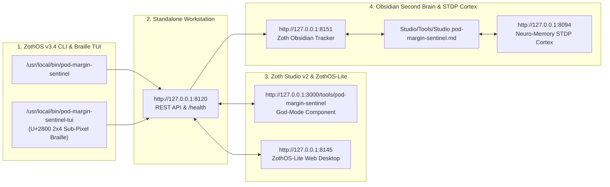

# POD Margin Sentinel (`pod-margin-sentinel`) — Full Developer & End-User Walkthrough

**POD Margin Sentinel** is a sovereign Print-on-Demand unit-economics simulator, break-even solver, cross-marketplace fee comparator (`Etsy Organic`, `Etsy Offsite Ads 15%`, `Etsy Offsite Ads 12%`, `Shopify Payments`, `TikTok Shop`), and promotional coupon stress-test engine for ZothOS and Zoth Studio v2.

---

## Part 1: Developer Perspective — Architecture, Unit Tests & REST API Contracts

### Step 1: Repository Architecture & Global CLI Binary Installation
Developers inspecting `~/NullAITech/pod-margin-sentinel` can review the core financial engine (`src/pod_margin_sentinel/margin_engine.py`), marketplace fee schedules (`fee_structures.py`), MCP stdio server (`mcp_server.py`), and HTTP server (`server.py`).

### Step 2: Automated Pytest Verification Suite (`22 passed`)
Running `pytest -v` executes 22 unit tests verifying break-even algebra, exact maximum safe discount percentages, Etsy Offsite Ads $100 fee cap edge cases, origin CSRF guards, and MCP tool handlers.

### Step 3: Live HTTP REST API Contracts (`/health` & `POST /api/calculate`)
Querying `GET /health` and posting an order payload (`{"retail_price": 34.99, "wholesale_cost": 12.50, "factory_shipping": 5.49, "platform_key": "etsy_offsite_ads_15"}`) to `POST /api/calculate` returns itemized COGS, transaction/gateway/offsite fees (`$9.02`), and net dollar profit (`$7.98`, `22.81%`).

---

## Part 2: End-User CLI Perspective — Order Calculations, Marketplace Comparison & Coupon Stress-Testing

### Step 4: Global ZothOS CLI Help & Subcommands (`pod-margin-sentinel --help`)
Running `pod-margin-sentinel --help` and `pod-margin-sentinel calc --help` displays the 7 subcommands (`calc`, `compare`, `breakeven`, `coupon`, `benchmarks`, `server`, `mcp`) and marketplace fee flags.

### Step 5: CLI Granular Order Profit & Cross-Marketplace Comparison
Executing `pod-margin-sentinel calc` and `pod-margin-sentinel compare --retail 34.99 --wholesale 12.50 --shipping 5.49` compares net take-home profit side-by-side across Etsy Organic (`$13.23`), Etsy 15% Offsite Ads (`$7.98`), Etsy 12% Offsite Ads (`$9.03`), Shopify Basic (`$15.69`), and TikTok Shop (`$14.60`).

### Step 6: CLI Promotional Coupon Stress Test & Catalog Benchmarks
Running `pod-margin-sentinel coupon --retail 38.99 --wholesale 13.80 --shipping 5.49` solves for the exact maximum safe discount (`32.9% OFF`) above a `15.0%` minimum net margin floor and audits standard `10%`–`30%` coupon tiers.

---

## Part 3: Standalone Web Workstation (`http://127.0.0.1:8120`)

### Step 7: Standalone Sovereign Workstation — Cost Configuration & Waterfall Ledger
Opening the standalone workstation at `http://127.0.0.1:8120` displays the 7 POD blank presets (`Gildan 18000`, `Comfort Colors 1717`, `Bella Canvas 3001`, `15oz Ceramic Mug`, `Canvas Wrap 16x20`, `Heavy Cotton Tote`, `Digital Wall Art`), interactive sliders, `$13.23` Net Profit banner, and the Itemized Waterfall Ledger.

### Step 8: Standalone Workstation — Comfort Colors 1717 on Etsy 15% Offsite Ads
Selecting `Comfort Colors 1717` (`$29.99` retail, `$10.80` wholesale, `$4.79` factory shipping) under `Etsy Ads (15%)` immediately recalculates net profit (`$6.60`, `22.0% NET MARGIN`), Offsite Ads attribution (`-$4.50`), and strategic target prices (`$21.25` Break-Even, `$39.60` for 35% target margin).

### Step 9: Standalone Workstation — Cross-Marketplace Comparison & Unlocked Coupon Stress Matrix
Scrolling down reveals the 5-card `Cross-Marketplace Net Profit Comparison` grid and the 100% unlocked `Coupon Discount Stress Matrix & Bulk Pricing Engine` with `.CSV` export.

---

## Part 4: Zoth Studio v2 God-Mode Integration (`:3000`) & Responsive Verification

### Step 10: Zoth Studio v2 God-Mode — Fulfillment & Margin Router
Navigating to `http://127.0.0.1:3000/tools/pod-margin-sentinel` loads the integrated Zoth Studio v2 God-Mode workspace (`PodCommerceGodModeTool.jsx`), ranking `Printify Choice US/UK Network` (`+$14.06 Net / 46.9%`), `Gelato Local Hub`, and `Sovereign Direct Fine-Art Atelier` with live U+2800 Braille profit curves.

### Step 11: Zoth Studio v2 God-Mode — Etsy 13-Tag SEO & Shopify GraphQL Transpiler
Switching to Tab 2 (`2. Etsy 13-Tag SEO & Shopify Transpiler`) audits the listing title (`100/140 chars — OPTIMAL`) and all 13 long-tail search tags (`100/100 A+ Algorithmic Peak`).

### Step 12: Mobile 390×844 Responsive Layout Verification
At `390×844` mobile viewport width, the Cost & Pricing Configuration panel, 2×2 marketplace buttons, and range sliders stack cleanly with zero horizontal overflow (`overflowPx === 0`).

---

## Sovereign 5-Layer Architecture & Second Brain Topology

### ZothOS v3.4 TUI & Obsidian Second Brain Sync
- **Unicode `U+2800` Braille TUI**: `pod-margin-sentinel-tui --status` / `pod-margin-sentinel-tui --json`
- **Zoth Obsidian Tracker (`:8151`)**: `zoth-obsidian-tracker --verify`
- **Connected Canon Notes**: [[00 Home]] · [[Zoth OS]] · [[Zoth Studio]] · [[ZothOS-Lite Web Desktop]] · [[Zoth Memory]] · [[Public Surfaces]]
