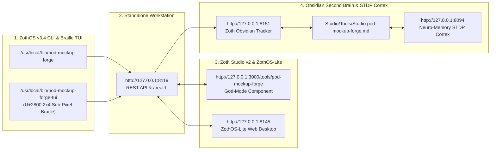

# POD Mockup Forge (`pod-mockup-forge`) — Full Developer & End-User Walkthrough

**POD Mockup Forge** is a photorealistic Print-on-Demand mockup compositor, print-zone aspect-fit calculator, 10-slot Etsy carousel blueprint planner, and Etsy 2026 seller photo compliance auditor for ZothOS and Zoth Studio v2.

---

## Part 1: Developer Perspective — Architecture, Unit Tests & REST API Contracts

### Step 1: Repository Architecture & Global CLI Binary Installation
Developers inspecting `~/NullAITech/pod-mockup-forge` can review the SVG/Canvas composite engine (`src/pod_mockup_forge/composite_engine.py`), Etsy 2026 photo auditor (`etsy_specs.py`), real image header probe (`image_probe.py`), 8 product scene templates (`templates.py`), and MCP server (`mcp_server.py`).

### Step 2: Automated Pytest Verification Suite (`23 passed`)
Running `pytest -v` executes 23 unit tests and 3 subtests validating SVG script-injection sanitization, bounding-box containment across all 8 templates, aspect-fit scaling math, Pillow image format probing, and Etsy 10-slot carousel blueprints.

### Step 3: Live HTTP REST API Contracts (`/health` & `POST /api/audit`)
Querying `GET /health` and posting image dimensions (`{"width_px": 2700, "height_px": 2025, "file_size_mb": 2.8}`) to `POST /api/audit` returns a `100/100` (`EXCELLENT`) Etsy 2026 photo compliance verdict (`4:3 Optimal`).

---

## Part 2: End-User CLI Perspective — Templates Registry, Aspect Fit, Photo Audit & Carousel Pack

### Step 4: Global ZothOS CLI Help & Templates Registry (`pod-mockup-forge list`)
Running `pod-mockup-forge --help` and `pod-mockup-forge list` displays all 7 subcommands (`list`, `render`, `fit`, `pack`, `audit`, `server`, `mcp`) and details the 8 mockup templates across Apparel, Drinkware, Wall Art, and Accessories.

### Step 5: CLI Print-Area Aspect Fit & Etsy Photo Compliance Audit
Executing `pod-mockup-forge fit --aw 4500 --ah 5400 --tw 810 --th 891` computes exact print-zone scaling (`742.5x891px`, `Scale: 0.165`) and `pod-mockup-forge audit --width 2700 --height 2025 --mb 2.4` verifies Etsy 2026 search readiness (`PASS 100/100`).

### Step 6: CLI 10-Slot Etsy Listing Carousel Pack Planner (`pod-mockup-forge pack`)
Running `pod-mockup-forge pack` outputs the structured 10-slot Etsy listing carousel blueprint (`Slot #1: Primary Hero Image`, `Slot #2: Secondary Lifestyle Angle`, `Slot #3: Macro Texture`, `Slot #4: Sizing Chart`, `Slot #5: Color Swatches`, etc.) with conversion tips.

---

## Part 3: Standalone Web Workstation (`http://127.0.0.1:8119`)

### Step 7: Standalone Sovereign Workstation — Mockup Configuration & Live Composite Canvas
Opening `http://127.0.0.1:8119` presents the 8 scene templates, surface color variation swatches, PNG/SVG drag-and-drop uploader, and the Live Composite View rendering `Gildan 18000 Crewneck Sweatshirt` in Sand (`2000x2000px 300 DPI compliant`, `100/100 EXCELLENT`).

### Step 8: Standalone Workstation — Switching Scene to Comfort Colors 1717 (4:3 Aspect) & Moss Swatch
Selecting `Comfort Colors 1717` (`Apparel • 4:3`) and clicking the `Moss` garment swatch updates the live canvas to `2700x2025px (300 DPI compliant) • Aspect: 4:3 (1.33:1)` with unwatermarked `Export 300 DPI Mockup`.

### Step 9: Standalone Workstation — Unlocked Etsy 10-Slot Photo Carousel Master Blueprint
Scrolling down reveals the 100% unlocked `Etsy 10-Slot Photo Carousel Master Blueprint` (`SLOT 01` through `SLOT 10`) and the `Download Master Listing Pack (.ZIP)` action.

---

## Part 4: Zoth Studio v2 God-Mode Integration (`:3000`) & Responsive Verification

### Step 10: Zoth Studio v2 God-Mode — 300-DPI Print & Mockup Forge
Navigating to `http://127.0.0.1:3000/tools/pod-mockup-forge` opens Tab 3 (`3. 300-DPI Print & Mockup Forge`) of `PodCommerceGodModeTool.jsx`, featuring substrate selection (`Bella+Canvas 3001 Heavyweight Tee 4500x5400px`) and sacred motif generation.

### Step 11: Zoth Studio v2 God-Mode — Live Garment Silhouette & Print-Zone Preview
Scrolling down shows the full garment silhouette with the `24K Alchemical Merkaba + U+2800 Braille Ring` centered inside the dashed `ZOTH ATELIER 300-DPI` print bounding box and 1-click `.PNG` download.

### Step 12: Mobile 390×844 Responsive Layout Verification
At `390×844` mobile resolution, the 2-column template selector, color swatches, artwork dropzone, and Live Composite View stack vertically with zero horizontal overflow (`overflowPx === 0`).

---

## Sovereign 5-Layer Architecture & Second Brain Topology

### ZothOS v3.4 TUI & Obsidian Second Brain Sync
- **Unicode `U+2800` Braille TUI**: `pod-mockup-forge-tui --status` / `pod-mockup-forge-tui --json`
- **Zoth Obsidian Tracker (`:8151`)**: `zoth-obsidian-tracker --verify`
- **Connected Canon Notes**: [[00 Home]] · [[Zoth OS]] · [[Zoth Studio]] · [[ZothOS-Lite Web Desktop]] · [[Zoth Memory]] · [[Public Surfaces]]
