# Polyglot Framework Exporter — Complete Developer & User Walkthrough

> **Sovereign Arsenal Verification** • **Port**: `:8126` • **Studio Route**: `/tools/polyglot-framework-exporter` • **CLI**: `/usr/local/bin/polyglot-framework-exporter` • **100% Free & Open-Access**

**Polyglot Framework Exporter** (`Polyglot Studio`) is a zero-dependency multi-framework project scaffolder, HTML/React-to-Framework AST component transpiler, production CI/CD & cloud deployment config generator (`Dockerfile`, `netlify.toml`, `vercel.json`, `wrangler.jsonc`, `.github/workflows/deploy.yml`), and deterministic in-memory PKZIP bundler supporting **16 modern web, meta, and native frameworks** (`Astro 5`, `Next.js 15`, `React 19`, `Svelte 5 / SvelteKit 2`, `Vue 3.5 / Nuxt 3`, `SolidJS / SolidStart`, `Angular 18+`, `Qwik City`, `Remix / React Router 7`, `Bun + Hono 4`, `HTMX 2.0 + Alpine.js`, `Tauri v2`, `Electron 33`, `Flutter 3.24`, `SwiftUI 5/6`, and `Jetpack Compose`).

---

## Part 1 — Developer & Maintainer Walkthrough (Source, Tests & API Contracts)

### Step 1.1: Repository Layout & CLI Installation
Developers cloning `~/NullAITech/polyglot-framework-exporter` inspect the Python package layout (`src/polyglot_framework_exporter/cli.py`, `transpiler.py`, `deploy_configs.py`, `zip_bundler.py`, `ui_server.py`, `mcp_server.py`, and `generators/`), standalone Web UI (`public/index.html`), and global ZothOS CLI entrypoints.

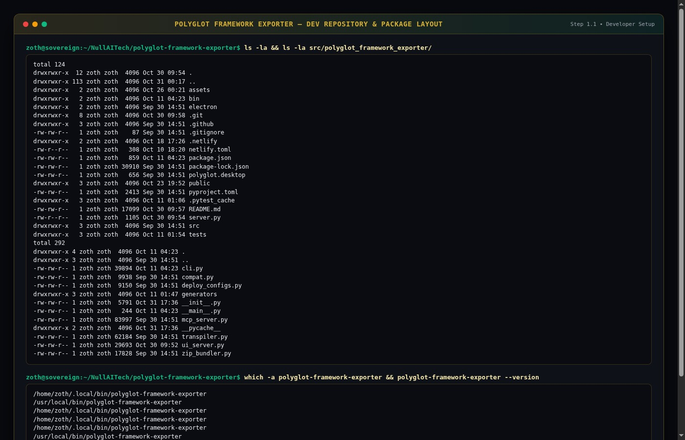

### Step 1.2: Running the 127-Test Automated Pytest Suite
Running `pytest tests/ -v` executes **127 unit and integration tests** across 11 test modules (`test_bun_hono_generator.py`, `test_cli.py`, `test_compat.py`, `test_generators.py`, `test_mcp_server.py`, `test_origin_guard.py`, `test_qwik_and_htmx_generator.py`, `test_solidstart_generator.py`, `test_static_traversal.py`, `test_transpiler.py`, `test_ui_server.py`, and `test_zip_bundler.py`) with **`127 passed in 7.62s`**.

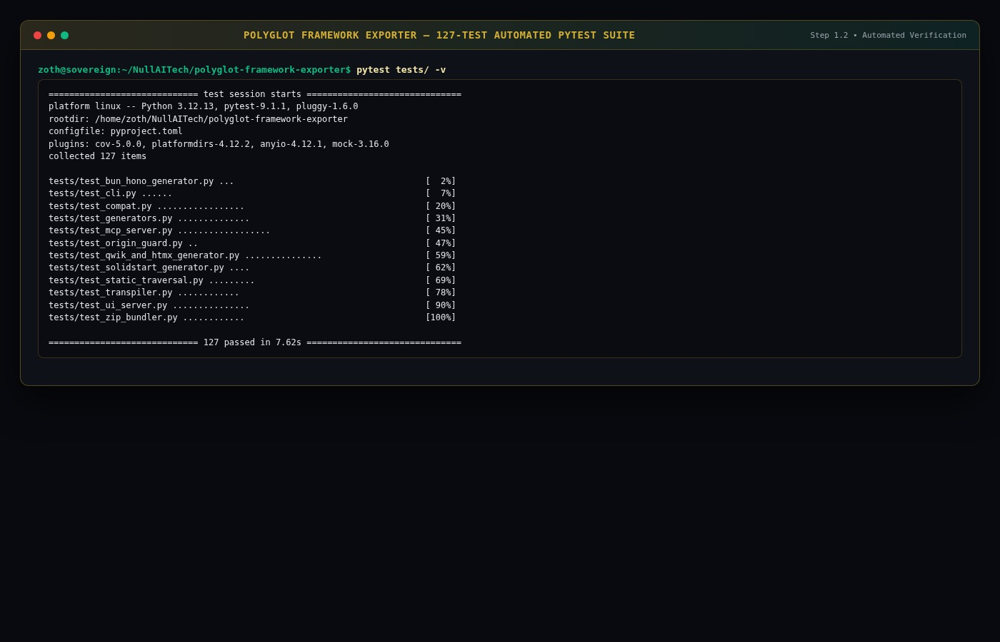

### Step 1.3: REST API Health & Framework Catalog Contracts (`:8126`)
The standalone server (`python3 server.py --port 8126`) exposes `/api/health`, `/api/frameworks`, `/api/diagnostics`, `/api/deploy-configs`, `/api/export`, and `/api/download-zip`.

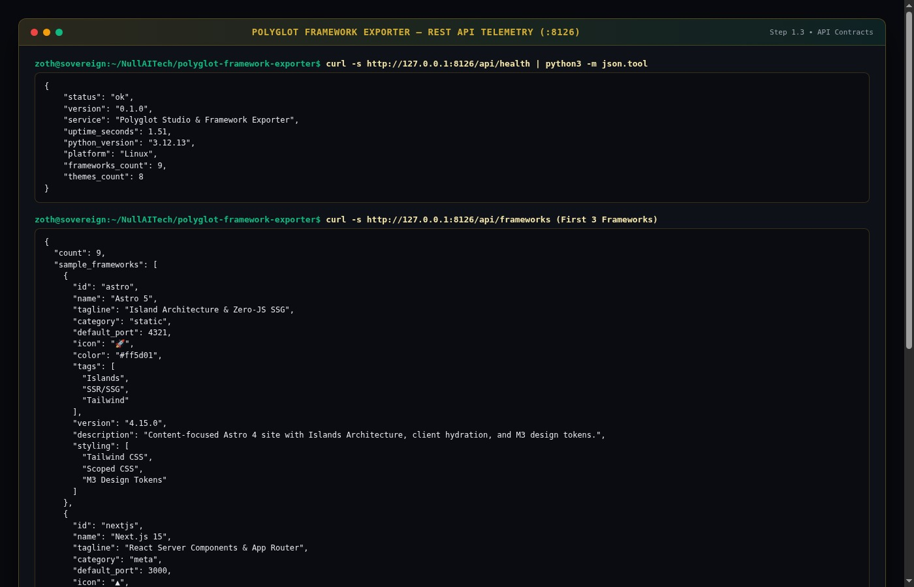

---

## Part 2 — End-User CLI & Terminal Workflow (`polyglot-framework-exporter`)

### Step 2.1: CLI Subcommands & 16-Framework Catalog Discovery
Users invoke `polyglot-framework-exporter --help` and `polyglot-framework-exporter --no-color frameworks` to list all 16 supported target frameworks (`angular`, `astro`, `bun_hono`, `compose`, `flutter`, `htmx`, `nextjs`, `qwik`, `react`, `remix`, `solid`, `solidstart`, `svelte`, `swiftui`, `vanilla`, `vue`) with versions, categories, and languages.

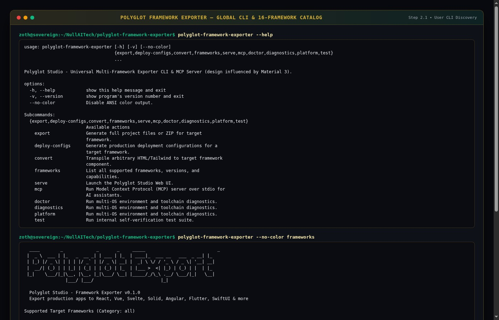

### Step 2.2: CLI Component AST Transpilation (`Svelte 5 Runes` & `Vue 3 <script setup>`)
Running `polyglot-framework-exporter --no-color convert --to svelte --name SovereignHero --input '<section class="hero">...'` transpiles raw HTML/JSX into an idiomatic Svelte 5 Runes (`$props()`, `{@render children()}`) component, while `--to vue` emits a strongly typed Vue 3 `<script setup lang="ts">` SFC.

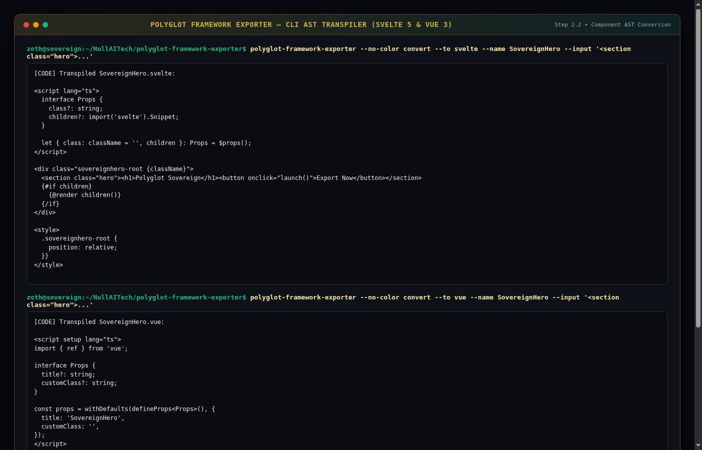

### Step 2.3: Scaffolding a Full Next.js 15 Project with Deployment Configs
Executing `polyglot-framework-exporter --no-color export nextjs --name sovereign-portal --theme emerald --deploy --dry-run` synthesizes a 30-file Next.js 15 App Router scaffold complete with Material 3 Emerald tokens, `.github/workflows/deploy.yml`, `Dockerfile`, `netlify.toml`, `vercel.json`, and `wrangler.jsonc`.

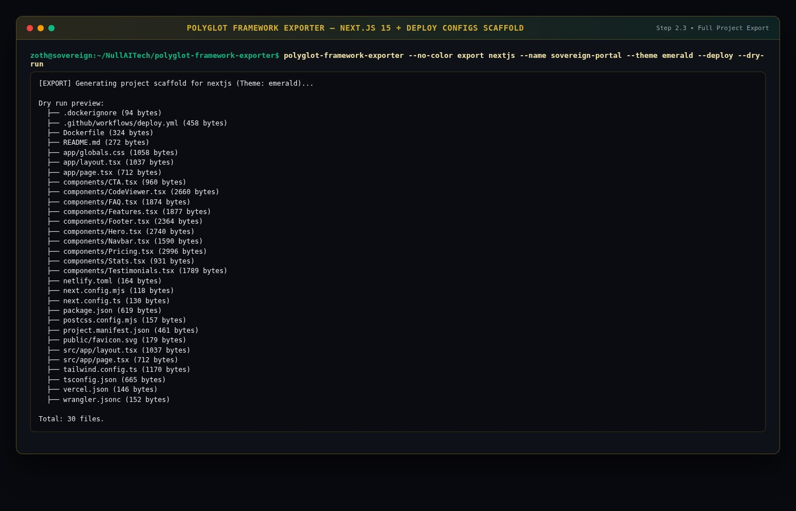

---

## Part 3 — End-User Standalone Web Workstation (`http://127.0.0.1:8126`)

### Step 3.1: Standalone Project Scaffolder & 13-Framework Selector Grid
Opening `http://127.0.0.1:8126` launches **Polyglot Studio** with the 100% Free & Open-Access header (`✦ 100% UNLOCKED`), `⚡ MCP Config` & `▣ Download ZIP` actions, and the interactive 13-framework card grid (`Astro 5`, `Next.js 15`, `Vite React 19`, `SvelteKit 2`, `Nuxt 3`, `Deno Fresh 2`, `Remix / RRv7`, `Bun + Hono 4`, `SolidStart`, `Qwik City`, `HTMX + Alpine`, `Tauri v2`, `Electron 33`).

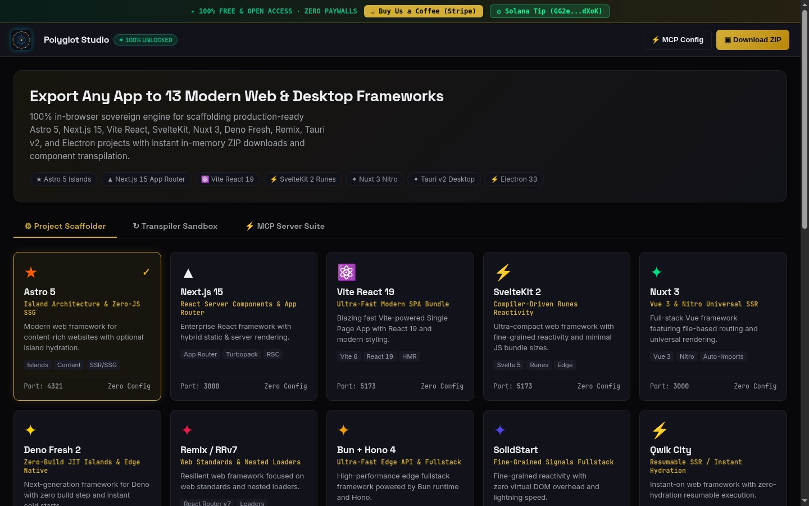

### Step 3.2: Interactive Next.js 15 File Tree Inspector & Code Viewer
Selecting **Next.js 15** updates the 3-pane Studio Workspace below: **Project Configuration** (directory name, title, design token theme, Tailwind/TS/PWA/MCP/CI checkboxes), **Project Files (14)** (`2.9 KB`), and the live **Code Viewer** with one-click `Copy File` and zero paywall blurs.

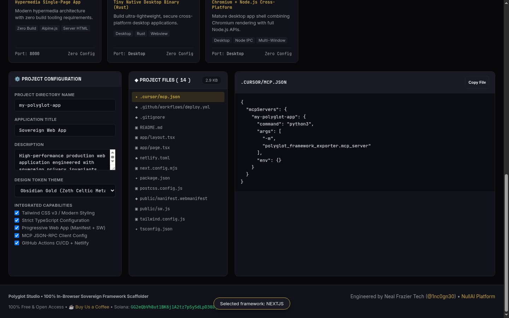

### Step 3.3: Live AST Transpiler Sandbox (`React 19 TSX` → `Svelte 5 Runes`)
Switching to the **↻ Transpiler Sandbox** tab, selecting `Svelte 5 Runes` as the Target Framework, and clicking **⚡ Convert AST** transpiles the source React 19 `Counter` component (`useState`) into Svelte 5 Runes (`$props()`, `$state(0)`) side-by-side in the browser.

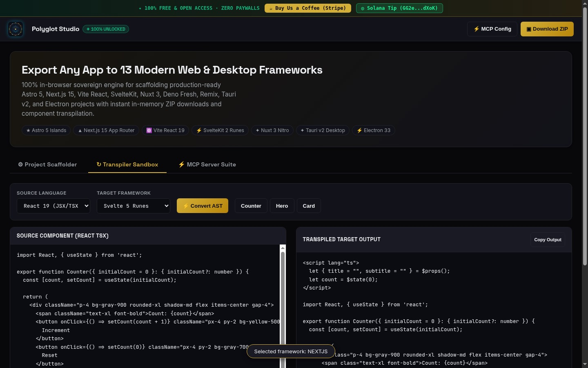

---

## Part 4 — Zoth Studio v2 God-Mode Workstation (`:3000/tools/polyglot-framework-exporter`) & Mobile Verification

### Step 4.1: Zoth Studio v2 God-Mode Overview (`:3000/tools/polyglot-framework-exporter`)
Navigating to `http://127.0.0.1:3000/tools/polyglot-framework-exporter` opens the Zoth Studio v2 God-Mode workstation with live local node status, quick-launch links (`Local :8126`, `Web Mirror`, `GitHub Repository`, `Try In-Browser`), and the Interactive Enclave Workstation.

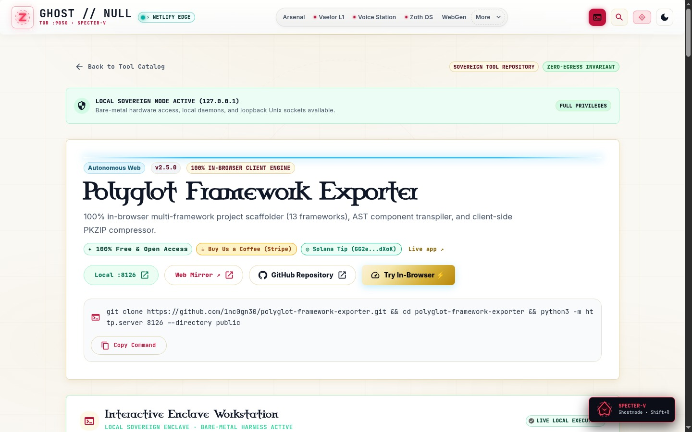

### Step 4.2: Zoth Studio v2 Polyglot Studio Foundry & Virtual Project Tree
Scrolling into the **Polyglot Studio Foundry** enclave reveals the 60fps Unicode Braille Orbit header, target framework pills, package/title inputs, in-memory `DOWNLOAD ZIP BUNDLE` trigger, and the interactive `VIRTUAL PROJECT TREE`.

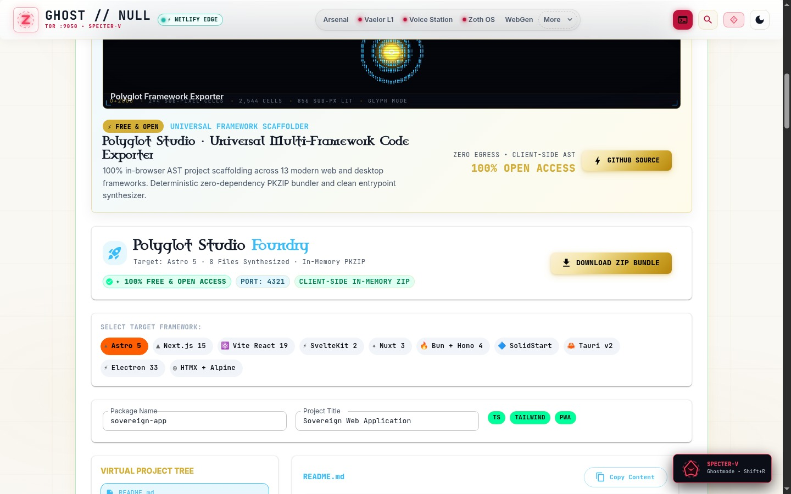

### Step 4.3: Mobile 390×844 Responsive Layout Verification
Verified at `390×844` mobile viewport (`overflowPx === 0`): all hero chips, tab buttons, framework cards, and workspace panels stack cleanly within the mobile viewport with zero horizontal scroll overflow.

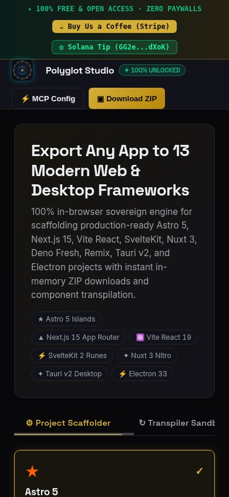

---

## Sovereign 5-Layer Architecture & Second Brain Topology

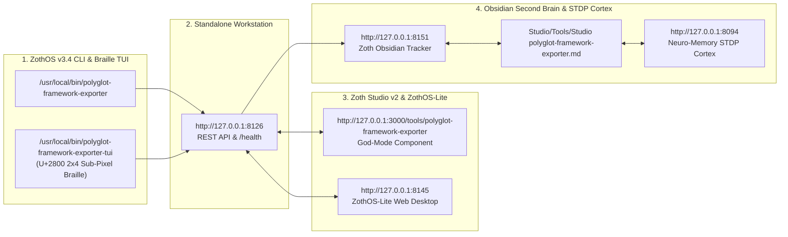

### ZothOS v3.4 TUI & Obsidian Second Brain Sync
- **Unicode `U+2800` Braille TUI**: `polyglot-framework-exporter-tui --status` / `polyglot-framework-exporter-tui --json`
- **Zoth Obsidian Tracker (`:8151`)**: `zoth-obsidian-tracker --verify`
- **Connected Canon Notes**: [[00 Home]] · [[Zoth OS]] · [[Zoth Studio]] · [[ZothOS-Lite Web Desktop]] · [[Zoth Memory]] · [[Public Surfaces]]
