# Printify Connector — Complete Developer & User Walkthrough

> **Sovereign Arsenal Verification** • **Port**: `:8115` • **Studio Route**: `/tools/printify-connector` • **CLI**: `/usr/local/bin/printify-connector` • **100% Free & Open-Access**

**Printify Connector** is a zero-dependency Printify Open API v1 client, bestseller blueprint catalog, verified print provider matrix, multi-channel 20% Printify Premium margin calculator (`Etsy`, `Shopify`, `Direct`), 300-DPI artwork resolution auditor, and 6-tool Antigravity MCP server.

---

## Part 1 — Developer & Maintainer Walkthrough (Source, Tests & API Contracts)

### Step 1.1: Repository Layout & Local CLI Setup
Developers cloning `~/NullAITech/printify-connector` inspect the pure-Python package (`src/printify_connector/catalog.py`, `margin_engine.py`, `artwork_auditor.py`, `client.py`, `mcp_server.py`, `server.py`, `cli.py`) and verify the global CLI binary at `/usr/local/bin/printify-connector`.

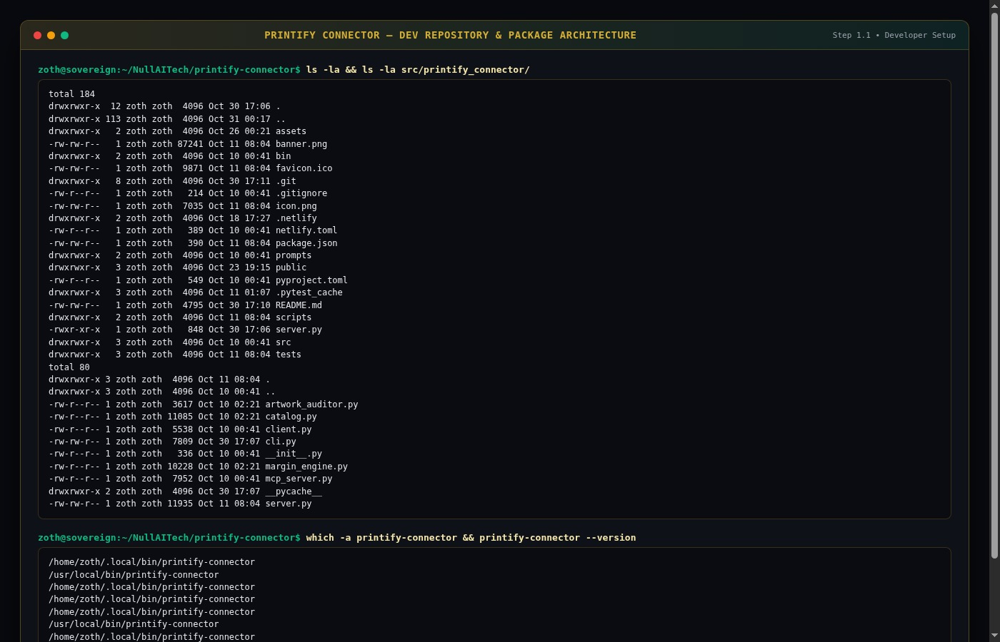

### Step 1.2: Running the 17-Test Automated Pytest Suite
Running `pytest tests/ -v` executes **17 unit and integration tests** (`test_bind_host.py`, `test_origin_guard.py`, `test_printify_connector.py`) verifying catalog blueprint lookups, verified print provider metrics, standard vs. 20% Printify Premium margin calculations, high-res vs. low-res artwork DPI audits, and MCP tool invocation (`17 passed in 0.05s`).

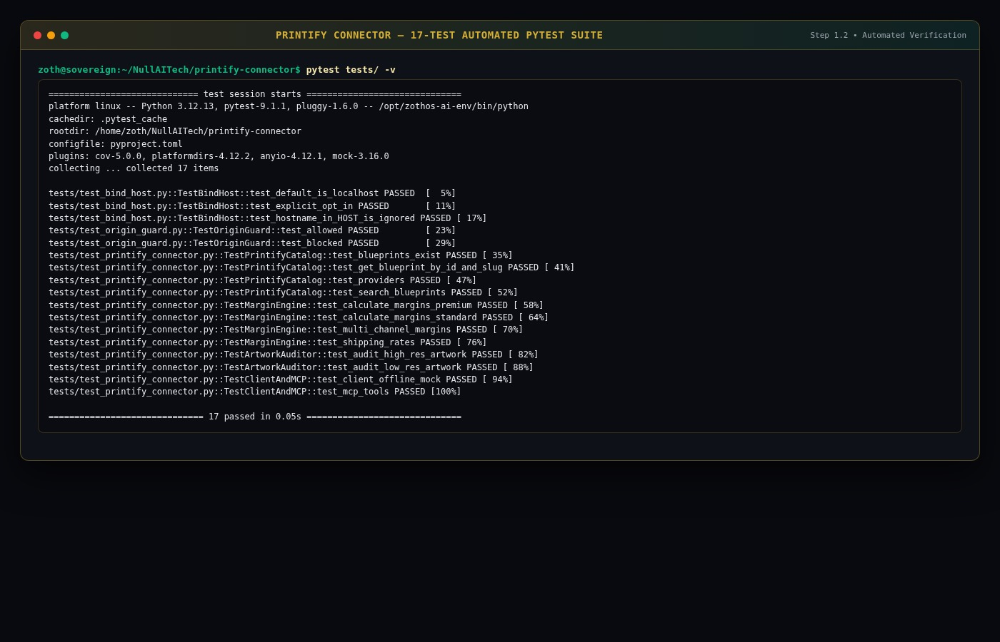

### Step 1.3: REST API Health & Blueprint Catalog Contracts (`:8115`)
The HTTP server (`printify-connector serve --port 8115`) exposes `/health`, `/api/blueprints`, `/api/providers`, `/api/margins`, and `/api/audit`.

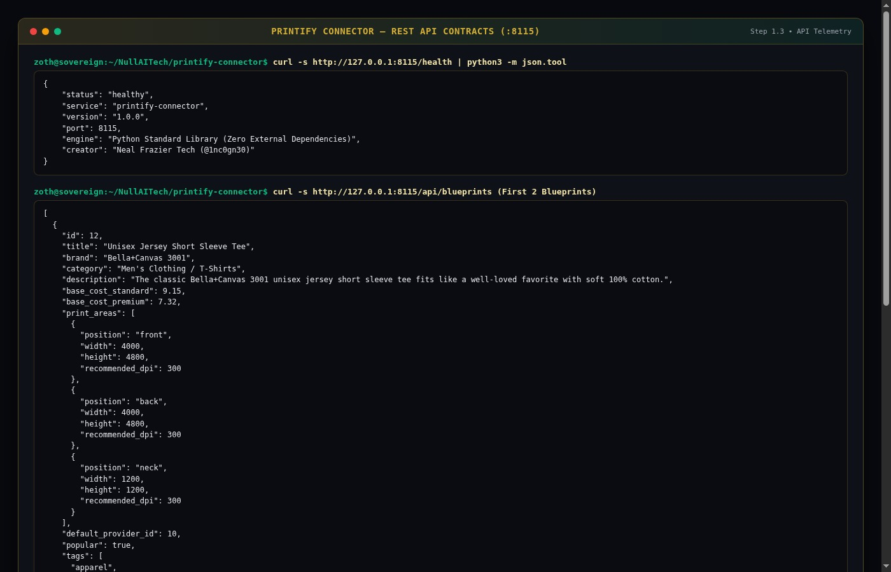

---

## Part 2 — End-User CLI & Terminal Workflow (`printify-connector`)

### Step 2.1: CLI Subcommands & Verified Print Providers
Users run `printify-connector --help` and `printify-connector providers` to inspect all 6 verified print providers (`Monster Digital`, `SwiftPOD`, `District Photo`, `Drive Fulfillment`, `MyLocker`, `Spoke Custom Products`) with quality ratings, average production days, and US/international shipping rates.

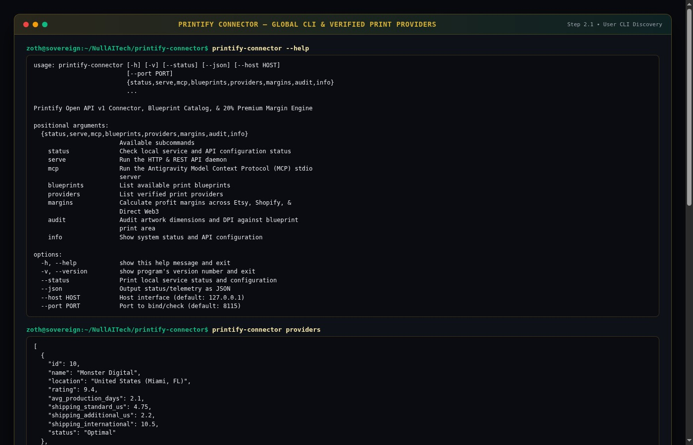

### Step 2.2: Multi-Channel Margin Engine (Standard vs. 20% Printify Premium)
Executing `printify-connector margins --blueprint 49 --price 42.00 --shipping 4.95` vs. `--premium` compares base production costs (`$13.84` standard vs. `$11.07` Printify Premium), platform fees, total COGS, net profit, and recommended pricing tiers across Etsy, Shopify, and Direct Web3 storefronts.

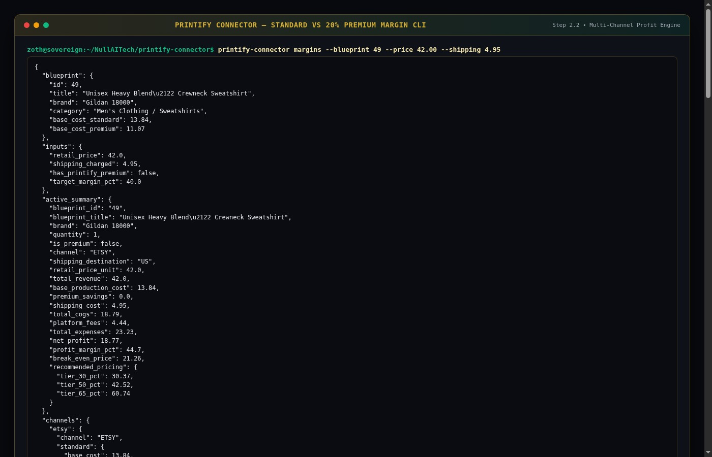

### Step 2.3: Pre-Flight 300-DPI Artwork Resolution Auditor
Running `printify-connector audit --blueprint 12 --width 4500 --height 5100 --name sovereign-master-300dpi.png` verifies `319 DPI` (`EXCELLENT`, `is_print_ready: true`), whereas auditing a `1200×1500` draft flags `90 DPI` (`CRITICAL_LOW_RES`, `is_print_ready: false`) before a print order is ever dispatched.

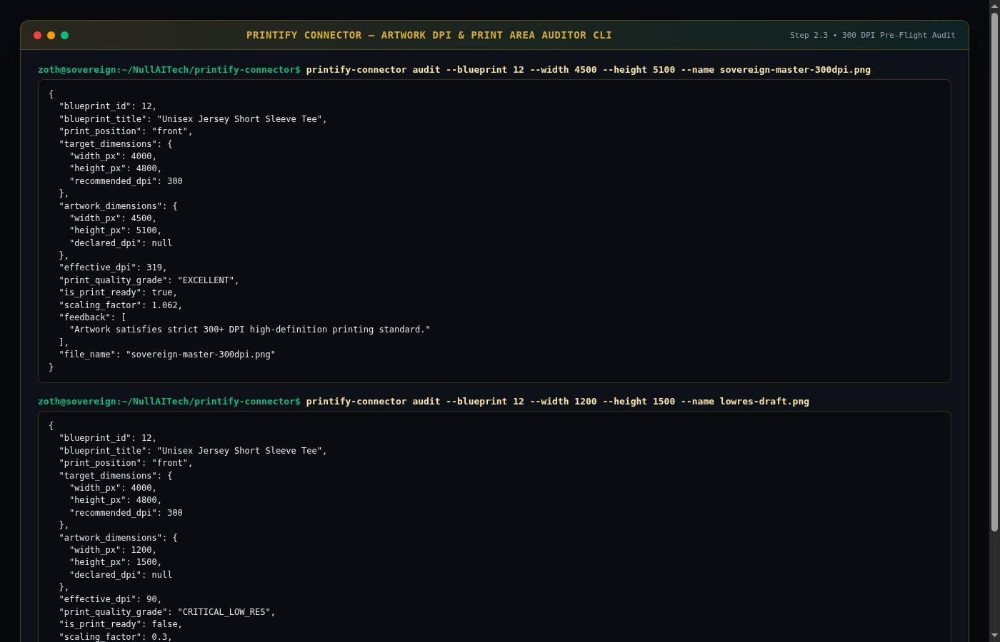

---

## Part 3 — End-User Standalone Web Workstation (`http://127.0.0.1:8115`)

### Step 3.1: Standalone Cockpit & Multi-Channel 20% Premium Margin Calculator
Opening `http://127.0.0.1:8115` displays the Bento overview (`7 Blueprints`, `6 Verified Providers`, `20% Off Premium Discount`, `6 MCP Tools`) and the interactive **Multi-Channel Margin & 20% Premium Calculator** computing real-time Net Margin (`52.9%` / `$14.82` profit per sale on Bella+Canvas 3001 at `$28.00` retail) and annual Printify Premium savings (`$183.00` on 100 sales, `$915.00` on 500 sales).

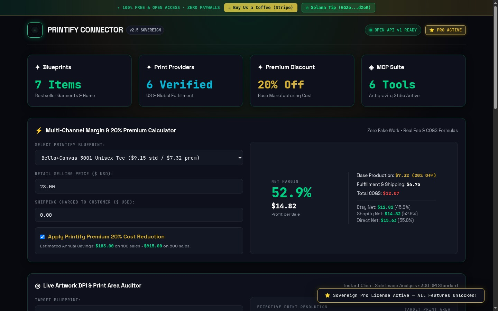

### Step 3.2: Live Artwork DPI & Print Area Auditor + Verified Providers Matrix
Scrolling down reveals the client-side **Live Artwork DPI & Print Area Auditor** (`319 DPI EXCELLENT — 300+ DPI High-Definition Master Quality` against the `4000 × 4800 px @ 300 DPI` target print area) and the **Verified Print Providers & Lead Time Matrix** with one-click `↓ Export Matrix CSV`.

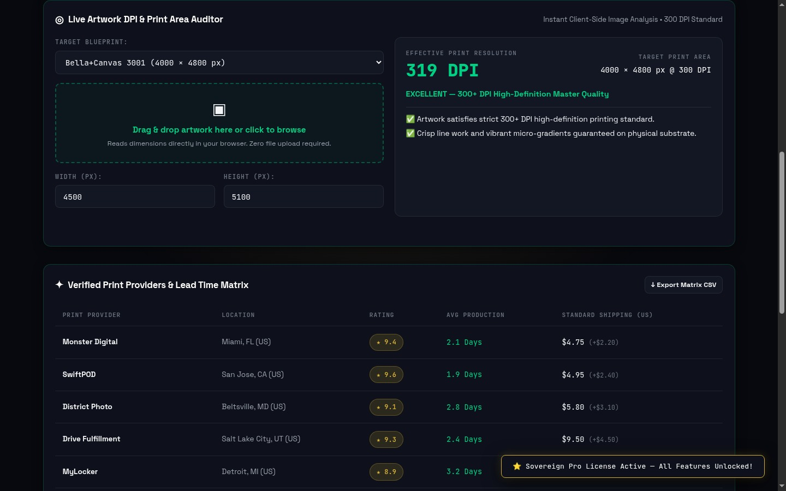

### Step 3.3: Schema-Valid Printify API v1 Payload Generator & Webhook Suite
At the bottom of the workstation, users generate and copy schema-valid **Printify API v1 Product Payloads** (`blueprint_id: 12`, `print_provider_id: 10`) and access the **Autonomous Multi-Store Sync & Webhook Router** (100% open-access with zero paywall blurs).

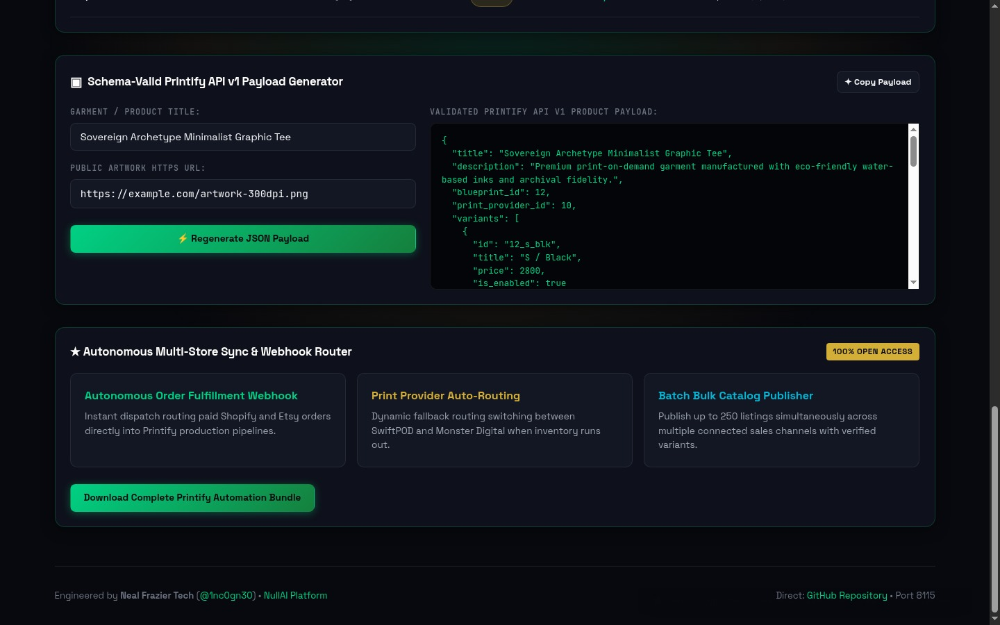

---

## Part 4 — Zoth Studio v2 God-Mode Workstation (`:3000/tools/printify-connector`) & Mobile Verification

### Step 4.1: Zoth Studio v2 God-Mode Overview (`:3000/tools/printify-connector`)
Navigating to `http://127.0.0.1:3000/tools/printify-connector` launches the Zoth Studio v2 God-Mode header with local node telemetry, CLI clone/run snippet, and direct workbench links.

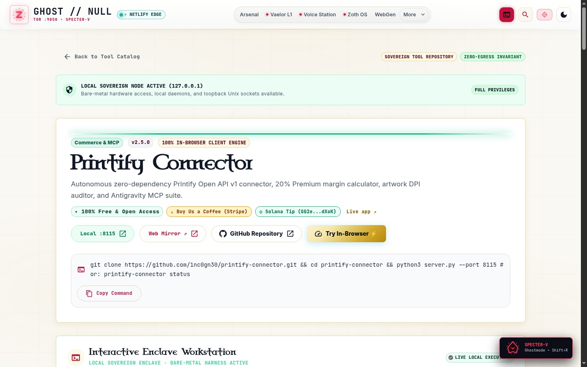

### Step 4.2: Zoth Studio v2 Interactive Fulfillment & Margin Router
Scrolling into the interactive enclave reveals the **Printify Connector — Margin, SEO & 300-DPI Asset Forge** with live sliders, `Printify Premium (-20% Base Cost) ACTIVE` toggle, 60fps Fulfillment Arbitrage Waterfall, and signed JSON dispatch payload export.

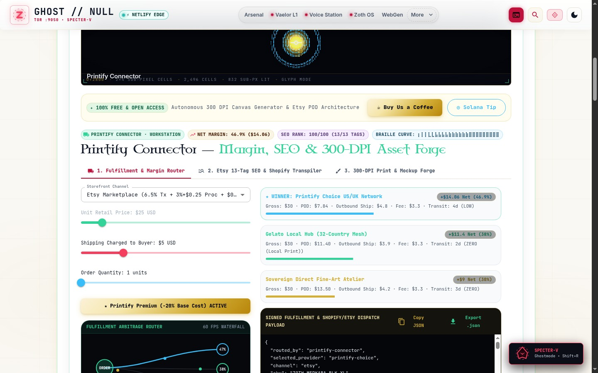

### Step 4.3: Mobile 390×844 Responsive Layout Verification
Verified at `390×844` mobile viewport (`overflowPx === 0`): all 4 Bento metric cards, form inputs, and tables stack cleanly in a single mobile column without horizontal overflow.

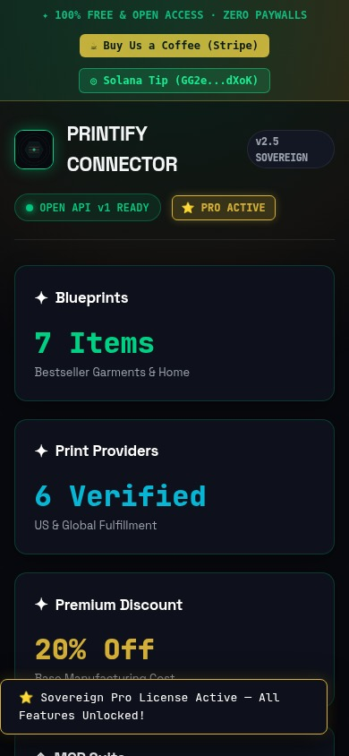

---

## Sovereign 5-Layer Architecture & Second Brain Topology

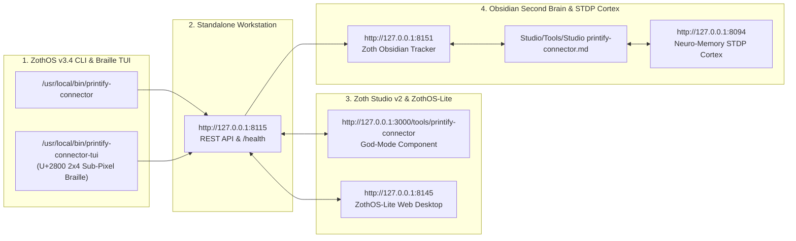

### ZothOS v3.4 TUI & Obsidian Second Brain Sync
- **Unicode `U+2800` Braille TUI**: `printify-connector-tui --status` / `printify-connector-tui --json`
- **Zoth Obsidian Tracker (`:8151`)**: `zoth-obsidian-tracker --verify`
- **Connected Canon Notes**: [[00 Home]] · [[Zoth OS]] · [[Zoth Studio]] · [[ZothOS-Lite Web Desktop]] · [[Zoth Memory]] · [[Public Surfaces]]
